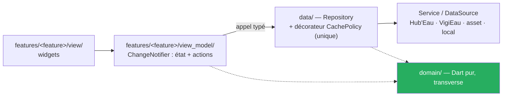

# MartinPêcheur — Claude AI Guidelines

> Application **Flutter** qui informe les usagers d'une rivière française sur son état — **écoulement**, **débit**, **sécheresse**, **vigilance crues** — à partir des APIs publiques **Hub'Eau**, **VigiEau** et **Vigicrues**.
> Carte de la doc : `docs/README.md` · **État vivant : `docs/project-state.md`**
> **Règle des statuts :** `docs/project-state.md` est la **seule source des statuts** ; ce fichier n'en garde qu'une ligne par tranche. Ce que git sait — commits, PR, horaires de fusion ou de poussée, branches, tags — ne se recopie pas dans les documents d'état : `git tag --list`, `gh pr list --state all`, `git log`. Un hash n'y figure que pour dire sur quel code un constat a été fait.

> ⚠️ **Ce fichier distingue** ✅ implémenté · 🔄 cible décidée, pas encore codée · 💭 spéculatif. Si ce fichier contredit le code, **le code a raison** : corriger ce fichier dans le même commit.

---

## Où on en est

| Tranche | Prouve | Statut |
|---|---|---|
| Porte de spike | Fond IGN (`F1`), exécutable Windows autonome (`F3`) | ✅ franchie sur Windows |
| T0 | Socle Flutter, carte, socle domaine, test d'architecture | ✅ close — `0.1.0` |
| T1 | Carte, fiches, modal et contrôle « ⚠ Avertissement » | ✅ close — `0.2.0` |
| T2 | Sécheresse et restrictions (VigiEau) | 🔄 porte non franchie — `0.3.0` datée et taguée sans elle |
| T3 | Favoris, filtres, fraîcheur | ✅ close — `0.4.0` |
| T4 | Crues : vigilance Vigicrues sur la carte et dans une fiche tronçon | ✅ close — `0.5.0` |
| Ergonomie | Maquette du 2026-10-03 (sélecteur, fiches, panneau Windows) et points d'interface ouverts | 🔄 en cours — `0.6.0`, avant T5 |
| T5 | Être prévenu, sans serveur ni compte | 🔄 cadrée — plan suspendu après l'ergonomie |

Détail, constats non faits, points ouverts : `docs/project-state.md`.

- **Android est une cible active en débogage** : émulateur `Pixel_7`, `flutter run -d emulator-5554`, lancé **par le commanditaire** (amendement d'`ADR-013`).
- **Restent explicitement différés** : `A⏸3` (signature de publication), `A⏸4` (appareil réel), `A⏸5` (préversion publiée).
- **La marque ⏸ ne vaut que pour ce qui reste explicitement différé** : une tâche marquée ⏸ reste listée, ni supprimée ni comptée faite.

Windows reste la **première cible construite** ; iOS est configuré et **jamais compilé** (aucun hôte macOS).

---

## Architecture — feature-first + MVVM (`ADR-014`)

**L'architecture recommandée par l'équipe Flutter**, adoptée par arbitrage du commanditaire le 2026-09-13 : une **tranche par écran**, et dans chaque tranche une **View** (widgets) et un **ViewModel** (`ChangeNotifier`). `domain/` et `data/` sont **partagés**. **Zéro bibliothèque d'état** : `ChangeNotifier` et `ListenableBuilder` sont dans Flutter.

⚠️ **Plus de CQRS, plus de bus.** `Query`/`Command`, le registre `Map<Type, gestionnaire>` et les gestionnaires sont **retirés** (`ADR-014` remplace ce volet d'`ADR-008` et d'`ADR-010`) : un typage perdu à l'envoi, pour une seule forme de lecture et presque aucune écriture. Un ViewModel appelle son dépôt par un **appel typé**, vérifié à la compilation. Pas non plus de couche de cas d'usage — le guide Flutter l'annonce optionnelle ; de fait, des ViewModels lisent plusieurs dépôts, chacun par son appel typé, sans couche de cas d'usage : `MapViewModel` trois (points de stations, observations hydrométriques, observations ONDE), `StationSheetViewModel` trois (stations, observations, favoris), `OndeSheetViewModel` deux (observations ONDE, favoris).

⚠️ **Pas de backend.** L'app appelle directement les APIs publiques. La seule donnée pré-calculée est un **asset généré hors exécution** (`ADR-003`), pas un service.



### Invariants à ne jamais casser

- **`lib/domain/` ne dépend de rien.** Dart pur : aucun `package:flutter`, `package:latlong2`, `package:http`, `package:drift`, `package:sqflite`, `dart:io`, `dart:ui`. Le verrou est `test/architecture/domain_isolation_test.dart`, **écrit avant la première ligne de `lib/domain/`**. Une dépendance d'infrastructure depuis le domaine est une erreur d'architecture, pas un détail.
- **Un widget n'appelle jamais un dépôt.** Il passe par le ViewModel de son écran, qui expose l'état et les actions. Un widget branche et affiche ; il ne décide pas.
- **Un ViewModel n'importe aucun widget** — ni `package:flutter/material.dart`, ni `widgets.dart`. C'est ce qui le rend testable **sans rendu**. La règle vaut pour tout fichier sous `view_model/` **et** pour tout `*_view_model.dart` posé à plat : on ne la contourne pas en déplaçant le fichier.
- **Aucun fichier sous `lib/features/` n'importe `lib/data/`** — ni la vue, ni le ViewModel. Un ViewModel dépend d'une **interface** de dépôt déclarée dans `domain/` ; c'est ce qui rend l'écran testable avec un double en mémoire. `main.dart` en est exempt, et lui seul : la racine de composition choisit les implémentations concrètes. `test/architecture/layers_test.dart` porte les **sept** règles (`domaine-ferme`, `data-vers-features`, `view-model-sans-widget`, `feature-vers-feature`, `features-vers-data`, `shared-sans-tranche`, `features-sans-fichier-a-plat`) et résout aussi les imports **relatifs** — `import '../../data/x.dart'` est la même dépendance que la forme `package:`.
- **Un widget partagé par plusieurs tranches vit dans `lib/features/shared/`** (amendement d'`ADR-014`) : importable par toute tranche, n'importe **aucune** tranche — règle `shared-sans-tranche`. Il porte : `warning_link.dart` (`WarningLink`, `WarningWindow`), `tap_target.dart` (cible de 44 pt, 48 sur Android), `keyboard_focus_ring.dart`, `action_color.dart` (couleur des actions principales), `data_sources_view.dart` (`DataSourcesView`, `DataSourcesLink`), `favorite_star.dart` (`FavoriteStar`, état d'affichage de l'étoile en Dart pur, sans aucun import), `favorite_star_button.dart` (`FavoriteStarButton`, `FavoriteWriteFailedNotice`), `unopened_link_notice.dart` (`UnopenedLinkNotice`), `flood_level_style.dart` (`FloodLevelStyle`, `floodLevelStyle`), `flood_level_gauge.dart` (`FloodLevelGauge`), `screen_layout.dart` (`WheelScrollsScreen`, `readingColumnWidth`, `readingColumnGutter`, et `ScreenTitleBar`, la seule barre de titre d'écran plein de `lib/`, verrou `test/project/screen_title_bar_test.dart`).
- **Une emprise (`Bounds`) vit dans `lib/domain/geo/bounds.dart`**, pas dans le fichier des contrats de dépôt : la vue en construit une à chaque relâchement de geste et n'a pas à importer `StationRepository` pour cela.
- **La politique de cache vit dans un seul composant** — le décorateur de dépôt `CachePolicy`, sous `lib/data/`, stale-while-revalidate. Jamais recopiée dans un dépôt nu, un ViewModel ou un widget.
- **Les unités sont typées, pas conventionnelles.** Un `double` nu passe en l/s là où on attend des m³/s : utiliser des `extension type` — `LitresPerSecond`, `CubicMetresPerSecond`, `Millimetres`, `Metres`. C'est le bug le plus coûteux du projet (`BR-002`).
- **Aucune valeur brute d'API n'atteint la vue.** La conversion l/s → m³/s et mm → m se fait dans le mapper, une seule fois (`BR-002`).
- **Les quatre échelles d'état restent séparées** — écoulement (fait observé), débit (statistique), sécheresse (décision préfectorale), vigilance crues (publication de l'État). Les fondre dans un champ unique mélangerait quatre natures (`BR-008`). **Une comparaison `==` ou `!=` sur `MapScaleKind` ne s'ajoute pas** : un `switch` exhaustif, que le compilateur vérifie quand une échelle arrive.
- **Toute nomenclature a une branche par défaut.** `sealed class` + `switch` exhaustif, avec une valeur `Inconnu` : oublier une branche doit être une **erreur de compilation** (`BR-011`).
- **Tout test de widget nomme sa plateforme** : `testWidgetsOnWindows` ou `testWidgetsOnAndroid`, jamais `testWidgets` nu sous `test/` — verrou `test/project/widget_test_platform_test.dart`, liste d'exceptions vide et verrouillée vide ; la règle entière est dans « Conventions ».
- **VigiEau ne s'appelle que derrière `RestrictionSource`.** L'API est en version `0.1` : le risque de rupture reste confiné à un module (`ADR-004`).
- **Vigicrues ne s'appelle que derrière `FloodVigilanceSource`** (`ADR-016`) : le vocabulaire de l'API n'apparaît que sous `lib/data/floods/` et dans `lib/main.dart`, commentaires compris (verrou `test/data/floods/flood_vocabulary_confinement_test.dart`). **L'application relaie le niveau publié, elle n'en calcule aucun** (`BR-015`).
- **Les quatre avertissements ne sont pas une finition.** Rien ne part en production sans eux (`BR-012`, `BR-013`). Leurs emplacements : le modal du premier lancement ; sur la carte et sur chaque fiche, un contrôle « ⚠ Avertissement » **toujours présent**, qui ouvre le texte du modal initial complété, sur une fiche datée, par sa phrase datée — un écran de carte ou de fiche sans ce contrôle ne part pas ; l'**encart renforcé** de `BR-013`, en tête de l'écran des restrictions, **non repliable**, dans tous les états. L'écran « Favoris », qui ne montre ni mesure ni état, n'a pas ce contrôle ; les fiches qu'il ouvre le portent. État des constats : `docs/project-state.md`. ⚠️ `BR-012` n'est le texte que du modal du premier lancement : l'étiquette « `BR-012`, `BR-013` » pour les quatre avertissements est un point ouvert (`docs/project-state.md`, point 52). L'avertissement de crue (`BR-015`) s'y ajoute : encart en tête de la fiche tronçon et texte de la fenêtre « ⚠ Avertissement » sur la lecture Crues.

---

## Disposition du dépôt

```
pubspec.yaml                    ← la racine EST le projet Flutter
analysis_options.yaml
lib/
  domain/                       ← Dart pur, transverse (voir invariants) ; geo/bounds.dart y porte
                                  l'emprise, hors des contrats de dépôt, et geo/geo_point.dart le
                                  point désigné
  domain/restrictions/          ← zones d'alerte, arrêtés, usages cités, nomenclatures closes,
                                  RestrictionSource et ses trois échecs ; decree_documents.dart :
                                  les documents distincts d'un point, « mêmes zones », dates communes, et sur
                                  ZonesAtPoint le droit d'écrire l'absence d'eaux superficielles — la vue les lit
  domain/floods/                ← tronçon de vigilance, carte de vigilance datée, niveaux (nomenclature
                                  close avec un niveau non reconnu), définitions publiées, règles d'étiquette
                                  et d'ancre, FloodVigilanceSource et ses trois échecs
  domain/links/                 ← le port ExternalLinkOpener, sans bibliothèque
  domain/filters/               ← MapFilter, la valeur du filtre de la carte (six cases d'écoulement,
                                  un département, la fraîcheur du débit), et ses prédicats, un par
                                  échelle : l'inconnu reste affiché ; bornes lues dans freshness.dart
  domain/favorites/             ← le favori — station, point ONDE, entrée non lisible — et le contrat
                                  FavoriteRepository ; l'identité d'un lieu, jamais une mesure
  data/                         ← dépôts + services : Hub'Eau, VigiEau (derrière RestrictionSource),
                                  asset du référentiel, stockage local, décorateur CachePolicy
  data/restrictions/            ← VigieauRestrictionSource, mapper (seul point de conversion),
                                  URI, CachedRestrictionSource (cache de session, 6 h)
  data/floods/                  ← VigicruesFloodVigilanceSource (derrière FloodVigilanceSource), mapper du
                                  GeoJSON (seul point de conversion), CachedFloodVigilanceSource (cache de
                                  session, 30 min) ; seul endroit, avec main.dart, à connaître le vocabulaire
                                  de l'API Vigicrues (ADR-016)
  data/links/                   ← l'implémentation du port, autour de url_launcher
  data/preferences/             ← shared_preferences : l'acquittement de l'avertissement et les favoris
                                  (SharedPreferencesFavoriteRepository, favorites_codec.dart)
  features/map/view/            ← widgets : FlutterMap, TileLayer IGN, marqueurs, pastilles de zone,
                                  flood_sections_layer.dart (calque des traits de vigilance),
                                  flood_section_label.dart (étiquette de tronçon),
                                  légende, puces d'échelle, contrôles de zoom, avis vides, attribution ;
                                  feuille « Filtres » (map_filter_sheet.dart), groupe « Favoris » /
                                  « Filtres » (map_entry_buttons.dart, sur map_round_button.dart), mise
                                  en page des surcouches (map_overlays_layout.dart : la colonne du haut
                                  s'arrête au-dessus de celle du bas et défile, « La légende défile »)
  features/map/view_model/      ← ChangeNotifier : état de l'écran et ses actions, aucun widget ; le
                                  filtre appliqué, délégué aux prédicats du domaine ; FloodLayerViewModel,
                                  l'état de la lecture Crues (carte de vigilance, étiquettes)
  features/{station_sheet,onde_sheet}/{view,view_model}/ ← fiches station et point ONDE
  features/warnings/{view,view_model}/ ← écran du premier lancement
  features/favorites/{view,view_model}/ ← écran « Favoris » (FavoritesScreen), route poussée par main.dart ;
                                  FavoritesViewModel
  features/restrictions/{view,view_model}/ ← écran « Sécheresse et restrictions », encart renforcé,
                                  badge de gravité ; RestrictionsViewModel
  features/flood_sheet/{view,view_model}/ ← fiche tronçon de vigilance crues, encart de crue ;
                                  FloodSheetViewModel (aucun appel réseau : la carte est déjà lue)
  features/shared/              ← widgets communs à plusieurs tranches, n'importent aucune tranche
                                  (liste : invariants)
  diagnostics/                  ← sonde de fluidité, inerte sans --dart-define=FLUIDITY_PROBE=true ;
                                  seul main.dart l'importe (convention, aucune règle de layers_test)
  main.dart                     ← câble dépôts et ViewModels ; SEUL fichier autorisé à importer data/
test/
  architecture/                 ← LE PREMIER TEST À ÉCRIRE — frontières de couches
  domain/  data/  features/     ← features/ contient les tests de view_model (sans rendu) et goldens/
  diagnostics/                  ← calcul de la sonde et câblage derrière le drapeau
  support/                      ← aides de test : testWidgetsOnWindows, testWidgetsOnAndroid, horloge
                                  simulée, doubles en mémoire
  project/                      ← non-régression sur la doc et la configuration : domain-model.md,
                                  nfr.md, CHANGELOG, Gherkin, traçabilité, vocabulaire, textes
                                  d'avertissement, identifiants iOS et Android, taille minimale
                                  Windows. `dart:io` y est autorisé, jamais sous lib/domain/
  fixtures/                     ← réponses d'API et extraits de référentiel réels, datés dans leur
                                  nom : une fixture est un fait constaté, jamais une invention
android/  ios/  windows/        ← versionnés. android/ : le GABARIT Flutter de plateforme
                                  seulement — les caches de construction (Gradle, build/) restent
                                  hors dépôt et ne se committent jamais
assets/
  referentiel/stations.json
  percentiles/                  ← 🔄 n'existe pas : produit par le futur script Dart (ADR-003)
docs/
  acceptance/                   ← critères d'acceptation en Gherkin français, un fichier par sujet,
                                  vérifiés par test ; jamais exécutés (aucun framework BDD)
  tracabilite.md                ← matrice US, BR, UC et tests, maintenue à la main, vérifiée par test
```

`analysis_options.yaml` : `flutter_lints` + `language: strict-casts, strict-inference, strict-raw-types` + `avoid_dynamic_calls`, `always_declare_return_types`, `prefer_final_locals`. **`dynamic` implicite interdit.**

---

## Stack (état réel par ligne)

| Composant | Techno | État |
|---|---|---|
| Langage | **Dart 3.13.5** | ✅ celui du SDK Flutter retenu |
| Runtime | **Flutter 3.47.7** stable | ✅ retenu par arbitrage du commanditaire. `pubspec.lock` est commité tel que 3.47.7 le résout : **un poste resté en 3.47.4 le réécrit** tant qu'il n'est pas mis à jour |
| Cibles | **Windows en premier**, Android, iOS | Windows ✅ construite en release et lancée hors Flutter · Android ✅ construite et lancée **en débogage** sur l'émulateur `Pixel_7` ; aucune release, aucun appareil réel · iOS 🔄 configuré, jamais compilé. Constats d'exécution : `docs/project-state.md` |
| Carte | **`flutter_map` 8.3.2** · fond **IGN Géoplateforme** (WMTS KVP) · attribution « © IGN Géoplateforme — Licence Ouverte » **affichée** | ✅ le plan IGN s'affiche. Signatures relevées dans le paquet installé : `TileLayer(urlTemplate:, tileDimension:, maxNativeZoom:, userAgentPackageName:)`, `Marker(point:, width:, height:, child:)`, `MapOptions(initialCenter:, initialZoom:, minZoom:, maxZoom:)`. ⚠️ `tileSize` est `@Deprecated`. La lecture Crues trace ses tronçons par **un seul `PolylineLayer`**, d'une instance stable d'un rendu à l'autre (`lib/features/map/view/flood_sections_layer.dart` : `flutter_map` vide ses caches de projection à chaque reconstruction) |
| Marqueurs | **Regroupement par zone administrative** (`ADR-015`), sans bibliothèque · `latlong2` 0.9.1 (par contrainte transitive) · `flutter_map_marker_cluster` lié **au spike seulement**, absent de `pubspec.yaml` | ✅ une pastille par **région** sous le zoom 7, par **département** de 7 à 9 (barycentre, compte, symbole de l'état le plus sévère, `BR-009`) ; **`F2c`** (viewport plus marge, sans regroupement) **à partir du zoom 9**. Seuls les seuils 7 et 9 sont révisables, sur constat d'écran ; chevauchement des pastilles d'Île-de-France accepté. Mesures de `NFR-01` : `docs/nfr.md` |
| Cache de tuiles | **intégré à `flutter_map` depuis 8.2** (`BuiltInMapCachingProvider`, 1 Go), actif par défaut hors web | ✅ hors réseau sur les zones déjà parcourues (`NV-W2`, `docs/nfr.md`). ⚠️ Une zone jamais chargée n'est pas constatée ; aucun téléchargement de zone (`UC-005` non livré, `ADR-012`) |
| Architecture | **feature-first + MVVM**, `ChangeNotifier` par écran (`ADR-014`) · `CachePolicy` en décorateur de dépôt · **zéro bibliothèque d'état** | ✅ le CQRS léger de T0 est retiré (`grep -rnE '\bBus\b|Query<|Command<' lib/` vide) ; `test/architecture/layers_test.dart` verrouille sept règles de couches |
| HTTP | **`package:http`** `^1.6.0` (`pubspec.yaml`) | ✅ transport à rejeu `JsonHttpClient` (`lib/data/http/json_http_client.dart`), partagé par Hub'Eau (`HubEauClient` y délègue : hydrométrie v2, ONDE v1), VigiEau et Vigicrues (`vigicruesJsonClient`, `lib/data/floods/vigicrues_endpoint.dart`) : **200 et 206 sont des succès** (`C-06`), rejeu sur 429/5xx et **jamais** sur 4xx, recul doublé à chaque essai, à **gigue injectée** (donc testable). **Délai par tentative : 20 s pour Hub'Eau** (`hubEauRequestTimeout`, `lib/data/http/hub_eau_client.dart`), **10 s pour VigiEau** (`defaultRequestTimeout`), **20 s pour Vigicrues** (`vigicruesRequestTimeout`), dépassement rejoué comme une panne réseau. Une tentative abandonnée est **annulée** (`AbortableRequest`), **sauf sa phase de connexion** (DNS, TCP, TLS) **et sauf une redirection suivie vers une autre origine**. ⚠️ **Vérifié en temps simulé** (`test/support/simulated_clock.dart`) et contre un serveur local seulement, **jamais contre l'API réelle** ; pour Hub'Eau et VigiEau, la composition réelle de `main.dart`, qui ne leur passe aucun délai, n'est éprouvée par aucun test ; celle de Vigicrues, sur `vigicruesJsonClient`, est vérifiée par `test/main_test.dart`, qui lit le texte de `main.dart`. Détail, pire cas et appels lents encore coupés : `NFR-07` de `docs/nfr.md`, `T-17` et `T-18` de `docs/sources/onde.md` |
| Stockage local | **`shared_preferences`** pour la **préférence simple** (`ADR-011`) · moteur **structuré** non tranché — `drift` candidat par défaut ; `sqflite` seul **ne couvre pas Windows** | ✅ `^2.5.5` dans `pubspec.yaml`, résolue 2.5.6 : l'acquittement de l'avertissement (`SharedPreferencesAcknowledgementRepository`) et les favoris (une clé `favorites`, une chaîne JSON, derrière `FavoriteRepository` : `SharedPreferencesFavoriteRepository`, **une seule instance** construite par `main.dart` et passée aux deux fiches et à l'écran « Favoris ») · 💭 moteur structuré à trancher au moment où ça bloque |
| Ouverture de lien | **`url_launcher` ^6.3.2** (résolue 6.3.3), **derrière le port `ExternalLinkOpener`** : seul `lib/data/links/url_launcher_external_link_opener.dart` l'importe, mode « hors de l'application » | ✅ BSD-3-Clause, éditeur `flutter.dev`, Windows et Android couverts ; le manifeste Android porte l'élément `<queries>` pour l'intention `VIEW`. ⚠️ **L'ouverture n'est éprouvée que par une fonction de lancement injectée** : `launchUrl` n'a jamais ouvert un arrêté sur une cible |
| Gestion d'état | **`ChangeNotifier` + `ListenableBuilder`**, zéro dépendance | ✅ `MapViewModel`, `StationSheetViewModel`, `OndeSheetViewModel`, `WarningsViewModel`, `RestrictionsViewModel`, `FavoritesViewModel`, `FloodLayerViewModel`, `FloodSheetViewModel` (`ADR-014`) |
| Graphes | courbe de débit (`US-11`) | 💭 à trancher |
| Tests | **`flutter test`** — `test/architecture/` d'abord, puis domaine, data, features (dont les `view_model`, sans rendu), plus `test/project/` sur la doc et la configuration | ✅ `flutter test` vert ; décompte du jour : `docs/project-state.md`. ⚠️ **Neuf fichiers mesurent en Roboto**, chargée depuis le SDK Flutter (`FLUTTER_ROOT`), et non en police de test : `test/features/map/view/map_overlays_phone_test.dart`, `map_sheet_height_test.dart`, `map_entry_buttons_overlap_test.dart` (par une copie privée), `map_reading_selector_test.dart`, `map_legend_test.dart`, `map_reading_block_test.dart`, `ergonomie_budget_test.dart` et `test/features/shared/sheet_frame_test.dart` (par `test/support/roboto.dart`, `chargerRoboto`) — tous échouent si la police manque —, `test/features/restrictions/view/restrictions_scale_text_test.dart` (ignoré, `markTestSkipped`, si `FLUTTER_ROOT` manque hors intégration continue). Leurs cas sous Windows mesurent en Roboto enregistrée sous le nom « Segoe UI », un substitut : **Segoe UI réelle n'est jamais mesurée**. Les verrous de gestes de la carte et du défilement de l'écran des restrictions tournent en plateforme Windows (la barre de défilement automatique du bureau y change ce que reçoit la carte). Plateforme des tests de widget : « Conventions » |
| Percentiles | **script Dart** produisant `assets/percentiles/` (`ADR-003`) | 🔄 |

> Toute bibliothèque retenue est vérifiée sur `pub.dev` avant d'être ajoutée : **version, licence compatible GPL-3.0, plateformes — Windows incluse —, date de dernière publication.** On lit la signature dans le paquet installé, on ne l'écrit pas de mémoire.

---

## Sources de données — ce qui est vérifié

Toutes vérifiées **par appels HTTP réels le 2026-07-30**. Détail : `docs/01-analyse.md`.

| Source | Base URL | Rôle |
|---|---|---|
| Hydrométrie **v2** | `https://hubeau.eaufrance.fr/api/v2/hydrometrie` | Débit, hauteur, historique |
| Écoulement ONDE v1 | `https://hubeau.eaufrance.fr/api/v1/ecoulement` | Assecs, écoulement observé |
| VigiEau | `https://api.vigieau.beta.gouv.fr/api` | Restrictions, arrêtés |
| Vigicrues | `https://www.vigicrues.gouv.fr` | Vigilance crues par tronçon (faits vérifiés le 2026-10-14 : `docs/sources/vigicrues.md`) |

### Les pièges qui coûtent une journée

| # | Piège |
|---|---|
| `C-01` | **L'API hydrométrie v1 est arrêtée** depuis le 05/05/2025 → HTTP 403. Seule la **v2** répond |
| `C-02` | **Le débit arrive en l/s, la hauteur en mm.** `53000.0` = 53 m³/s. Diviser par 1000 |
| `C-04` | `obs_elab` **n'a pas de `sort`** — il est ignoré silencieusement et renvoie 1900. Toujours passer `date_debut_obs_elab` |
| `C-05` | Interroger un **code site** (8 car.) renvoie chaque mesure **en double**. N'utiliser que des codes station (10 car.) |
| `C-06` | **HTTP 206 est un succès.** Un client qui n'accepte que 200 casse dès la première pagination |
| `C-10` | Les codes ONDE sont des **chaînes** (`"1a"`, `"1f"`), les libellés de campagne en **minuscules** |
| `C-14` | VigiEau `?commune=` → **HTTP 409**. Toujours `lat`/`lon` |
| `C-15` | **Aucun SLA**, aucun quota chiffré. Mode dégradé obligatoire, throttle client |

---

## La règle qui structure tout le produit

> **On ne qualifie jamais un débit de « suffisant ».**

Aucune API n'expose de seuil réglementaire par station — vérifié sur Hub'Eau, HydroPortail et SANDRE. Le produit sépare donc deux questions et ne les mélange jamais (`ADR-002`) :

| Question | Réponse | Nature |
|---|---|---|
| Ce débit est-il **inhabituel pour la saison** ? | Percentile face à 30 ans d'historique | **Statistique** |
| Qu'est-ce qui est **interdit chez moi** ? | Niveau de gravité, usages restreints, PDF de l'arrêté | **Réglementaire** |

**Mots bannis** pour qualifier un débit : *suffisant, insuffisant, normal, bon, sûr*. Vocabulaire complet : `docs/glossary.md`.

---

## Documentation & Spec

Tout vit dans **ce dépôt** (`docs/`) — code et spec évoluent dans le même commit. Carte complète : `docs/README.md`.

| Artefact | Dossier | Nom | Quand |
|---|---|---|---|
| **Business Rule** | `docs/br/` | `BR-NNN-slug.md` | règle métier invariante |
| **Use Case** | `docs/use-cases/` | `UC-NNN-slug.md` | scénario acteur↔système (mermaid inline) |
| **ADR** | `docs/adr/` | `ADR-NNN-slug.md` | décision technique tranchée + alternatives écartées |

Docs transverses : `docs/glossary.md` · `docs/context-map.md` · `docs/project-state.md`.
Cadrage produit : `docs/01-analyse.md` → `docs/04-ui.md`.

- `NNN` = 3 chiffres séquentiels, jamais réutilisés. `slug` = kebab-case français.
- On **ne supprime pas** un artefact obsolète → statut `Remplacé par …`.
- **Une contrainte d'API subie n'est pas une règle métier** : elle va au tableau `C-xx` de `01-analyse.md`, pas dans `br/`.
- **Diagrammes** : dispersés **à côté** de la sous-partie qu'ils illustrent, jamais en section dédiée. **Mermaid inline** uniquement.
- Templates : `docs/{br,use-cases,adr}/*-template.md`.
- **Trois ADR ont été tranchés sans arbitrage du commanditaire** (`ADR-002`, `004`, `006`) ; `ADR-016` l'est en partie (arbitrages 1, 6, 10 et 12 du commanditaire, le 2026-10-14 ; les choix d'architecture `R1` à `R5` sont tranchés par défaut). Chacun porte une section « Si la décision est revue ». Ne pas les traiter comme définitifs. **`ADR-004` est en partie arbitré le 2026-09-27** (cadrage de T2) : chemin nominal VigiEau sans repli data.gouv, eaux superficielles d'abord et autres zones nommées, un seul appel par point filtré par profil dans le domaine ; ses autres choix restent proposés.
- **`ADR-013` et `ADR-014` sont, eux, des arbitrages du commanditaire** — bascule Flutter et Windows première cible (2026-09-12, écrit a posteriori le 2026-09-13), feature-first + MVVM (2026-09-13). Ils ne se révisent pas par défaut. **`ADR-015`** (2026-09-22, regroupement des marqueurs par zone administrative sous le zoom 9) est aussi un arbitrage du commanditaire ; seuls ses **seuils de zoom** (7 et 9) sont révisables, sur constat d'écran. `ADR-011` (2026-09-18) est aussi un arbitrage du commanditaire, **limité à la préférence simple** : le moteur de donnée structurée reste ouvert. Dans `ADR-006`, **seul** le libellé « Non renseigné » est arbitré (2026-09-18) ; le reste garde son statut par défaut.

---

## Conventions

- **Code :** anglais · **Domaine et documentation :** français
- **Commits :** Conventional Commits — scopes : `domain`, `data`, `ui`, `map`, `hydrometrie`, `ecoulement`, `restrictions`, `avertissement`, `docs`, `ci`. Petits commits, un par tâche du plan
- **Ordre d'implémentation :** `domain/` → `data/` → `features/<feature>/view_model/` → `features/<feature>/view/`
- **TDD** : test rouge avant implémentation. Commencer par la conversion d'unités — c'est le bug le plus coûteux du projet
- **Un test de widget nomme sa plateforme** : `testWidgetsOnWindows` par défaut, `testWidgetsOnAndroid` pour un test de téléphone (fenêtre de moins de 600 px de large) ou qui porte sur Android par son objet, son titre commençant par « Android : » (`test/support/windows_platform.dart`, `test/support/android_platform.dart`). Jamais `testWidgets` nu sous `test/` hors `test/support/`, même en commentaire de fin de ligne : `test/project/widget_test_platform_test.dart` le verrouille, sans liste d'exceptions
- **Critère de fin d'étape :** `flutter analyze` **zéro remarque**, `flutter test` **vert**, `dart format` **sans diff**. Montrer les sorties, ne pas les résumer
- **Release Windows :** `flutter build windows --release` → le livrable est le dossier `build/windows/x64/runner/Release/`, lancé **hors** Flutter pour vérification. La commande est **exécutée par le commanditaire**
- **Release Android :** ⏸ **la publication reste différée** (`A⏸3` signature, `A⏸5` préversion) ; la **cible est active en débogage** : `flutter run -d emulator-5554`, **exécuté par le commanditaire**
- **Dart strict non négociable.** Unités par `extension type`, nomenclatures par `sealed class` closes avec `Inconnu`
- **SOLID et YAGNI, dans cet ordre de priorité quand ils semblent se contredire.** Rien qui ne soit exigé par une tâche du plan : pas de dépôt générique, pas d'abstraction « pour plus tard », pas de paramètre inutilisé. Mais ce qui est construit respecte une responsabilité par classe, des dépendances sur des interfaces (`StationRepository`, `RestrictionSource`), l'extension par ajout (une nomenclature gagne une branche, elle ne modifie pas un `switch` ailleurs) et l'inversion des dépendances que `test/architecture/layers_test.dart` verrouille. **L'architecture (`ADR-014`, feature-first + MVVM) n'est pas négociable au niveau d'une tâche** : ce qui ne rentre pas dans View / ViewModel / Repository remonte au commanditaire, il ne contourne pas. Toute relecture vérifie explicitement ces trois points : SOLID, YAGNI, conformité à l'architecture

### Le poste et le bac à sable

- **Aucun chemin de poste dans le dépôt** : le projet se développe sur plusieurs ordinateurs. `flutter` et `dart` sont sur le PATH ; ce qui est propre à une machine vit dans `CLAUDE.local.md` et `.claude/settings.local.json`, tous deux ignorés par git
- **Le bac à sable de Claude ne construit rien en natif.** `flutter run -d windows`, `flutter build windows` et `flutter run -d emulator-5554` sont lancés **par le commanditaire** : une commande par bloc `bash`, avec le résultat attendu énoncé. Ce résultat est **constaté, jamais supposé**
- Claude lance lui-même `flutter analyze`, `flutter test`, `dart format`
- **Ne rien toucher à Bitdefender ni au système**
- **`gh` dépend du poste** — constater par `command -v gh` (ou le chemin d'installation) et `gh auth status` avant de déléguer une opération GitHub au commanditaire ; sa présence se note dans `CLAUDE.local.md`, pas ici
---

## Orchestration

Claude est **chef d'orchestre**, pas exécutant solitaire.

- **Déléguer** : `Explore` (haiku) pour la lecture et le repérage · `general-purpose` (sonnet) pour une tâche de TDD cadrée · opus pour un plan, un ADR, une revue
- **Vérifier soi-même** après chaque retour d'agent : `flutter analyze` et `flutter test`. Un rapport d'agent n'est pas une preuve
- **Relire chaque implémentation par un second agent** avant le commit
- **Trois échecs sur le même point : arrêt et question.** Pas de quatrième tentative
- **Solliciter le commanditaire** pour : git destructif · un ADR · l'ajout d'une bibliothèque · un changement de périmètre · tout constat qui ne se voit qu'à l'écran. Toujours par **question fermée avec recommandation**
- **Contrat de sortie — cinq lignes au plus** : ce qui est fait (avec les commits) · ce qui est rouge (avec la sortie) · ce qui est différé · la question ouverte · la commande à lancer

---

## Anti-hallucination

Lire avant d'écrire. Ne jamais inventer une API, un endpoint, un champ, un paquet, une signature ou une volumétrie.

**Sur ce projet, la règle est plus stricte que d'habitude :**

> **Tout fait relatif à une API publique est vérifié par appel réel, et daté.**
> Un fait non vérifié est signalé comme tel, avec l'URL consultée.
> On ne spécifie jamais d'après une documentation seule.

Ce n'est pas de la prudence rédactionnelle : la documentation Hub'Eau est **en écart avec la production** sur au moins quatre points (v1 annoncée vivante mais arrêtée, unités, `code_methode_obs = 8` non documenté, casse des libellés). Le cadrage a déjà évité quatre erreurs bloquantes de cette façon. La même exigence vaut pour une bibliothèque : signature lue dans le paquet installé, version relevée, date notée.

Distinguer **implémenté** ✅ / **décidé mais pas codé** 🔄 / **spéculatif** 💭 — ne jamais compter du 🔄 comme un acquis. Toujours exposer les alternatives avant de recommander. **Ce fichier inclus** : dès qu'il diverge du code, le corriger dans le même commit.

**Ne jamais inventer un seuil hydrologique.** C'est la faute la plus grave possible sur ce produit.
