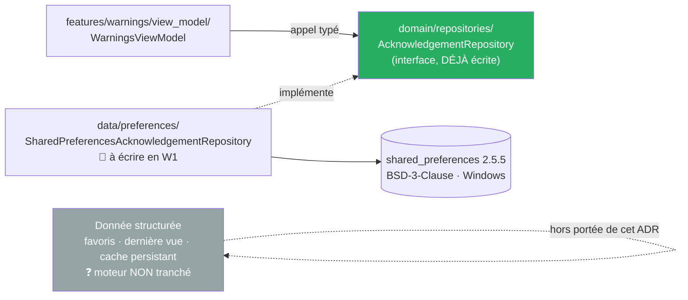

# ADR-011 — Stockage local : `shared_preferences` pour la préférence simple

- **Statut :** **Accepté — arbitrage du commanditaire du 2026-09-18**, **portée limitée**
- **Date :** 2026-09-18
- **Portée :** ~~la **préférence simple** — une clé, une chaîne. Le **moteur de donnée structurée**
  (favoris, dernière vue, cache d'observations persistant) **n'est pas tranché par cet ADR** : il
  reste ouvert, `drift` candidat par défaut.~~ **Amendée le 2026-10-12** : les **favoris** entrent
  dans la préférence simple — une clé, une chaîne JSON — par l'arbitrage 2 du 2026-10-12 (T3). Voir
  la section « Amendement du 2026-10-12 », avant « Conséquences ».
  Le moteur de donnée structurée (dernière vue, cache d'observations persistant) **reste non
  tranché**, `drift` candidat par défaut.
- **État du code :** 🔄 **décidé, pas encore codé.** Au 2026-09-18, `shared_preferences`
  **n'est pas** dans `pubspec.yaml` et **aucun fichier de `lib/` ne l'utilise** (constaté par
  lecture de `pubspec.yaml` et `grep` sur `lib/` et `test/`). L'ajout du paquet et
  l'implémentation sont la tâche `W1` du plan T1.

---

## Contexte

Le numéro `ADR-011` était **réservé** depuis T0 au choix d'un moteur de stockage local, à trancher
« quand un écran en aura besoin ». Cet écran arrive : `BR-012` exige un avertissement initial
acquitté, et `UC-006 A3` exige que l'avertissement soit **relu** quand son texte change. Il faut
donc persister une **version de texte acquittée** — une chaîne — d'un lancement à l'autre.

### Ce que le code demande, exactement

L'interface est **déjà déclarée**, dans `lib/domain/repositories/repositories.dart` (posée en `V4`
le 2026-09-14, lue le 2026-09-18) :

```dart
abstract interface class AcknowledgementRepository {
  Future<String?> readAcknowledgedVersion();
  Future<void> writeAcknowledgedVersion(String version);
}
```

Deux méthodes, une clé, une chaîne. `readAcknowledgedVersion` rend `null` quand rien n'a jamais été
écrit — le premier lancement. C'est tout ce que T1 persiste : **aucune collection, aucune requête,
aucun schéma, aucune migration.**

### Ce qui reste hors de portée

Les besoins de stockage **structuré** existent dans le cadrage mais **aucun écran ne les a encore
formulés** : favoris (T3), dernière vue de carte, cache d'observations survivant à la fermeture de
l'application. Trancher leur moteur aujourd'hui serait décider d'après un besoin que personne n'a
écrit.

### Les faits relevés sur le paquet, datés

> **Relevé par appel réel le 2026-09-18 à 09:00 UTC** sur
> `https://pub.dev/api/packages/shared_preferences` et les pages pub.dev correspondantes.
> `CLAUDE.md` l'exige avant toute dépendance : version, licence, plateformes — Windows incluse —,
> date de dernière publication.

| Fait | Valeur relevée le 2026-09-18 |
|---|---|
| Version | **2.5.5** |
| Date de publication | **2026-03-25** |
| Licence | **BSD-3-Clause** |
| Éditeur | **flutter.dev**, éditeur **vérifié** |
| Plateformes | Android, iOS, Linux, macOS, Web, **Windows** |
| Contrainte Dart | `^3.9.0` — le projet est en **Dart 3.13.3** : **satisfaite** |
| Contrainte Flutter | `>=3.35.0` — le projet est en **Flutter 3.47.4** : **satisfaite** |
| Implémentation Windows | **`shared_preferences_windows` 2.4.1**, publiée le **2024-08-09**, **BSD-3-Clause**, dépend de **`path_provider_windows`** (BSD-3-Clause) |

**Sur la licence :** BSD-3-Clause est une licence permissive, compatible avec une distribution sous
GPL-3.0. ⚠️ Ceci est une **connaissance générale**, pas un relevé daté — contrairement aux lignes
du tableau ci-dessus.

---

## Décision

**`shared_preferences` est retenu pour la préférence simple.** Aujourd'hui, **une seule clé** : la
version d'avertissement acquittée (`BR-012`, tâche `W1`).

**Le moteur de donnée structurée reste à trancher** — favoris, dernière vue, cache d'observations
persistant. Il sera tranché **quand un écran en aura besoin**, pas avant. `drift` reste le candidat
par défaut ; **`sqflite` seul ne couvre pas Windows**, ce qui le disqualifie sur la seule cible
construite.

### Ce que la décision fixe

- L'interface `AcknowledgementRepository` **vit dans `lib/domain/repositories/repositories.dart`**
  et n'y bouge pas. Elle est déjà écrite : `W1` la **réalise**, ne la redéclare pas.
- L'implémentation concrète va sous **`lib/data/preferences/`**. Aucun ViewModel, aucune vue ne
  connaît `shared_preferences` — l'invariant `features-vers-data` de
  `test/architecture/layers_test.dart` l'interdit, et `domain_isolation_test.dart` interdit au
  domaine de le connaître.
- On persiste une **chaîne de version, jamais un booléen.** Un booléen ne distinguerait jamais
  « acquitté une fois » de « acquitté **cette** version » ; c'est ce qui permet de faire relire un
  avertissement dont le texte a changé (`UC-006 A3`).
- Le dépôt reste **bête** : une valeur stockée inattendue — une chaîne vide, par exemple — est
  rendue telle quelle. C'est `WarningsViewModel` qui décide de son sens, jamais le dépôt.



### Amendement du 2026-10-12 — les favoris en shared_preferences (T3, arbitrage 2 du 2026-10-12)

**La décision.** Les favoris de T3 se persistent dans `shared_preferences`, sans bibliothèque
nouvelle : **une clé, `favorites`**, portant **une chaîne JSON** de la forme
`{"version":1,"favoris":[…]}` (`version` 1, chaque entrée avec son `type` ; forme écrite et lue par
`lib/data/preferences/favorites_codec.dart`). Le tout **derrière `FavoriteRepository`**
(`lib/domain/favorites/favorite_repository.dart`), réalisé par
`SharedPreferencesFavoriteRepository` (`lib/data/preferences/`), qui n'emploie que `getString` et
`setString`. Aucun ViewModel, aucune vue ne connaît le paquet.

**Les faits, relus le 2026-10-12 dans les paquets installés** (versions résolues par
`.dart_tool/package_config.json` ; lecture des sources, **rien n'est constaté à l'exécution sur une
cible**) :

| Paquet, fichier, ligne | Fait relu le 2026-10-12 |
|---|---|
| `shared_preferences` 2.5.5, `lib/src/shared_preferences_legacy.dart`, l. 129 | `String? getString(String key) => _preferenceCache[key] as String?;` — lecture **synchrone du cache mémoire**, une valeur d'un autre type lève |
| même fichier, l. 79-97 | `getInstance()` charge ce cache une fois par session ; si le chargement lève, l'erreur est rendue et le chargement sera retenté à l'appel suivant |
| même fichier, l. 99-107 | commentaire du cache, l. 105-106 : « It is NOT guaranteed that this cache and the device prefs will remain in sync since the setter method might fail for any reason. » |
| même fichier, l. 157-162 | sur Android, une valeur ne peut pas commencer par trois préfixes réservés (`VGhpcyBpcyB0aGUgcHJlZml4IGZvciBhIGxpc3Qu`, …) — la nôtre commence par `{` |
| même fichier, l. 163-164 | `Future<bool> setString(String key, String value) => _setValue('String', key, value);` |
| même fichier, l. 177-187 | `_setValue` **écrit le cache** (`_preferenceCache[key] = value;`, l. 184) **avant** d'appeler le magasin (`return _store.setValue(valueType, prefixedKey, value);`, l. 186) — **inchangé en 2.5.6** (relu dans le paquet installé le 2026-10-14, version résolue depuis le 2026-10-14 : même corps, l. 202-212, cache l. 209, magasin l. 211 ; 2.5.6 ajoute seulement à `setString` un commentaire : `false` quand la plateforme sait que l'écriture a échoué, `true` aussi quand elle n'en rend pas compte) |
| `shared_preferences_windows` 2.4.1, `lib/shared_preferences_windows.dart`, l. 129-138 | `setValue` modifie sa **propre copie mémoire** (`_cachedPreferences`, l. 38 et 50-57) puis appelle `_writePreferences` |
| même fichier, l. 374-400 | `_writePreferences` réécrit **tout le fichier JSON** (`localDataFile.writeAsStringSync(stringMap);`, l. 394) ; toute exception → `debugPrint` et **`false`** (l. 395-398). Aucun fichier temporaire ni renommage n'y est visible |
| même fichier, l. 349-370 | `_readFromFile` fait `json.decode(stringMap)` (l. 363) **sans `try`** |
| `shared_preferences_android` 2.4.28, `android/src/main/kotlin/io/flutter/plugins/sharedpreferences/LegacySharedPreferencesPlugin.kt`, l. 66 | `return preferences.edit().putString(key, value).commit()` ; l. 59-65, une valeur à préfixe réservé lève une `RuntimeException` |

**Ce qui en découle.**

- **Le cache est écrit avant le magasin.** Après un `setString` qui rend `false` ou qui lève,
  `getString` rend **la valeur non écrite** jusqu'à la fin de la session : un dépôt sans mémo ne
  suffit donc pas à ce qu'une étoile « ne change pas d'état » après une écriture refusée.
- **Écriture compensatoire** — **décision de la boucle principale du 2026-10-12, réversible**, pas
  un arbitrage du commanditaire : sur une écriture en échec, le dépôt rappelle
  `setString('favorites', valeur d'avant)` — la liste vide encodée s'il n'y avait aucune valeur —,
  résultat et levée ignorés, puis lève `EcritureDeFavorisEnEchec`. Cela remet le cache du paquet,
  que l'écriture compensatoire atteigne le magasin ou non. Pour « tout effacer », qui ne décode pas
  la valeur, la valeur d'avant est le texte brut rendu par `getString` ; s'il n'y en a pas, ou s'il
  n'est pas une chaîne, aucune compensation n'est tentée : après un « tout effacer » en échec sur
  une valeur qui n'est pas une chaîne, le cache porte la liste vide alors que le magasin garde
  l'ancienne valeur, jusqu'à la fin de la session. Écartée : la limite documentée, sans
  compensation.
- **Sur Windows, le fichier est réécrit en entier, et il est partagé** avec la clé d'acquittement
  de l'avertissement (`acknowledged_warning_version`). La copie mémoire de l'implémentation Windows
  est elle aussi modifiée avant l'écriture (l. 131) : sans compensation, une valeur de favoris
  refusée partirait dans le fichier à la prochaine écriture réussie d'une autre clé. Un fichier qui
  ne se décode plus fait échouer `getInstance()` : lire, ajouter et retirer sortent en
  `ListeDeFavorisIllisible`, « tout effacer » en `EcritureDeFavorisEnEchec`, et l'acquittement ne se
  lit plus non plus — lu dans les sources, **jamais provoqué**.
- **Le dépôt est sérialisé par instance** (même décision, réversible) : une opération ne commence
  qu'une fois la précédente terminée, quelle que soit son issue. Sans cela, deux lire-puis-écrire
  croisés — l'étoile d'une fiche et un retrait dans la liste — perdent un favori. Ce n'est pas un
  mémo : rien n'est gardé entre deux opérations. La sérialisation ne vaut qu'**au sein d'une
  instance** : la racine de composition ne doit en composer qu'une. La file n'a **aucune borne de
  temps** : un `setString` qui ne se terminerait jamais bloquerait toutes les opérations suivantes
  de l'instance, `readAll` compris — improbable (écriture synchrone sur Windows, `commit()` sur
  Android), **non éprouvé**.
- **Le diagramme d'origine ci-dessus, gardé, est dépassé sur les favoris** : il les range encore
  dans la donnée structurée au moteur non tranché.

**Ce qui reste 💭 — non trouvé, non vérifié.**

- 💭 **Taille maximale d'une valeur** : rien trouvé dans `README.md`, `CHANGELOG.md` et les sources
  (`lib/`, et `android/src/main/` pour Android) des trois paquets ci-dessus, relus le 2026-10-12.
- 💭 **Ce que devient une écriture interrompue** (fermeture brutale pendant `writeAsStringSync` sur
  Windows, pendant `commit()` sur Android) : rien trouvé dans les mêmes fichiers. Aucune écriture
  atomique n'est visible dans l'implémentation Windows ; ce que garantit `commit()` relève de la
  plateforme Android, non relue ici.
- 💭 **Rien n'est constaté sur une cible** : le dépôt est éprouvé par test, contre un double qui
  imite l'ordre « cache puis magasin » et contre le magasin de test du paquet
  (`SharedPreferences.setMockInitialValues`). Aucune écriture refusée n'a été provoquée sur Windows
  ni sur Android, et l'implémentation iOS (`shared_preferences_foundation`) n'a pas été relue.

**Le moteur structuré reste ouvert jusqu'au hors-ligne (`US-10`).**

**Si l'amendement est revu :** une classe, `lib/data/preferences/`, et une migration de la valeur
déjà écrite.

---

## Conséquences

- ➕ **Une dépendance minuscule pour un besoin minuscule.** Une clé, une chaîne : aucun schéma,
  aucune migration, aucune requête à écrire ni à relire.
- ➕ **Windows est couverte par une implémentation publiée**, et l'éditeur est `flutter.dev` — pas
  un paquet tiers à surveiller.
- ➕ **Le moteur reste remplaçable sans toucher à un écran.** L'interface est dans le domaine :
  changer de moteur ne change qu'une classe de `lib/data/`.
- ➖ **Une deuxième décision de stockage viendra.** Le jour où un écran demande des favoris ou un
  cache persistant, il faudra trancher un moteur structuré — et le projet aura alors **deux**
  mécanismes de persistance. C'est assumé : un moteur de base pour une chaîne coûterait plus cher,
  tout de suite, que cette double appartenance plus tard.
- ➖ **Deux paquets transitifs entrent sur Windows** — `shared_preferences_windows` et
  `path_provider_windows` — dont le premier n'a pas été republié depuis le **2024-08-09**. Ce n'est
  pas une panne constatée, c'est un fait relevé.
- ➖ ⚠️ **Rien n'est constaté à l'exécution.** Au 2026-09-18, le paquet n'est pas lié, aucun test ne
  tourne dessus, et **la persistance n'a jamais été vue fonctionner sur Windows dans ce projet**.
  La décision repose sur des relevés pub.dev, pas sur un lancement. `W1` doit le constater.

---

## Alternatives écartées

- **`drift` dès maintenant.** C'est le candidat par défaut du stockage structuré, et il couvre
  Windows. Écarté **pour ce besoin-ci** : de la génération de code et un SQLite natif à construire
  sur trois plateformes — dont deux ne sont pas éprouvées — pour persister **un seul entier ou une
  seule chaîne**. Il redeviendra la bonne réponse le jour où un écran demande de la donnée
  structurée, et **cet ADR ne le disqualifie pas** : il ne le convoque pas encore.
- **Un fichier JSON écrit à la main.** Zéro dépendance en apparence. En réalité, il exige quand
  même `path_provider` pour connaître le dossier d'application par plateforme, **plus** une écriture
  atomique maison (fichier temporaire, renommage) pour ne pas corrompre la préférence sur une
  fermeture brutale. C'est du code à écrire et à tester pour obtenir moins bien ce que
  `shared_preferences` fournit déjà.
- **`sqflite`.** Écarté sur un fait, pas sur un goût : **`sqflite` seul ne couvre pas Windows**, la
  seule cible construite du projet (`ADR-013`).

---

## Si la décision est revue

- **Ce qui bascule : une seule classe**, sous `lib/data/preferences/`, plus la ligne de
  `pubspec.yaml`. L'interface `AcknowledgementRepository` ne bouge pas, **aucun ViewModel ne
  change**, aucune vue ne change, aucun test de ViewModel ne change — ils ne connaissent que
  l'interface et se testent avec un double en mémoire.
- **Ce qui n'est pas impacté :** `lib/domain/` en entier, les règles métier, les quatre
  avertissements et leurs textes. La façon de stocker une chaîne n'est pas une règle métier.
- **Ce que la révision devra rouvrir malgré tout :** la valeur déjà écrite chez les usagers. Changer
  de moteur sans migration ferait réapparaître l'avertissement initial — ce qui est **acceptable**
  (`BR-012` préfère un avertissement de trop à un avertissement manquant), mais doit être dit et
  non subi.
- **Le moteur structuré, lui, n'a rien à défaire** : il n'est pas tranché ici.

---

## Liens

- **Règles :** [`BR-012`](../br/BR-012-acquittement-au-premier-lancement.md) — l'avertissement
  initial et son acquittement
- **Cas d'usage :** [`UC-006`](../use-cases/UC-006-acquitter-l-avertissement-initial.md),
  variante `A3` — *« la version stockée ne correspond plus, l'écran est réaffiché. Un simple
  booléen ne suffit pas. »*
- **Architecture :** [`ADR-014`](ADR-014-feature-first-mvvm.md) — l'interface dans `domain/`,
  l'implémentation dans `data/`, verrouillées par `test/architecture/layers_test.dart`
- **Cible :** [`ADR-013`](ADR-013-bascule-flutter-cible-windows.md) — Windows est la seule cible
  construite ; c'est ce qui disqualifie `sqflite`
- **Plan :** [T1, tâche `W1`](../superpowers/plans/2026-09-13-t1-fiche-station-et-avertissements.md)
  — ajout du paquet, test rouge, implémentation
- **Source relevée le 2026-09-18 à 09:00 UTC :**
  [`pub.dev/api/packages/shared_preferences`](https://pub.dev/api/packages/shared_preferences) ·
  [`pub.dev/packages/shared_preferences`](https://pub.dev/packages/shared_preferences) ·
  [`pub.dev/packages/shared_preferences_windows`](https://pub.dev/packages/shared_preferences_windows)
