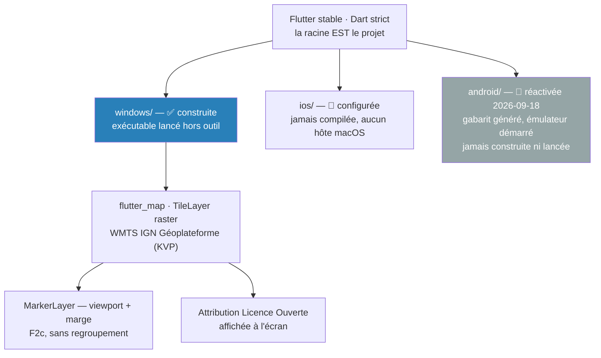

# ADR-013 — Flutter, et Windows en première cible construite

- **Statut :** **Accepté — arbitrage du commanditaire du 2026-09-12** (porte de spike franchie sur `F1` et `F3`), Android différé le même jour, **différé levé le 2026-09-18** (voir
  « [Amendement du 2026-09-18 — Android réactivé](#amendement-du-2026-09-18--android-réactivé) »).
  Le **reste** de cet ADR est inchangé : Windows demeure la première cible construite.
- **Date :** 2026-09-13 · **amendé le 2026-09-18**

> ⚠️ **Cet ADR est écrit a posteriori.** La porte de spike a été exécutée le **2026-09-09**, la
> décision arbitrée le **2026-09-12**, ce document rédigé le **2026-09-13** (et versionné sur `feat/t1-mvvm-fiche-station` le **2026-09-14**), après la livraison de
> T0. Le plan T0 l'annonçait explicitement dans sa section « Ce que T0 ne fait pas » : *« Aucun
> `ADR-013` (bascule de stack et cible unique). Il reste à écrire ; `.gitignore` le cite déjà comme
> la décision qui rend `windows/` et `ios/` versionnés. »* Il ne crée donc aucune décision : il
> consigne celle qui a été prise, et les faits datés qui l'ont produite.

---

## Contexte

### Pourquoi Flutter

Le 2026-08-24, le commanditaire a fait de **Windows une cible produit**, aux côtés d'Android et
d'iOS : des usagers consulteront l'état de la rivière depuis un PC. Le critère de choix retenu ce
jour-là est **la qualité technique** ; une réécriture est acceptée si elle est justifiée. Le même
jour, le **pré-téléchargement de zone cartographique sort de la v1** (`US-20`) — arbitrage confirmé
le 2026-10-21.

**Le fait structurant :** `flutter_map`, en Dart pur, est le seul moteur cartographique
multi-plateforme relevé qui couvre Android, iOS **et** Windows sans passer par une WebView.

Relevé le 2026-08-24 sur pub.dev et la documentation Flutter. ⚠️ **Documentation et métadonnées
seulement, rien n'a été exécuté** : d'où la porte de spike.

| Fait | Constat |
|---|---|
| Flutter — Android, iOS, Windows | Les trois en tier **`Supported`**, aucune mention `beta`. Android 24→37, iOS 15→26, Windows 10 et 11, `x64` **et** `Arm64` |
| `flutter_map` **8.3.1** | Plateformes verbatim : *« Android, iOS, Linux, macOS, web, Windows »*. **BSD-3-Clause**, 100 % Dart |
| `maplibre_gl` **0.27.0** | *« Not supported: desktop targets (Windows, macOS, Linux) »* — **Windows exclu** |
| `maplibre` (maplibre.dart) **0.3.5** | Windows listé, mais : *« Windows & macOS: maplibre-gl-js through a WebView »*. Ce n'est pas du natif |
| `drift` **2.34.3** | **MIT**, plateformes Android, iOS, Linux, macOS, web **et Windows** |
| `sqflite` **2.4.3** | Plateformes « Android, iOS, macOS ». **Windows absent** — renvoyé vers `sqflite_common_ffi` |
| `flutter_map_marker_cluster` **8.2.2** | Contrainte `flutter_map: ^8.2.2` — **compatible 8.x**. BSD-3 |
| `flutter_map_supercluster` **4.3.0** | 🚨 Contrainte `flutter_map: ^5.0.0`, publié trois ans plus tôt — **inutilisable en 8.x** |

### La chaîne des faits, datée

| Date | Fait | Source |
|---|---|---|
| 2026-09-09 | **Porte de spike Flutter exécutée** — `F1` ✅ sur Windows, `F3` ✅, `F2` **rouge** sur la règle fixée d'avance (chiffres ci-dessous) | [`COMPTE-RENDU.md`](../../spike/porte_flutter/COMPTE-RENDU.md) |
| 2026-09-12 | **Arbitrage du commanditaire** : verdict favorable sur `F1` + `F3`, `F2c` retenue par défaut, **Android ⏸ différé jusqu'à nouvel ordre**, arbre git frais | [`project-state.md`](../project-state.md) § Arbitrages récents |
| 2026-09-13 | **T0 livrée** — 31 tâches sur 31, PR #11 fusionnée sur `dev` (`015a245`), version `0.1.0`, **248 tests** (247 du plan + `changelog_test`), constatés par `flutter test` le 2026-09-13, tag `v0.1.0` posé localement (non poussé) | plan T0 § Avancement, [`CHANGELOG.md`](../../CHANGELOG.md) |

### Ce que la porte de spike a mesuré, le 2026-09-09

| Épreuve | Cible | Résultat |
|---|---|---|
| `F1` — le fond IGN s'affiche | Windows, `flutter run -d windows` | ✅ **le plan IGN s'affiche**, le glisser déplace la carte. ⚠️ à cette date, **la molette ne zoomait pas** (voir « Conséquences ») |
| `F2` — 4 150 marqueurs clusterisés | émulateur `Pixel_7`, `x86_64`, Android 16 | ⚠️ **rouge sur la règle fixée d'avance, non tranchée** — `trames 213` · `raster p50 1,9 ms` · **`p90 16,2 ms`** (budget ≤ 16,7 ms ✅) · `p99 143,1 ms` · `build p90 1,5 ms` · **`jank 19, soit 8,9 %`** pour un seuil < 5 % ❌ |
| `F3` — exécutable Windows autonome | `flutter build windows --release`, binaire lancé **seul** | ✅ la fenêtre s'ouvre hors de Flutter et affiche la carte. Dossier `Release` : **33 Mo, 14 fichiers**, dont `flutter_windows.dll` 20,3 Mo |

Le verdict de `F2` est **rouge, pas nul** : le budget de rastérisation tient, c'est le taux de trames
en retard qui dépasse. Les deux variantes de remesure (`F2b` sans animations, `F2c` sans
regroupement) sont codées au commit `207edec` et **n'ont jamais été mesurées** — elles attendaient
Android, qui a été différé le 2026-09-12. La levée du différé, le 2026-09-18, **ne rouvre pas `F2`** :
elle rend la remesure possible, elle ne la programme pas (voir l'amendement en fin de document).

### Versions réellement liées

Relevées le 2026-09-09 par `flutter pub deps --style=compact` dans le projet de spike, puis le
2026-09-13 dans `pubspec.yaml` à la racine. **On vérifie ce qui est lié, on ne le suppose pas** : une
propriété de construction mal nommée peut donner l'illusion d'un essai concluant.

| Composant | Au spike (2026-09-09) | Dans le projet (2026-09-13) | Licence |
|---|---|---|---|
| Flutter | **3.47.1** stable (revision `6655482ec0`) | **3.47.4** stable (`flutter --version`) | BSD-3-Clause |
| Dart | **3.13.1** | **3.13.3** — `environment: sdk ^3.13.3` | BSD-3-Clause |
| `flutter_map` | **8.3.2** liée | `^8.3.2` | BSD-3-Clause |
| `latlong2` | **0.9.1** (par contrainte transitive ; pub.dev publie `0.10.1`) | `^0.9.1` | Apache-2.0 |
| `http` | — | `^1.6.0` | BSD-3-Clause |
| `flutter_lints` | — | `^6.0.0` | — |
| `flutter_map_marker_cluster` | **8.2.2** liée dans le spike | **absente du projet** — `F2c` n'en a pas besoin | BSD-3-Clause |

---

## Décision

**Le projet passe à Flutter, et Windows est la première cible construite** — la seule à la date de
la décision (2026-09-12) ; pour Android, voir l'amendement du 2026-09-18 et la note du 2026-10-14.

| Composant | Retenu |
|---|---|
| Langage | **Dart**, `strict-casts` / `strict-inference` / `strict-raw-types` |
| Runtime | **Flutter stable** |
| Carte | **`flutter_map`**, tuiles **raster WMTS IGN Géoplateforme** (KVP) |
| Marqueurs | **viewport plus une marge, sans regroupement** (`F2c`) |
| Hors-ligne carto | **cache de tuiles intégré à `flutter_map`** (voir ➖ ci-dessous) |
| Attribution | « © IGN Géoplateforme — Licence Ouverte », **affichée à l'écran** |

### Les cibles, et leur état réel

| Cible | État |
|---|---|
| **Windows** | ✅ **la seule construite.** `flutter build windows --release` produit un exécutable **lancé hors outil de développement** par le commanditaire le 2026-09-13 |
| **iOS** | 🔄 **configuré, jamais compilé** — aucun hôte macOS. Le `bundleIdentifier` est aligné et verrouillé par un test (`test/project/ios_bundle_identifier_test.dart`) ; rien de plus n'est affiché comme acquis |
| **Android** | ~~⏸ **différé jusqu'à nouvel ordre** (arbitrage du 2026-09-12)~~ → **différé levé le 2026-09-18**, voir l'amendement ci-dessous. Reste ⏸ ce qui y est explicitement listé : signature de publication, appareil réel, préversion |

### Amendement du 2026-09-18 — Android réactivé

**Arbitrage du commanditaire du 2026-09-18** (« active android et lancer l'émulateur ») : **le différé
Android du 2026-09-12 est levé.** Android redevient une **cible active**.

**Ce qui est constaté ce jour-là, par exécution :**

| Fait | Relevé |
|---|---|
| Chaîne d'outils Android | `flutter doctor` rend « [√] Android toolchain - develop for Android devices (Android SDK version 36.0.0) », sous Flutter 3.47.4. Le SDK est celui du poste, sur un **chemin sans espace ni parenthèse** — la leçon de 2026-08-15 tient |
| NDK | Flutter 3.47.4 exige **`28.2.13676358`**, lu dans `packages/flutter_tools/gradle/src/main/kotlin/FlutterExtension.kt` du SDK Flutter installé. Ce NDK **est présent sur le poste** (dossier daté du 2026-09-09), à côté du `27.1.12297006`. **L'épingle `27.1` du spike n'a donc plus lieu d'être** : `ndkVersion = flutter.ndkVersion` est conservé |
| Plateforme | `flutter create --project-name martinpecheur --org fr.martinpecheur --platforms android .` — le **gabarit Android est généré** |
| Émulateur | `Pixel_7` (seul listé par `flutter emulators`) lancé par `flutter emulators --launch Pixel_7` ; `adb devices` le voit **`emulator-5554 device`**, puis **`sys.boot_completed=1`** |

**Ce qui n'est PAS constaté :**

- 🚨 **Rien n'a été construit ni lancé sur Android.** Le bac à sable ne compile pas de natif (socket
  AF_UNIX fermée, Gradle ne démarre pas) : `flutter run -d emulator-5554` est à lancer **par le
  commanditaire**. **Aucun écran de l'application n'a été vu sur Android sous Flutter.**
  *Note du 2026-10-14 (`P3` de T3), l'état du 2026-09-18 ci-dessus est conservé :* ~~Rien n'a été
  construit ni lancé sur Android~~ ne vaut plus. Une construction de débogage est lancée sur
  l'émulateur `Pixel_7`, confirmée en bloc par le commanditaire (voir la note du 2026-10-14 sous le
  schéma, plus bas). Le NDK exigé par Flutter n'y est pas relevé : ce qu'il a servi à construire n'est
  consigné nulle part.
- Le NDK est donc **présent, pas éprouvé**. La tâche `A⏸2` du plan T0 exige de le *« constater par
  une construction réussie, pas par un raisonnement »* : elle passe de ⏸ à **🔄**, pas à ✅.
- `adb` **ne voit toujours pas** le Galaxy A54 réel ; `NV-5` (tenue sur Android d'entrée de gamme
  réel) reste **ouvert**. Toutes les mesures de fluidité existantes viennent d'un émulateur.

**Conséquence sur le dépôt :** **`android/` redevient versionné** — le **gabarit** Flutter de
plateforme seulement. Les caches de construction restent hors dépôt ; des caches résiduels de 2,5 Go
subsistent sur le poste, à supprimer **par le commanditaire** — Flutter construit dans `build/` à la
racine, pas dans `android/app/build`, ces caches sont donc **inertes pour Flutter**. Le commentaire de
`.gitignore` décrit désormais l'état du dépôt.

**Ce que cet amendement ne change PAS :**

- **Windows reste la première cible construite** — et la seule dont un exécutable ait été lancé hors
  outil de développement.
- **L'architecture est intacte** : feature-first + MVVM ([`ADR-014`](ADR-014-feature-first-mvvm.md)),
  `lib/domain/` pur, les sept règles de couches. Une cible de plus n'est pas une décision
  d'architecture.
- **iOS reste configuré et jamais compilé** (aucun hôte macOS, `NV-W4`).
- **Le hors-ligne de la dernière carte reste livré en partie** : le `Must` d'[`UC-005`](../use-cases/UC-005-consulter-la-carte-hors-ligne.md)
  n'est couvert que par le cache des tuiles déjà parcourues. Réactiver Android n'y change rien. Le
  pré-téléchargement de zone, lui, est hors v1 (arbitrage du 2026-08-24, confirmé le 2026-10-21).
- **`F2` n'est pas rouverte** : `F2c` (viewport plus marge, sans regroupement) reste l'approche par
  défaut tant qu'aucune mesure ne réhabilite le regroupement.

### L'approche par défaut de la carte

**Marqueurs du viewport plus une marge proportionnelle, sans regroupement** — la variante `F2c`. Elle
est retenue **tant qu'aucune mesure ne réhabilite le clustering**, pas parce que le regroupement
serait disqualifié : `F2` n'est pas tranchée, elle est rouge sur un seul relevé, sur émulateur
`x86_64`, dans un mode d'exécution (`--profile`) que le commanditaire n'a pas confirmé.

⚠️ **Le prix est réel et assumé :** au zoom national, la France entière est visible et les **4 150
stations sont toutes dessinées**. Ce n'est pas un défaut caché, c'est le coût de l'approche.

### Conséquences sur le dépôt

- **La racine EST le projet Flutter** : `pubspec.yaml`, `analysis_options.yaml` et `lib/` à la racine,
  plus de sous-dossier d'application.
- **`windows/` et `ios/` sont versionnés** — ils se modifient à la main. C'est ce que `.gitignore`
  annonce depuis sa troisième ligne : *« `android/`, `ios/` et `windows/` sont VERSIONNÉS : ils se
  modifient à la main et portent la signature de release (ADR-013). »*
  ✅ **Depuis le 2026-09-18** (voir l'amendement), la plateforme Android est générée et son
  **gabarit** est versionné. Seuls les **caches résiduels** du poste restent à supprimer, par le
  commanditaire, et ne se committent jamais.
- **Dart strict non négociable** : `flutter_lints`, `language: strict-casts, strict-inference,
  strict-raw-types`, `avoid_dynamic_calls`, `always_declare_return_types`, `prefer_final_locals`.
  `dynamic` implicite interdit.
- **Aucun outillage Node.** Le générateur de percentiles d'[`ADR-003`](ADR-003-reference-percentiles-en-asset.md)
  sera un **script Dart** (arbitrage du 2026-09-12).

> **Note du 2026-10-14** (le schéma ci-dessus date du 2026-09-18 et n'est pas réécrit) : la mention
> ~~« jamais construite ni lancée »~~ pour `android/` ne vaut plus. Une construction Android en
> débogage est constatée le 2026-10-14 (APK du 2026-10-14 à 15:11:49, code de `0.4.0`), et le
> commanditaire confirme en bloc qu'elle s'est lancée sur l'émulateur `Pixel_7` et que « les écrans de
> T3 fonctionnent au toucher » (`P2` de T3, `docs/project-state.md`, points 9 et 62). Non dit : la durée
> et la dernière ligne de la construction, le premier écran vu. La publication reste différée
> (`A⏸3`, `A⏸5`), aucun appareil réel (`A⏸4`), aucune release Android.

### Ce que ce choix ne touche pas

Le **cadrage produit est indépendant de la stack** : les quatre documents de cadrage, les **14 règles
métier**, les **6 cas d'usage**, les **17 contraintes d'API vérifiées**, et les ADR
[`001`](ADR-001-api-hydrometrie-v2.md), [`002`](ADR-002-qualification-du-debit.md),
[`003`](ADR-003-reference-percentiles-en-asset.md), [`004`](ADR-004-integration-vigieau.md),
[`006`](ADR-006-onde-quatre-categories.md), [`007`](ADR-007-ecarter-qualite-eau.md). Les quatre
avertissements (`BR-012`, `BR-013`) restent une condition de mise en production, sur toute cible.

---

## Conséquences

### ➕

- **Windows est *construit*.** Déboguer la carte sur le poste, sans cycle de déploiement mobile, se
  fait avec un binaire **lancé hors outil** : dossier de publication **31 Mo** pour un budget de
  60 Mo, dont `flutter_windows.dll` 21 Mo et le référentiel 6,4 Mo (constaté le 2026-09-13,
  `CHANGELOG.md` — le nombre de fichiers n'y est pas relevé).
- **Le rendu carto est natif**, sans WebView à nourrir : `flutter_map` dessine dans le moteur Flutter.
- **Dart rend au compilateur ce qui serait sinon une discipline.** `BR-011` (nomenclature tolérante à
  l'inconnu) et `BR-002` (unités) s'écrivent en `sealed class` à `switch` exhaustif et en
  `extension type` : **oublier une branche est une erreur de compilation**.
- **Zéro bibliothèque hors des quatre déclarées.** `flutter_map`, `latlong2`, `http`, `flutter_lints`.

### ➖

- **Le hors-ligne cartographique n'est pas réglé.** `flutter_map` embarque un cache de tuiles depuis
  la 8.2 (`BuiltInMapCachingProvider`, 1 Go, actif par défaut hors web) — **constaté dans la
  documentation seulement au spike**, puis **constaté à l'écran le 2026-09-13** : carte réseau
  désactivée, la carte s'ouvre et le fond s'affiche **sur les zones déjà parcourues** (`NV-W2`,
  [`docs/nfr.md`](../nfr.md)). ⚠️ Une zone **jamais chargée** n'a pas été constatée, et **aucun
  téléchargement de zone à la demande n'existe** — il est hors v1 (`US-20`, arbitrage du 2026-08-24,
  confirmé le 2026-10-21) : hors réseau, une zone jamais parcourue reste sans fond. Le `Must`
  d'[`UC-005`](../use-cases/UC-005-consulter-la-carte-hors-ligne.md) et d'`US-10` reste **livré en
  partie** : ni la persistance de `DerniereVueCarte`, ni le bandeau hors-ligne.
- **`F2` n'est pas tranchée, et aucune mesure de fluidité n'existe sur Windows.** `NFR-01`
  (rastérisation `p90` ≤ 16,7 ms, trames en retard < 5 %) est **non mesuré** sur la seule cible
  construite — `NV-W3` dans `docs/nfr.md`, ouvert sans date. Le binaire de T0 a été jugé à l'œil, pas
  au chiffre.
- **iOS n'a jamais été compilé, et Android n'a jamais été construit.** Deux des trois cibles
  déclarées ne sont adossées à aucune exécution. ⚠️ **Amendé le 2026-09-18** : Android n'est plus
  différé, mais il n'est pas pour autant éprouvé. Des dettes du spike, une seule tombe — le **NDK
  `28.2.13676358` est présent sur le poste**, l'épingle `27.1.12297006` est abandonnée et
  `ndkVersion = flutter.ndkVersion` conservé, **sans qu'une construction l'ait encore confirmé**.
  Restent dues : `adb` ne voyant pas le Galaxy A54, et `NV-5` (tenue sur Android réel) ouvert.
  *Note du 2026-10-14 (`P3` de T3) :* ~~Android n'a jamais été construit~~ ne vaut plus — une
  construction de débogage est lancée sur l'émulateur `Pixel_7` (confirmation en bloc du
  commanditaire, `P2` de T3 ; note sous le schéma, plus bas). **iOS n'a toujours jamais été
  compilé.** Ce qui reste dû est inchangé : `adb` ne voit pas le Galaxy A54, `NV-5` est ouvert, la
  publication Android (`A⏸3`, `A⏸5`) est différée.
- **La spec d'UI est écrite pour le mobile.** [`04-ui.md`](../04-ui.md) suppose un écran étroit et le
  tactile ; le lot clavier/souris et responsive reste dû. Premier élément de ce lot déjà instruit :
  la molette. Elle **ne zoomait pas** au spike (2026-09-09) ; elle **zoome** à l'exécution de T0
  (2026-09-13). `NV-W1` est **clos** dans `docs/nfr.md`, mais la cause de l'écart **n'est pas
  établie** — seule sa disparition est constatée.

---

## Alternatives écartées

- **Flutter avec MapLibre natif** (`maplibre_gl`) plutôt que `flutter_map` en raster. Sa
  documentation exclut Windows (`maplibre_gl` 0.27.0, relevé du 2026-08-24). **Non essayé** : aucun
  spike, aucune mesure. Ce n'est donc pas une option écartée sur preuve, mais une
  **piste non instruite** — à ouvrir par un spike si la tenue en charge l'exige, jamais à présenter comme évaluée.

---

## Si la décision est revue

- **Le cadrage produit ne bouge pas** — il ne dépend d'aucune technologie : `BR-001` à `BR-014`,
  `UC-001` à `UC-006`, `ADR-001`, `002`, `003`, `004`, `006`, `007`, et les 17 contraintes d'API.
- **`lib/domain/` est du Dart pur** et se porte tel quel vers tout hôte Dart. Le verrou est
  `test/architecture/domain_isolation_test.dart`, qui interdit sous `lib/domain/` tout
  `package:flutter`, `package:flutter_map`, `package:latlong2`, `package:http`, `package:drift`,
  `package:sqflite`, `dart:io` et `dart:ui`.
- **Les fixtures de `test/fixtures/` sont indépendantes de la stack** : ce sont des réponses d'API
  capturées et datées (`test/fixtures/CAPTURES.md`). Elles survivraient à un changement de stack.
- **Ce qui serait à refaire :** l'intégralité de `lib/data/`, `lib/features/`, `lib/main.dart`, les
  dossiers de plateforme, et la chaîne de build. Le code reste dans l'historique git — T0 est
  fusionnée sous `015a245` (PR #11), version `0.1.0`.

---

## Liens

- **Complété par :** [`ADR-014`](ADR-014-feature-first-mvvm.md) — feature-first + MVVM
- **Toujours en vigueur :** [`ADR-001`](ADR-001-api-hydrometrie-v2.md),
  [`ADR-002`](ADR-002-qualification-du-debit.md), [`ADR-003`](ADR-003-reference-percentiles-en-asset.md),
  [`ADR-004`](ADR-004-integration-vigieau.md), [`ADR-006`](ADR-006-onde-quatre-categories.md),
  [`ADR-007`](ADR-007-ecarter-qualite-eau.md)
- **Stockage local :** [`ADR-011`](ADR-011-stockage-local.md) — réservé au 2026-09-13, **tranché le
  2026-09-18 pour la préférence simple** (`shared_preferences`). Le **moteur structuré** reste à
  trancher quand un écran en aura besoin : `drift` candidat par défaut ; `sqflite` seul **ne couvre
  pas Windows**
- **Preuves :** [`spike/porte_flutter/COMPTE-RENDU.md`](../../spike/porte_flutter/COMPTE-RENDU.md)
  (2026-09-09) · [plan T0](../superpowers/plans/2026-09-13-t0-socle-flutter.md) ·
  [`docs/nfr.md`](../nfr.md) (`NFR-01`, `NV-W1`, `NV-W2`, `NV-W3`) ·
  [`CHANGELOG.md`](../../CHANGELOG.md) § `[0.1.0]` · [`project-state.md`](../project-state.md)
