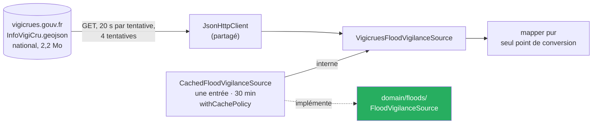

# ADR-016 — Intégrer Vigicrues derrière une abstraction

- **Statut :** Accepté.
  - Sont **arbitrés par le commanditaire** le 2026-10-14 (cadrage de T4, § 2) :
    - **1** : la voie « GeoJSON national mis en cache », choisie **après correction d'un fait faux** (voir « Arbitrages ») ;
    - **6** : la durée de conservation, 30 minutes ;
    - **10** : le bouton « Réessayer » comme seul geste qui relance après un échec sans vigilance lue ;
    - **12** : un rafraîchissement en fond qui échoue est retenté au geste suivant, un à la fois.
  - Les choix d'architecture **R1 à R5** (cadrage § 12.3) — emplacements, types d'échec propres, 20 s par tentative, frontière « illisible » / « écartée et comptée », aucune simplification à la lecture — sont **tranchés par défaut** : révisables par un nouvel amendement.
- **Date :** 2026-10-14

## Contexte

T4 ajoute une quatrième lecture à la carte : la **vigilance crues** publiée par Vigicrues, tronçon par tronçon. Les faits ci-dessous viennent d'appels réels du 2026-10-14 (14:30 à 14:37 UTC), détaillés dans [`docs/sources/vigicrues.md`](../sources/vigicrues.md) (`VC-01` à `VC-13`), un jour de vigilance verte nationale.

- **Adresse** (`VC-01`) : `/services/InfoVigiCru.geojson`, l'adresse publiée `/services/1/…` y redirige (`302`). 2 245 691 octets, aucune compression, `Cache-Control: max-age=120`.
- **Portée** (`VC-02`) : **le GeoJSON ne se filtre pas** — cinq jeux de paramètres rendent la collection entière. La seule source qui porte tracés, niveaux et date est donc **un appel national de 2,2 Mo**. C'est ce qui contredit `NFR-07` (« aucun appel national en bloc »).
- **Forme** (`VC-03`) : `FeatureCollection`, 337 entités en `MultiLineString`, coordonnées `[longitude, latitude]`, `bbox` déclarée **fausse**. Les codes sont des chaînes, `NivInfViCr` un nombre.
- **Niveaux** (`VC-04`) : nomenclature Sandre 837, `1` à `4`. **Seul `1` est observé** ; `2` à `4` sont documentés, jamais observés.
- **Date** (`VC-05`) : `DtHrInfoVigiCru` au premier niveau du document, avec décalage explicite ; c'est la date du bulletin national.
- **Poids** (`VC-06`) : 56 110 points, 537 lignes ; effet sur `NFR-01` non mesuré.
- **Couverture** (`VC-07`) : métropole et Corse ; un cours d'eau hors des tronçons n'est pas suivi.
- **Lien station–tronçon** (`VC-11`) : renseigné dans un seul sens, du tronçon vers ses stations (codes Hub'Eau, présents dans le référentiel) ; le détail d'une station ne nomme pas son tronçon ; le GeoJSON ne porte aucune station.
- **Bulletin** (`VC-08`) : `cdensup_1` est le code du territoire ; le bulletin est à `/bulletin_local/<code>`.
- **Licence** (`VC-09`) : Licence Ouverte, attribution « © VIGICRUES » et date de mise à jour ; formats susceptibles d'évoluer sans préavis.
- **Erreurs** (`VC-10`) : servies en HTML, jamais en JSON ; aucune panne réelle observée.
- **Flux RSS** (`VC-12`) : date d'item qui n'est pas celle de l'information, code inconnu rendu en message national, paramètre invalide rendu en `200`.
- **Définitions publiées** (`VC-13`) : légende et explications de la page d'accueil, citées telles quelles (`BR-014`).

> Règle propre à ce projet : tout fait relatif à une API publique est vérifié par appel réel et daté. Les niveaux `2` à `4` ne le sont pas : ils s'éprouvent par des cas construits, nommés tels.

## Décision

- **Une abstraction du domaine.** `FloodVigilanceSource` vit dans `lib/domain/floods/` ; une implémentation, `VigicruesFloodVigilanceSource`, sur le GeoJSON national, sous `lib/data/floods/`. **Types d'échec propres aux crues** (`VigilanceInjoignable`, `VigilanceRefusee`, `VigilanceIllisible`), sans partage avec `RestrictionLookupFailure`.
- **Adresse appelée** : l'adresse finale, sans la redirection (`VC-01`).
- **Transport** : le `JsonHttpClient` partagé, **20 s par tentative** (constante propre, comme `hubEauRequestTimeout` : 2,2 Mo sur un réseau mobile), 4 tentatives, recul existant. Pire cas avant l'échec : 83,5 à 87 s, comme Hub'Eau.
- **Cache de session d'une seule entrée, 30 minutes**, par `withCachePolicy` (`CachedFloodVigilanceSource`) : premier appel attendu ; périmée, la vigilance est rendue avec sa date pendant qu'une nouvelle se charge en fond ; un rafraîchissement en échec est absorbé, l'ancienne vigilance reste affichée avec sa date ; un échec du premier appel n'est jamais mis en cache.
- **Nouvel essai** : après un échec **sans vigilance lue**, seul le geste explicite « Réessayer » relance (quatre tentatives au plus). Une vigilance lue et périmée se rafraîchit en fond au geste suivant sur la lecture Crues, **un essai à la fois**, y compris après un rafraîchissement en échec (arbitrage 12).
- **Mapper pur, seul point de conversion** (`[longitude, latitude]` → `GeoPoint`, la seule inversion d'ordre). **« Tout ou rien »** pour la réponse entière : racine qui n'est pas une `FeatureCollection`, `features` absent, date absente ou non lisible (`BR-001`) → `VigilanceIllisible`. **« Écartée et comptée »** entité par entité : sans code, sans nom, sans code de territoire ou sans tracé lisible ; l'avis dit le compte. La `bbox` déclarée n'est pas lue (`VC-03`).
- **Confinement, sur le modèle d'AR-1 d'[`ADR-004`](ADR-004-integration-vigieau.md)** : le nom affichable « Vigicrues », l'adresse du site public et le gabarit de l'adresse du bulletin vivent dans `lib/domain/sources/source_names.dart`, et les textes d'écran les interpolent ; le **vocabulaire de l'API** (`InfoVigiCru`, `NivInfViCr`, `CdEntCru`, `DtHrInfoVigiCru`, `RefInfoVigiCru`, `lbentcru`, `cdensup_1`, `/services/`) est confiné à `lib/data/floods/` et à `main.dart`, **commentaires compris**, verrouillé par test.
- **Aucune simplification à la lecture**, décodage sur l'isolat principal : `simplificationTolerance` par défaut au rendu d'abord ; revus si `NFR-01` échoue à la porte.
- **Aucune bibliothèque nouvelle.**

## Conséquences

- ➕ Un appel, un document : tracés, niveaux chiffrés (Sandre 837) et date arrivent ensemble, sans lecture XML ni bibliothèque.
- ➕ Le vocabulaire de l'API et sa forme sont confinés : une rupture de format (`VC-09`, « sans préavis ») reste dans `lib/data/floods/`.
- ➕ Une entité cassée ne cache pas les 336 autres vigilances publiées.
- ➖ **2,2 Mo par chargement** et une **exception nommée à `NFR-07`** : un chargement réussi au plus toutes les 30 minutes, seulement après la première activation de la lecture Crues dans la session ; après un échec sans vigilance lue, un essai par appui sur « Réessayer ».
- ➖ Le premier chargement peut durer jusqu'à 87 s avant d'échouer ; la carte le dit (« Lecture de la vigilance publiée par Vigicrues… »).
- ➖ Les niveaux `2` à `4` ne sont éprouvés que par des cas construits ; leur forme réelle dans le GeoJSON reste à constater au premier épisode de vigilance.
- ➖ Le poids de 56 110 points sur la fluidité (`NFR-01`) n'est pas mesuré : constat à la porte de T4.

## Alternatives écartées

- **Tracés embarqués et niveaux par le flux RSS filtré.** Écarté : la date d'item n'est pas celle de l'information, le niveau est un mot jamais vu au-delà de « vert », un code inconnu rend le message national (qui se lirait « vert »), les erreurs sont servies en `200` (`VC-12`), et il faudrait une lecture XML que le projet ne fait nulle part (aucune bibliothèque XML dans `pubspec.yaml`).
- **Lien vers le site seul.** Écarté par l'arbitrage Q3 du commanditaire du 2026-10-03 (cadrage d'ensemble, `docs/superpowers/specs/2026-10-03-cadrage-t4-t5-crues-design.md` § 6), au profit d'une quatrième lecture sur la carte.
- **Vigilance dans la fiche station seule.** Écarté par l'arbitrage Q3 du commanditaire du 2026-10-03 (cadrage d'ensemble, `docs/superpowers/specs/2026-10-03-cadrage-t4-t5-crues-design.md` § 6), au profit d'une quatrième lecture sur la carte. Constat du 2026-10-14 : le lien station–tronçon n'est renseigné que du tronçon vers ses stations (`VC-11`).

## Si la décision est revue

- **Déclencheurs :** Vigicrues publie la vigilance « sous une forme structurée » annoncée avec le Sandre (`VC-09`) ; ou `NFR-01` échoue sur 56 110 points.
- **À défaire :** `VigicruesFloodVigilanceSource`, son mapper et son cache, sous `lib/data/floods/`, et la ligne de composition de `main.dart`.
- **Pas impacté :** `FloodVigilanceSource` et les types d'échec du domaine, les ViewModels, les vues, les textes d'écran.

## Arbitrages

| Date | Question | Réponse du commanditaire |
|---|---|---|
| 2026-10-14 | La seule source qui porte tracés et niveaux est un appel national de 2,2 Mo — quelle voie ? | « Tracés embarqués + RSS » — **réponse donnée sur un fait faux** : on avait relevé le GeoJSON « sans date » alors qu'il est daté (`VC-05`) |
| 2026-10-14 | **Après correction du fait** : le GeoJSON est daté, et la date du RSS par tronçon n'est pas celle de la vigilance en cours (`VC-12`). Le choix tient-il ? | **« Passer à B, GeoJSON »** : un appel national mis en cache, niveaux chiffrés Sandre 837, date et tracés dans le même document, aucune bibliothèque ; `NFR-07` amendé pour Vigicrues avec son motif ; `NFR-01` mesuré à la porte |

## Liens

- Source et faits : [`docs/sources/vigicrues.md`](../sources/vigicrues.md)
- Modèle de confinement : [`ADR-004`](ADR-004-integration-vigieau.md)
- Architecture : [`ADR-014`](ADR-014-feature-first-mvvm.md), amendement du 2026-10-14
- Exigence amendée : `NFR-07` ([`nfr.md`](../nfr.md))
- Cadrage : `docs/superpowers/specs/2026-10-14-cadrage-t4-design.md`
