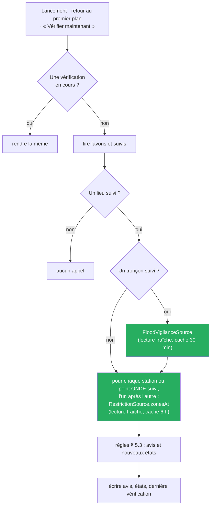

# ADR-017 — Vérifier les lieux suivis depuis l'appareil, sans serveur

- **Statut :** **Accepté** — arbitrages du commanditaire du 2026-10-17 : **1** (T5 se clôt sur l'étape 1, l'étape 2 est une tranche à part), **2** (vérification au lancement et au retour au premier plan, caches comme frein), **6** (stockage en `shared_preferences`), **7** (un service du domaine), **11** (voie « planificateur » de l'essai Windows) et **12** (bibliothèques des essais). Les décisions `PD` du plan sont prises par la boucle principale et réversibles.
- **Date :** 2026-10-17, écrit le 2026-10-21 (lot des documents de T5, tâche `O3`)

## Contexte

Un usager qui suit un lieu veut savoir quand le niveau publié change, sans ouvrir chaque fiche (`US-22`). Le produit n'a **pas de backend** : l'application appelle directement les APIs publiques. Une alerte qui arriverait application fermée suppose soit un serveur, soit une tâche de fond sur l'appareil ; or la tâche de fond n'est prouvée sur aucune cible.

Le cadrage d'ensemble de T4 et T5 ([`2026-10-03-cadrage-t4-t5-crues-design.md`](../superpowers/specs/2026-10-03-cadrage-t4-t5-crues-design.md), § 4, arbitrage 0 du 2026-10-03) avait déjà découpé T5 en **deux étapes** : la vérification à l'ouverture de l'application, sans tâche de fond ; puis les notifications en tâche de fond, seulement après un essai technique par cible qui prouve qu'une vérification part application fermée. Il pose aussi que l'application n'a ni serveur ni **engagement de délai** : aucun avis ne promet d'arriver à temps.

Les forces en jeu :

- **Les sources ne promettent rien** (`C-15`) : aucun SLA, aucun quota chiffré ; Hub'Eau n'expose aucun quota (`C-12`) ; VigiEau annonce `X-RateLimit-Limit: 300` sans que la fenêtre soit élucidée (`C-13`, `VG-10`). Un client qui interroge sans frein s'expose à un refus.
- **Vigicrues est un document national de 2,2 Mo**, non compressé, publié « au moins deux fois par jour, à 10h et 16h » — cadence annoncée, **non mesurée** (`VC-01`, `VC-05`). Le relire à chaque geste est exclu ; l'application le garde déjà 30 minutes (`ADR-016`).
- **Les niveaux 2 à 4 de Vigicrues n'ont jamais été observés en production** (`VC-04`) : leur comparaison ne s'éprouve que par des cas construits.
- **Aucune bibliothèque de tâche de fond ne couvre Windows et Android à la fois.** Le relevé du 2026-10-17 (`spike/t5_tache_de_fond/RELEVE-BIBLIOTHEQUES.md`, lu, rien exécuté) retient, pour des essais seulement, `flutter_local_notifications` 22.3.2 (Android et Windows) et `workmanager` 0.10.10 (Android, pas Windows). Un notificateur Windows non empaqueté, une tâche périodique Android reportée par Doze, un clic qui ne relance pas l'exécutable fermé sont des **hypothèses à éprouver**, non des faits.
- **L'état du code** (cadrage de T5, § 4.1) : `FavoriteRepository` et `shared_preferences` existent ; les caches de `CachePolicy` rendent une valeur périmée tout de suite et la rafraîchissent en fond sans prévenir l'appelant ; aucun `AppLifecycleListener`, aucune tâche de fond, aucune notification dans `lib/`.

> Faits relatifs aux APIs : voir `docs/sources/vigicrues.md`, `docs/sources/vigieau.md` et `docs/01-analyse.md`. Rien n'est ici spécifié d'après une documentation seule ; ce qui n'a pas été éprouvé est dit tel.

## Décision

**La vérification part de l'appareil, quand l'application est ouverte ; elle ne tourne pas application fermée dans T5.**

1. **Un cas d'usage du domaine, `FollowUpCheck`** (arbitrage 7), Dart pur sous `lib/domain/follow_up/`. Il dépend de ports seulement : `FavoriteRepository`, `FollowUpRepository`, `NoticeRepository`, `FloodVigilanceSource`, `RestrictionSource`, `StationRepository` (coordonnées d'une station, lues sans réseau dans le référentiel embarqué) et une horloge injectée. Les règles de comparaison sont pures et testées seules.
2. **Trois déclencheurs, une vérification à la fois** (arbitrage 2) : au premier affichage de la carte après l'acquittement, à chaque retour de l'application au premier plan, sur « Vérifier maintenant ». Un appel pendant qu'une vérification court rend la même.
3. **Lecture fraîche dans `CachePolicy`**, seul composant de cache : la vérification ne se contente pas d'une valeur périmée rendue tout de suite, elle la relit avant de comparer. Les écrans gardent la vue ordinaire ; les deux vues partagent la **même entrée de cache**, donc jamais deux téléchargements à la fois.
4. **Charge** (`NFR-07` amendé) : aucun appel sans lieu suivi ; Vigicrues seulement si un tronçon est suivi, par le cache de 30 min ; VigiEau, un appel par station ou point ONDE suivi, l'un après l'autre, par le cache de 6 h.
5. **Deux clés `shared_preferences`**, `follow_ups` (le suivi : réglages, derniers états, dernière vérification, séries d'échecs) et `notices` (avis, 100 au plus), JSON versionné, derrière des ports du domaine ([`ADR-011`](ADR-011-stockage-local.md) amendé). Aucune bibliothèque dans l'application.
6. **Ordre des écritures** (`PD13`) : les avis d'abord ; si cette écriture échoue, rien d'autre ne s'écrit et la vérification suivante redonne les mêmes avis. Ensuite seulement les derniers états, reportés sur l'état stocké au moment de l'écriture, si bien qu'un réglage changé pendant la vérification est gardé. **Assumé :** si le report des derniers états échoue après l'écriture des avis, les mêmes avis peuvent revenir **une fois** à la vérification suivante ; cela vaut mieux qu'un avis perdu.
7. **L'étape 2 (notifications en tâche de fond) n'est pas dans T5** (arbitrage 1). T5 livre l'étape 1 et deux essais techniques jetables, un par cible, dans un projet séparé sous `spike/t5_tache_de_fond/`, jamais importé par `lib/` ni par `test/`, exclu de l'analyse de la racine. Voie Windows : le planificateur de tâches lance l'exécutable de l'essai avec un argument, la tâche étant créée et supprimée à la main par le commanditaire (arbitrage 11). Voie Android : `workmanager`. Bibliothèques des essais : `flutter_local_notifications` 22.3.2 et `workmanager` 0.10.10 (arbitrage 12). L'étape 2 sera cadrée à part, sur ce que les essais auront prouvé, bibliothèque comprise.
8. **L'essai Windows n'est pas empaqueté** (`PD15`). [`ADR-018`](ADR-018-empaquetage-msix-microsoft-store.md) (MSIX) donne à l'application publiée une identité que l'essai `E-W` n'utilise pas : ce que le MSIX changerait pour l'affichage d'un toast et pour la relance par un clic est lu, non essayé, et dit dans le compte rendu.

L'application **relaie, elle ne calcule rien** (`BR-015`, `BR-016`) : le seuil de crue est un niveau publié, choisi par l'usager, comparé à un autre niveau publié.

## Conséquences

- ➕ **Aucune bibliothèque dans l'application**, aucun serveur, aucun compte : le périmètre « sans serveur » du produit est tenu.
- ➕ **La charge est bornée par les caches existants** et par l'absence d'appel sans lieu suivi ; un lieu de plus coûte au plus un appel VigiEau par vérification.
- ➕ **Le domaine reste testable seul** : la vérification, ses règles et ses échecs se jouent avec des doubles en mémoire, sans rendu, sans réseau.
- ➕ **Les écritures ne perdent pas d'avis** : l'ordre avis puis états ne peut que répéter un avis, jamais en supprimer un.
- ➕ **Les essais de l'étape 2 ne coûtent à l'application aucune ligne** et à son `pubspec.yaml` aucune dépendance, quel que soit leur résultat.
- ➖ **Un avis dépend d'une ouverture** : application fermée, rien n'est vérifié ni dit. L'avertissement de suivi (`BR-016`) le dit ; ce n'est pas un système d'alerte.
- ➖ **Un changement survenu puis défait entre deux vérifications n'est pas vu** ; l'avertissement le dit.
- ➖ **Une écriture concurrente depuis une tâche de fond** est le premier risque de l'étape 2 : avec l'API historique de `shared_preferences`, qui garde un cache par processus, une tâche de fond et l'application ne voient pas forcément la même valeur (`ADR-011`, amendement du 2026-10-12). Noté ici, non résolu.
- ➖ **Le report des derniers états peut échouer** après des avis écrits : les mêmes avis reviennent une fois. Accepté (`PD13`).
- ➖ **Le projet d'essai versionné** ajoute des fichiers hors `lib/` à entretenir et à exclure de l'analyse ; écart assumé au précédent de `spike/porte_flutter/`, qui ne versionne que son compte rendu (arbitrage 14).
- ➖ **La cadence réelle de Vigicrues et le comportement de VigiEau sous une série d'appels restent non mesurés** ; le frein est celui des caches, pas un constat d'API.

## Alternatives écartées

- **La vérification dans un ViewModel.** Elle part du lancement et du retour au premier plan, sans écran, et partira demain d'une tâche de fond : un ViewModel que seul un écran possède ne convient pas. Un cas d'usage du domaine est appelable des trois endroits.
- **Une couche `lib/application/`.** `ADR-014` l'a retirée ; la rouvrir pour un seul cas d'usage contredit la décision. Le cas d'usage vit sous `lib/domain/`, sur des ports.
- **`drift`.** Le suivi et les avis tiennent en deux chaînes JSON ; un moteur structuré ajouterait une bibliothèque et une migration pour un gain que rien ne demande. Le moteur reste ouvert jusqu'au hors-ligne (`US-10`).
- **L'étape 2 dans T5.** Aucune bibliothèque n'est prouvée sur les deux cibles ; décider avant les essais, c'est choisir sans constat (arbitrage 1).
- **La zone de notification Windows** (`tray_manager`, `launch_at_startup`). Un processus résident pour surveiller quelques niveaux publiés : lourd et intrusif, non retenu (arbitrage 11).
- **Une notification planifiée d'avance (`zonedSchedule`).** Elle s'écrit avant que l'on sache le contenu et ne peut pas dépendre d'un appel réseau : elle ne peut donc pas dire un changement.

## Si la décision est revue

Deux déclencheurs :

- **À l'ouverture de la tranche de l'étape 2**, une fois les comptes rendus des deux essais écrits : bibliothèque, déclencheur de fond, écriture concurrente dans `shared_preferences`. Ce qui change : l'appelant de `FollowUpCheck` (une tâche de fond s'ajoute aux trois déclencheurs). Ce qui n'est **pas** touché : le cas d'usage, ses règles, ses ports.
- **Si les avis dépassaient ce qu'une clé `shared_preferences` porte sans gêne** (lenteur de lecture, taille, écritures refusées). Ce qui change : l'implémentation des ports de `lib/data/follow_up/` et une migration des valeurs écrites. Ce qui n'est **pas** touché : le domaine, les écrans, les règles.

## Liens

- Cadrage d'ensemble : `docs/superpowers/specs/2026-10-03-cadrage-t4-t5-crues-design.md` (§ 4, arbitrage 0)
- Cadrage : `docs/superpowers/specs/2026-10-17-cadrage-t5-design.md` (§ 5.4, § 6, § 11.1) · plan : `docs/superpowers/plans/2026-10-21-t5-suivi-des-lieux.md`
- Règles : [`BR-016`](../br/BR-016-un-avis-relaie-un-changement-publie.md), [`BR-015`](../br/BR-015-relayer-la-vigilance-crues-ne-rien-predire.md), `BR-001`, `BR-007`, `BR-008`, `BR-011`
- Décisions liées : [`ADR-011`](ADR-011-stockage-local.md) · [`ADR-014`](ADR-014-feature-first-mvvm.md) · [`ADR-016`](ADR-016-integration-vigicrues.md) · [`ADR-018`](ADR-018-empaquetage-msix-microsoft-store.md)
- Contraintes d'API : `C-12`, `C-13`, `C-15` (`docs/01-analyse.md`) · `VC-01`, `VC-04`, `VC-05` (`docs/sources/vigicrues.md`) · `VG-10` (`docs/sources/vigieau.md`)
- Charge : `NFR-07` (`docs/nfr.md`)
- Relevé des bibliothèques : `spike/t5_tache_de_fond/RELEVE-BIBLIOTHEQUES.md`
