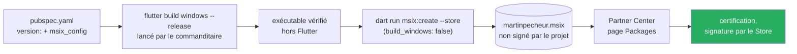

# ADR-018 — Empaquetage MSIX pour le Microsoft Store, par le paquet `msix`

- **Statut :** **Accepté — arbitrages du commanditaire du 2026-10-21** : la version passe à `1.0.0`
  (arbitrage 2, « mettre la version 1.0.0 »), l'outil est retenu (arbitrage 1, « j'accepte l'outil
  msix ») et le paquet emballe l'exécutable déjà vérifié (arbitrage 3, `build_windows: false`). **Amendé
  le même jour** (arbitrage 4) : `store: true` dans `msix_config`, après un paquet construit sans
  `--store` et refusé par Partner Center. Écrit le 2026-10-21 à la demande du commanditaire (« écris l'ADR d'empaquetage MSIX avec le
  paquet msix en dépendance de développement »), en exécution de l'arbitrage du 2026-10-19.
- **Date :** 2026-10-21
- **Numéro :** `ADR-018`, et non `ADR-017` : ce numéro est **réservé** par le cadrage de T5, approuvé le
  2026-10-17, à « Vérifier les lieux suivis depuis l'appareil, sans serveur »
  (`docs/superpowers/specs/2026-10-17-cadrage-t5-design.md`, § 11.1).
- **État du code :** ✅ **configuré le 2026-10-21** : `msix: ^3.18.0` en `dev_dependencies` (résolu en
  3.18.0), section `msix_config` dans `pubspec.yaml`, avec le logo propre à l'application
  (`windows/store/logo.png`, piste A choisie par le commanditaire le 2026-10-21) ; le tout verrouillé par
  `test/project/msix_config_test.dart`. Des paquets ont été construits par le commanditaire le
  2026-10-21 ; leur suivi, soumission comprise, est dans `docs/project-state.md`.
- **Portée :** l'outil d'empaquetage, l'identité du paquet, sa version, qui construit quoi. **Cet ADR ne
  décide aucune publication**, qui reste une décision du commanditaire.

---

## Contexte

L'arbitrage du 2026-10-19 a demandé **un ADR d'empaquetage MSIX pour le Microsoft Store**, à écrire entre
la clôture de l'ergonomie et le plan de T5 ; aucune publication n'y est décidée
(`docs/project-state.md`, « Arbitrages en vigueur sans autre trace »). Depuis, le commanditaire a créé le
produit dans Partner Center (2026-10-21, même section).

### L'identité imposée par Partner Center, relevée le 2026-10-21

> Constatée à l'écran de Partner Center le 2026-10-21. Seules figurent ici les valeurs publiques par
> nature : celles du manifeste de tout paquet publié, et l'ID de la fiche.

| Champ | Valeur |
|---|---|
| Type de produit | « Application MSIX ou PWA », fixé à la création du produit |
| Nom réservé | `MartinPêcheur` (le `display_name` du paquet) |
| `Package/Identity/Name` | `46Monbsoft.com.MartinPcheur` |
| `Package/Identity/Publisher` | `CN=6D56381B-9EA9-4C93-83CC-28D86DB31617` |
| `Package/Properties/PublisherDisplayName` | `Monbsoft` |
| ID Store | `9NLKQL1WKQFK` |

### Ce que le Store exige d'un paquet MSIX

> Relu le 2026-10-21 sur [*App package requirements for MSIX app*](https://learn.microsoft.com/en-us/windows/apps/publish/publish-your-app/msix/app-package-requirements)
> (`updated_at` 2026-08-24) et sur les [politiques du Store](https://learn.microsoft.com/en-us/windows/apps/publish/store-policies),
> version 7.20 (`updated_at` 2026-09-15, applicable le 2026-10-22).

- **Signature.** « The Microsoft Store will automatically re-sign your MSIX/AppX packages with a Microsoft
  certificate during the publishing process after your app passes certification. » Aucun certificat n'est
  à acheter. Un installeur EXE ou MSI, lui, doit être signé par l'éditeur (« You must Authenticode-sign
  your MSI/EXE installer yourself ») ; qu'un tel certificat soit payant est une inférence, non relevée.
- **Identité.** Les valeurs du manifeste doivent correspondre à celles de Partner Center, à la casse près.
- **Version `a.b.c.d`.** « The last (fourth) section of the version number is reserved for Store use and
  must be left as 0 […]. The other sections must be set to an integer between 0 and 65535 (except for the
  first section, which cannot be 0). » **La version `0.6.0` ne pouvait donc pas être soumise** : d'où
  le passage à `1.0.0` (arbitrage 2).
  Une soumission n'a pas à monter de version (« you are not limited to providing higher-versioned packages
  with each subsequent submission ») ; mais seule une version plus haute **met à jour** les usagers déjà
  équipés.
- **Politique de confidentialité.** Politique 10.5.1 : « Product types that inherently have access to
  Personal Information must always have privacy policies. These include, but are not limited to, Desktop
  Bridge and Win32 products. » L'adresse se donne « by entering the privacy policy URL in Partner Center ».
  Une application Flutter Windows est un exécutable Win32 : **l'adresse d'une politique de confidentialité
  est donc exigée**. La réponse à la question « informations personnelles » de la page « Propriétés »
  reste à trancher, en accord avec `NFR-05` (`docs/nfr.md`). Le projet n'a encore aucune politique de
  confidentialité.
- **Logo.** Politique 10.1.1 : un produit « must not use a name, images, or any other metadata that is the
  same as that of other products unless the product is also published by you ». L'icône actuelle de toutes
  les cibles est celle du **gabarit Flutter** (`ios/Runner/Assets.xcassets/AppIcon.appiconset/`,
  `windows/runner/resources/app_icon.ico` : mêmes empreintes que le gabarit du SDK, relevé du 2026-10-21) :
  elle ne peut pas servir de logo au paquet.

### Le paquet `msix`, relevé le 2026-10-21

> Relevé sur [`pub.dev/api/packages/msix`](https://pub.dev/api/packages/msix), sur
> [`pub.dev/packages/msix`](https://pub.dev/packages/msix), dans le `README.md` et dans les **sources du tag
> `v3.18.0` sur GitHub** (`lib/msix.dart`, `lib/src/configuration.dart`, `lib/src/appx_manifest.dart`,
> `lib/src/assets.dart`), avant l'ajout. Ces points ont ensuite été **relus dans le paquet installé**,
> le même jour : table suivante.

| Fait | Valeur |
|---|---|
| Version, date | **3.18.0**, publiée le **2026-06-27** |
| Licence, éditeur | **MIT**, **kremer.software** vérifié (compatibilité MIT et GPL-3.0 : connaissance générale) |
| Plateformes, Dart | Windows ; `>=2.19.0 <4.0.0`, satisfaite par Dart 3.13.5 |
| Dépendances directes | `args`, `yaml`, `path`, `package_config`, `pub_semver` (déjà dans `pubspec.lock`), `get_it`, `image`, `console`, `cli_util` (nouvelles ; résolues le 2026-10-21, leurs propres dépendances étaient déjà dans `pubspec.lock`) |
| Commande | `dart run msix:create --store` (ou `store: true`) ; `build_windows: true` par défaut, donc `flutter build windows` en release |
| Champs exigés avec `--store` | `identity_name`, `publisher_display_name`, `publisher` (`configuration.dart`, validation) |
| Version | sans `msix_version`, l'outil prend `a.b.c` de `version:` dans `pubspec.yaml` et ajoute `0` (`configuration.dart`, `_getPubspecVersion`) |
| Signature | avec `--store`, **ni signature ni installation de certificat** (`msix.dart` : `if (_config.signMsix && !_config.store)`) ; sans `--store`, signature par un **certificat de test** fourni, **installé sur la machine** par défaut (`install_certificate: true`) |
| Fichier produit | `build/windows/x64/runner/Release/martinpecheur.msix` — dans le dossier de l'exécutable de release ; chaque exécution y efface les `.msix` précédents |
| Capacités | `runFullTrust` est **toujours** ajoutée (`appx_manifest.dart`) ; c'est une capacité restreinte, 💭 une justification demandée par Partner Center n'est pas vérifiée |
| Bibliothèques | les DLL du runtime Visual C++ sont copiées dans le paquet, puis retirées du dossier Release après l'empaquetage (`assets.dart`) |

**Relu dans le paquet installé le 2026-10-21** (`msix-3.18.0` du cache pub, après l'ajout ; lecture des
sources, **rien n'est constaté à l'exécution**) :

| Fichier, ligne | Fait relu |
|---|---|
| `LICENSE`, l. 1 | « MIT License » |
| `lib/msix.dart`, l. 107 | `if (_config.buildWindows) await WindowsBuild().build();` — `flutter build windows`, en release sauf option de débogage (`lib/src/windows_build.dart`, l. 15-20) |
| `lib/msix.dart`, l. 113 | `cleanTemporaryFiles(clearMsixFiles: true)` : les `.msix` précédents du dossier sont effacés |
| `lib/msix.dart`, l. 125 et 140-149 | lecture de l'éditeur du certificat (l. 125), puis installation du certificat et signature (l. 140-149), seulement `if (_config.signMsix && !_config.store)` : **avec `--store`, rien de cela** |
| `lib/src/configuration.dart`, l. 28-29 et 426-447 | dossier `build/windows/runner/Release`, recalé sur `build/windows/x64/runner/Release` par `_updateBuildFilesFolder` |
| `lib/src/configuration.dart`, l. 67-68 | nom du fichier : `outputName ?? appName`, soit `martinpecheur.msix` d'après `name: martinpecheur` de `pubspec.yaml` |
| `lib/src/configuration.dart`, l. 86-87 et 499-509 | `msix_version` absente : version de `pubspec.yaml`, `major.minor.patch.0` |
| `lib/src/configuration.dart`, l. 99-100 | `install_certificate: false` désactive l'installation du certificat |
| `lib/src/configuration.dart`, l. 102-105 et 358-367 | `build_windows: false` désactive la construction ; le dossier de construction doit alors contenir un `.exe`, sinon : « Build files not found at […], first run "flutter build windows" then try again » |
| `lib/src/appx_manifest.dart`, l. 53 | `MinVersion` = `os_min_version` (`10.0.17763.0` par défaut), `MaxVersionTested="10.0.22621.2506"` |
| `lib/src/appx_manifest.dart`, l. 217 | `capabilities.add('runFullTrust');` |
| `lib/src/assets.dart`, l. 255-261 | sans `logo_path`, les icônes par défaut de `lib/assets/icons/` sont copiées : **c'est le logo de Flutter** (regardé le 2026-10-21) |

---

## Décision

**Le paquet MSIX se construit avec `msix` 3.18.0, en dépendance de développement.** Rien de `msix`
n'entre dans `lib/` ; l'outil assemble le paquet à partir de l'exécutable de release.

1. **`dev_dependencies` : `msix: ^3.18.0`**, accordé le 2026-10-21. Les points de la table ci-dessus ont
   été **relus dans le paquet installé** le même jour, avant toute construction : ils sont conformes.
2. **Une section `msix_config` dans `pubspec.yaml`**, sans aucun secret :

   ```yaml
   msix_config:
     display_name: MartinPêcheur
     publisher_display_name: Monbsoft
     identity_name: 46Monbsoft.com.MartinPcheur
     publisher: CN=6D56381B-9EA9-4C93-83CC-28D86DB31617
     logo_path: windows/store/logo.png
     capabilities: internetClient
     languages: fr-fr
     install_certificate: false
     build_windows: false
     store: true
   ```

   - **`logo_path: windows/store/logo.png`** : le logo propre à MartinPêcheur (piste A, « Profil », choisie
     par le commanditaire le 2026-10-21), 1080 × 1080, rendu de `windows/store/logo.svg` (le README de
     `msix` demande « at least 400x400px »). Sans lui, l'outil mettrait le logo de Flutter dans le paquet.
     Les images de la fiche du Store (1:1 et 9:16) sont rendues à côté, depuis leurs propres sources
     (`windows/store/README.md`). Les icônes de l'application elle-même (exécutable Windows, Android, iOS)
     portent le même martin-pêcheur depuis le 2026-10-21, à la place du logo de Flutter (décision du
     commanditaire ; `test/project/app_icons_test.dart`).
   - **Pas de `msix_version`** : la version vient de `pubspec.yaml`, seule source ; l'outil la dérive en
     `a.b.c.0`.
   - **`store: true`** (arbitrage 4, amendement du 2026-10-21) : tout paquet construit est un paquet du
     Store, même par `dart run msix:create` sans `--store`. Le choix initial, « le paquet du Store se
     demande par `--store` », a laissé passer un oubli le 2026-10-21 : lancé sans `--store`, l'outil a
     signé le paquet de son certificat de test et remplacé l'éditeur par `CN=Msix Testing, …` ; Partner
     Center l'a refusé (nom de famille et éditeur non valides). Constaté par Claude dans le paquet ouvert :
     `AppxSignature.p7x` présent, `Publisher` du manifeste à `CN=Msix Testing`.
   - **`build_windows: false`** (arbitrage 3) : l'outil ne relance pas `flutter build windows`, il emballe
     le dossier `Release` **déjà construit et vérifié** ; sans exécutable dans ce dossier, il s'arrête
     (« first run "flutter build windows" then try again »).
   - **`install_certificate: false`** ne joue que pour un paquet construit **hors** mode Store : elle
     empêche alors l'outil d'installer son certificat de test dans le magasin de certificats du poste
     (« ne rien toucher au système »). Avec `store: true`, elle ne joue plus ; elle reste en seconde
     garde si `store: true` venait à être retiré.
3. **Version.** Le premier nombre ne pouvant valoir 0, **`pubspec.yaml` est passé à `1.0.0+7` le
   2026-10-21** (arbitrage 2), version datée au `CHANGELOG` et verrouillée par
   `test/project/changelog_test.dart`. L'outil en dérivera `1.0.0.0`.
4. **Qui construit.** Le bac à sable de Claude ne construit rien en natif : **le commanditaire lance**
   `flutter build windows --release`, vérifie l'exécutable hors Flutter, puis lance
   `dart run msix:create --store` (`--store` redit `store: true`, sans conflit), qui emballe ce même
   dossier ; chaque commande avec son résultat attendu
   énoncé. Il dépose ensuite `martinpecheur.msix` sur la page « Packages » de la soumission. Claude écrit la configuration et lance
   `flutter analyze`, `flutter test`, `dart format`. Un test de `test/project/` vérifie les valeurs
   d'identité de `msix_config`, comme `ios_bundle_identifier_test.dart` et `android_configuration_test.dart`
   vérifient celles d'iOS et d'Android.
5. **Le livrable de vérification reste l'exécutable de release** (`build/windows/x64/runner/Release/`).
   Le MSIX en est l'emballage, réservé au Store : avec `build_windows: false`, il contient **exactement**
   l'exécutable vérifié. Il est donc produit **après** la vérification, jamais avant ; et toute
   reconstruction de l'exécutable demande de le vérifier à nouveau avant d'emballer.



**Hors de cet ADR**, une soumission demande aussi : la porte de mise en production (les quatre
avertissements, `BR-012` et `BR-013`, et la porte de T2), l'acceptation du contrat du développeur dans
Partner Center, la politique de confidentialité, le logo, et la fiche du Store. Leur état se suit dans
`docs/project-state.md`.

---

## Conséquences

- ➕ **Aucun certificat à acheter, aucun hébergement** : le Store signe et distribue, mises à jour comprises.
- ➕ **Une configuration courte, sans manifeste écrit à la main** : `msix` produit le manifeste et les
  images de tuiles à partir d'un seul logo, et prend la version dans `pubspec.yaml`.
- ➕ **Le paquet donnerait à l'application une identité**, qui manque à `flutter_local_notifications` pour
  `cancel` et `getActiveNotifications` sur Windows (`spike/t5_tache_de_fond/RELEVE-BIBLIOTHEQUES.md`). T5
  essaie d'abord la voie **non empaquetée** (essai E-W du cadrage de T5) ; ce que le MSIX y apporterait
  reste à établir.
- ➖ **Une dépendance de développement**, et quatre paquets nouveaux dans `pubspec.lock`, résolus le
  2026-10-21 : `cli_util` 0.6.0, `console` 4.1.0, `get_it` 9.3.0, `image` 4.12.0. Rien n'entre dans
  l'application livrée : `NFR-05` n'est pas touché.
- ➖ **Deux livrables Windows dans un même dossier** : l'exécutable de release (vérification) et le MSIX
  (Store), dans cet ordre. Le risque se déplace : avec `build_windows: false`, oublier de reconstruire
  emballerait un exécutable périmé ; la vérification de l'exécutable reste donc le pas qui précède.
- ➖ **La numérotation par tranche change de dizaine** : `0.6.0` est suivie de `1.0.0`, la même
  application. La version de T5, prévue à `0.7.0+7` par le cadrage d'ergonomie (R13 de T5), est à
  refixer au plan de T5.
- ➖ ⚠️ **Peu de chose est constaté à l'exécution.** Les comportements de `msix` sont lus dans ses
  sources (GitHub, puis paquet installé). Deux seulement sont vus à l'œuvre, le 2026-10-21, dans des
  paquets construits par le commanditaire et ouverts par Claude : les tuiles tirées du logo avec
  `logo_path`, et la signature de test qui remplace l'éditeur sans `--store`. Le logo de Flutter dans
  les tuiles sans `logo_path` est lu dans les icônes du paquet installé et cohérent avec le refus de
  certification 10.1.1.11 ; le paquet refusé n'a pas été ouvert.
- ➖ 💭 **Dossier des données sous MSIX.** Une application empaquetée voit ses écritures dans le dossier
  d'application redirigées vers celui du paquet : les préférences (`ADR-011`) n'y seraient pas au même
  endroit que pour l'exécutable de release. Inférence, non vérifiée ; sans effet sur des usagers, aucune
  version Windows n'ayant été distribuée.

---

## Alternatives écartées

- **Manifeste écrit à la main et `makeappx.exe`** (fourni par le SDK Windows). Aucune dépendance, mais un
  `AppxManifest.xml` et une dizaine d'images de tuiles à tenir à la main : plus de travail et plus
  d'erreurs, pour le même paquet.
- **Projet d'empaquetage Visual Studio.** Une solution Visual Studio à maintenir à côté de
  `flutter build windows`, étrangère à la chaîne Flutter.
- **Outil en ligne de commande du Store (`msstore`).** 💭 Non relevé en détail. Sa publication automatique
  demande des identifiants d'API du Store, un secret à tenir hors du dépôt public : écarté tant que la
  soumission se fait à la main.
- **Installeur EXE ou MSI.** Exclu par le type de produit, et par la signature qu'il faudrait fournir.

---

## Si la décision est revue

- **Ce qui se défait :** la ligne de `dev_dependencies`, la section `msix_config` et le test de projet qui
  la vérifie. `lib/`, les autres tests et l'exécutable de release ne changent pas.
- **Ce qui ne bouge pas :** l'identité du produit dans Partner Center, valable pour tout outil qui produit
  un MSIX ; la règle de version du Store.
- **Ce qui coûterait cher :** changer de **type de produit** (vers « EXE ou MSI ») demanderait un autre
  produit dans Partner Center, d'après une
  [réponse Microsoft Q&A d'avril 2023](https://learn.microsoft.com/en-us/answers/questions/1244248/windows-store-change-existing-msix-or-pwa-app-to-e),
  non officielle.

---

## Arbitrages demandés

1. ✅ **Arbitré le 2026-10-21** : « j'accepte l'outil msix » — `msix` 3.18.0 en dépendance de
   développement, `msix_config` comme ci-dessus, sans `msix_version`.
2. ✅ **Arbitré le 2026-10-21** : « mettre la version 1.0.0 », tout de suite plutôt qu'au moment de la
   publication, avec la règle `a.b.c.0` dérivée par l'outil (pas de `msix_version` à part).
3. ✅ **Arbitré le 2026-10-21** : `build_windows: false` — « le MSIX emballe l'exécutable de release déjà
   vérifié », au lieu de le reconstruire.
4. ✅ **Arbitré le 2026-10-21**, amendement : « ajoute store: true dans msix_config, amende ADR-018 et son
   test », après le refus par Partner Center d'un paquet construit sans `--store`.

---

## Liens

- **Arbitrages :** `docs/project-state.md`, « Arbitrages en vigueur sans autre trace », 2026-10-19 et
  2026-10-21
- **Cible :** [`ADR-013`](ADR-013-bascule-flutter-cible-windows.md) — Windows première cible
- **Préférences :** [`ADR-011`](ADR-011-stockage-local.md) — `shared_preferences`
- **Vie privée :** `docs/nfr.md`, `NFR-05`
- **T5 :** `docs/superpowers/specs/2026-10-17-cadrage-t5-design.md` (réserve `ADR-017`) ;
  `spike/t5_tache_de_fond/RELEVE-BIBLIOTHEQUES.md`
- **Sources relevées le 2026-10-21 :**
  [`pub.dev/api/packages/msix`](https://pub.dev/api/packages/msix) ·
  [`pub.dev/packages/msix`](https://pub.dev/packages/msix) ·
  [dépôt `msix`, tag `v3.18.0`](https://github.com/YehudaKremer/msix/tree/v3.18.0) ·
  [exigences d'un paquet MSIX](https://learn.microsoft.com/en-us/windows/apps/publish/publish-your-app/msix/app-package-requirements) ·
  [politiques du Microsoft Store 7.20](https://learn.microsoft.com/en-us/windows/apps/publish/store-policies)
