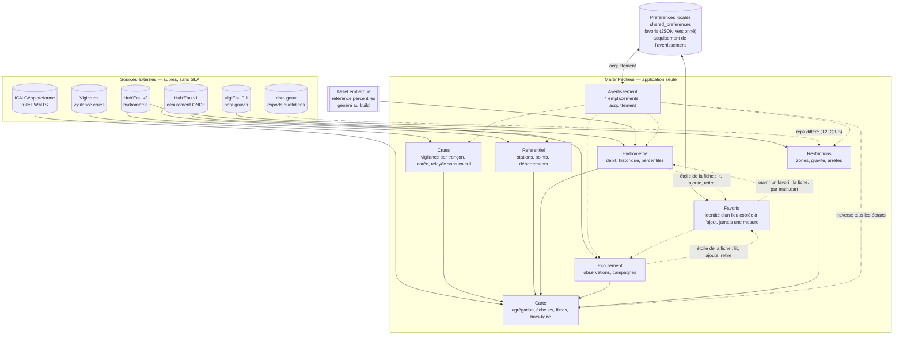
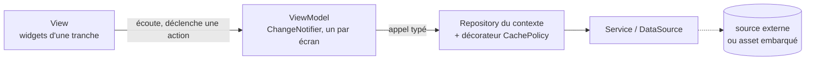

# Carte des contextes

~~Six contextes bornés~~ ~~Sept contextes bornés~~ **Huit contextes bornés** (le huitième, `Crues`, est ajouté le 2026-10-14 : il est codé par T4, `lib/domain/floods/` ; le septième, `Favoris`, est ajouté le 2026-10-14 : il est codé par T3, `lib/domain/favorites/`), aucun backend. Toutes les sources sont des **APIs publiques
externes**, sans authentification et **sans SLA** — le contrat est subi, jamais négocié. Le septième contexte n'a **aucune source externe** : il vit dans le stockage local de l'appareil.

## Relations entre contextes

| Amont → Aval | Nature | Contrat |
|---|---|---|
| `Referentiel` → `Carte` | Fournisseur | Position et identité des points. Quasi-statique |
| `Hydrometrie` → `Carte` | Fournisseur | Échelle 2 (niveau de débit) |
| `Ecoulement` → `Carte` | Fournisseur | Échelle 1 (écoulement) |
| `Restrictions` → `Carte` | Fournisseur | Échelle 3 (sévérité sécheresse) — 🔄 **non livrée sur la carte en T2** (Q6-A) : T2 livre un écran distinct, atteint par la désignation d'un point, et la carte ne connaît pas la tranche `restrictions` (un rappel injecté par `main.dart`) |
| `Crues` → `Carte` | Fournisseur | Échelle 4 (vigilance crues) — un calque de traits et des étiquettes ; `FloodLayerViewModel` dans la tranche carte (`ADR-014` amendé) |
| `Avertissement` → tous | **Transverse, non négociable** | ~~Aucun écran ne s'affranchit de `BR-012` / `BR-013`~~ **Aucun écran qui montre une mesure ou un état ne s'affranchit de `BR-012` / `BR-013`** (nuancé le 2026-10-14, arbitrage du commanditaire sur question fermée « Nuancer la phrase »). L'écran « Favoris » n'a pas de contrôle « ⚠ Avertissement » : il ne montre que l'identité des lieux, aucune mesure ni aucun état ; les fiches qu'il ouvre portent le contrôle. L'encart de crue de `BR-015` compte parmi les emplacements : en tête de la fiche tronçon, et le texte de la fenêtre « ⚠ Avertissement » sur la lecture Crues. |
| Asset percentiles → `Hydrometrie` | Fournisseur, lecture seule | Généré hors application (`ADR-003`) |
| `Hydrometrie`, `Ecoulement` ↔ `Favoris` | **Partenaires**, dans les deux sens | La fiche d'une station et celle d'un point ONDE lisent, ajoutent et retirent un favori (l'étoile) ; l'écran « Favoris » en lit, retire et vide la liste (« Repartir d'une liste vide » appelle `FavoriteRepository.clear`), et `main.dart` rouvre la fiche du lieu. Ce qui passe : un `StationCode` et un libellé, ou un `OndePoint` entier — **jamais une mesure** (`BR-001`). Le favori ne relit pas le référentiel : le libellé est copié à l'ajout |
| `Favoris` → `Carte` | **Aucune relation de données** | Le bouton « Favoris » de la carte est un rappel que `main.dart` injecte ; la carte ne connaît pas la tranche `favorites`, et ouvrir un favori ne la déplace pas (arbitrage 6 du 2026-10-12) |
| Préférences locales ↔ `Favoris` | Stockage local, lecture et écriture | `shared_preferences`, une clé `favorites`, une chaîne JSON versionnée, derrière `FavoriteRepository` ; une valeur illisible lève un échec typé, jamais une liste vide ([`ADR-011`](adr/ADR-011-stockage-local.md), amendé le 2026-10-12) |
| Préférences locales ↔ `Avertissement` | Stockage local, lecture et écriture | `shared_preferences`, la clé `acknowledged_warning_version` : la version du texte que l'usager a acquittée au premier lancement (`BR-012`), derrière `AcknowledgementRepository` (`SharedPreferencesAcknowledgementRepository`, câblé dans `main.dart`) — antérieur à T3 (`ADR-011`, 2026-09-18) |

**Les quatre échelles ne fusionnent jamais** (`BR-008`) : un fait observé, une statistique
une décision préfectorale et une vigilance publiée par l'État sont quatre natures distinctes.

## Comment un écran atteint un contexte

Un contexte borné est atteint **par un dépôt, jamais autrement**. Le chemin est le même pour
~~les six~~ ~~les sept~~ les huit, et il est direct — **View → ViewModel → Repository → Service**
([`ADR-014`](adr/ADR-014-feature-first-mvvm.md), *feature-first* + MVVM) :

Trois conséquences sur la carte des contextes :

- **Un widget n'atteint aucun contexte directement.** Il passe par le ViewModel de son écran.
- **Un écran qui croise deux contextes croise deux dépôts**, dans son ViewModel — c'est là, et
  nulle part ailleurs, que l'agrégation du contexte `Carte` s'écrit.
- **Le contexte `Avertissement` reste transverse** : il ne dépend d'aucune donnée, donc d'aucun
  dépôt. Il traverse les vues (`BR-012`, `BR-013`).

## Couches anticorruption

| Source | Protection | Motif |
|---|---|---|
| VigiEau | **`RestrictionSource`**, ~~deux implémentations~~ **une implémentation en T2** (`VigieauRestrictionSource`, sous `lib/data/restrictions/`) ; le repli sur l'export data.gouv est **différé** (Q3-B, 2026-09-27) | API en version `0.1` sur `beta.gouv.fr`, rupture possible sans préavis (`ADR-004`). Le contrat est déclaré **dans le domaine** (`lib/domain/restrictions/`) : un ViewModel ne peut pas importer `data/` |
| Vigicrues | `FloodVigilanceSource`, une implémentation (`VigicruesFloodVigilanceSource`, `lib/data/floods/`) ; vocabulaire de l'API confiné | formats susceptibles d'évoluer sans préavis (`VC-09`) ; `ADR-016` |
| Hub'Eau | Mappers dédiés par endpoint | Unités trompeuses, nomenclatures incomplètes, doublons site/station (`BR-002`, `BR-011`) |
| Toutes | `BR-011` — branche par défaut obligatoire | Sources publiques sans engagement de stabilité |

## Ce qui n'existe pas, et pourquoi

| Absent | Motif |
|---|---|
| Backend, base serveur | Hors périmètre v1. Contourné par un asset généré au build (`ADR-003`) |
| Compte utilisateur | Hors périmètre v1. Les favoris sont locaux — ✅ depuis T3 (contexte `Favoris`) : un stockage sur l'appareil, **ni compte, ni synchronisation, ni export, ni partage** (non prévus, cadrage de T3, § 3) |
| Catalogue d'événements | Aucun événement de domaine, aucun event sourcing, aucune projection, **aucun registre de messages** ([`ADR-014`](adr/ADR-014-feature-first-mvvm.md)). Un écran demande une donnée par un **appel typé** de son ViewModel à un dépôt ; rien ne publie, rien ne s'abonne — sauf la vue, qui écoute son propre ViewModel |
| Contexte `Qualite` | Écarté (`ADR-007`) |
