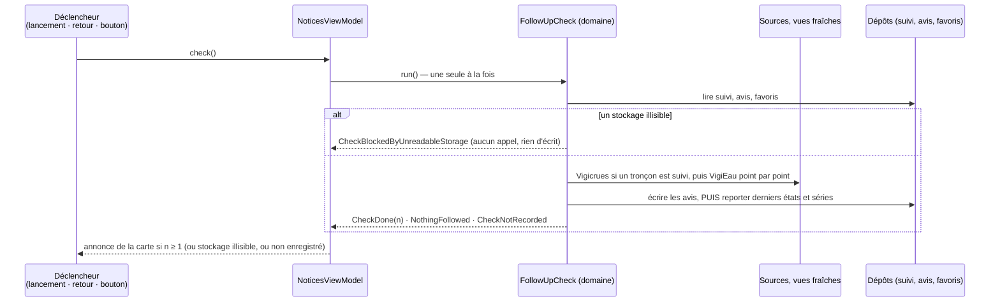

# T5 — Être prévenu : avis sur les lieux suivis, sans serveur ni compte — plan d'implémentation

> **For agentic workers:** REQUIRED SUB-SKILL: Use superpowers:subagent-driven-development (recommended) or superpowers:executing-plans to implement this plan task-by-task. Steps use checkbox (`- [ ]`) syntax for tracking.

**Goal:** l'usager **suit** un lieu de ses favoris : un tronçon Vigicrues, à partir d'un seuil qu'il choisit parmi les niveaux publiés ; une station ou un point ONDE, pour les restrictions sécheresse. Quand l'application est **ouverte** (lancement, retour au premier plan, « Vérifier maintenant »), elle relit les sources. Elle produit un **avis daté et attribué** à chaque changement publié, et aussi quand la vérification n'a pas pu se faire. Les avis se lisent dans l'écran « Avis reçus » et sont annoncés sur la carte (`US-22`). Les notifications en tâche de fond sont **essayées** dans un projet jetable, sur Windows et sur Android, et **jamais livrées**. Version `1.1.0`, porte franchie sur **Windows et Android**.

**Architecture:** feature-first + MVVM (`ADR-014`), amendée par `ADR-017`. Un **cas d'usage du domaine**, `FollowUpCheck`, écrit en Dart pur sous `lib/domain/follow_up/`, réunit six ports : favoris, suivi, avis, Vigicrues, VigiEau et référentiel. Son seul appelant est `NoticesViewModel`, qui porte les trois déclencheurs et l'annonce de la carte. Le stockage passe par `shared_preferences` : deux clés JSON versionnées, sous `lib/data/follow_up/`. Une **lecture fraîche** s'ajoute à `CachePolicy`, qui reste le seul composant de cache. La tranche `lib/features/notices/{view,view_model}/` est nouvelle. L'annonce est un widget que `main.dart` injecte en tête des avis du bloc de lecture : aucun emplacement nouveau dans la mise en page. **Aucune bibliothèque n'entre dans l'application.**

**Tech Stack:** Flutter 3.47.7 / Dart 3.13.5 · `shared_preferences` 2.5.6, par l'API historique déjà employée · `AppLifecycleListener` du SDK : constructeur à `packages/flutter/lib/src/widgets/app_lifecycle_listener.dart:66-77`. L'état initial est lu à la construction (l. 77), puis `onResume` part à **toute** transition vers `resumed` (l. 222-230), y compris quand la fenêtre Windows s'affiche à sa première trame (`windows/runner/flutter_window.cpp:30`). Il est donc **ignoré tant que la vérification de lancement n'a pas été demandée** (`C1`). En test, les transitions se simulent par le canal `flutter/lifecycle` (`app_lifecycle_listener_test.dart:15-22` du SDK), et l'état du binding se remet à `resumed` en fin de test · pour les essais seulement : `flutter_local_notifications` 22.3.2 et `workmanager` 0.10.10, sous `spike/t5_tache_de_fond/` · cibles **Windows** et **Android** (émulateur `Pixel_7`) ; iOS est configuré mais jamais compilé.

**Spec:** [`docs/superpowers/specs/2026-10-17-cadrage-t5-design.md`](../specs/2026-10-17-cadrage-t5-design.md), **approuvé par le commanditaire le 2026-10-17** avec ses dix-sept arbitrages (§ 2), ses textes d'écran (§ 11.2) et ses décisions réversibles (§ 11.3). Ce plan l'applique **sur les écrans refaits par la tranche d'ergonomie**, comme le demandait le § 7 (« à relire sur les écrans refaits »). Les écarts au cadrage sont au tableau « Décisions de ce plan » (`PD`). Les questions ouvertes sont au tableau « Questions au commanditaire » (`Q`). L'exécutant d'une tâche lit le cadrage **et** sa tâche. Les faits de code ont été relevés le 2026-10-21 sur `3be3e6a`. Le plan a été relu le même jour par un second agent, contre la spec et contre le code. Ses trois constats bloquants et ses dix-huit autres sont intégrés, dont `PD18` à `PD20` et `Q1`, élargie.

⚠️ **Identifiants de tâche propres à ce plan.** `O1`, `M1`, `P1`… existent aussi dans les plans de T1 à T4 et d'Ergonomie. Hors de ce document (`project-state.md`, messages de commit), on écrit **`T5-O1`** ; dans le titre d'un commit, « (O1 de T5) ». Les essais du cadrage gardent leurs noms, `E-A` et `E-W`.

## Contraintes globales

Chaque tâche les porte, même quand elle ne les répète pas.

- **Aucune bibliothèque dans l'application.** Le `pubspec.yaml` de la racine ne change que de version (`O1`). `msix_config` ne change pas : `capabilities: internetClient` est exact (`msix_config_test.dart:58-70`). Les essais ont leur propre `pubspec.yaml`, sous `spike/t5_tache_de_fond/` : jamais importé par `lib/` ni par `test/`, exclu de l'analyse de la racine (`Z1`).
- **Les sept règles de couches** (`layers_test.dart`) et l'isolement du domaine restent verts ; aucune liste n'y change. `lib/domain/follow_up/` n'importe que `lib/domain/`. `lib/features/notices/` n'importe que ses propres fichiers et `lib/features/shared/`. La carte n'importe pas `notices/` : l'annonce lui est **injectée** comme un `Widget`, comme les fiches. `main.dart` compose.
- **L'application relaie, elle ne calcule rien** (`BR-015`, `BR-016`). Le seuil est un niveau **publié**, choisi par l'usager, et comparé à un autre niveau publié. Aucun avis ne naît d'un débit, d'une hauteur ou d'un écoulement. Aucun texte ne dit « fin de vigilance », « danger écarté » ni « restrictions levées ».
- **Un silence n'est jamais une absence** (`BR-007`, `BR-016`). Une vérification impossible, un lieu non vérifiable, un stockage illisible ou une écriture en échec se disent toujours.
- **Charge** (arbitrage 2, `NFR-07` amendé). Sans lieu suivi, **aucun appel**. Vigicrues n'est lu **que si** un tronçon est suivi. VigiEau reçoit un appel par station ou point ONDE suivi, **l'un après l'autre**. Les caches bornent tout. Un test écrit ses instants à partir de `floodVigilanceCacheTtl` et `restrictionsCacheTtl`, jamais « 30 min » ni « 6 h » en dur.
- **Le nom « VigiEau » est confiné.** `test/data/restrictions/restriction_source_test.dart:169-251` lit les fichiers en entier, commentaires compris, sans tenir compte de la casse. Le nom n'y est admis que sous `lib/data/restrictions/`, dans `lib/domain/sources/source_names.dart` et dans `lib/main.dart`. Les textes de T5 interpolent donc `restrictionsSourceName`, et aucun commentaire de `lib/domain/follow_up/`, `lib/data/follow_up/` ou `lib/features/` ne l'écrit. Le vocabulaire de l'API VigiEau, `alerte_renforcee` **compris**, et celui de Vigicrues (`flood_vocabulary_confinement_test.dart:140-144`) n'y paraissent pas non plus.
- **Textes d'écran.** Ils sont recopiés mot pour mot du cadrage, § 11.2, et du tableau `PD12` pour les phrases que le cadrage abrège par « … ». Vouvoiement, aucun verbe d'instruction. Les listes balayées dans `lib/domain` et `lib/features` (`vocabulary_lists.dart`) s'appliquent : les mots de `BR-003` et les mots de garantie (`fiable`, `vérifié(e)(s)`, `officiel…`, « en direct », « temps réel », `garantie`). « Vérification » et « vérifier » restent libres. Un texte qui manque se demande au commanditaire, il ne s'invente pas.
- **Nomenclatures closes.** `sealed class` + `switch` exhaustif sans `default` (`BR-011`). `Favorite`, `FollowUp`, `FollowedPlace` et `ReceivedNotice` grandissent **par branche**. Une comparaison `==` / `!=` sur `MapScaleKind` ne s'ajoute pas.
- **Dates.** Elles sont stockées en UTC. On affiche par `formatLocalDateTime` (« JJ/MM/AAAA à HH:MM », `lib/domain/formatting/display_date.dart:51`) les instants : information de vigilance, réception, dernière vérification. La date d'un arrêté s'affiche par `formatCalendarDate`, comme l'écran des restrictions (`restrictions_screen.dart:651`). L'horloge s'injecte par `DateTime Function()? now`, la convention du dépôt ; aucun test ne lit `DateTime.now()`.
- **Fixtures.** Ni les niveaux 2 à 4 ni un changement d'arrêté n'ont été vus (`VC-04`). On les éprouve par des **cas construits dans le fichier de test**, nommés tels (« cas construit, jamais observé en production — `VC-04` »), jamais sous `test/fixtures/`.
- **Écrans refaits.** Les sections ajoutées aux fiches se posent dans la partie du corps enveloppée de `NoMinIntrinsicHeight`, après la mesure mise en avant (`sheet_frame.dart:186`). La hauteur mise en avant ne change donc pas. L'**étoile** de la fiche tronçon change en revanche son **en-tête**. La matrice de 576 configurations de la tranche d'ergonomie se relance (`W2`). Un cas qui sort des acceptations arbitrées (arbitrages 13, 18 et 19 d'Ergonomie) est un rouge : **arrêt et question**.
- **Les avertissements.** L'avertissement de suivi (`BR-016`) s'ajoute aux autres. C'est un encart non repliable, annoncé en priorité, en tête d'« Avis reçus », repris sous chaque réglage « Me prévenir ». La fenêtre « ⚠ Avertissement » d'« Avis reçus » porte le texte de suivi. Le contrôle « ⚠ Avertissement » reste présent sur la carte et sur chaque fiche, dans tous leurs états. `warningTextVersion` ne bouge pas, et le modal du premier lancement ne change pas.
- **Tout test de widget nomme sa plateforme** : `testWidgetsOnWindows` ou `testWidgetsOnAndroid`, jamais `testWidgets(` nu. Une fenêtre de moins de 600 px de large se teste sous Android, avec un titre « Android : … ». Chaque écran ou section nouvelle a **un cas Android à 360 × 640 et à 200 %** : rien n'y est coupé, et les cibles mesurent au moins 48.
- **Code et spec dans le même commit** : le `.feature`, `glossary.md`, `domain-model.md`, `tracabilite.md` et `04-ui.md` qu'une tâche touche s'écrivent avec elle, de même que le verrou de `test/project/` qui bouge.
- **Version** `1.1.0+9` (`PD1`), ouverte par `O1`, datée par `P3`.
- **Git** : un commit par tâche, par liste de chemins explicite (`git add -- <chemins>` puis `git commit -- <chemins>`). Messages en Conventional Commits, en français, **sans ligne d'attribution**. Rien n'est poussé, fusionné ni tagué sans demande. `windows/flutter/generated_plugin_registrant.h` et `android/.kotlin/` ne se committent jamais.

## Review Focus

Cinq conditions que le cadrage implique sans qu'un critère les éprouve, les plus probables d'abord. Chacune a son cas de test dans la tâche nommée ; le relecteur de cette tâche vérifie qu'il y est.

| # | Condition | Ce qu'une personne raisonnable attend | Tâche |
|---|---|---|---|
| 1 | L'usager change « Me prévenir » (seuil, interrupteur) ou retire l'étoile **pendant qu'une vérification court** | son réglage est gardé tel qu'il l'a laissé. La vérification n'écrase rien et ne ressuscite aucun suivi éteint. Au plus, les avis de la vérification en cours sont gardés | `D2` (contrat de `recordCheck`), `M4` (source retenue, réglage changé en cours) |
| 2 | Lancement, retour au premier plan et « Vérifier maintenant » arrivent **dans la même seconde** | une seule vérification, un seul jeu d'avis, aucun « Suivi commencé » en double | `M4` (une à la fois), `V4`, `C1` |
| 3 | L'**écriture des avis échoue** (stockage plein, préférences inaccessibles) | aucun dernier état n'est enregistré, donc la vérification suivante redonne les mêmes avis, et rien n'est perdu. L'échec est dit (`Q2`) | `M4`, `V4` |
| 4 | L'usager ouvre un favori tronçon pendant la lecture de la vigilance, puis **touche une station** ou change de lecture avant la fin | la fiche du tronçon ne surgit pas après coup. La carte ne bouge pas | `C2` |
| 5 | La lecture fraîche de Vigicrues **échoue à la 31e minute**, avec une carte périmée en cache | la carte garde l'ancienne vigilance avec **sa** date. La vérification dit « Vérification impossible » et ne compare jamais à la carte périmée | `D1`, `M4` |

---

## Cible et périmètre

| Cible | État dans ce plan |
|---|---|
| **Windows** | construite en release, exécutable lancé hors Flutter (`P1`) ; essai `E-W` du projet jetable (`Z3`) |
| **Android** | émulateur `Pixel_7`, en débogage (`P2`) ; essai `E-A` du projet jetable (`Z2`). La publication (`A⏸3`, `A⏸5`) et l'appareil réel (`A⏸4`) restent ⏸ |
| **iOS** | configuré, jamais compilé |

**Ce que T5 fait :** le § 3 du cadrage, « Dedans », `D1` à `D12`.

**Ce que T5 ne fait pas :** le § 3 du cadrage, « Dehors ». En particulier : aucune notification système, aucune tâche de fond ni aucun lancement planifié **dans l'application** ; aucun rattachement d'une station à un tronçon ; aucun avis qu'on touche pour rouvrir une fiche ; aucun rappel ; aucun export ; aucun changement du modal du premier lancement. L'empaquetage MSIX de `1.1.0` et sa soumission au Store sont hors de la porte et relèvent du commanditaire (`ADR-018`).

---

## Qui lance quoi

| Commande | Lancée par |
|---|---|
| `flutter analyze`, `flutter test`, `dart format`, `flutter pub get` ; dans `spike/t5_tache_de_fond/`, `flutter create`, `flutter pub get` et `flutter analyze` | **Claude**, dans le bac à sable (`flutter` est sur le PATH de Git Bash) |
| `flutter build windows --release`, le lancement de l'exécutable, `flutter emulators --launch Pixel_7`, `flutter run -d emulator-5554`, la construction et le lancement du projet d'essai, `schtasks`, `adb`, `reg query`, tout constat à l'écran | **le commanditaire** |

Toute commande du commanditaire se donne **seule dans son bloc `bash`**, avec le **résultat attendu énoncé**. Ce qu'il rapporte est ensuite **constaté et recopié**, jamais supposé. Aucun chemin propre au poste n'entre dans le dépôt : les commandes partent de la racine du dépôt.

## Critère de fin, identique pour chaque tâche — dit ici une seule fois

```bash
flutter analyze
flutter test
dart format --output=none --set-exit-if-changed lib test
```

Attendu : `No issues found!`, tous les tests verts, code de sortie **0**. Recopier le **nombre total de tests**, qui ne fait que croître. Repère de départ : **7 120**, `dev` à `3be3e6a`, constaté le 2026-10-21. **Un commit par tâche**, par **liste de chemins explicite**. Un fichier régénéré hors de la liste se signale ; il ne se committe pas.

⚠️ **Brief de tout sous-agent, en tête :**
- Interdit : `git stash`, `git checkout`, `git switch`, `git restore`, `git reset`, `git clean`, `git add`, `git commit`, `git push`, et `python`/`python3` (bloque sur ce poste).
- Le sous-agent rend la **sortie rouge brute** de son étape de test rouge avant d'implémenter.

Au retour, la boucle principale relit `git status` et relance elle-même le critère de fin. Elle fait relire par **un** second agent ; une re-relecture n'a lieu qu'après une correction de **code**, et les remarques mineures vont au journal. Puis elle committe. Avant chaque commit : `git branch --show-current` (attendu : `feat/t5-suivi`), puis `git status`.

**Journal d'exécution :** `.superpowers/sdd/2026-10-21-t5-suivi-des-lieux/progress.md`, ignoré par git. Une ligne `Task <ID>: en cours` au lancement de la tâche, `Task <ID>: complete (<hachage>)` une fois le hachage du commit lu.

**Trois échecs sur le même point : arrêt et question.** Pas de quatrième tentative.

---

## Note de conception — une vérification, d'un bout à l'autre

Le plan fixe ce déroulé parce qu'aucune tâche ne pourrait le choisir seule sans défaire les autres :



1. **Un seul déclencheur, un seul exécutant.** `main.dart` appelle `NoticesViewModel.check()` dans trois cas : une fois au premier affichage de la carte, après l'acquittement ; à chaque `onResume` d'un `AppLifecycleListener` reçu **après** cette première demande ; sur « Vérifier maintenant ». `check()` rend la vérification en cours s'il y en a une. `FollowUpCheck.run()` fait de même de son côté (`PD6`).
2. **Ordre des écritures.** Les avis s'écrivent **d'abord**. Si cette écriture échoue, rien d'autre ne s'écrit : les derniers états ne bougent pas et la vérification suivante redonnera les mêmes avis. Viennent ensuite les derniers états, par `recordCheck`. Celui-ci **reporte sur l'état stocké au moment de l'écriture**, si bien qu'un réglage changé pendant la vérification est gardé (`PD13`).
3. **Lecture fraîche.** `FollowUpCheck` reçoit les **vues fraîches** des sources en cache (`D1`) ; les écrans gardent les vues ordinaires. Les deux vues partagent la même entrée de cache : jamais deux téléchargements à la fois.
4. **Annonce.** C'est un widget de la tranche `notices`, que `main.dart` injecte dans `MapView` (`announcement`). `buildMapOverlays` la pose **en tête de la pièce des avis** du bloc de lecture. Elle ne passe pas par `mapNoticesFor` (R10) et n'ajoute aucun emplacement à `MapLayoutSlot` (`PD7`, cadrage d'ergonomie l. 389). Fermée, elle ne compte pour rien.
5. **Favori tronçon** (`C2`). L'ouvrir passe la carte sur Crues. La vue active la lecture Crues à **chaque** passage sur Crues, quelle que soit son origine (`PD8`). `main.dart` garde l'ouverture **en attente** jusqu'à ce que la vigilance soit lue. L'attente tombe dès que l'usager fait autre chose (`PD9`).

---

## Structure de fichiers

### Domaine — `lib/domain/` (Dart pur)

| Fichier | Responsabilité | Tâche |
|---|---|---|
| `favorites/favorite.dart` (modifié) | `FloodSectionFavorite`, `floodSectionFavoriteIn`, `sameFavoritePlace` étendu | `M1` |
| `follow_up/followed_place.dart` | `FollowedPlace` (`FloodSectionPlace`, `DroughtPlace` : `StationPlace`, `OndePointPlace`), `followedPlaceOf` | `M2` |
| `follow_up/flood_threshold.dart` | `FloodThreshold`, rappels du réglage | `M2` |
| `follow_up/follow_up.dart` | `FollowUp` et ses trois branches, `FailureSeries`, `LastKnownFloodLevel`, `KnownZone`, `LastKnownZones`, égalités de niveau, de gravité et de type de zone, appariement suivi ↔ favori | `M2` |
| `follow_up/follow_up_repository.dart` | port `FollowUpRepository`, `FollowUpBook`, `CheckRecord`, `FollowUpStorageFailure` | `M2` |
| `follow_up/received_notice.dart` | `ReceivedNotice` (`UnreadableNotice`, `ReadableNotice` et ses six branches), `FollowUpSource`, `CheckFailureCause`, `NotVerifiableReason` | `M3` |
| `follow_up/notice_repository.dart` | port `NoticeRepository`, `maxStoredNotices`, `NoticeStorageFailure` | `M3` |
| `follow_up/follow_up_rules.dart` | rangs, avis de crue dû, changements de sécheresse | `M3` |
| `follow_up/follow_up_check.dart` | `FollowUpCheck`, `CheckOutcome` | `M4` |
| `warnings/warning_texts.dart` (modifié) | textes de l'avertissement de suivi | `W1` |

### Données — `lib/data/`

| Fichier | Responsabilité | Tâche |
|---|---|---|
| `cache/cache_policy.dart` (modifié) | `CachedReads<T>`, `withCachePolicyReads` (lecture ordinaire **et** fraîche) ; `withCachePolicy` inchangé pour ses appelants | `D1` |
| `floods/cached_flood_vigilance_source.dart`, `restrictions/cached_restriction_source.dart` (modifiés) | getter `fresh`, une vue qui implémente le même port | `D1` |
| `preferences/favorites_codec.dart` (modifié) | type `troncon` | `M1` |
| `follow_up/follow_up_codec.dart`, `follow_up/shared_preferences_follow_up_repository.dart` | clé `follow_ups` | `D2` |
| `follow_up/notices_codec.dart`, `follow_up/shared_preferences_notice_repository.dart` | clé `notices` | `D3` |

### Tranches

| Fichier | Responsabilité | Tâche |
|---|---|---|
| `features/notices/view_model/notice_texts.dart` | titre, corps et ligne « Reçu le » de chaque avis (Dart pur) | `N1` |
| `features/notices/view_model/notices_view_model.dart` | `NoticesViewModel`, `NoticesState`, `MapAnnouncement` | `V4` |
| `features/notices/view/notices_screen.dart`, `notice_tile.dart` | écran « Avis reçus » | `W5` |
| `features/notices/view/notices_announcement.dart` | l'annonce de la carte | `W6` |
| `features/flood_sheet/view_model/flood_sheet_view_model.dart` (modifié) | étoile, seuil, état `FicheTronconAbsente`, `FloodFollowUpChoice` | `V1` |
| `features/flood_sheet/view/flood_sheet_panel.dart` (modifié), `flood_follow_up_section.dart` (créé) | étoile, section « Me prévenir », fiche d'un tronçon absent | `W2` |
| `features/station_sheet/…`, `features/onde_sheet/…` (modifiés) | interrupteur sécheresse : ViewModel `V2`, vue `W3` | `V2`, `W3` |
| `features/favorites/…` (modifiés) | ligne tronçon (`M1`), rappel et accès (`V3`, `W4`), ouverture du tronçon (`C2`) | `M1`, `V3`, `W4`, `C2` |
| `features/shared/follow_up_toggle.dart` | `FollowUpToggle` (Dart pur, sans import), `followUpWriteFailedText` | `V2` |
| `features/shared/follow_up_warning_card.dart` | `FollowUpWarningCard` | `W1` |
| `features/shared/drought_follow_up_section.dart` | `DroughtFollowUpSection` | `W1` |
| `features/shared/screen_layout.dart` (modifié) | `ScreenTitleBar(trailing:)` | `W5` |
| `features/map/view/map_view.dart` (modifié), `map_traversal_order.dart` (modifié) | `announcement` (`W6`) ; lecture Crues activée à tout passage sur Crues (`C2`) | `W6`, `C2` |
| `lib/main.dart` (modifié) | arguments des constructeurs (`M1`, `V1`, `V2`, `V3`, `W2`, `W3`) ; composition de T5 (`C1`) ; ouverture du favori tronçon (`C2`) | — |

### Aides de test — `test/support/`

| Fichier | Responsabilité | Tâche |
|---|---|---|
| `follow_up_repository_contract.dart` | `followUpRepositoryContract(...)`, le contrat éprouvé sur le double **et** sur le dépôt réel | `M2` |
| `in_memory_follow_up_repository.dart` | `InMemoryFollowUpRepository` | `M2` |
| `notice_repository_contract.dart`, `in_memory_notice_repository.dart` | idem pour les avis | `M3` |
| `app_lifecycle.dart` | `envoyerEtatDeCycleDeVie(AppLifecycleState)`, par le canal `flutter/lifecycle` | `C1` |

### Essais — `spike/t5_tache_de_fond/`

Un projet Flutter jetable, versionné sans `build/` ni caches (`Z1`), avec un `COMPTE-RENDU.md` (`Z2`, `Z3`). `RELEVE-BIBLIOTHEQUES.md` y est déjà.

### Partages entre tâches — à exécuter en série

| Tâches | Fichier partagé |
|---|---|
| `O2`, `O4`, `X1` | `test/project/tracabilite_test.dart`, `docs/tracabilite.md`, `docs/README.md` |
| `O4`, `M1`, `N1`, `W1`, `W2`, `W3`, `W4`, `W5`, `W6`, `X1` | `docs/acceptance/suivi.feature`, `test/project/acceptance_features_test.dart` |
| `M1`, `M2`, `M3`, `M4` | `docs/domain-model.md`, `test/project/domain_model_doc_test.dart` |
| `M1`, `V1`, `V2`, `V3`, `W2`, `W3`, `W4`, `C1`, `C2`, `K1` | `lib/main.dart`, `test/main_test.dart` |
| `W2`, `W3` | `test/support/ergonomie_fiches.dart`, `ergonomie_mesures.dart`, matrice d'ergonomie |
| `W6`, `C2` | `lib/features/map/view/map_view.dart` |
| `O1`, `P3` | `CHANGELOG.md`, `test/project/changelog_test.dart` |

---

## Lot 0 — Préalable, sur demande du commanditaire

### Task A0 : Branche `feat/t5-suivi`, plan committé

**Agent :** aucun. La boucle principale s'en charge, **après accord explicite du commanditaire** pour chaque opération git.
**État constaté le 2026-10-21 :** `dev` local à `3be3e6a`, à égalité avec `origin/dev`. Non committés : ce plan, `docs/README.md`, `docs/project-state.md` et `CLAUDE.md` (lignes T5), plus l'artefact de poste `windows/flutter/generated_plugin_registrant.h`, qui ne se committe jamais.

- [ ] **Étape 1** — `git branch --show-current` dans une commande seule (attendu : `dev`), puis `git fetch` et `git status --short`. Si `origin/dev` a avancé : `git merge --ff-only origin/dev`. **Jamais** de commit de fusion sur `dev`.
- [ ] **Étape 2** — sur accord : `git switch -c feat/t5-suivi`, puis le commit des documents par chemins explicites (ce plan, `docs/README.md`, `docs/project-state.md`, `CLAUDE.md`), message `docs: plan de T5, approuvé (A0 de T5)`.
- [ ] **Étape 3** — critère de fin ; recopier le décompte (attendu : 7 120).

---

## Lot 1 — Documents, avant le code

> Les textes approuvés (cadrage § 11.1 et § 11.2) sont recopiés **mot pour mot**. Aucune ligne de `lib/` ne change dans ce lot ; `pubspec.yaml` ne change que de version.

### Task O1 : Ouvrir la version `1.1.0` ; T5 en cours

**Agent :** mécanique (sonnet, effort léger).
**Files:** modifiés `pubspec.yaml` (`version: 1.1.0+9`), `CHANGELOG.md`, `test/project/changelog_test.dart`, `docs/project-state.md`, `CLAUDE.md` (ligne T5 seulement).

- [ ] **Étape 1** — tests d'abord, dans `changelog_test.dart` :
  - un groupe `'version 1.1.0 (T5)'` qui porte deux tests : « `pubspec.yaml porte version: 1.1.0+9` » (`^version:\s*1\.1\.0\+9\s*$`) ; « une section `## [1.1.0]`, une seule, sous `[Non publié]` et au-dessus de `[1.0.1]`, ouverte : son chapeau dit « Version ouverte » » ;
  - dans le groupe `1.0.1`, le test « `pubspec.yaml porte version: 1.0.1+8` » est **retiré** et remplacé par un commentaire, selon le précédent des l. 966-968 (« Le verrou … est retiré : le pubspec est passé à 1.1.0+9 ; le groupe 1.1.0 porte le verrou de version courant ») ;
  - `flutter test test/project/changelog_test.dart` → rouge, **sortie recopiée**.
- [ ] **Étape 2** — `pubspec.yaml` : `version: 1.1.0+9`. `CHANGELOG.md` : `## [1.1.0]` ouverte sous `## [Non publié]`, chapeau « Sixième tranche (T5) : être prévenu, quand l'application est ouverte, d'un changement publié sur un lieu suivi. Version ouverte, non publiée. », sans « Ajouté » (`X1` l'écrit en une fois). `msix_config_test.dart` reste vert : le premier nombre est 1.
- [ ] **Étape 3** — `docs/project-state.md` : en-tête « Mis à jour » ; ligne T5 « 🔄 **en cours** — plan `docs/superpowers/plans/2026-10-21-t5-suivi-des-lieux.md`, version `1.1.0` ouverte » ; « Prochaine étape » nomme `T5-O2`. `CLAUDE.md` : ligne T5 « 🔄 en cours — `1.1.0` ». Ce que git sait ne se recopie pas.
- [ ] **Étape 4** — critère de fin, commit `docs: version 1.1.0 ouverte, T5 en cours (O1 de T5)`.

### Task O2 : Règles — `BR-016` écrite ; `BR-001`, `BR-007`, `BR-011` amendées ; glossaire, carte des contextes

**Agent :** mécanique (sonnet, effort moyen), recopie de textes approuvés.
**Files:** créé `docs/br/BR-016-un-avis-relaie-un-changement-publie.md` · modifiés `docs/br/BR-001-date-de-mesure-obligatoire.md`, `docs/br/BR-007-absence-de-donnee-jamais-neutre.md`, `docs/br/BR-011-nomenclature-tolerante-a-l-inconnu.md`, `test/project/tracabilite_test.dart`, `docs/tracabilite.md`, `docs/README.md` (index des règles), `docs/02-specifications.md` (§ 2), `docs/glossary.md`, `docs/context-map.md`, `CLAUDE.md` (invariant « Les quatre avertissements »)

- [ ] **Étape 1** — `_brAttendues` (`tracabilite_test.dart:38-54`) gagne `'BR-016'`, et le titre du groupe passe à « BR-001 à BR-016 ». Lancer → **rouge**, sortie recopiée. Dans `docs/tracabilite.md`, une ligne `BR-016` marquée 🔄 T5, **sans chemin de test futur** (l. 662-690 : un chemin cité doit exister) ; le titre de section devient « BR-001 → BR-016 ».
- [ ] **Étape 2** — `BR-016` sur le gabarit, commentaires retirés : **Statut** Accepté · **Date** 2026-10-17 · **Contexte borné** Suivi · Avertissement. **Règle** et **Invariants** : le texte du cadrage § 11.1, recopié. **Justification** : la vérification relit depuis l'appareil, sans serveur ni engagement de délai ; un changement défait entre deux ouvertures n'est pas vu ; comparer deux niveaux publiés n'est pas calculer un niveau. **Vérifiable par** : `test/domain/follow_up/follow_up_rules_test.dart`, `follow_up_check_test.dart`, l'encart d'« Avis reçus ». **Liens** : `UC-010`, `ADR-017`, `BR-015`, `BR-013`, `BR-008`.
- [ ] **Étape 3** — `BR-001`, `BR-007`, `BR-011` : les ajouts du § 11.1, mot pour mot, dans « Invariants & cas limites ». L'en-tête « Statut » est complété de « · **amendé le 2026-10-17 (T5, suivi)** ». `UC-010` et `ADR-017` vont sous « Liens ».
- [ ] **Étape 4** — `docs/README.md`, index des règles : lignes `BR-015` (qui manquait, relevé du 2026-10-21) et `BR-016`. `docs/02-specifications.md` § 2 : lignes `BR-015` et `BR-016`, au format des l. 66-79.
- [ ] **Étape 5** — `docs/glossary.md`, « Termes métier » : « Lieu suivi », « Avis », « Seuil de vigilance » (un niveau publié choisi par l'usager, **jamais un seuil hydrologique**), « Vérification », « Vérification impossible ». « Contextes bornés » : lignes `Favoris` (qui manquait) et `Suivi`. `docs/context-map.md` : contexte `Suivi` dans le schéma et la liste ; « neuf contextes » ; relations `Suivi → Favoris`, `Suivi → Crues`, `Suivi → Restrictions` (client) ; la ligne `Avertissement → tous` compte l'encart de suivi. `CLAUDE.md`, invariant des avertissements : « L'avertissement de suivi (`BR-016`) s'y ajoute : encart en tête de l'écran « Avis reçus », non repliable, repris sous chaque réglage « Me prévenir » ; fenêtre « ⚠ Avertissement » de cet écran. »
- [ ] **Étape 6** — critère de fin, commit `docs: BR-016 « un avis relaie un changement publié » ; BR-001, 007, 011 amendées (O2 de T5)`.

### Task O3 : `ADR-017` ; amendements d'`ADR-014`, d'`ADR-011` et de `NFR-07`

**Agent :** mécanique (sonnet, effort moyen).
**Files:** créé `docs/adr/ADR-017-verifier-les-lieux-suivis-depuis-l-appareil.md` · modifiés `docs/adr/ADR-014-feature-first-mvvm.md`, `docs/adr/ADR-011-stockage-local.md`, `docs/nfr.md`, `docs/README.md` (index des décisions : `ADR-017` remplace la note « réservé », l. 92)

- [ ] **Étape 1** — `ADR-017` sur le gabarit, avec le contenu du cadrage § 11.1 développé :
  - **Statut** : Accepté — arbitrages 1, 2, 6, 7, 11 et 12 du commanditaire, du 2026-10-17.
  - **Contexte** : cadrage d'ensemble § 4 ; `C-12`, `C-13`, `C-15` ; le relevé des bibliothèques (`spike/t5_tache_de_fond/RELEVE-BIBLIOTHEQUES.md`).
  - **Décision** : un `flowchart` mermaid, celui du cadrage § 5.4.
  - **Conséquences** ➕ / ➖.
  - **Alternatives écartées** : les six du § 11.1.
  - **Si la décision est revue** : les deux déclencheurs.
  - Une ligne dit qu'`ADR-018` (MSIX) donne à l'application une identité que l'essai `E-W` n'utilise pas (`PD15`).
- [ ] **Étape 2** — `ADR-014` : une puce de tête et une section « Amendement du 2026-10-17 (T5) », au format de celles du 2026-10-14 (l. 10 et 181-183), avec le texte du § 11.1. `ADR-011` : une section « Amendement du 2026-10-17 — le suivi et les avis en shared_preferences (T5, arbitrage 6) », au format de celle du 2026-10-12 (l. 113). Elle nomme les deux clés, `follow_ups` et `notices`, et ajoute une ligne « Si l'amendement est revu ».
- [ ] **Étape 3** — `docs/nfr.md`, ligne `NFR-07` : la cible gagne le texte du § 11.1, inséré après la phrase sur Vigicrues. La colonne « Constaté par » gagne « tests de `withCachePolicyReads` et des vues fraîches (`D1`), de `FollowUpCheck` (`M4`) ». `nfr_doc_test.dart` reste vert : il ne fige pas ce texte.
- [ ] **Étape 4** — critère de fin, commit `docs: ADR-017 — vérifier les lieux suivis depuis l'appareil ; ADR-014, ADR-011 et NFR-07 amendés (O3 de T5)`.

### Task O4 : `US-22`, `UC-010`, `suivi.feature`

**Agent :** mécanique (sonnet, effort moyen).
**Files:** créés `docs/use-cases/UC-010-etre-prevenu-d-un-changement-sur-un-lieu-suivi.md`, `docs/acceptance/suivi.feature` · modifiés `docs/02-specifications.md`, `docs/README.md` (index des cas d'usage ; ligne `acceptance/` de « Organisation », qui nomme `crues.feature` et `suivi.feature`), `test/project/tracabilite_test.dart`, `docs/tracabilite.md`, `test/project/acceptance_features_test.dart`

- [ ] **Étape 1** — tests d'abord :
  - `tracabilite_test.dart` : `_ucAttendus` + `'UC-010'`, titres « UC-001 à UC-010 ». Dans `docs/tracabilite.md`, les lignes `UC-010` et `US-22` 🔄 T5, sans chemin de test.
  - `acceptance_features_test.dart` : `_featureFiles` + `'suivi.feature'`, et les commentaires et titres disent « neuf » ; `_suiviRules = <String>['BR-001', 'BR-003', 'BR-007', 'BR-008', 'BR-011', 'BR-014', 'BR-015', 'BR-016']`, chacune citée par au moins un scénario ; `_suiviStory = 'US-22'` ; un verrou de comptage « `US-22` compte exactement 22 scénarios », sur le modèle de `US-21` (l. 435-445). Recopier la forme des tests de `crues.feature`.
  - `flutter test test/project` → **rouge**, sortie recopiée.
- [ ] **Étape 2** — `docs/02-specifications.md` :
  - Dans « Should », après `US-21` : `| US-22 | P1, P2, P3 | Je suis **prévenu**, quand j'ouvre l'application, d'un changement du niveau publié sur un lieu que je suis — la vigilance crues d'un tronçon, à partir du seuil que j'ai choisi, la gravité sécheresse au point d'une station ou d'un point ONDE —, par un avis daté et attribué ; une vérification impossible m'est dite · 🔄 **T5** ([UC-010](use-cases/UC-010-…), [suivi.feature](acceptance/suivi.feature)). L'application relaie, elle ne calcule aucun niveau ([BR-016](br/BR-016-…)) |` (personas du cadrage, § 11.1).
  - Sous « Won't (v1) », un amendement daté du 2026-10-21 : « alertes personnalisées » est livré en **étape 1**, à l'ouverture de l'application (T5, `ADR-017`) ; les notifications en tâche de fond attendent une tranche à part, cadrée sur les essais ; « notifications push » au sens d'un envoi par serveur reste dans la liste.
- [ ] **Étape 3** — `UC-010` sur le gabarit, au modèle d'`UC-009`.
  - En-tête : **Contexte borné** Suivi · **Acteur** tous les personas · **Préconditions** : un lieu en favori, « Me prévenir » activé.
  - **Déclencheurs** : lancement après l'acquittement, retour au premier plan, « Vérifier maintenant ».
  - **Flux nominal** : cadrage § 5.4 et § 7.4, en étapes numérotées.
  - **Alternatifs** :
    - A1 — aucun lieu suivi ;
    - A2 — première lecture : « Suivi commencé » ;
    - A3 — source injoignable, refusée ou illisible ;
    - A4 — lieu non vérifiable ;
    - A5 — un stockage illisible et « Repartir… » ;
    - A6 — l'écriture des avis échoue (`Q2`) ;
    - A7 — vérification déjà en cours ;
    - A8 — lien non ouvert.
  - **Règles** : `BR-001`, `BR-007`, `BR-008`, `BR-011`, `BR-014`, `BR-015`, `BR-016`.
  - **Liens** : `ADR-017`, `ADR-011`, `UC-008`, `UC-009`.
  - Un `stateDiagram` mermaid placé **à côté de A3**, pour la série d'échecs d'un lieu : `Lu → EnSerie` au premier échec, avec un avis ; `EnSerie → EnSerie` sans avis ; `EnSerie → Lu` à la première lecture réussie, sans avis.
- [ ] **Étape 4** — `docs/acceptance/suivi.feature`. L'en-tête suit le modèle de `crues.feature` (« Critères d'acceptation en Gherkin — spécification lisible, jamais exécutée. Vérifié par test/project/acceptance_features_test.dart. Source : cadrage de T5 (2026-10-17), § 9 ; UC-010 ; … »), avec le marqueur `# ── US-22 — …`. On écrit **un scénario par critère** du cadrage § 9 : 1 à 21 et 15 bis, soit 22. Chacun cite entre parenthèses la règle qu'il éprouve. Les textes d'écran vont **entre guillemets français, mot pour mot**, et suivent `PD12` pour les « … ». Aucun mot de `_forbiddenFlowWords`, aucun verbe de `_instructionVerbs`. **Aucune ligne « Vérifié par »** dans cette tâche : `X1` les ajoute, une fois les fichiers écrits.
- [ ] **Étape 5** — `docs/README.md` : ligne `UC-010` de l'index et ligne `acceptance/`. Critère de fin, commit `docs: US-22, UC-010 « Être prévenu d'un changement sur un lieu suivi » et suivi.feature (O4 de T5)`.

---

## Lot 2 — Domaine, `lib/domain/`

> Chaque type ajouté entre dans `typesDuDomaine` (`domain_model_doc_test.dart:21-78`) et dans `docs/domain-model.md`, qui gagne la section « Contexte Suivi — ce que l'on relit, et quand (T5) », entre « Contexte Crues » et « Agrégats ». Un nom qui contient `ZoneRestriction`, `PointOnde`… est refusé (l. 114-124). Les égalités se font par valeur, avec `==` et `hashCode`.

### Task M1 : Le favori tronçon

**Agent :** mécanique (sonnet, effort moyen).
**Files:** modifiés `lib/domain/favorites/favorite.dart`, `lib/data/preferences/favorites_codec.dart`, `lib/features/favorites/view/favorites_screen.dart`, `lib/main.dart` (une branche du `switch` de `onOpen`, l. 792-820), `docs/domain-model.md`, `test/project/domain_model_doc_test.dart`, `test/domain/favorites/favorite_test.dart`, `test/data/preferences/favorites_codec_test.dart`, `test/data/preferences/shared_preferences_favorite_repository_test.dart`, `test/features/favorites/view/favorites_screen_test.dart`, `test/project/acceptance_features_test.dart`

**Interfaces :**
- `final class FloodSectionFavorite extends Favorite { FloodSectionFavorite({required this.code, required this.name, required this.addedAt}); final FloodSectionCode code; final String name; final DateTime addedAt; }`. Le constructeur lève `ArgumentError` si `addedAt` n'est pas en UTC (`_requireUtc`) ou si `name` est blanc. `name` est le nom publié **au moment de l'ajout**. L'égalité porte sur `code`, `name` et `addedAt`.
- `FloodSectionFavorite? floodSectionFavoriteIn(Iterable<Favorite> favorites, FloodSectionCode code)`, à côté de `stationFavoriteIn`.
- `sameFavoritePlace` : une branche `(FloodSectionFavorite x, FloodSectionFavorite y) => x.code == y.code`.
- Codec : `const String _typeTroncon = 'troncon';`. Une entrée s'écrit `{"type":"troncon","ajoute_le":<ISO UTC>,"code":<FloodSectionCode.value>,"nom":<name>}`. `favoritesFormatVersion` **reste 1** : un lecteur plus ancien garde l'entrée en `UnreadableFavorite` et la réécrit à l'identique. Une entrée dont le code ou le nom est blanc, ou dont la date n'a pas de fuseau, devient `UnreadableFavorite`. Le codec refuse aussi, pour un point ONDE, une latitude hors de [-90 ; 90] ou une longitude hors de [-180 ; 180] (aujourd'hui, seule la finitude est vérifiée : `favorites_codec.dart:202-210`). Un tel point serait refusé par `GeoPoint` à la vérification (`geo_point.dart:20-40`) ; il devient lui aussi un `UnreadableFavorite`.
- `favorites_screen.dart` : `const String floodSectionFavoriteKind = 'Tronçon $floodSourceName';`. La ligne d'un tronçon donne `(name, [floodSectionFavoriteKind, _addedOn(addedAt)], false, '$removeNamedFavoritePrefix$name')`. Elle **n'ouvre rien** tant que `C2` ne l'a pas ouverte.
- `main.dart` : `case FloodSectionFavorite(): break;`, le temps que `C2` y mette l'ouverture.

**Cas de test**
- `favorite_test` :
  - le constructeur refuse une date non UTC et un nom blanc ;
  - deux tronçons de même code et de noms différents sont le même lieu (`sameFavoritePlace`), mais pas égaux ;
  - un tronçon et une station de même valeur de code ne sont jamais le même lieu ;
  - `floodSectionFavoriteIn` trouve le tronçon, ou rend `null`.
- `favorites_codec_test` :
  - aller-retour d'une liste des **quatre** types, dans l'ordre ;
  - `{"type":"troncon","code":""}` est gardé en `UnreadableFavorite` et réécrit à l'identique ;
  - un point ONDE de latitude 91 est gardé en `UnreadableFavorite` ;
  - la version écrite reste `1`.
- Dépôt : `add` d'un tronçon déjà présent sous un autre nom ne change rien.
- `favorites_screen_test` (Windows ; Android à 360 × 640 et à 200 %) :
  - la ligne porte le nom, « Tronçon Vigicrues » et « Ajouté le … » ;
  - un tap ne déclenche pas `onOpen` ;
  - « Retirer des favoris : <nom> » appelle `onRemove`.
- `acceptance_features_test` : le groupe `suivi.feature` est créé et cite `floodSectionFavoriteKind`.

- [ ] **Étape 1** — tests rouges, sortie recopiée ; **Étape 2** — implémenter, puis `docs/domain-model.md` (section Favoris : le quatrième type, le sous-diagramme) et `typesDuDomaine` + `'FloodSectionFavorite'` ; **Étape 3** — critère de fin, commit `feat(domain): le favori tronçon, gardé par code et nom publié à l'ajout (M1 de T5)`.

### Task M2 : Le suivi — lieux, seuil, derniers états, port

**Agent :** mécanique (sonnet, effort moyen).
**Files:** créés `lib/domain/follow_up/followed_place.dart`, `flood_threshold.dart`, `follow_up.dart`, `follow_up_repository.dart`, `test/domain/follow_up/followed_place_test.dart`, `flood_threshold_test.dart`, `follow_up_test.dart`, `in_memory_follow_up_repository_test.dart`, `test/support/follow_up_repository_contract.dart`, `test/support/in_memory_follow_up_repository.dart` · modifiés `docs/domain-model.md`, `test/project/domain_model_doc_test.dart`

**Interfaces :**
- `followed_place.dart`
  - `sealed class FollowedPlace`, avec trois branches :
    - `final class FloodSectionPlace extends FollowedPlace { const FloodSectionPlace(this.code); final FloodSectionCode code; }` ;
    - `sealed class DroughtPlace extends FollowedPlace`, qui a deux branches : `final class StationPlace extends DroughtPlace { const StationPlace(this.code); final StationCode code; }` et `final class OndePointPlace extends DroughtPlace { const OndePointPlace(this.code); final OndeStationCode code; }`.
  - `FollowedPlace? followedPlaceOf(Favorite favorite)`, qui rend `null` pour un `UnreadableFavorite`.
- `flood_threshold.dart`
  - `enum FloodThreshold { jaune, orange, rouge }`.
  - `String floodFollowUpReminder(FloodThreshold threshold)` rend « Prévenu : vigilance crues à partir du jaune », « Prévenu : vigilance crues à partir de l'orange » ou « Prévenu : vigilance crues à partir du rouge ».
  - `const String droughtFollowUpReminder = 'Prévenu : restrictions sécheresse';`.
  - `FloodThreshold` n'a **aucune branche inconnue** (R2) : c'est une valeur de l'usager.
- `follow_up.dart`
  - Types :
    - `enum FailureSeries { checkImpossible, notVerifiable }` ;
    - `final class LastKnownFloodLevel { const LastKnownFloodLevel({required this.level, required this.informationDate}); final FloodVigilanceLevel level; final DateTime informationDate; }` ;
    - `final class KnownZone { const KnownZone({required this.name, required this.kind, required this.severity, required this.decreeValidFrom}); final String name; final ZoneKind kind; final DroughtSeverity severity; final DateTime decreeValidFrom; }` ;
    - `final class LastKnownZones { LastKnownZones({required this.readAt, required List<KnownZone> zones}); final DateTime readAt; final List<KnownZone> zones; }`, dont la liste n'est pas modifiable.
  - `sealed class FollowUp`, et ses trois branches :
    - `final class FloodFollowUp extends FollowUp { const FloodFollowUp({required this.place, required this.threshold, this.lastKnown, this.series}); final FloodSectionPlace place; final FloodThreshold threshold; final LastKnownFloodLevel? lastKnown; final FailureSeries? series; }` ;
    - `final class DroughtFollowUp extends FollowUp { const DroughtFollowUp({required this.place, this.lastKnown, this.series}); final DroughtPlace place; final LastKnownZones? lastKnown; final FailureSeries? series; }` ;
    - `final class UnreadableFollowUp extends FollowUp { const UnreadableFollowUp({required this.raw}); final String raw; }`.
  - Fonctions :
    - `bool sameFloodLevel(FloodVigilanceLevel a, FloodVigilanceLevel b)` : même branche. Deux `NiveauCruesInconnu` sont égaux si l'**encodage JSON** de leurs `raw` est le même (`jsonEncode`, de `dart:convert`, admis dans le domaine). `raw` est un `Object?` qui peut être une `Map` ou une `List` (`flood_vigilance_level.dart:61-66`, `flood_vigilance_mapper.dart:87-96`), et après un aller-retour JSON, deux telles valeurs ne sont jamais `==`. Un brut que `jsonEncode` refuse n'est égal qu'à lui-même (`identical`).
    - `bool sameDroughtSeverity(DroughtSeverity a, DroughtSeverity b)` et `bool sameZoneKind(ZoneKind a, ZoneKind b)` : même branche, et même `rawValue` (une `String?`) pour l'inconnu. Ce sont elles qui portent les égalités de `LastKnownFloodLevel` et de `KnownZone`.
    - `FollowedPlace? placeOfFollowUp(FollowUp followUp)` rend `null` pour un suivi illisible.
    - `FollowUp? followUpOf(Iterable<FollowUp> followUps, FollowedPlace place)`.
    - `bool followsAnyPlace(Iterable<Favorite> favorites, Iterable<FollowUp> followUps)` : vrai s'il existe un suivi lisible dont le lieu est celui d'un favori.
- `follow_up_repository.dart`
  - `final class FollowUpBook { FollowUpBook({required List<FollowUp> followUps, this.lastCheckAt}); final List<FollowUp> followUps; final DateTime? lastCheckAt; }`.
  - `final class CheckRecord { CheckRecord({required this.checkedAt, required List<FollowUp> updated, required List<FollowUp> orphans}); … }`. `orphans` porte les suivis **tels qu'ils ont été lus** au début de la vérification, et non leurs seuls lieux.
  - `abstract interface class FollowUpRepository` :
    - `Future<FollowUpBook> read()` : rien de stocké donne un livre vide ; une racine illisible lève `SuiviIllisible` ; une entrée illisible donne un `UnreadableFollowUp`, à sa place.
    - `Future<void> followFlood(FloodSectionPlace place, FloodThreshold threshold)` : crée le suivi, ou change son seuil en **gardant** son dernier état et sa série.
    - `Future<void> followDrought(DroughtPlace place)` : sans effet si le lieu est déjà suivi.
    - `Future<void> unfollow(FollowedPlace place)` : sans effet si le lieu n'est pas suivi.
    - `Future<void> recordCheck(CheckRecord record)` : **reporte sur l'état stocké au moment de l'écriture**. Pour chaque suivi de `updated` dont le lieu est **encore** suivi, il remplace le dernier état et la série, et **garde le seuil stocké**. Un lieu de `updated` qui n'est plus suivi est ignoré. Il retire chaque suivi de `orphans` **seulement si l'entrée stockée lui est encore égale** : un suivi recréé pendant la vérification, sans dernier état, n'est pas effacé. Il pose `lastCheckAt`.
    - `Future<void> clear()` : écrase sans décoder ; c'est « Repartir sans lieu suivi ».
    - Chaque écriture lit d'abord le stockage : une racine illisible lève `SuiviIllisible` et **n'écrase rien**.
  - `sealed class FollowUpStorageFailure implements Exception { const FollowUpStorageFailure(this.diagnostic); final String diagnostic; }`, avec deux branches : `final class SuiviIllisible` et `final class EcritureDuSuiviEnEchec`.
- `test/support/follow_up_repository_contract.dart` : `void followUpRepositoryContract(Future<FollowUpRepository> Function() create)`. Ce sont les cas du contrat ci-dessous ; les tests de `D2` l'appellent aussi.
- `test/support/in_memory_follow_up_repository.dart` : `InMemoryFollowUpRepository([FollowUpBook? initial])`. Ses pilotes : `Object? readError`, `Object? writeError`, `Completer<void>? writeGate`, `int readCalls`, `int writeCalls`, `List<CheckRecord> recordedChecks`, `FollowUpBook get stored`. Il suit le même contrat.

**Cas de test**
- `followedPlaceOf` donne la bonne branche pour chacun des quatre favoris (`null` pour l'illisible).
- Les trois rappels sont exacts. `FloodThreshold.values` vaut `[jaune, orange, rouge]`.
- `sameFloodLevel(NiveauCruesInconnu(5), NiveauCruesInconnu(5))` est vrai. Avec `'5'` et `5`, il est faux. Deux `NiveauCruesInconnu(<Map>{'a': 1})` construits séparément sont égaux.
- `followsAnyPlace` :
  - un suivi sans favori est faux ;
  - un favori sans suivi est faux ;
  - un suivi illisible est faux ;
  - une station suivie et en favori est vraie.
- Contrat de `FollowUpRepository` :
  - un livre vide au départ ;
  - `followFlood` crée le suivi ; le rappeler avec un autre seuil garde `lastKnown` et `series` ;
  - `followDrought` deux fois ne crée qu'une entrée ;
  - `unfollow` ;
  - **`recordCheck`** :
    - reporte le dernier état ;
    - garde le seuil stocké quand `updated` en porte un autre (Review Focus 1) ;
    - ignore un lieu éteint entre-temps ;
    - retire un orphelin resté égal à sa lecture ;
    - garde un orphelin remplacé entre-temps par un suivi neuf (même lieu, sans dernier état) ;
    - pose `lastCheckAt` ;
  - `clear` ;
  - un suivi illisible survit à `followFlood` d'un autre lieu, à l'identique.

- [ ] **Étape 1** — tests rouges, sortie recopiée ; **Étape 2** — implémenter ; `docs/domain-model.md`, section « Contexte Suivi » (avec un `classDiagram` de ces types) ; `typesDuDomaine` gagne les types publics ; **Étape 3** — critère de fin, commit `feat(domain): suivi d'un lieu, seuil publié choisi, dernier état connu (M2 de T5)`.

### Task M3 : Les avis et les règles

**Agent :** **raisonnement** (opus, effort moyen).
**Files:** créés `lib/domain/follow_up/received_notice.dart`, `notice_repository.dart`, `follow_up_rules.dart`, `test/domain/follow_up/received_notice_test.dart`, `follow_up_rules_test.dart`, `in_memory_notice_repository_test.dart`, `test/support/notice_repository_contract.dart`, `test/support/in_memory_notice_repository.dart` · modifiés `docs/domain-model.md`, `test/project/domain_model_doc_test.dart`

**Interfaces :**
- `received_notice.dart`
  - `enum FollowUpSource { floods, drought }` · `enum CheckFailureCause { unreachable, refused, unreadable }`.
  - `sealed class NotVerifiableReason`, avec trois branches : `SectionAbsent(DateTime informationDate)`, `SectionMaybeUnreadable(DateTime informationDate)` et `StationAbsent()`.
  - `sealed class ReceivedNotice`, avec deux branches :
    - `final class UnreadableNotice extends ReceivedNotice { const UnreadableNotice({required this.raw}); final String raw; }` ;
    - `sealed class ReadableNotice extends ReceivedNotice { DateTime get receivedAt; bool get read; ReadableNotice asRead(); }`.
  - Les six branches de `ReadableNotice` portent chacune `required DateTime receivedAt` (UTC) et `bool read = false` (`PD3`) :
    - `FloodFollowUpStarted({placeLabel, level, informationDate, threshold})` ;
    - `DroughtFollowUpStarted({placeLabel, required List<KnownZone> zones, required DateTime readAt})`, où une liste vide veut dire « aucune zone citée ». `readAt` est le `retrievedAt` de la lecture (cadrage § 5.2 : « les zones et la date de la lecture »). Il est stocké, mais aucun texte du § 11.2 ne l'affiche ;
    - `FloodLevelChanged({placeLabel, before, after, informationDate})` ;
    - `DroughtZoneChanged({placeLabel, zoneName, zoneKind, DroughtSeverity? before, DroughtSeverity? after, DateTime? decreeValidFrom})` : `before` est `null` pour une zone nouvelle ; `after` et `decreeValidFrom` sont `null` pour une zone plus citée ;
    - `CheckImpossible({source, cause, required List<String> placeLabels})` ;
    - `PlaceNotVerifiable({placeLabel, reason})`.
- `notice_repository.dart`
  - `const int maxStoredNotices = 100;`.
  - `abstract interface class NoticeRepository` :
    - `Future<List<ReceivedNotice>> readAll()` : le plus récent en tête ; rien de stocké donne une liste vide ; une racine illisible lève `ListeDAvisIllisible` ; une entrée illisible donne un `UnreadableNotice`, à sa place.
    - `Future<void> addAll(List<ReadableNotice> notices)` : insère en tête, **dans l'ordre donné**, garde les `maxStoredNotices` premières entrées (illisibles comprises), et n'écrit rien si la liste est vide.
    - `Future<void> markAllRead()` : un illisible reste tel quel.
    - `Future<void> clear()`.
  - `sealed class NoticeStorageFailure implements Exception`, avec `ListeDAvisIllisible` et `EcritureDAvisEnEchec`. Une écriture sur une racine illisible lève `ListeDAvisIllisible` sans rien écraser.
- `follow_up_rules.dart`
  - `int? publishedFloodRank(FloodVigilanceLevel level)` : vert 0, jaune 1, orange 2, rouge 3 ; `null` pour `NiveauCruesInconnu`. Ce rang **compare deux niveaux publiés**, il n'en calcule aucun.
  - `int floodThresholdRank(FloodThreshold threshold)` : 1, 2, 3.
  - `bool floodNoticeDue({required FloodVigilanceLevel before, required FloodVigilanceLevel after, required FloodThreshold threshold})` vaut `!sameFloodLevel(before, after) && (rang(before) == null || rang(after) == null || max(rang(before), rang(after)) >= floodThresholdRank(threshold))`.
  - `int zoneKindRank(ZoneKind kind)` : eaux superficielles 0, eaux souterraines 1, eau potable 2, type inconnu 3. C'est l'ordre de `ZonesAtPoint.surfaceWaterZones` puis `otherZones` (`zones_at_point.dart:43-74`).
  - `LastKnownZones lastKnownZonesOf(ZonesAtPoint zones)` : la liste vaut `surfaceWaterZones` puis `otherZones`, chacune réduite à son nom, son type, sa gravité et `decree.validFrom` ; `readAt` vaut `retrievedAt`.
  - `final class DroughtZoneChange { const DroughtZoneChange({required this.name, required this.kind, required this.before, required this.after, required this.decreeValidFrom}); … }`.
  - `List<DroughtZoneChange> droughtZoneChanges({required LastKnownZones before, required LastKnownZones after})` :
    - les zones s'apparient par (`sameZoneKind`, nom) ; à clé égale, dans l'ordre d'apparition ;
    - un **changement** est une gravité différente ; un **ajout** est une zone sans ancienne ; une **disparition** est une zone sans nouvelle ;
    - une date d'arrêté changée, gravité égale, ne donne **rien** (R5) ;
    - l'ordre suit `zoneKindRank`, puis, à rang égal, l'ordre de `after`, et les disparitions dans l'ordre de `before`.
- Doubles et contrat : `noticeRepositoryContract(Future<NoticeRepository> Function() create)` ; `InMemoryNoticeRepository([List<ReceivedNotice> initial])`, avec les pilotes de `M2` et `List<ReceivedNotice> get stored`.

**Cas de test**
- Critère 11, seuil orange :
  - jaune → orange, orange → rouge, rouge → orange et orange → jaune donnent un avis ;
  - vert → jaune et jaune → vert n'en donnent pas.
- Seuil jaune : vert → jaune donne un avis. Seuil rouge : orange → jaune n'en donne pas.
- Niveaux égaux : aucun avis.
- Critère 12 : `NiveauCruesInconnu` avant ou après, contre tout niveau reconnu, avec tout seuil : un avis. Deux inconnus de même brut : aucun avis ; de bruts différents : un avis.
- Rangs : `publishedFloodRank` n'a aucune valeur au-delà de 3.
- Sécheresse (critère 13, cas construits dits tels) :
  - gravité alerte → crise : un changement ;
  - zone nouvelle : `before == null` ;
  - zone plus citée : `after == null` ;
  - même gravité et nouvelle date d'arrêté : rien ;
  - zone renommée : une disparition puis un ajout (R5) ;
  - ordre : une zone d'eaux superficielles disparue passe avant une zone d'eaux souterraines nouvelle ;
  - `GraviteInconnue('x')` → `GraviteInconnue('y')` donne un changement ;
  - deux zones de même nom et de même type s'apparient dans l'ordre.
- `lastKnownZonesOf` respecte l'ordre de l'écran des restrictions.
- Contrat des avis :
  - 101 avis ajoutés : 100 gardés, les plus récents ;
  - avec 99 existants, 3 ajoutés en tête dans l'ordre donné : les 2 plus anciens tombent ;
  - `markAllRead` ;
  - un illisible garde sa place et son brut ;
  - `addAll([])` n'écrit rien (`writeCalls` inchangé) ;
  - une racine illisible lève l'échec à la lecture comme à l'écriture.

- [ ] **Étape 1** — tests rouges, sortie recopiée ; **Étape 2** — implémenter ; `docs/domain-model.md`, `typesDuDomaine` ; **Étape 3** — critère de fin, commit `feat(domain): avis reçus et règles de changement, sur des niveaux publiés (M3 de T5)`.

### Task M4 : `FollowUpCheck`, la vérification

**Agent :** **raisonnement** (opus, effort élevé).
**Prérequis :** `M1`, `M2`, `M3`.
**Files:** créés `lib/domain/follow_up/follow_up_check.dart`, `test/domain/follow_up/follow_up_check_test.dart` · modifiés `docs/domain-model.md`, `test/project/domain_model_doc_test.dart`

**Interfaces :**
- `CheckOutcome` est une `sealed class` à quatre branches :
  - `CheckDone(this.newNotices)`, avec `final int newNotices` ;
  - `NothingFollowed()` ;
  - `CheckBlockedByUnreadableStorage()` ;
  - `CheckNotRecorded(this.noticesWritten)`, avec `final int noticesWritten`, qui vaut 0 si c'est l'écriture des avis qui a échoué.
- `final class FollowUpCheck { FollowUpCheck({required this._favorites, required this._followUps, required this._notices, required this._floods, required this._restrictions, required this._stations, DateTime Function()? now}); Future<CheckOutcome> run(); }`. Ses dépendances sont **seulement** des ports du domaine : `FavoriteRepository`, `FollowUpRepository`, `NoticeRepository`, `FloodVigilanceSource`, `RestrictionSource` et `StationRepository`.

**Le déroulé**, que la signature ne détermine pas :
1. **Une à la fois.** Si une vérification est en cours, `run()` rend son `Future`. La garde se libère dans un `finally`.
2. **Lecture du stockage.** On lit `FollowUpRepository.read()`, `NoticeRepository.readAll()` et `FavoriteRepository.readAll()`. Si **l'une** de ces lectures lève, la vérification rend `CheckBlockedByUnreadableStorage` : aucune source n'est appelée, rien n'est écrit. Les favoris sont rangés dans ce cas par `Q1`.
3. **Appariement.** Chaque suivi lisible est apparié à son favori : un `FloodSectionFavorite` de même code, un `StationFavorite`, ou un `OndePointFavorite` de même `point.code`. Un suivi sans favori est un orphelin. Un `UnreadableFollowUp` est ignoré et gardé.
4. **Rien à vérifier.** Aucun suivi apparié : la vérification rend `NothingFollowed`, sans appel de source. S'il y a des orphelins, elle les retire par `recordCheck(CheckRecord(checkedAt: now, updated: [], orphans: …))` ; sinon, elle n'écrit rien. Un échec de cette écriture est ignoré : `NothingFollowed` reste rendu.
5. **Horloge.** `now = clock().toUtc()` est lu **une fois**. Il donne le `receivedAt` de tous les avis et le `checkedAt`.
6. **Crues.** Seulement si un tronçon est apparié : `await floods.current()`.
   - **Échec.** `VigilanceInjoignable` devient `unreachable`, `VigilanceRefusee` devient `refused`, `VigilanceIllisible` ou toute autre exception devient `unreadable`. Chaque tronçon prend la série `checkImpossible`, et ses derniers états ne changent pas. Les tronçons dont la série **s'ouvre** (`series != checkImpossible` avant) sont nommés par **un** avis `CheckImpossible(floods, cause, noms)`.
   - **Succès.** Pour chaque tronçon, dans l'ordre des favoris, on cherche `map.sectionByCode(code)`.
     - **Tronçon absent.** La raison est `SectionMaybeUnreadable(date)` si `map.skippedEntities > 0`, sinon `SectionAbsent(date)`. Si la série était autre que `notVerifiable`, un avis `PlaceNotVerifiable`. La série devient `notVerifiable`.
     - **Tronçon présent.** La série devient `null`. Si le dernier état est `null`, un avis `FloodFollowUpStarted`. Sinon, quand `floodNoticeDue(…)` est vrai, un avis `FloodLevelChanged`. Le dernier état devient **toujours** le niveau et la date lus, avec ou sans avis. Le nom de l'avis est celui du favori.
7. **Sécheresse.** Les stations et points ONDE appariés passent **l'un après l'autre**, dans l'ordre des favoris.
   - **Point lu.** Pour une station, le point vient de `stations.findByCode(code)` ; une station absente du référentiel donne `PlaceNotVerifiable(StationAbsent())`, une fois par série. Pour une station trouvée, le point est `GeoPoint(latitude: station.latitude, longitude: station.longitude)`. Pour un point ONDE, c'est `GeoPoint(latitude: point.latitude, longitude: point.longitude)`. Le point se construit **dans** le `try` qui entoure `await restrictions.zonesAt(point)`. Si `GeoPoint` lève, la cause est `unreadable`, et `run()` ne lève jamais.
   - **Échec.** `SourceInjoignable` devient `unreachable`, `RequeteRefusee` devient `refused`, `ReponseIllisible` ou toute autre exception devient `unreadable`. La série s'ouvre ou continue **pour ce lieu seul**. Les autres lieux se lisent quand même.
   - **Succès.** La série devient `null`. Si le dernier état est `null`, un avis `DroughtFollowUpStarted(zones)`. Sinon, un avis `DroughtZoneChanged` par élément de `droughtZoneChanges`. Le dernier état devient `lastKnownZonesOf(...)`.
   - **Avis d'échec.** On émet un avis `CheckImpossible(drought, cause, noms)` **par cause** dont des lieux ouvrent leur série, dans l'ordre `unreachable`, `refused`, `unreadable` (`PD4`).
8. **Ordre des avis d'une vérification** : le bloc crues, puis le bloc sécheresse. Dans chaque bloc, l'avis « Vérification impossible » vient en tête, puis les lieux dans l'ordre des favoris.
9. **Écritures** (`PD13`).
   - On écrit d'abord les avis, par `notices.addAll(nouveaux)`, s'il y en a. Si cette écriture lève, la vérification rend `CheckNotRecorded(0)` et **rien d'autre ne s'écrit**.
   - On écrit ensuite `followUps.recordCheck(CheckRecord(checkedAt: now, updated: …, orphans: …))`. Si cette écriture lève, elle rend `CheckNotRecorded(nouveaux.length)`. Les avis déjà écrits peuvent alors revenir une fois : c'est assumé et dit dans `ADR-017`.
   - Sinon, la vérification rend `CheckDone(nouveaux.length)`.

**Cas de test** (doubles `InMemory…` ; sources de test qui comptent leurs appels, l'une d'elles retenue par un `Completer`)
- Critères 7 et 8 :
  - sans favori ni suivi : `NothingFollowed`, **zéro** appel aux deux sources ;
  - stations suivies seules : Vigicrues jamais appelé ;
  - un tronçon suivi seul : VigiEau jamais appelé.
- Critère 10 : la première lecture d'un tronçon, d'une station ou d'un point ONDE donne un « Suivi commencé ». Celui d'une station sans zone porte une liste vide. Aucune règle de changement ne s'y applique.
- Critères 11 et 12 : un cas construit de bout en bout, jaune → orange avec un seuil orange, donne un avis daté de l'information.
- Critère 13 : un changement de gravité donne un avis nommé, avec ses zones dans l'ordre.
- Critère 14 :
  - Vigicrues injoignable, deux tronçons : **un** avis qui nomme les deux ;
  - à la vérification suivante, même échec : aucun avis ;
  - après un succès puis un échec : un avis ;
  - VigiEau refuse le point A et répond au point B : B est lu ; un avis nomme A seul ;
  - A injoignable et B refusé dans la même vérification : deux avis (`PD4`) ;
  - le dernier état ne change pas pendant un échec.
- Critère 15 : un tronçon absent de la carte donne un avis `SectionAbsent`, une seule fois par série ; avec `skippedEntities > 0`, ce sera `SectionMaybeUnreadable` ; une station absente du référentiel donne un avis `StationAbsent`.
- Critère 15 bis : suivi illisible, avis illisibles ou favoris illisibles (`Q1`) rendent `CheckBlockedByUnreadableStorage`, avec **zéro** appel et **zéro** écriture.
- Orphelins : le suivi d'un favori retiré est passé dans `orphans`, tel qu'il a été lu. Avec pour seul suivi un orphelin, `NothingFollowed` est rendu et l'orphelin est retiré.
- Point ONDE hors plage, cas construit en contournant le codec : la vérification rend `CheckDone`, et l'avis de ce lieu est « Vérification impossible », de cause `unreadable`.
- `recordCheck` en échec après des avis écrits : `CheckNotRecorded(n)`.
- Review Focus 1 : la source est retenue ; pendant ce temps, le seuil passe d'orange à rouge par `followFlood`, puis la source répond. Le seuil stocké reste rouge.
- Review Focus 2 : trois `run()` successifs, la source retenue, donnent **un** appel et le même `Future`. Une fois libérée, un nouveau `run()` relance la vérification.
- Review Focus 3 : `writeError` sur les avis donne `CheckNotRecorded(0)` et `recordedChecks` vide ; la vérification suivante, sans erreur, redonne les mêmes avis.
- Review Focus 5 : Vigicrues lève `VigilanceInjoignable` donne « Vérification impossible », et le dernier état connu ne change pas.
- `receivedAt` de tous les avis = `now` de l'horloge injectée, en UTC.

- [ ] **Étape 1** — tests rouges, sortie recopiée ; **Étape 2** — implémenter ; `docs/domain-model.md` (le déroulé, en bref, à côté du diagramme de séquence du cadrage § 5.4) ; **Étape 3** — critère de fin, commit `feat(domain): FollowUpCheck — relire les lieux suivis, comparer, dire l'impossible (M4 de T5)`.

---

## Lot 3 — Données

### Task D1 : La lecture fraîche dans `CachePolicy` ; les vues fraîches

**Agent :** **raisonnement** (opus, effort moyen) — concurrence du rafraîchissement partagé.
**Files:** modifiés `lib/data/cache/cache_policy.dart`, `lib/data/floods/cached_flood_vigilance_source.dart`, `lib/data/restrictions/cached_restriction_source.dart`, `test/data/cache/cache_policy_test.dart`, `test/data/floods/cached_flood_vigilance_source_test.dart`, `test/data/restrictions/cached_restriction_source_test.dart`

**Interfaces :**
- `final class CachedReads<T> { const CachedReads({required this.read, required this.readFresh}); final Future<T> Function() read; final Future<T> Function() readFresh; }`.
- `CachedReads<T> withCachePolicyReads<T>({…})` : les **mêmes paramètres** que `withCachePolicy` (l. 69-76). Les deux lectures partagent **le même** `refreshInFlight`.
  - `read` : le comportement actuel, inchangé.
  - `readFresh` : `readCache()` d'abord. Une valeur **valide** (âge < `ttl`) est rendue telle quelle. Une valeur **périmée** (âge ≥ `ttl`, borne incluse, comme l. 127) ou **absente** se relit : on **attend** `refresh()`, partagé avec un rafraîchissement déjà en vol. `networkAvailable` n'est pas consulté. Un **échec** remonte tel quel ; l'ancienne valeur reste en cache pour `read`.
- `withCachePolicy<T>(…) => withCachePolicyReads<T>(…).read` : les appelants qui n'ont pas besoin d'une lecture fraîche (hydrométrie, ONDE) ne changent pas.
- `CachedFloodVigilanceSource` : `FloodVigilanceSource get fresh`, une vue dont `current()` appelle `readFresh`, sur **la même** entrée.
- `CachedRestrictionSource` : `RestrictionSource get fresh`, une vue dont `zonesAt(point)` appelle la lecture fraîche de **l'entrée du point**. `_reads` garde un `CachedReads` par clé.

**Cas de test** (horloge injectée ; instants tirés de `floodVigilanceCacheTtl` et `restrictionsCacheTtl`)
- `cache_policy_test` :
  - lecture fraîche d'une valeur valide : zéro `load` ;
  - à `ttl` exactement : `load` est attendu, puis la nouvelle valeur est rendue ;
  - lecture fraîche à froid : un seul `load` ;
  - un `read` périmé et un `readFresh` lancés ensemble ne font qu'**un** `load` ;
  - échec de `load` à la lecture fraîche : l'exception remonte ; un `read` suivant rend l'ancienne valeur et relance en fond ;
  - les cas (2) à (11) existants passent sans changement.
- Vigicrues :
  - `fresh.current()` à 29 min d'un `current()` : zéro appel ;
  - à 30 min : il attend la nouvelle carte ;
  - Review Focus 5 : l'échec à 31 min remonte, et `current()` rend l'ancienne carte avec **sa** date.
- VigiEau : deux points ont deux entrées ; la vue fraîche d'un point ne relit pas l'autre.

- [ ] **Étape 1** — tests rouges, sortie recopiée ; **Étape 2** — implémenter ; **Étape 3** — critère de fin, commit `feat(data): lecture fraîche dans CachePolicy, vues fraîches des sources en cache (D1 de T5)`.

### Task D2 : Le suivi stocké

**Agent :** mécanique (sonnet, effort moyen).
**Prérequis :** `M2`.
**Files:** créés `lib/data/follow_up/follow_up_codec.dart`, `lib/data/follow_up/shared_preferences_follow_up_repository.dart`, `test/data/follow_up/follow_up_codec_test.dart`, `test/data/follow_up/shared_preferences_follow_up_repository_test.dart`

**Interfaces :**
- `const int followUpsFormatVersion = 1;` · `FollowUpBook decodeFollowUps(String? stored)` · `String encodeFollowUps(FollowUpBook book)`.
- Racine : `{"version":1,"derniere_verification":<ISO UTC>|null,"suivis":[…]}`.
- **Mots propres au projet, jamais ceux d'une API.**
  - `type` : `crues`, `secheresse`.
  - Lieu : `{"type":"station"|"onde","code":…}`.
  - Seuil : `jaune`, `orange`, `rouge`.
  - Niveau : `vert`, `jaune`, `orange`, `rouge`, ou `{"inconnu":<brut>}`.
  - Gravité : `vigilance`, `alerte`, `alerte-renforcee`, `crise`, ou `{"inconnue":<brut>}`.
  - Type de zone : `eaux-superficielles`, `eaux-souterraines`, `eau-potable`, ou `{"inconnu":<brut>}`.
  - Série : `verification-impossible`, `non-verifiable`.
  - ⚠️ `alerte_renforcee`, avec le tiret bas, est du vocabulaire VigiEau confiné. Le tiret est voulu.
- Une entrée illisible est gardée en `UnreadableFollowUp(raw: jsonEncode(entrée))` et réécrite à l'identique. Une racine illisible (JSON invalide, version absente ou future, `suivis` qui n'est pas une liste) lève `SuiviIllisible`. Tout cela suit le modèle de `favorites_codec.dart:41-78`.
- `final class SharedPreferencesFollowUpRepository implements FollowUpRepository { SharedPreferencesFollowUpRepository({this._preferences = SharedPreferences.getInstance}); }`, sur la clé `'follow_ups'`. Les écritures passent l'une après l'autre par `_inTurn` (modèle : `shared_preferences_favorite_repository.dart:103-107`), avec écriture compensatoire et `EcritureDuSuiviEnEchec` si `setString` rend `false` ou lève.

**Cas de test** — `followUpRepositoryContract` appelé sur le dépôt réel, monté sur `FakeSharedPreferences` ; aller-retour de chaque branche, inconnus compris (bruts `5` et `'5'` distincts) ; entrée illisible gardée à l'identique ; racine illisible : `read` et chaque écriture lèvent `SuiviIllisible` et la valeur stockée ne change pas ; version `2` illisible ; `clear` sur racine illisible remplace ; `setString` à `false` donne `EcritureDuSuiviEnEchec`, la valeur d'avant étant rétablie ; le JSON écrit ne contient ni `alerte_renforcee`, ni `NivInfViCr`, ni `niveauGravite`.

- [ ] **Étape 1** — tests rouges, sortie recopiée ; **Étape 2** — implémenter ; **Étape 3** — critère de fin, commit `feat(data): suivi des lieux en shared_preferences, clé follow_ups versionnée (D2 de T5)`.

### Task D3 : Les avis stockés

**Agent :** mécanique (sonnet, effort moyen).
**Prérequis :** `M3`.
**Files:** créés `lib/data/follow_up/notices_codec.dart`, `lib/data/follow_up/shared_preferences_notice_repository.dart`, `test/data/follow_up/notices_codec_test.dart`, `test/data/follow_up/shared_preferences_notice_repository_test.dart`

**Interfaces :**
- `const int noticesFormatVersion = 1;` · `List<ReceivedNotice> decodeNotices(String? stored)` · `String encodeNotices(List<ReceivedNotice> notices)`.
- Racine : `{"version":1,"avis":[…]}`.
- `type` : `suivi-commence-crues`, `suivi-commence-secheresse`, `crues-change`, `zone-secheresse-change`, `verification-impossible`, `lieu-non-verifiable`.
- Chaque entrée porte `recu_le` (ISO UTC) et `lu`, plus ses champs, dans les mots de `D2`.
- Source : `crues`, `secheresse`. Cause : `injoignable`, `refusee`, `illisible`. Raison : `troncon-absent`, `troncon-peut-etre-illisible`, `station-absente`.
- Une entrée illisible est gardée en `UnreadableNotice`. Une racine illisible lève `ListeDAvisIllisible`.
- `SharedPreferencesNoticeRepository({this._preferences = SharedPreferences.getInstance})`, sur la clé `'notices'`, avec `_inTurn`, écriture compensatoire et `EcritureDAvisEnEchec`.

**Cas de test** — `noticeRepositoryContract` sur le dépôt réel ; aller-retour des six branches (zones vides, `before` et `after` nuls) ; ordre conservé ; 100 au plus ; entrée illisible gardée ; `markAllRead` ne touche pas un illisible ; racine illisible : aucune écriture ; `setString` en échec ; aucun mot d'API dans le JSON écrit.

- [ ] **Étape 1** — tests rouges, sortie recopiée ; **Étape 2** — implémenter ; **Étape 3** — critère de fin, commit `feat(data): avis reçus en shared_preferences, clé notices, 100 au plus (D3 de T5)`.

---

## Lot 4 — Textes des avis et ViewModels

### Task N1 : Les textes des avis

**Agent :** mécanique (sonnet, effort moyen).
**Prérequis :** `M3`.
**Files:** créés `lib/features/notices/view_model/notice_texts.dart` (Dart pur, sans widget), `test/features/notices/view_model/notice_texts_test.dart` · modifié `test/project/acceptance_features_test.dart`

**Interfaces :**
- `const String noticesScreenTitle = 'Avis reçus';` · `const String noticeNewMark = 'Nouveau';`.
- `String noticeTitle(ReceivedNotice notice)` ; `List<String> noticeBody(ReceivedNotice notice, {UtcOffsetOf offsetOf = systemUtcOffsetOf})` (le lieu en première ligne, puis les phrases) ; `String? noticeReceivedLine(ReadableNotice notice, {UtcOffsetOf offsetOf = systemUtcOffsetOf})` (« Reçu le JJ/MM/AAAA à HH:MM »).
- `String joinPlaceLabels(List<String> labels)` : « A », « A et B », « A, B et C ».
- `const String unreadableNoticeText = <texte de Q3>;`.
- Les textes du cadrage § 11.2 et de `PD12`, **mot pour mot**. Les noms de source viennent de `floodSourceName`, `floodAttribution`, `floodPublicSiteLabel` et `restrictionsSourceName`, **jamais en littéral pour VigiEau**. Les niveaux se disent de trois façons :
  - `String? floodLevelAdjective(FloodVigilanceLevel level)`, définie ici, rend `verte`, `jaune`, `orange` ou `rouge`, et `null` pour un niveau non reconnu ;
  - **titre** d'un avis de crue : « Vigilance crues <adjectif> », ou « Niveau de vigilance non reconnu » ;
  - **« Avant : »** : « Avant : vigilance <adjectif>. », ou « Avant : niveau de vigilance non reconnu. » ;
  - **« Suivi commencé », crues** : la ligne s'ouvre par `floodVigilanceTitle(level)` (« Vigilance orange », « Niveau de vigilance non reconnu »), qui donne la forme « Vigilance <niveau> » du § 11.2.

  Les gravités se disent par `droughtSeverityLabel`, les types de zone par `zoneKindLabel`, et la date d'arrêté par `formatCalendarDate`.

**Cas de test** — un cas par ligne du § 11.2 et de `PD12`, le texte entier comparé :
- les deux « Suivi commencé », dont « VigiEau ne cite aucune zone d'alerte à cet endroit. Cela ne dit pas qu'aucune restriction ne s'y applique. » ;
- « Vigilance crues orange » avec « Avant : vigilance jaune. » ;
- le niveau non reconnu, dont le texte égale `floodUnknownLevelText` (`flood_sheet_panel.dart:58-60`, importé par le test) ;
- les trois avis de sécheresse, dont « Cela ne dit pas que les restrictions sont levées : l'arrêté fait foi. » ;
- les six « Vérification impossible » ;
- les trois « lieu non vérifiable ».

Ensuite :
- `joinPlaceLabels` pour 1, 2 et 3 lieux ;
- la date d'arrêté sans conversion de fuseau ;
- l'heure de réception convertie par `offsetOf` ;
- aucun texte ne contient un mot de `forbiddenFlowWords`, `forbiddenGuaranteeWords` ni un verbe d'instruction ;
- `acceptance_features_test` : les titres et phrases cités par `suivi.feature`.

- [ ] **Étape 1** — tests rouges, sortie recopiée ; **Étape 2** — implémenter ; **Étape 3** — critère de fin, commit `feat(ui): textes des avis reçus, datés et attribués (N1 de T5)`.

### Task V1 : Fiche tronçon — étoile, seuil, tronçon absent

**Agent :** mécanique (sonnet, effort élevé).
**Prérequis :** `M1`, `M2`, `D2`.
**Files:** modifiés `lib/features/flood_sheet/view_model/flood_sheet_view_model.dart`, `test/features/flood_sheet/view_model/flood_sheet_view_model_test.dart`, `lib/features/flood_sheet/view/flood_sheet_panel.dart` (branche provisoire), `lib/main.dart` (construction, `_onFloodSheetChanged`), `test/main_test.dart` (motif des l. 2770-2811 et `_app`)

**Interfaces :**
- `final class FicheTronconAbsente extends FloodSheetState { const FicheTronconAbsente({required this.code, required this.name, required this.informationDate}); final FloodSectionCode code; final String name; final DateTime informationDate; }`.
  - Ce nouvel état casse deux `switch` exhaustifs, que `V1` complète **pour rester verte**. Dans `flood_sheet_panel.dart:96-106`, la branche est provisoire, `FicheTronconAbsente() => const SizedBox.shrink()`, et `W2` la rend. Dans `main.dart:416-423` (`_onFloodSheetChanged`), un état absent neuf compte comme une **ouverture** : il ramène le corps en haut, comme `FicheTronconOuverte`.
  - `favoriteStar` et `followUpChoice` vivent **hors de** `state`. Une lecture ou une écriture de l'étoile ou du suivi notifie, mais ne remplace jamais `state` : la racine ne doit pas y lire une nouvelle ouverture.
- `final class FloodFollowUpChoice { const FloodFollowUpChoice({required this.selected, required this.enabled, this.writeFailed = false}); final FloodThreshold? selected; final bool enabled; final bool writeFailed; }`, avec égalité par valeur. `selected == null` veut dire « Non ».
- `FloodSheetViewModel({required this._links, required this._favorites, required this._followUps, DateTime Function()? now})`.
- `void open(FloodSection section, DateTime informationDate)` reste synchrone et lance la lecture des favoris et du suivi, protégée par `_generation`. `void openAbsent(FloodSectionFavorite favorite, DateTime informationDate)` met l'état `FicheTronconAbsente`.
- `FavoriteStar? get favoriteStar` suit le modèle de la station (`station_sheet_view_model.dart:204-228`) :
  - `null` si la fiche est fermée ou les favoris pas encore lus ;
  - étoile inactive si la liste est illisible ;
  - présente dans les deux états ouverts.
- `Future<void> toggleFavorite()` :
  - l'ajout crée `FloodSectionFavorite(code, name: section.name, addedAt: now().toUtc())`, puis fait `unfollow(FloodSectionPlace(code))`, dont un échec est ignoré. Un suivi resté d'un ancien favori ne revient donc jamais : « Me prévenir » est sur « Non » à l'ajout (critère 3), et la première lecture donnera « Suivi commencé » ;
  - le retrait retire le favori **puis** `unfollow(FloodSectionPlace(code))` ; un échec de cette seconde écriture est ignoré (l'orphelin tombe à la vérification suivante) ;
  - un échec d'écriture du favori met `writeFailed`.
- `FloodFollowUpChoice? get followUpChoice` :
  - `null` si le tronçon n'est pas en favori ou si le suivi n'est pas encore lu ;
  - suivi illisible : `enabled: false`, `selected: null`.
- `Future<void> chooseThreshold(FloodThreshold? threshold)` : `null` appelle `unfollow` ; un seuil appelle `followFlood`. Un échec met `writeFailed` (texte : `Q2`). Il ne fait rien si le choix n'est pas `enabled`, ou s'il est déjà celui demandé.
- `main.dart` passe `favorites: favorites` et `followUps: followUps`, et construit **une seule** `SharedPreferencesFollowUpRepository()`, déclarée `final FollowUpRepository followUps`. Le motif de `main_test.dart:2770` est mis à jour.

**Cas de test**
- Étoile :
  - une ouverture lit les favoris ; l'étoile est pleine si le tronçon y est ;
  - ajout et retrait ;
  - le retrait éteint le suivi ;
  - liste illisible : étoile inactive.
- Choix du seuil :
  - `followUpChoice` est `null` hors favori ;
  - une fois en favori, il vaut « Non », même si un suivi orange restait stocké pour ce tronçon ;
  - choisir orange écrit `FloodFollowUp(threshold: orange)` ; choisir « Non » éteint le suivi ;
  - un échec d'écriture met `writeFailed` ;
  - suivi illisible : choix inactif.
- Tronçon absent : `openAbsent` donne l'état absent ; l'étoile y est disponible et pleine.
- Générations : une ouverture plus récente l'emporte sur une lecture lente des favoris.
- Bulletin : les tests de `openBulletin` restent verts.

- [ ] **Étape 1** — tests rouges, sortie recopiée ; **Étape 2** — implémenter ; **Étape 3** — critère de fin, commit `feat(ui): fiche tronçon — favori, seuil de vigilance choisi, tronçon absent (V1 de T5)`.

### Task V2 : Fiches station et ONDE — l'interrupteur sécheresse

**Agent :** mécanique (sonnet, effort moyen).
**Prérequis :** `V1` (`main.dart`).
**Files:** créés `lib/features/shared/follow_up_toggle.dart`, `test/features/shared/follow_up_toggle_test.dart` · modifiés `lib/features/station_sheet/view_model/station_sheet_view_model.dart`, `lib/features/onde_sheet/view_model/onde_sheet_view_model.dart`, leurs tests, `lib/main.dart`, `test/main_test.dart`

**Interfaces :**
- `lib/features/shared/follow_up_toggle.dart`, sans import :
  - `final class FollowUpToggle { const FollowUpToggle({required this.on, required this.enabled, this.writeFailed = false}); final bool on; final bool enabled; final bool writeFailed; }`, avec égalité par valeur ;
  - `const String followUpWriteFailedText = <texte de Q2>;`.
- Les deux ViewModels :
  - gagnent `required this._followUps` ;
  - `FollowUpToggle? get droughtFollowUp` vaut `null` hors de l'état **prêt** (`Prete`, `OndeSheetPrete`), si le lieu n'est pas en favori, ou si le suivi n'est pas encore lu (`PD18`). Si le suivi est illisible, il vaut `enabled: false`, `on: false` ;
  - `Future<void> toggleDroughtFollowUp()` appelle `followDrought` ou `unfollow` ;
  - l'ajout de l'étoile fait aussi `unfollow` du lieu, et le retrait éteint le suivi, comme dans `V1`.
- `main.dart` passe `followUps: followUps` aux deux.

**Cas de test** — pour chaque fiche :
- l'interrupteur est absent hors favori, et absent hors de l'état prêt (`EnCours`, `EnEchec`, `Introuvable`), même étoile pleine ;
- il est éteint à l'ajout, même si un suivi restait stocké pour ce lieu ;
- l'allumer écrit `DroughtFollowUp(StationPlace(code))` (ou `OndePointPlace`) ; l'éteindre fait `unfollow` ;
- retirer l'étoile fait `unfollow` ;
- suivi illisible : interrupteur inactif ;
- écriture en échec : `writeFailed` ;
- les tests existants de l'étoile restent verts.

- [ ] **Étape 1** — tests rouges, sortie recopiée ; **Étape 2** — implémenter ; **Étape 3** — critère de fin, commit `feat(ui): fiches station et ONDE — « Me prévenir des restrictions sécheresse » (V2 de T5)`.

### Task V3 : « Favoris » — rappel du réglage, avis non lus

**Agent :** mécanique (sonnet, effort moyen).
**Prérequis :** `V2`, `D3`.
**Files:** modifiés `lib/features/favorites/view_model/favorites_view_model.dart`, `test/features/favorites/view_model/favorites_view_model_test.dart`, `lib/main.dart`, `test/main_test.dart`

**Interfaces :**
- `FavoritesViewModel({required this._favorites, required this._followUps, required this._notices})`.
- `load()` lit aussi le suivi et les avis. Leurs échecs ne changent pas l'état des favoris.
- `String? reminderOf(Favorite favorite)` rend `floodFollowUpReminder(threshold)` ou `droughtFollowUpReminder` ; `null` si le lieu n'est pas suivi, ou si le suivi est illisible.
- `int? get unreadNotices` : le nombre de `ReadableNotice` non lus ; `null` si les avis sont illisibles ou pas encore lus.
- `Future<void> refreshUnreadNotices()` relit seulement les avis, sans repasser par `FavorisEnLecture`. `C1` l'appelle au retour de l'écran « Avis reçus ».
- `remove(favorite)` retire le favori **puis** fait `unfollow(followedPlaceOf(favorite))`, dont un échec est ignoré. Retirer un lieu depuis « Favoris » éteint son suivi, comme depuis sa fiche.
- `main.dart` construit **une seule** `SharedPreferencesNoticeRepository()`, déclarée `final NoticeRepository notices`, et la passe. Le verrou `main_test.dart:589-593` (`contains('favoritesViewModel: FavoritesViewModel(favorites: favorites)')`) est adapté dans cette tâche.

**Cas de test**
- Les rappels des trois sortes de lieu.
- Aucun rappel pour un lieu non suivi.
- Suivi illisible : aucun rappel, les favoris restent lus.
- Compte des non lus ; un illisible n'est pas compté.
- Avis illisibles : `null`.
- `remove` d'un tronçon suivi éteint son suivi ; `refreshUnreadNotices` met le compte à jour sans changer l'état des favoris.

- [ ] **Étape 1** — tests rouges, sortie recopiée ; **Étape 2** — implémenter ; **Étape 3** — critère de fin, commit `feat(ui): favoris — rappel de « Me prévenir », avis non lus (V3 de T5)`.

### Task V4 : `NoticesViewModel` — vérifier, annoncer, lire

**Agent :** **raisonnement** (opus, effort moyen).
**Prérequis :** `M4`.
**Files:** créés `lib/features/notices/view_model/notices_view_model.dart`, `test/features/notices/view_model/notices_view_model_test.dart`

**Interfaces :**
- `sealed class NoticesState`, et ses branches :
  - `AvisFermes` ;
  - `AvisEnLecture` ;
  - `AvisPrets({required List<ReceivedNotice> notices, required bool followsAnyPlace, required bool favoritesUnreadable, required DateTime? lastCheckAt})`. Quand `favoritesUnreadable` est vrai, `followsAnyPlace` est faux, et l'écran dit le texte de `Q1` au lieu de « Aucun lieu n'est suivi » ; le geste de remplacement reste celui de « Favoris » ;
  - `AvisIllisibles` ;
  - `ReglagesDeSuiviIllisibles`.
  Les deux dernières ont des noms distincts des échecs du domaine.
- `sealed class MapAnnouncement`, et ses branches :
  - `NewNoticesAnnouncement(this.count)` ;
  - `UnreadableStorageAnnouncement()` ;
  - `NotRecordedAnnouncement()` (`Q2`).
- `NoticesViewModel({required this._notices, required this._followUps, required this._favorites, required this._check, required this._links})`, où `_check` est un `FollowUpCheck`.
- Membres :
  - `NoticesState get state` ;
  - `bool get checking` ;
  - `bool get lastCheckNotRecorded` ;
  - `int get unopenedLinkCount` ;
  - `MapAnnouncement? get announcement`.
- `Future<CheckOutcome> check()` est le **seul** chemin vers `FollowUpCheck.run()`.
  - **Pendant une vérification** : il rend la même et `checking` est vrai.
  - **Issue de la vérification, l'écran fermé** :
    - `CheckDone(n ≥ 1)` donne `NewNoticesAnnouncement(nombre d'avis non lus après la vérification)` (`PD19`) ;
    - `CheckBlockedByUnreadableStorage` donne `UnreadableStorageAnnouncement` ;
    - `CheckNotRecorded(0)` donne `NotRecordedAnnouncement` ;
    - `CheckNotRecorded(n ≥ 1)` : les avis sont écrits, donc `NewNoticesAnnouncement` ; ils ne sont jamais tus ;
    - `CheckDone(0)` et `NothingFollowed` laissent l'annonce telle qu'elle était.
  - `lastCheckNotRecorded` devient vrai sur tout `CheckNotRecorded`, et redevient faux sur `CheckDone` ou `NothingFollowed`.
  - **L'écran ouvert** : aucune annonce n'est posée, et l'état se relit.
- `Future<void> load()` : à l'ouverture de l'écran, **retire l'annonce**, lit les avis, le suivi et les favoris, puis calcule `followsAnyPlace` par `followsAnyPlace(...)`. Des favoris illisibles donnent `favoritesUnreadable: true`.
- `Future<void> close()` : `markAllRead()` (R8) puis `AvisFermes`. Un échec est ignoré : les avis restent « Nouveau ».
- `Future<void> startOverNotices()` appelle `notices.clear()` ; `Future<void> startOverFollowUps()` appelle `followUps.clear()`. Chacun est suivi d'une relecture.
- `Future<void> openVigicrues()` passe `Uri.parse(floodPublicSiteUrl)` à `_links.open` ; un échec incrémente `unopenedLinkCount`.
- `void dismissAnnouncement()`.

**Cas de test**
- Les états :
  - aucun lieu suivi (`followsAnyPlace` faux) ;
  - favoris illisibles (`favoritesUnreadable` vrai) ;
  - aucun avis ;
  - avis lus avec `lastCheckAt` ;
  - avis illisibles ;
  - suivi illisible.
- `check()` :
  - deux appels donnent un `run` ;
  - `checking` vaut vrai pendant la vérification et faux après.
- Annonce :
  - l'écran fermé, un avis nouveau donne `NewNoticesAnnouncement(1)` ; avec 2 non lus déjà stockés, `(3)` ;
  - stockage illisible donne l'annonce du stockage ;
  - écriture des avis en échec donne `NotRecordedAnnouncement` ; report en échec après des avis écrits donne `NewNoticesAnnouncement` ; dans les deux cas, `lastCheckNotRecorded` est vrai, puis faux après un `CheckDone` ;
  - `CheckDone(0)` n'ajoute ni ne retire rien.
- Écran ouvert :
  - `load()` retire l'annonce ;
  - un `check()` ne pose pas d'annonce, et l'état se relit avec les nouveaux avis.
- Fermeture : `close()` marque tout lu ; la réouverture n'a plus de « Nouveau ».
- `startOver…` : chacun appelle le bon `clear`.
- Lien : un `openVigicrues` en échec donne `unopenedLinkCount == 1`.

- [ ] **Étape 1** — tests rouges, sortie recopiée ; **Étape 2** — implémenter ; **Étape 3** — critère de fin, commit `feat(ui): NoticesViewModel — un seul chemin vers la vérification, l'annonce, la lecture (V4 de T5)`.

---

## Lot 5 — Vues

### Task W1 : L'avertissement de suivi et la section sécheresse partagés

**Agent :** mécanique (sonnet, effort moyen).
**Prérequis :** `V2`, qui crée `FollowUpToggle` et `followUpWriteFailedText`.
**Files:** modifiés `lib/domain/warnings/warning_texts.dart`, `test/domain/warnings/warning_texts_test.dart`, `test/project/acceptance_features_test.dart` · créés `lib/features/shared/follow_up_warning_card.dart`, `lib/features/shared/drought_follow_up_section.dart`, `test/features/shared/follow_up_warning_card_test.dart`, `test/features/shared/drought_follow_up_section_test.dart`

**Interfaces :**
- `warning_texts.dart` (le fichier importe `source_names.dart` si besoin) :
  - `const String followUpWarningHeadline = "CE N'EST PAS UN SYSTÈME D'ALERTE";` ;
  - `const String followUpWarningBody`, qui est le corps arbitré (arbitrage 9) écrit avec `$floodSourceName` et `$restrictionsSourceName` ; le texte rendu égale, au caractère près, celui du cadrage § 11.2 ;
  - `const String followUpWarningWindowText = followUpWarningBody;`. C'est le texte propre à la fenêtre « ⚠ Avertissement » d'« Avis reçus », sous le texte général.
  - `warningTextVersion` **ne change pas**.
- `follow_up_warning_card.dart` :
  - `const Key followUpWarningCardKey` ;
  - `class FollowUpWarningCard extends StatelessWidget { const FollowUpWarningCard({this.announced = false, super.key}); }`, sur le modèle de `FloodWarningCard` (`flood_warning_card.dart:25-80`) ;
  - rendu : `Semantics(container: true, liveRegion: announced)`, l'icône exclue des annonces, le titre en gras puis le corps ;
  - **aucun** repli, fermeture ni masquage.
- `drought_follow_up_section.dart` :
  - `const String droughtFollowUpLabel = 'Me prévenir des restrictions sécheresse';` ;
  - `const String droughtFollowUpRule = "Un avis quand la gravité d'une zone d'alerte change à cet endroit, d'après $restrictionsSourceName.";` ;
  - `const Key droughtFollowUpSwitchKey` ;
  - `class DroughtFollowUpSection extends StatelessWidget { const DroughtFollowUpSection({required this.toggle, required this.onToggle, super.key}); final FollowUpToggle toggle; final VoidCallback onToggle; }` ;
  - rendu : un interrupteur, `Semantics(toggled: on, enabled:, label: droughtFollowUpLabel)` dans `KeyboardFocusRing(onActivate:)`, avec une cible d'au moins `minimumTapTarget` ; puis la règle ; puis `followUpWriteFailedText` en `liveRegion` si `writeFailed` ; puis `FollowUpWarningCard()`.

**Cas de test**
- `warning_texts_test` :
  - le corps égale le texte arbitré, recopié en littéral **dans le test** (le test n'est pas balayé par le confinement) ;
  - le titre ;
  - aucun mot de `BR-003`, aucun mot de garantie ;
  - `warningTextVersion` vaut toujours `'2026-09-13.1'`.
- Carte (Windows) :
  - un seul nœud conteneur ;
  - `liveRegion` seulement si `announced` ;
  - aucun widget repliable dans le sous-arbre.
- Section (Windows ; Android à 360 × 640 et à 200 %) :
  - annonce « Me prévenir des restrictions sécheresse », `toggled` selon `on` ;
  - un tap, Entrée et Espace appellent `onToggle` ; rien n'est appelé si la section est inactive ;
  - `writeFailed` affiche la phrase ;
  - l'avertissement est complet sous la règle ;
  - la cible fait au moins 48 sous Android.
- `acceptance_features_test` : le titre, le corps, le libellé et la règle cités par `suivi.feature`.

- [ ] **Étape 1** — tests rouges, sortie recopiée ; **Étape 2** — implémenter ; **Étape 3** — critère de fin, commit `feat(ui): avertissement de suivi et section « Me prévenir » partagés (W1 de T5)`.

### Task W2 : Fiche tronçon — étoile, « Me prévenir », tronçon absent

**Agent :** **raisonnement** (opus, effort moyen) — la matrice d'ergonomie.
**Prérequis :** `V1`, `W1`.
**Files:** créé `lib/features/flood_sheet/view/flood_follow_up_section.dart` · modifiés `lib/features/flood_sheet/view/flood_sheet_panel.dart`, `test/features/flood_sheet/view/flood_sheet_panel_test.dart`, `lib/main.dart` (arguments de `FloodSheetPanel`), `test/main_test.dart`, `test/support/ergonomie_fiches.dart` (`ficheTronconBlavet` avec étoile), `test/support/ergonomie_mesures.dart` (tronçon `etoile: true`), la table de `test/features/map/view/ergonomie_replis_releves` si elle change, `test/project/acceptance_features_test.dart`

**Interfaces :**
- `flood_follow_up_section.dart` :
  - constantes : `const String floodFollowUpTitle = 'Me prévenir';` · `const String floodFollowUpNoLabel = 'Non';` · `const String floodFollowUpRule = "Un avis à chaque changement de la vigilance publiée, dès qu'elle atteint le niveau choisi ou le quitte.";` ;
  - `class FloodFollowUpSection extends StatelessWidget { const FloodFollowUpSection({required this.choice, required this.onChoose, super.key}); final FloodFollowUpChoice choice; final void Function(FloodThreshold? threshold) onChoose; }` ;
  - rendu : le titre, puis quatre choix exclusifs, « Non », « Jaune », « Orange » et « Rouge », chacun `Semantics(inMutuallyExclusiveGroup: true, checked:, button: true)` dans un `KeyboardFocusRing`, avec une cible d'au moins `minimumTapTarget` ; puis la règle ; puis `followUpWriteFailedText` si `writeFailed` ; puis `FollowUpWarningCard()`.
- `FloodSheetPanel` gagne `FavoriteStar? favoriteStar`, `VoidCallback? onToggleFavorite`, `FloodFollowUpChoice? followUpChoice` et `void Function(FloodThreshold?)? onChooseThreshold`. Chaque paire porte un `assert` **à sens unique**, `valeur == null || rappel != null`, comme `station_summary_sheet.dart:621-622` et `sheet_frame.dart:227` : `main.dart` passe les rappels sans condition, et les valeurs sont souvent `null`. L'étoile passe à `SheetFrame`.
  - La section se pose **après** le lien du bulletin et `UnopenedLinkNotice`, dans la `NoMinIntrinsicHeight` existante (l. 139-179). L'encart de crue reste en tête.
  - `FicheTronconAbsente` : même `SheetFrame`, avec la nature `floodSheetNature`, l'étoile et `floodWarningWindowText`. Le corps porte `Text(name)` en gras, `FloodWarningCard()`, `floodSectionAbsentText(informationDate)`, puis la section si `followUpChoice != null`.
  - `String floodSectionAbsentText(DateTime informationDate, {UtcOffsetOf offsetOf = systemUtcOffsetOf})` rend « Ce tronçon n'est pas dans la vigilance publiée par Vigicrues le JJ/MM/AAAA à HH:MM. », le nom de la source venant de `floodSourceName`.
- `main.dart` passe les quatre arguments depuis `floodSheetViewModel`.

**Cas de test**
- Panneau (Windows ; Android à 360 × 640 et à 200 %) :
  - l'étoile dans l'en-tête ;
  - sans favori, aucune section ;
  - en favori, « Non » est coché ; un tap sur « Orange » appelle `onChoose(orange)` ;
  - un seul choix coché à la fois ;
  - la règle et l'avertissement sont présents ;
  - la section suit le lien du bulletin ;
  - l'encart de crue reste avant le niveau.
- Tronçon absent : le texte exact, l'encart, l'étoile et « ⚠ Avertissement » sont présents.
- Deux encarts portent le même titre, « CE N'EST PAS UN SYSTÈME D'ALERTE » : l'encart de crue (`floodWarningCardKey`) et l'avertissement de suivi (`followUpWarningCardKey`). Les tests les distinguent **par clé**, jamais par `find.text(...)` en `findsOneWidget` (modèle à adapter : `flood_sheet_panel_test.dart:265`).
- Intrinsèques : `sheetFeaturedHeightOf` sur la fiche **ne change pas** par la section ; l'en-tête change par l'étoile.
- **Matrice d'ergonomie** : on relance `ergonomie_budget_test.dart` et `map_layout_invariants_test.dart`, le tronçon mesuré avec son étoile.
  - Si la table des replis change, on la régénère par le moyen que son en-tête indique, et l'on recopie les cas changés dans le message de commit.
  - Un cas qui passe de « tient » à « le bloc défile » **hors** des acceptations des arbitrages 13, 18 et 19 d'Ergonomie : **arrêt et question fermée au commanditaire**.
- `acceptance_features_test` : les libellés de la section et le texte du tronçon absent.

- [ ] **Étape 1** — tests rouges, sortie recopiée ; **Étape 2** — implémenter ; matrice relancée, résultat recopié ; **Étape 3** — critère de fin, commit `feat(ui): fiche tronçon — étoile, « Me prévenir » à partir d'un niveau publié, tronçon absent (W2 de T5)`.

### Task W3 : Fiches station et ONDE — la section sécheresse

**Agent :** mécanique (sonnet, effort moyen).
**Prérequis :** `V2`, `W1` ; après `W2` (fichiers d'ergonomie).
**Files:** modifiés `lib/features/station_sheet/view/station_summary_sheet.dart`, `lib/features/onde_sheet/view/onde_summary_sheet.dart`, leurs tests, `lib/main.dart`, `test/main_test.dart`

**Interfaces :**
- `StationSheetPanel` et `OndeSheetPanel` gagnent `FollowUpToggle? droughtFollowUp` et `VoidCallback? onToggleDroughtFollowUp`, avec l'`assert` à sens unique `droughtFollowUp == null || onToggleDroughtFollowUp != null`.
- La section `DroughtFollowUpSection` se pose **à la fin du corps de l'état prêt**, dans la `NoMinIntrinsicHeight` existante de `StationSummarySheet` (`station_summary_sheet.dart:254`), après l'avis d'ancienneté (l. 265-271), et de `OndeSummarySheet` (`onde_summary_sheet.dart:227`), après l'avis de saison (l. 256). Les deux résumés reçoivent la section en paramètre (`Widget? followUpSection`). Les autres états n'en ont pas : `V2` rend alors `null` (`PD18`).
- `main.dart` passe les deux arguments.

**Cas de test** (Windows ; Android à 360 × 640 et à 200 %)
- La section est la dernière du corps, et absente sans `droughtFollowUp`. Un panneau en `EnCours` avec `droughtFollowUp: null` n'en montre aucune.
- La mesure mise en avant ne change pas (`sheetFeaturedHeightOf`).
- La matrice d'ergonomie reste verte. Si elle rougit : **arrêt et question**.

- [ ] **Étape 1** — tests rouges, sortie recopiée ; **Étape 2** — implémenter ; **Étape 3** — critère de fin, commit `feat(ui): fiches station et ONDE — « Me prévenir des restrictions sécheresse » (W3 de T5)`.

### Task W4 : « Favoris » — rappel du réglage, accès « Avis reçus »

**Agent :** mécanique (sonnet, effort moyen).
**Prérequis :** `V3`.
**Files:** modifiés `lib/features/favorites/view/favorites_screen.dart`, `test/features/favorites/view/favorites_screen_test.dart`, `lib/main.dart`, `test/project/acceptance_features_test.dart`

**Interfaces :**
- `FavoritesScreen` gagne trois paramètres :
  - `required String? Function(Favorite favorite) reminderOf` ;
  - `required int? unreadNotices` ;
  - `VoidCallback? onOpenNotices`. Absent, aucun accès n'est montré. `C1` le branche (`PD11`).
- Le rappel s'ajoute aux détails de chaque ligne suivie, en dernier ; c'est du texte, aucune mesure.
- L'accès :
  - `String noticesAccessLabel(int? unread)` rend « Avis reçus », « Avis reçus — 1 nouveau » ou « Avis reçus — 2 nouveaux » ;
  - `const Key favoritesNoticesButtonKey` ;
  - c'est un bouton, avec une cible d'au moins `minimumTapTarget`, posé **en tête** du contenu dans les états `AucunFavori`, `FavorisLus` et `FavorisIllisibles`. Des avis peuvent exister sans favori.
- `main.dart` passe `reminderOf: favoritesViewModel.reminderOf` et `unreadNotices: favoritesViewModel.unreadNotices`.

**Cas de test** (Windows ; Android à 360 × 640 et à 200 %)
- Rappels : « Prévenu : vigilance crues à partir de l'orange » sous la ligne d'un tronçon suivi ; « Prévenu : restrictions sécheresse » sous une station suivie ; rien sous un lieu non suivi.
- Libellé de l'accès : « Avis reçus — 2 nouveaux » ; `unreadNotices: null` donne « Avis reçus ».
- Le tap appelle `onOpenNotices`. Sans rappel, aucun accès.
- L'accès est présent dans les trois états.
- `acceptance_features_test` : les rappels et l'accès cités par `suivi.feature`.

- [ ] **Étape 1** — tests rouges, sortie recopiée ; **Étape 2** — implémenter ; **Étape 3** — critère de fin, commit `feat(ui): favoris — rappel de « Me prévenir » et accès aux avis reçus (W4 de T5)`.

### Task W5 : L'écran « Avis reçus »

**Agent :** mécanique (sonnet, effort élevé).
**Prérequis :** `N1`, `V4`, `W1`.
**Files:** créés `lib/features/notices/view/notices_screen.dart`, `lib/features/notices/view/notice_tile.dart`, `test/features/notices/view/notices_screen_test.dart`, `test/features/notices/view/notice_tile_test.dart` · modifiés `lib/features/shared/screen_layout.dart`, `test/features/shared/screen_layout_test.dart`, `test/project/acceptance_features_test.dart`

**Interfaces :**
- `ScreenTitleBar` gagne `Widget? trailing`, posé à droite du titre (`PD10`). `screen_title_bar_test.dart` reste vert : `screen_layout.dart` reste le seul porteur de `BackButton(`.
- `class NoticesScreen extends StatelessWidget`, et son constructeur :
  ```dart
  const NoticesScreen({
    required NoticesState state,
    required bool checking,
    required bool lastCheckNotRecorded,
    required int unopenedLinkCount,
    required VoidCallback onCheckNow,
    required VoidCallback onOpenVigicrues,
    required VoidCallback onStartOverNotices,
    required VoidCallback onStartOverFollowUps,
    UtcOffsetOf utcOffsetOf = systemUtcOffsetOf,
    super.key,
  });
  ```
- Le contenu, **dans l'ordre** :
  1. `ScreenTitleBar(title: noticesScreenTitle, trailing: WarningLink(extraText: followUpWarningWindowText))` ;
  2. `FollowUpWarningCard(announced: true)` ;
  3. le lien « Lire la vigilance sur www.vigicrues.gouv.fr », l'adresse dessous en `SelectableText`, puis `UnopenedLinkNotice` si `unopenedLinkCount > 0` ;
  4. « Dernière vérification : le JJ/MM/AAAA à HH:MM », ou « Aucune vérification pour l'instant. » ; si `lastCheckNotRecorded`, le texte de `Q2` ;
  5. le bouton « Vérifier maintenant », qui devient « Vérification en cours… » et inactif pendant une vérification ;
  6. l'état : les textes vides du § 11.2, la liste, ou les deux états illisibles avec leur geste « Repartir… » (modèle : `favorites_screen.dart:258-264` et `:406-453`).
- La colonne de lecture se lit par `readingColumnWidth`. `Échap` ferme l'écran (`Navigator.maybePop`), comme « Favoris ».
- `NoticeTile({required ReceivedNotice notice, UtcOffsetOf utcOffsetOf})` : « Nouveau » si l'avis n'est pas lu, puis le titre, le corps et « Reçu le … ». Un illisible porte `unreadableNoticeText`. **Pas un lien** (R9) : la tuile n'a ni `onTap` ni rôle de bouton.

**Cas de test** (Windows ; Android à 360 × 640 et à 200 %)
- Critère 19 : l'ordre de l'en-tête et des cinq éléments qui suivent ; l'encart est non repliable et en `liveRegion` ; la fenêtre « ⚠ Avertissement » porte le texte de suivi.
- Le bouton de vérification : inactif pendant une vérification, il en dit le libellé.
- Les vides : aucun lieu suivi, et aucun avis.
- La liste : le plus récent en tête ; « Nouveau » sur les non lus seulement.
- Critère 16 : chaque avis porte le lieu, le niveau ou la gravité, la date de l'information ou de l'arrêté, la source et « Reçu le … ».
- Les illisibles : avis illisibles, avec « Repartir d'une liste vide » et son sous-titre ; suivi illisible, avec « Repartir sans lieu suivi » et son sous-titre ; chaque geste appelle son rappel.
- Une tuile n'est pas actionnable.
- `acceptance_features_test` : les textes de l'écran cités par `suivi.feature`.

- [ ] **Étape 1** — tests rouges, sortie recopiée ; **Étape 2** — implémenter ; **Étape 3** — critère de fin, commit `feat(ui): écran « Avis reçus », encart de suivi en tête (W5 de T5)`.

### Task W6 : L'annonce sur la carte

**Agent :** **raisonnement** (opus, effort moyen) — le bloc de lecture.
**Prérequis :** `V4`.
**Files:** créés `lib/features/notices/view/notices_announcement.dart`, `test/features/notices/view/notices_announcement_test.dart` · modifiés `lib/features/map/view/map_view.dart` (`MapView.announcement`, `buildMapOverlays(announcement:)`), `lib/features/map/view/map_traversal_order.dart`, `test/features/map/view/map_reading_block_test.dart` ou `map_view_test.dart`, `test/project/acceptance_features_test.dart`

**Interfaces :**
- `notices_announcement.dart` :
  - `class NoticesAnnouncement extends StatelessWidget { const NoticesAnnouncement({required this.announcement, required this.onRead, required this.onDismiss, super.key}); final MapAnnouncement? announcement; … }` ; `null` rend `SizedBox.shrink()` ;
  - textes : `String newNoticesAnnouncementText(int count)` rend « 1 avis nouveau sur vos lieux suivis » ou « N avis nouveaux sur vos lieux suivis » ; `const String unreadableStorageAnnouncementText = "Aucune vérification n'a été faite : les avis ou les réglages enregistrés n'ont pas pu être lus.";` ; `NotRecordedAnnouncement` prend le texte de `Q2` ; `const String readNoticesLabel = 'Lire les avis';` ; `const String dismissAnnouncementLabel = "Fermer l'annonce";` ;
  - rendu : l'habillage d'un avis de carte (fond blanc, largeur au plus 420, marge 12), `Semantics(liveRegion: true)` ; l'action « Lire les avis » et la fermeture, chacune avec une cible d'au moins `minimumTapTarget` et un `KeyboardFocusRing` ;
  - `NotRecordedAnnouncement` n'a que la fermeture.
- `MapView({…, Widget? announcement})` → `buildMapOverlays({…, Widget? announcement})`. L'annonce est posée **en tête** de la liste passée à `MapReadingBlockNotices`, sous `FocusTraversalOrder(order: NumericFocusOrder(mapTraversalOrderAnnouncement))`. Elle n'entre pas dans `mapNoticesFor` (R10). `MapLayoutSlot` et `allocateMapLayout` **ne changent pas** (`PD7`).
- `map_traversal_order.dart` : `const double mapTraversalOrderAnnouncement = 1.2;`, entre le sélecteur (1) et les avis (1.25).

**Cas de test**
- Annonce seule (Windows ; Android à 360 × 640 et à 200 %) :
  - les textes exacts pour 1 et pour 3 avis, et pour le stockage illisible ;
  - « Lire les avis » appelle `onRead` ; la fermeture appelle `onDismiss` ;
  - `liveRegion` ;
  - `null` occupe une hauteur nulle.
- Dans la carte :
  - avec une annonce **fermée** (`NoticesAnnouncement(announcement: null)` injecté), la pièce des avis garde **exactement** la hauteur intrinsèque qu'elle a sans annonce : 0 sans autre avis, et rien n'est peint ;
  - ouverte, elle est **au-dessus** du premier avis de carte, et la carte ne bouge pas ;
  - l'ordre de tabulation est sélecteur, annonce, avis ;
  - sur la lecture Crues, l'annonce et l'avis « Réessayer » coexistent.
- La matrice d'ergonomie reste verte : l'annonce n'y entre pas.
- `acceptance_features_test` : les textes de l'annonce.

- [ ] **Étape 1** — tests rouges, sortie recopiée ; **Étape 2** — implémenter ; **Étape 3** — critère de fin, commit `feat(map): l'annonce des avis nouveaux, en tête des avis du bloc de lecture (W6 de T5)`.

---

## Lot 6 — Composition

### Task C1 : `main.dart` — vérifier au lancement et au retour ; « Avis reçus » ; l'annonce

**Agent :** **raisonnement** (opus, effort élevé).
**Prérequis :** `D1`, `W2` à `W6`.
**Files:** modifiés `lib/main.dart`, `test/main_test.dart` · créé `test/support/app_lifecycle.dart`

**Interfaces :**
- `main()` :
  - `floodVigilanceSource` est déclarée `final CachedFloodVigilanceSource`, et `restrictionSource` `final CachedRestrictionSource`, pour atteindre `.fresh` ;
  - **un seul** `AssetStationRepository(stationsRead.stations)`, partagé par `StationSheetViewModel` et `FollowUpCheck` ;
  - `FollowUpCheck(favorites: favorites, followUps: followUps, notices: notices, floods: floodVigilanceSource.fresh, restrictions: restrictionSource.fresh, stations: stations)` ;
  - `NoticesViewModel(notices: notices, followUps: followUps, favorites: favorites, check: followUpCheck, links: const UrlLauncherExternalLinkOpener())`.
- `MartinPecheurApp` gagne `required this.noticesViewModel`.
- `_MartinPecheurAppState` :
  - `AppLifecycleListener(onResume: _onResume)` est créé dans `initState` et libéré dans `dispose` ;
  - la vérification de lancement est demandée **une fois**, par `addPostFrameCallback`, à la première construction de la carte (`main.dart:524`), donc après l'acquittement (R11). Un drapeau `_launchCheckRequested` le note ;
  - `_onResume` lance `unawaited(noticesViewModel.check())` **seulement si** `_launchCheckRequested` est vrai. Avant, `onResume` peut partir à l'affichage de la fenêtre (Windows, première trame) ou pendant le modal : il est ignoré.
- `void _openNotices(BuildContext context)` pousse une `MaterialPageRoute` qui écoute `noticesViewModel` (`ListenableBuilder`) et affiche `NoticesScreen`.
  - Avant de pousser : `unawaited(noticesViewModel.load())`. Si l'écran est déjà ouvert (`state is! AvisFermes`), rien ne se passe.
  - Pendant l'animation de sortie, la route garde **le dernier état montré**, sur le modèle `shownState` / `leaving` de la route des favoris (`main.dart:736-739`, `:827-830`) : `AvisFermes` ne s'affiche jamais.
  - À la fermeture : `.then((_) { leaving = true; unawaited(noticesViewModel.close().then((_) { si l'écran « Favoris » est ouvert, favoritesViewModel.refreshUnreadNotices() })); })`. Le compte de l'accès suit ainsi le marquage des avis lus.
  - Rappels : `onCheckNow` → `check()` ; `onOpenVigicrues` → `openVigicrues()` ; `startOver…`.
- Points d'entrée de l'écran :
  - depuis « Favoris » : `onOpenNotices: () => _openNotices(routeContext)`, au-dessus de la route des favoris ;
  - depuis l'annonce : `onRead: () => _openNotices(context)`.
- `MapView(announcement: ListenableBuilder(listenable: noticesViewModel, builder: … NoticesAnnouncement(announcement: noticesViewModel.announcement, onRead: …, onDismiss: noticesViewModel.dismissAnnouncement)))`.
- `test/support/app_lifecycle.dart` : `Future<void> envoyerEtatDeCycleDeVie(AppLifecycleState state)`, par `TestDefaultBinaryMessengerBinding.instance.defaultBinaryMessenger.handlePlatformMessage('flutter/lifecycle', const StringCodec().encodeMessage(state.toString()), (_) {})`. Le canal génère les transitions intermédiaires. Avant de monter l'application, on envoie `resumed`. Un `addTearDown` remet `resumed` en fin de test : l'état du binding survit d'un test à l'autre.

**Cas de test** (`test/main_test.dart`, groupe `'suivi des lieux (C1 de T5) — composition reelle'`)
- Verrous du texte de `main.dart` :
  - une seule construction de chaque dépôt de T5 et de `AssetStationRepository(` ;
  - `FollowUpCheck(` reçoit `floodVigilanceSource.fresh` et `restrictionSource.fresh` ;
  - le motif Vigicrues de la l. 2770 est adapté.
- Lancement :
  - avertissement déjà acquitté : **une** vérification après les premières trames, et une seule ;
  - non acquitté : aucune vérification ; après l'acquittement, une.
- Retour au premier plan :
  - `hidden` puis `resumed` donnent une vérification de plus ;
  - le modal affiché, aucune ;
  - l'application montée avec l'état initial `null`, puis `resumed` envoyé avant la première trame de la carte : une seule vérification au lancement, pas deux.
- « Avis reçus » ouvert depuis « Favoris » avec 2 avis non lus : au retour, l'accès dit « Avis reçus », sans « nouveaux ». Pendant l'animation de sortie, aucun état vide n'est montré.
- Review Focus 2 : lancement, retour et « Vérifier maintenant » dans la même trame, la source retenue, donnent un appel.
- Critère 18 : un tronçon suivi et une source qui répond donnent « 1 avis nouveau sur vos lieux suivis » sur la carte. « Lire les avis » ouvre « Avis reçus » ; l'annonce disparaît ; « Nouveau » s'affiche ; au retour, plus de « Nouveau ».
- « Favoris » → « Avis reçus » : l'écran s'ouvre au-dessus des favoris, et le retour ramène aux favoris.
- Critère 15 bis : stockage illisible donne le texte de l'annonce et zéro appel de source.
- Critère 7 : sans lieu suivi, zéro appel aux deux sources, et aucune annonce.
- Les groupes existants restent verts.

- [ ] **Étape 1** — tests rouges, sortie recopiée ; **Étape 2** — implémenter ; **Étape 3** — critère de fin, commit `feat(ui): composition de T5 — vérifier au lancement et au retour, avis reçus, annonce (C1 de T5)`.

### Task C2 : Ouvrir un favori tronçon

**Agent :** **raisonnement** (opus, effort élevé).
**Prérequis :** `C1`.
**Files:** modifiés `lib/features/map/view/map_view.dart`, `test/features/map/view/map_view_flood_test.dart`, `lib/features/favorites/view/favorites_screen.dart` (la ligne tronçon ouvre), `test/features/favorites/view/favorites_screen_test.dart`, `lib/main.dart`, `test/main_test.dart`

**Interfaces :**
- `_handleScaleSelected` (l. 1474-1493) **garde** son activation : chaque toucher de « Vigilance crues » relit, même déjà sur Crues, car `selectScale` sort alors sans notifier (`map_view_model.dart:1028-1030`). `_MapViewState` **ajoute** une écoute de `viewModel.scale`. Elle active la lecture Crues (`flood.activate()` puis `flood.onViewportChanged(bounds visibles, …)`) au passage sur `crues` venu **d'ailleurs que le sélecteur**, ce que dit un drapeau posé par `_handleScaleSelected` (`PD8`).
- `main.dart`, dans `onOpen` :
  - `case FloodSectionFavorite favorite:` ferme les fiches station et ONDE, pose `_pendingFloodFavorite = favorite`, appelle `mapViewModel.selectScale(MapScaleKind.crues)` puis `_tryOpenPendingFloodFavorite()`.
  - Un écouteur de `floodLayerViewModel`, ajouté dans `initState`, rappelle `_tryOpenPendingFloodFavorite()`.
  - Selon l'état de la lecture :
    - `LectureCruesPrete(map)` : la section existe → `floodSheetViewModel.open(section, map.informationDate)`, sinon → `openAbsent(favorite, map.informationDate)` ; dans les deux cas, l'attente tombe.
    - `LectureCruesEnEchec` : l'attente tombe ; la carte montre son avis et « Réessayer » ; la fiche ne s'ouvre pas (R7).
  - L'attente tombe aussi :
    - à `onStationTap`, `onOndeTap`, `onFloodSectionTap`, `onPointDesignated` et `onOpenFavorites` ;
    - quand la lecture quitte Crues (`_onMapChanged`) (`PD9`).
- `favorites_screen.dart` : la ligne tronçon s'ouvre, `opens: true`.

**Cas de test**
- `map_view_flood_test` : `viewModel.selectScale(MapScaleKind.crues)` appelé hors de la vue donne un appel à la source et des étiquettes calculées sur l'emprise visible. Le toucher de l'entrée du sélecteur garde son comportement : il ne fait qu'une activation, et un nouveau toucher, déjà sur Crues, relit encore.
- `main_test`, groupe `'favori troncon (C2 de T5) — composition reelle'` :
  - critère 2 : ouvrir le favori passe en lecture Crues ; une fois la vigilance lue, la fiche du tronçon est ouverte ;
  - tronçon absent : la fiche le dit, avec l'étoile pleine ;
  - lecture en échec : aucune fiche, « Réessayer » présent ;
  - vigilance déjà lue : la fiche s'ouvre sans attendre ;
  - Review Focus 4 : la lecture retenue, l'usager touche une station puis la lecture répond : la fiche **station** reste, et aucune fiche tronçon ne s'ouvre ; même chose si l'usager repasse à Écoulement ;
  - la caméra ne bouge pas (même centre, même zoom).

- [ ] **Étape 1** — tests rouges, sortie recopiée ; **Étape 2** — implémenter ; **Étape 3** — critère de fin, commit `feat(map): ouvrir un favori tronçon — lecture Crues, fiche une fois la vigilance lue (C2 de T5)`.

---

## Lot 7 — Clavier et documents

### Task K1 : Clavier

**Agent :** mécanique (sonnet, effort moyen).
**Prérequis :** `C2`.
**Files:** modifiés `test/main_test.dart`, tests de vue de `notices`, `flood_sheet`, `station_sheet`, `onde_sheet` et `favorites` ; les vues concernées, si un défaut apparaît.

**Cas de test** (`focusedWithin`, `test/support/focus.dart`)
- « Avis reçus » : l'ordre de tabulation est retour, « ⚠ Avertissement », lien Vigicrues, « Vérifier maintenant », puis « Repartir… » quand il est présent. `Échap` ferme l'écran et marque les avis lus.
- Fiche tronçon : Tab atteint « Non », « Jaune », « Orange » et « Rouge », dans cet ordre, après le lien du bulletin. Entrée ou Espace choisit. Le contrôle qui reçoit le focus est amené en vue sous l'en-tête épinglé.
- Fiches station et ONDE : l'interrupteur est atteint en dernier dans le corps ; Espace le bascule.
- « Favoris » : l'accès « Avis reçus » est le premier arrêt après le retour.
- Carte : l'annonce, entre le sélecteur et les avis ; « Lire les avis » puis la fermeture.

- [ ] **Étape 1** — tests rouges ou verts d'emblée, sortie recopiée ; **Étape 2** — corriger ce qui rougit ; **Étape 3** — critère de fin, commit `test(ui): clavier des écrans et sections de T5 (K1 de T5)`.

### Task X1 : Documents restants

**Agent :** mécanique (sonnet, effort moyen).
**Prérequis :** `K1`.
**Files:**
- `docs/04-ui.md` :
  - wireframes de la section « Me prévenir » des trois fiches, de l'écran « Avis reçus » et de l'annonce ;
  - § 5, emplacements de l'avertissement : une ligne 6, « Avis reçus et réglages « Me prévenir » ».
- `docs/03-conception.md` :
  - § 2 : la tranche `notices` et `FollowUpCheck` ;
  - § 4 : la lecture fraîche ;
  - § 5 : l'écran « Avis reçus ».
- `docs/tracabilite.md` et `test/project/tracabilite_test.dart` :
  - `US-22`, `BR-016` et `UC-010` en `✅ T5`, avec leurs chemins de test ;
  - `_lignesLivreesEnT5` et ses entrées de `_citationsExigees`, sur le modèle de T4, l. 567-604.
- `docs/acceptance/suivi.feature` : les lignes « Vérifié par test/….dart, groupe « … » ».
- `CHANGELOG.md` : la section `## [1.1.0]`, « Ajouté » et « Modifié », écrits pour l'usager.
- `CLAUDE.md` :
  - l'arborescence : `domain/follow_up/`, `data/follow_up/`, `features/notices/`, et les nouveaux fichiers de `shared/` dans l'invariant ;
  - la stack : la ligne « Gestion d'état » nomme `NoticesViewModel` ; une ligne pour la vérification à l'ouverture (`AppLifecycleListener`) ; les essais sous `spike/`, hors de l'application.
- `docs/README.md` : la tranche `notices` dans « Organisation ».
- `docs/project-state.md`.

- [ ] Tests de `test/project/` rouges d'abord, là où une liste change (sortie recopiée) ; écrire ; critère de fin ; commit `docs: T5 dans 04-ui, 03-conception, la traçabilité et le CHANGELOG (X1 de T5)`.

---

## Lot 8 — Essais de l'étape 2, projet jetable (arbitrages 1, 11, 12, 14)

> Un essai qui échoue est un **résultat**, pas un défaut de T5. Un blocage par l'antivirus se **constate et se rapporte** ; rien n'y est réglé (consigne du poste). Les essais peuvent courir dès `O3` écrit, en parallèle du code de l'application. Le projet jetable n'entre jamais dans le décompte des tests.

### Task Z1 : Le projet jetable `spike/t5_tache_de_fond/`

**Agent :** **raisonnement** (opus, effort moyen) — runner natif et Gradle.
**Prérequis :** `O3`.
**Files:** créés sous `spike/t5_tache_de_fond/` : le projet Flutter (`lib/main.dart`, `pubspec.yaml`, `pubspec.lock`, `android/`, `windows/`), `README.md` (ce que fait l'essai, comment le lancer) · modifiés `analysis_options.yaml` (`exclude` + `spike/**`), `.gitignore`

- [ ] **Étape 1** — dans `spike/t5_tache_de_fond/`, `flutter create --project-name t5_tache_de_fond --org fr.martinpecheur.essai --platforms windows,android .`. `RELEVE-BIBLIOTHEQUES.md` reste tel quel. Le `pubspec.yaml` de l'essai prend exactement `flutter_local_notifications: 22.3.2`, `workmanager: 0.10.10` et `http: ^1.6.0`. Puis `flutter pub get` dans l'essai.
- [ ] **Étape 2** — on relit **dans les paquets installés**, jamais de mémoire, chaque signature employée : `FlutterLocalNotificationsPlugin.initialize`, `show`, les réglages Windows (AUMID, GUID) et Android ; `Workmanager().initialize`, `registerPeriodicTask` ; le `README` de chaque paquet pour le manifeste Android et le désucrage (version de `desugar_jdk_libs`). Les versions et lignes lues vont au `README.md` de l'essai.
- [ ] **Étape 3** — code de l'essai :
  - **Point d'entrée** : `main(List<String> args)`. Avec `--verifier` (Windows), il vérifie, notifie si la date de l'information a changé depuis la dernière exécution, écrit une ligne au journal, puis `exit(0)`. Sans argument, il ouvre un écran de pilotage : « Demander l'autorisation » (Android 13+), « Programmer la tâche (15 min) », « Annuler la tâche », « Vérifier maintenant », et le journal.
  - **Vérification** : elle lit le GeoJSON de Vigicrues, à l'adresse et au champ de date que lit `lib/data/floods/`, **recopiés** et jamais importés. Elle note l'heure réelle et la date de l'information.
  - **Journal** : un fichier texte du dossier temporaire de la plateforme.
  - **Android** : un `callbackDispatcher` de premier niveau, annoté `@pragma('vm:entry-point')` ; une tâche périodique `workmanager` de 15 min ; `POST_NOTIFICATIONS` déclarée ; le désucrage dans `android/app/build.gradle.kts`.
  - **Windows** : `windows/runner/main.cpp` ne **montre** jamais la fenêtre quand `--verifier` est présent. La fenêtre est créée mais jamais affichée : le rappel de première trame qui l'affiche est sauté. Le toast passe par l'AUMID du paquet de notifications, **sans** MSIX ni raccourci.
- [ ] **Étape 4** — `analysis_options.yaml` (racine) : `- spike/**` sous `exclude`. `.gitignore` : `spike/t5_tache_de_fond/windows/flutter/ephemeral/`, `spike/t5_tache_de_fond/android/.gradle/`, `spike/t5_tache_de_fond/android/local.properties` et `spike/t5_tache_de_fond/android/.kotlin/` ; `build/`, `.dart_tool/` et `.flutter-plugins-dependencies` y sont déjà ignorés à toute profondeur. Le `pubspec.lock` de l'essai est **versionné** (arbitrage 14 : reconstruire sur un autre poste).
- [ ] **Étape 5** — `flutter analyze` **dans l'essai** donne zéro remarque. À la racine, le critère de fin : `flutter analyze` zéro, et `flutter test` au **même** décompte (R14). `git status` ne montre ni `build/` ni cache. Commit `chore(ci): projet jetable des essais de l'étape 2, hors de l'application (Z1 de T5)`.

### Task Z2 : Essai `E-A` — Android, émulateur `Pixel_7` (commanditaire)

**Prérequis :** `Z1`. **Trois heures au plus**, puis la tâche est annulée.

```bash
flutter emulators --launch Pixel_7
```

```bash
cd spike/t5_tache_de_fond && flutter run -d emulator-5554
```

Attendu : l'écran de pilotage. Le commanditaire déroule les constats du cadrage, § 10.1, `E-A` :
- **(a)** la demande de `POST_NOTIFICATIONS` ;
- **(b)** la tâche programmée, l'application **retirée des récentes**, part au moins deux fois ;
- **(c)** et **(d)** une notification porte la date de l'information ;
- **(e)** après `adb shell dumpsys deviceidle force-idle`, ce qu'il advient ;
- **(f)** l'écart entre les heures prévues et réelles, d'après le journal :

```bash
adb shell run-as fr.martinpecheur.essai.t5_tache_de_fond ls cache
```

L'identifiant exact de l'application et le chemin du journal sont relus dans le `README.md` de l'essai, puis recopiés ici avant le lancement. Enfin, « Annuler la tâche ».

- [ ] La boucle principale écrit la section Android de `spike/t5_tache_de_fond/COMPTE-RENDU.md`, sur le modèle de `spike/porte_flutter/COMPTE-RENDU.md` : versions liées, constats `a` à `f` recopiés mot pour mot et datés, « Non vérifié ». Commit `docs: essai E-A, tâche de fond Android, compte rendu (Z2 de T5)`.

### Task Z3 : Essai `E-W` — Windows, planificateur de tâches (commanditaire)

**Prérequis :** `Z1`. **Une tâche toutes les 30 minutes, trois heures au plus**, créée puis supprimée **par le commanditaire**.

```bash
cd spike/t5_tache_de_fond && flutter build windows --release
```

Attendu : `Built build\windows\x64\runner\Release\t5_tache_de_fond.exe`. Puis, **en PowerShell** (accents graves et `$(…)` sont de sa syntaxe), depuis `spike/t5_tache_de_fond/` :

```powershell
schtasks /create /tn MartinPecheurEssaiT5 /sc minute /mo 30 /tr "`"$((Resolve-Path build\windows\x64\runner\Release\t5_tache_de_fond.exe).Path)`" --verifier"
```

Attendu : « Opération réussie ». Constats `E-W` :
- **(a)** aucune fenêtre ne s'ouvre au lancement par le planificateur ;
- **(b)** le journal note la lecture ;
- **(c)** un toast paraît **sans MSIX ni raccourci** ;
- **(d)** aucun processus `t5_tache_de_fond.exe` ne reste ;
- **(e)** ce qui se passe au clic sur le toast.

Au plus tard trois heures après :

```bash
schtasks /delete /tn MartinPecheurEssaiT5 /f
```

```bash
reg query "HKCU\Software\Classes\AppUserModelId"
```

**(f)** : les clés écrites par le plugin, listées. Leur suppression appartient au commanditaire.

- [ ] La boucle principale écrit la section Windows du compte rendu, avec les constats `a` à `f`. Elle y ajoute une section « Ce que l'empaquetage MSIX (`ADR-018`) change pour l'étape 2 — lu, non essayé » : l'identité du paquet, `cancel` et `getActiveNotifications`, et le lancement d'une application empaquetée par le planificateur, que rien ici n'a éprouvé. Puis la **recommandation** pour la tranche de l'étape 2, cible par cible. Commit `docs: essai E-W, planificateur et toast Windows, compte rendu (Z3 de T5)`.

---

## Lot 9 — La porte, sur Windows **et** Android

### Task P1 : L'exécutable Windows de `1.1.0`, lancé hors Flutter (commanditaire)

**Prérequis :** `X1`.

```bash
flutter build windows --release
```

Attendu : `Built build\windows\x64\runner\Release\martinpecheur.exe`. L'exécutable se lance ensuite **hors Flutter**, par un double-clic. Avant les constats, la boucle principale relève la date de `data/app.so` : c'est la preuve que l'exécutable lancé est le nouveau.

**Constats** du cadrage, § 10, de `a` à `j`, côté Windows. Ils sont dictés par identifiant et recopiés mot pour mot.

Pour **d**, les lieux suivis sont fixés : **un tronçon et une station**. On attend **deux** avis « Vérification impossible », un par source (`PD4`). Le cadrage en annonçait un seul, ce qui ne vaut que pour une source suivie.

Pour **b**, on relève la place de la section « Me prévenir » (`PD18`).

Pour **f** :
- fenêtre réduite puis restaurée ;
- fenêtre quittée par le focus puis reprise.

Dans les deux cas, la date de « Dernière vérification » doit changer.

### Task P2 : Android, émulateur `Pixel_7` (commanditaire)

**Prérequis :** `P1`.

```bash
flutter emulators --launch Pixel_7
```

```bash
flutter run -d emulator-5554
```

Attendu : construction et lancement sur l'émulateur. **Constats** `a` à `j` côté Android, `h` compris (cibles de 48, police à 100 % puis 200 %). Le constat `d` porte le même jeu de lieux qu'en `P1`. Pour `b` et `h`, on vérifie que la section « Me prévenir », en fin de fiche, s'atteint au téléphone et se lit à 200 % (`PD18`, cadrage d'ergonomie l. 387). La version installée se lit par `adb shell dumpsys package fr.martinpecheur.app | grep versionName` (attendu : `1.1.0`).

### Task P3 : Clore la version `1.1.0`

**Agent :** mécanique (sonnet, effort léger).
**Prérequis :** `P1`, `P2`, `Z2`, `Z3`.
**Files:** `CHANGELOG.md` (`## [1.1.0] — <date>` ; « Constaté à l'exécution » d'après les constats recopiés ; « Non vérifié » d'après ce qui n'a pas été dit, dont les niveaux 2 à 4 et un changement d'arrêté s'ils n'ont pas été vus), `test/project/changelog_test.dart` (forme datée de la section, sur le modèle de `0.6.0`), `docs/project-state.md` (ligne T5 close, ou porte non franchie ; comptes rendus des essais ; « Prochaine étape » : la tranche de l'étape 2, à cadrer sur les essais), `CLAUDE.md` (ligne T5 seulement)

- [ ] Tests du `CHANGELOG` rouges, sortie recopiée ; écrire ; critère de fin ; commit `docs: version 1.1.0 datée, porte de T5 (P3 de T5)`. **Aucun tag, aucune poussée, aucune fusion sans demande.**

---

## Décisions à valider avec le plan

### Au commanditaire — arbitrées le 2026-10-17

Les dix-sept arbitrages du cadrage (§ 2), ses textes d'écran (§ 11.2) et ses décisions réversibles (§ 11.3), approuvés avec lui. **R13 est remplacée par `PD1`.**

### Prises par la boucle principale pour ce plan, réversibles

| # | Décision | Tâche |
|---|---|---|
| PD1 | **Version `1.1.0+9`**, au lieu de `0.6.0+6` (R13 du cadrage) et de `0.7.0+7` (R13 de T5 dans le cadrage d'ergonomie). Depuis `ADR-018`, l'application est en `1.0.1+8`. T5 ajoute une fonctionnalité sans rien casser, d'où une version **mineure**. Le Store exige un numéro supérieur à `1.0.1.0` ; `msix` en tirera `1.1.0.0`. Le numéro de construction passe à 9 | `O1`, `P3` |
| PD2 | Branche **`feat/t5-suivi`**, depuis `dev` à `3be3e6a`. Elle arrive sur `dev` en un seul commit écrasé, ou par une PR fusionnée en squash, sur demande | `A0` |
| PD3 | `ReceivedNotice` se divise en `UnreadableNotice` et en `ReadableNotice`, ce dernier à six branches. Le cadrage nommait un seul `FollowUpStarted` : il est scindé en `FloodFollowUpStarted` et `DroughtFollowUpStarted`, pour qu'un avis porte **une seule** échelle par son type (`BR-008`). Une entrée illisible n'a pas de date de réception sûre, d'où le type à part | `M3` |
| PD4 | « Vérification impossible » : un avis **par source et par cause** dans une même vérification. Chaque cause a son texte (§ 11.2), et un même avis ne peut pas en dire deux. Le plus souvent, il n'y a qu'un avis | `M4` |
| PD5 | `LastCheck` du cadrage se réduit à `FollowUpBook.lastCheckAt`. La date de dernière lecture réussie **par source** n'est lue par aucun écran (YAGNI) | `M2` |
| PD6 | `NoticesViewModel` porte les trois déclencheurs et l'annonce ; c'est le seul appelant de `FollowUpCheck`. Ainsi, « Vérification en cours… » dit vrai aussi pour une vérification partie au lancement ou au retour au premier plan | `V4`, `C1` |
| PD7 | L'annonce se pose **en tête de la pièce des avis** du bloc de lecture, injectée par `main.dart` : ni nouvel emplacement, ni nouvelle répartition, ni bouton (point 61, R10, cadrage d'ergonomie l. 389). Elle cède en défilant comme les avis (repli 3). Sa place se constate à la porte | `W6` |
| PD8 | La vue active **aussi** la lecture Crues à un passage sur Crues venu d'ailleurs que le sélecteur. Le toucher du sélecteur garde son activation, y compris la relecture à chaque toucher. Sans cela, ouvrir un favori tronçon depuis `main.dart` ne lirait aucune vigilance (`map_view.dart:1474-1493`) | `C2` |
| PD9 | L'ouverture d'un favori tronçon reste **en attente** dans l'état de la racine jusqu'à la lecture de la vigilance. Elle tombe à tout autre geste qui ouvre une fiche, ouvre « Favoris », désigne un point ou quitte Crues. Un tronçon absent ouvre l'état `FicheTronconAbsente` (R7) | `V1`, `C2` |
| PD10 | `ScreenTitleBar` gagne `trailing`, pour porter le « ⚠ Avertissement » d'« Avis reçus » dans sa barre de titre (§ 7.4, R12) | `W5` |
| PD11 | L'accès « Avis reçus » paraît dans « Favoris » dans tous les états lus, liste vide et liste illisible comprises : des avis peuvent exister sans favori | `W4` |
| PD12 | **Textes que le cadrage abrège par « … »**, complétés sur la forme de la phrase qui les précède. Ils sont à approuver avec le plan : <br>· crues, refusée : « Vigicrues a refusé la demande : aucun avis de crue n'a pu être donné pour <lieux>. Cela ne dit rien du risque de crue. » <br>· crues, illisible : « La vigilance publiée par Vigicrues n'a pas pu être lue : aucun avis de crue n'a pu être donné pour <lieux>. Cela ne dit rien du risque de crue. » <br>· sécheresse, refusée : « VigiEau a refusé la demande pour <lieux> : aucun avis de restrictions n'a pu être donné. Cela ne dit rien des restrictions en vigueur. » <br>· sécheresse, illisible : « La réponse de VigiEau n'a pas pu être lue pour <lieux> : aucun avis de restrictions n'a pu être donné. Cela ne dit rien des restrictions en vigueur. » <br>· tronçon peut-être illisible : « <nom> : ce tronçon n'a pas pu être lu dans la vigilance publiée par Vigicrues le JJ/MM/AAAA à HH:MM. Aucun avis de crue ne peut être donné pour lui. » <br>· zone nouvelle : « Zone « <nom> » (<type>) : <gravité> d'après VigiEau, arrêté en vigueur depuis le JJ/MM/AAAA. Avant : cette zone n'était pas citée à cet endroit. L'arrêté fait foi. » <br>· avis de crue, ligne de date : « Information de vigilance du JJ/MM/AAAA à HH:MM — © VIGICRUES. Avant : vigilance <niveau>. ». Un ancien niveau non reconnu se dit « Avant : niveau de vigilance non reconnu. » <br>· titre de l'avis « lieu non vérifiable » : « Lieu non vérifiable » (le nom du critère 15 ; le § 11.2 ne donne que les corps) <br>· « Suivi commencé », crues : « Vigilance <niveau> » se dit par `floodVigilanceTitle` (« Vigilance orange » ; « Niveau de vigilance non reconnu ») | `N1` |
| PD13 | Écritures d'une vérification : **les avis d'abord**, puis `recordCheck`, qui **reporte sur l'état stocké**. Un échec des avis n'enregistre rien. Un échec du report peut redonner une fois les mêmes avis, ce qui vaut mieux qu'un avis perdu | `M2`, `M4`, `D2` |
| PD14 | Le lien « Lire la vigilance sur www.vigicrues.gouv.fr » ne se pose **qu'en tête d'« Avis reçus »** (§ 7.4). Sous chaque réglage, il n'y a que l'avertissement (§ 7.1, § 7.2). Sous réserve de `Q4` | `W1`, `W5` |
| PD15 | L'essai `E-W` reste **non empaqueté**, comme cadré (arbitrage 11). Ce que le MSIX d'`ADR-018` changerait est lu, non essayé, et dit dans le compte rendu | `Z3` |
| PD16 | Les cas Android à 360 × 640 et à 200 % sont portés **par chaque tâche de vue**. `K1` ne garde que le clavier, qui ne s'éprouve d'un écran à l'autre qu'après la composition | `W1` à `W6`, `K1` |
| PD17 | Dans le stockage, la gravité « alerte renforcée » s'écrit `alerte-renforcee`, avec un tiret, et tous les mots composés de même. `alerte_renforcee` est du vocabulaire VigiEau confiné dans tout `lib/` (`restriction_source_test.dart:232-251`) | `D2`, `D3` |
| PD18 | La section « Me prévenir » des fiches station et ONDE se pose **en fin de corps**, dans l'**état prêt** seulement. Le cadrage d'ergonomie (l. 387) laissait au plan de T5 le choix entre la tête du corps et la fin du contenu. La fin garde la mesure mise en avant en tête et ne touche pas à la matrice des replis. La place se constate au téléphone (`P2`). Dans les autres états, il n'y a ni mesure ni lieu lu : pas de réglage | `V2`, `W3`, `P2` |
| PD19 | Le nombre de l'annonce est celui des avis **non lus** après la vérification, c'est-à-dire ceux que l'écran marquera « Nouveau ». Ce n'est pas celui des seuls avis de cette vérification. Le § 7.5 dit « N avis nouveaux » : les deux se confondent tant que l'usager ouvre l'écran entre deux vérifications | `V4` |
| PD20 | Un suivi resté d'un ancien favori ne revient jamais. L'ajout d'un favori depuis une fiche éteint d'abord le suivi du lieu, et le retrait d'un favori depuis « Favoris » l'éteint aussi. La vérification retire les orphelins, même quand aucun lieu n'est suivi, mais seulement s'ils n'ont pas changé depuis leur lecture (critères 3 et 4) | `M2`, `M4`, `V1`, `V2`, `V3` |

## Questions au commanditaire — à trancher avec la relecture du plan

Les questions sont fermées, et la recommandation est en tête de chaque ligne. Le plan est écrit sur la recommandation ; une autre réponse change les tâches nommées.

| # | Question | Recommandation | Autre réponse | Tâches |
|---|---|---|---|---|
| Q1 | La **liste des favoris** est illisible au moment d'une vérification. Que fait celle-ci, et que dit « Avis reçus » ? | **La bloquer comme un stockage illisible** : aucune source n'est appelée, rien n'est écrit, et la même annonce paraît (« … les avis ou les réglages enregistrés n'ont pas pu être lus »). Les favoris sont la moitié des réglages ; sans eux, on n'a ni le point ONDE ni le nom des lieux. « Avis reçus » montre ses avis et, à la place de « Aucun lieu n'est suivi… », la phrase « La liste des favoris n'a pas pu être lue : aucune vérification n'est faite tant qu'elle n'est pas remplacée, depuis l'écran « Favoris ». » | Une annonce propre : « Aucune vérification n'a été faite : la liste des favoris n'a pas pu être lue. », et la même phrase dans « Avis reçus » | `M4`, `V4`, `W5`, `W6` |
| Q2 | Textes des deux **échecs d'écriture**, absents du § 11.2 | Réglage « Me prévenir » : « Le réglage n'a pas pu être enregistré. » Vérification, dans l'annonce et dans « Avis reçus » : « La dernière vérification n'a pas pu être enregistrée sur cet appareil. » | D'autres textes, dictés | `V2`, `W1`, `W5`, `W6` |
| Q3 | Texte d'un **avis enregistré illisible** au milieu d'une liste lisible | « Avis non lisible par cette version de l'application », calqué sur `unreadableFavoriteText` (« Favori non lisible par cette version de l'application ») | Ne pas l'afficher seul, mais dire en tête de liste « N avis enregistrés n'ont pas pu être lus. » | `N1`, `W5` |
| Q4 | Le lien « Lire la vigilance sur www.vigicrues.gouv.fr » : où ? L'arbitrage 9 dit l'encart « repris sous le réglage, suivi du lien » | **En tête d'« Avis reçus » seulement** (`PD14`). Sous les réglages sécheresse, un lien vers Vigicrues serait hors de propos, et la fiche tronçon a déjà le lien de son bulletin | Aussi sous chaque réglage « Me prévenir », des trois fiches | `W1`, `W2`, `W3`, `W5` |

## Récapitulatif

| Lot | Tâches | Agents |
|---|---|---|
| 0 — Préalable | `A0` | boucle principale, sur accord |
| 1 — Documents | `O1`, `O2`, `O3`, `O4` | sonnet |
| 2 — Domaine | `M1`, `M2`, `M3` (opus), `M4` (opus) | — |
| 3 — Données | `D1` (opus), `D2`, `D3` | — |
| 4 — Textes, ViewModels | `N1`, `V1`, `V2`, `V3`, `V4` (opus) | — |
| 5 — Vues | `W1`, `W2` (opus), `W3`, `W4`, `W5`, `W6` (opus) | — |
| 6 — Composition | `C1`, `C2` | opus |
| 7 — Clavier, documents | `K1`, `X1` | sonnet |
| 8 — Essais | `Z1` (opus), `Z2`, `Z3` (commanditaire, comptes rendus par la boucle principale) | — |
| 9 — Porte | `P1`, `P2` (commanditaire), `P3` | — |

**33 tâches**. Quatre sont lancées par le commanditaire (`Z2`, `Z3`, `P1`, `P2`, avec les constats qu'elles portent), et une se fait sur son accord (`A0`).

## Ordre d'exécution

```
A0 → O1 → O2 → O3 → O4
M1 → M2 → M3 → M4                (domain-model.md en série)
D1 (dès O1) ; D2 (après M2) ; D3 (après M3)
N1 (après M3) ; V1 (après M1, M2, D2) → V2 → V3 (après D3) ; V4 (après M4)
W1 (après V2) → W2 (après V1) → W3 ; W4 (après V3) ; W5 (après N1, V4, W1) ; W6 (après V4)
C1 (après D1, W2 à W6) → C2 → K1 → X1
Z1 (dès O3) → Z2, Z3 (commanditaire, à tout moment avant P3)
X1 → P1 → P2 → P3 (après Z2, Z3)
```

Parallélisme : **trois implémentations à la fois au plus** (consigne du commanditaire du 2026-10-21, pour T5), en copies isolées, intégrées une par une. Peuvent courir ensemble :
- `D1` avec une tâche du domaine ;
- `Z1` avec toute tâche hors de `analysis_options.yaml` et `.gitignore` ;
- `N1` avec `V1` ;
- `W4` avec `W5`.

**Jamais** deux tâches qui touchent ensemble `main.dart`, `main_test.dart`, `acceptance_features_test.dart`, `domain-model.md`, `map_view.dart` ou les fichiers d'ergonomie (tableau « Partages entre tâches »).

## Les choses à ne jamais faire dans ce plan

- Calculer un niveau ; comparer autre chose que deux niveaux publiés ; tirer un avis d'un débit, d'une hauteur ou d'un écoulement ; rattacher une station à un tronçon.
- Taire une vérification impossible, un lieu non vérifiable, un stockage illisible ou une écriture en échec. Lire une racine illisible comme une liste vide. Écraser un stockage illisible ailleurs que par « Repartir… ».
- Appeler une source sans lieu suivi ; lire Vigicrues sans tronçon suivi ; lancer deux vérifications à la fois ; comparer à une vigilance périmée.
- Écrire « VigiEau » ou `alerte_renforcee` ailleurs que là où le confinement l'admet ; écrire un nom de champ d'API dans le stockage.
- Dire « fin de vigilance », « danger écarté », « restrictions levées », « temps réel » ou un mot de garantie.
- Ajouter une bibliothèque à l'application ; toucher `msix_config` ; importer le projet jetable depuis `lib/` ou `test/`.
- Ajouter un bouton aux colonnes de la carte ; un emplacement à `MapLayoutSlot` ; un seuil de taille dans `lib/`.
- Faire importer `features/notices/` par la carte, ou une tranche par une autre ; ajouter une comparaison `==` sur `MapScaleKind` ; écrire `testWidgets(` nu.
- Changer `warningTextVersion` ou le modal du premier lancement.
- Pousser, fusionner ou taguer sans demande ; committer `windows/flutter/generated_plugin_registrant.h` ; toucher à l'antivirus.
