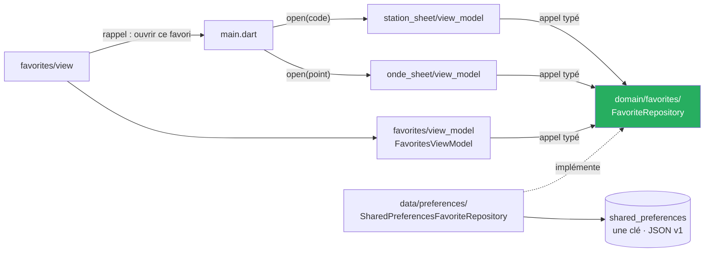
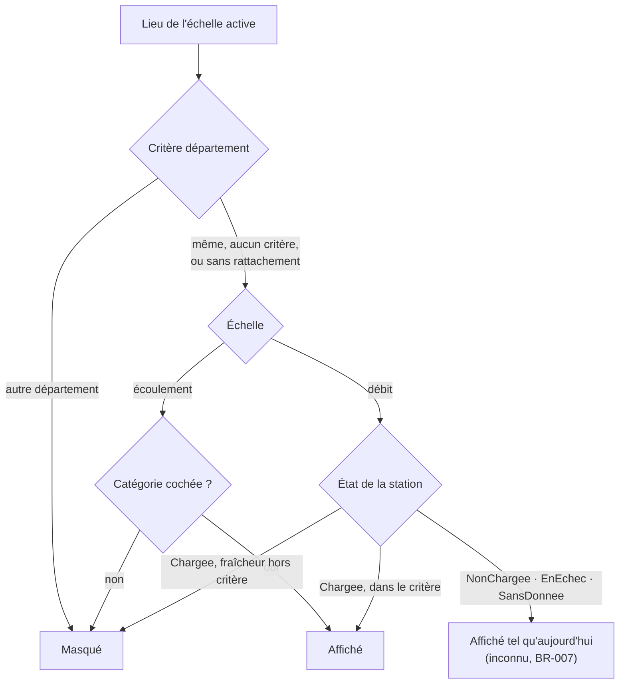

# Cadrage de T3 — Favoris, filtres, fraîcheur

**Date :** 2026-10-12 · **Statut :** ✅ **approuvé par le commanditaire le 2026-10-12** ; huit arbitrages reçus le 2026-10-12 (§ 2) — plus aucune question ouverte ; les textes de § 10.1 (amendements de règles métier, textes d'écran) sont approuvés avec ce document · **Branche :** `feat/t3-favoris-filtres`, partie de `dev` à `1247de3` · **État vivant :** [`project-state.md`](../../project-state.md)

> Ce document décide du **quoi**, du **pourquoi** et des **frontières** (où vit quoi, au regard d'[`ADR-014`](../../adr/ADR-014-feature-first-mvvm.md)). Il ne fixe ni la disposition ni les tâches : le plan vient après. Tout fait de code est cité `fichier:ligne`, lu le 2026-10-12 ; ce qui n'a pas été lu est marqué 💭. Relu par un second agent le 2026-10-12 ; ses corrections sont intégrées.

## 1. But et succès

Permettre à l'usager de **retrouver les lieux qu'il suit** (`US-14`, P1 et P3) et de **réduire la carte à ce qu'il cherche** (`US-13`, P3 et P5), sans qu'un lieu masqué ou une liste vide se lise comme « rien à signaler » (`BR-007`).

**T3 est réussie si :**

1. un favori ajouté depuis une fiche se retrouve dans la liste **après relancement de l'application** ;
2. un filtre appliqué se voit **en permanence** sur la carte, s'efface en un geste, et une carte vidée par lui le dit ;
3. aucune valeur mesurée n'apparaît sans sa date (`BR-001`), aucun débit n'est qualifié (`BR-003`) ;
4. les trois dettes de T2 sont soldées, la suite reste verte et son décompte ne baisse pas (repère : 2 330) ;
5. la porte est franchie **sur Windows et sur Android** (arbitrage 7).

« Fraîcheur », dans le titre, désigne le **critère de filtre** : le calcul et le rendu de la fraîcheur sont déjà livrés (§ 4).

## 2. Arbitrages du commanditaire — 2026-10-12

| # | Arbitrage |
|---|---|
| 1 | **Périmètre : « Le titre seul ».** `US-14` (favoris) + `US-13` (filtres : états, département, fraîcheur) + les trois dettes de T2 déjà placées en T3 (décision du 2026-10-06 au soir). La courbe (`US-11`), la recherche (`US-16`) et `integration_test/`, que le plan de T1 renvoyait à T3, sont **renvoyés à une tranche ultérieure, dits tels**. |
| 2 | **Stockage des favoris : `shared_preferences`.** Liste de favoris sérialisée sous une clé, derrière une interface de dépôt du domaine. Aucune bibliothèque nouvelle. Amendement d'`ADR-011` ; le moteur structuré reste ouvert jusqu'au hors-ligne (`US-10`). |
| 3 | **Cibles d'un favori : stations hydrométriques et points ONDE.** Type clos ; le point désigné des restrictions pourra s'y ajouter en T5 par une branche. |
| 4 | **Critère « fraîcheur » du filtre : les seuils des règles existantes.** Débit : Toutes / Moins de 2 h / Moins de 24 h (`BR-005`). ~~Écoulement : Toutes / Campagne de moins de 60 jours (`BR-010`).~~ Aucun seuil nouveau ; le croquis de `docs/04-ui.md` (« Moins de 7 jours ») est à corriger. **Amendé pour l'écoulement par l'arbitrage 5.** |
| 5 | **Fraîcheur sur l'écoulement : « Pas de critère ».** Sur l'écoulement la feuille ne propose pas de fraîcheur et dit que la carte ne montre que les campagnes des 60 derniers jours. Le critère reste sur le débit (2 h / 24 h). Motif : la carte ne charge déjà que ces 60 jours (`map_view_model.dart:1230`) ; le critère n'y aurait masqué que les points observés il y a exactement 60 jours. |
| 6 | **Ouvrir un favori : « La fiche seule ».** La fiche s'ouvre, la carte ne bouge pas. Aucun canal de caméra ; aucune coordonnée copiée pour une station. Le recentrage : tranche ultérieure, non nommée. |
| 7 | **Porte de T3 : « Windows et Android ».** Release Windows lancée hors Flutter **et** émulateur Android ; T3 ne se clôt pas tant qu'Android n'est pas construit et vu. ⚠️ Conséquence : la porte dépend de la **construction Android, jamais constatée à ce jour** (`A1` de T2) ; § 9 porte les constats sur les deux cibles. |
| 8 | **Entrées sur la carte : « En bas à droite ».** Deux boutons « Favoris » et « Filtres » dans un **groupe à part**, au-dessus de `+` / `−` / recentrer ; le bouton « Filtres » change de forme quand un filtre est actif ; le haut de la carte ne bouge pas. |

Compris aussi, sans objection : T3 s'ouvre alors que **la porte de T2 reste due** (`A1`, `E4`, `P1`, `P2`).

## 3. Périmètre

### Dedans

| # | Élément | Source |
|---|---|---|
| D1 | Étoile sur la fiche station et la fiche ONDE : ajouter, retirer, état lisible sans la couleur | `US-14`, `UC-003 § 6`, `04-ui.md` l. 277, 308, 323 |
| D2 | Écran « Favoris » : liste, retrait, ouverture de la fiche, états vide et illisible | `US-14`, `03-conception.md` l. 186 |
| D3 | Persistance locale des favoris, versionnée, tolérante à l'inconnu | arbitrage 2, `BR-011` |
| D4 | Feuille « Filtres » : états (écoulement), département (deux échelles), fraîcheur (débit seul) | `US-13`, arbitrages 4 et 5 |
| D5 | Bouton « Filtres » qui montre le filtre actif, avis de carte vidée par le filtre, action « Effacer les filtres » | `BR-007`, arbitrage 8 |
| D6 | Dette 1 — plateforme des tests de widget ; dette 2 — décisions métier sorties de la vue des restrictions ; dette 3 — barre de titre partagée | `project-state.md`, point 59, (4) et (5) |
| D7 | Porte de T3 sur Windows et Android, version `0.4.0` | arbitrage 7 |

### Dehors

| Élément | Vers | Motif |
|---|---|---|
| Courbe de débit (`US-11`), recherche (`US-16`), `integration_test/` | tranche ultérieure, non nommée | arbitrage 1 |
| Recentrer la carte sur un favori ouvert | tranche ultérieure, non nommée | arbitrage 6 |
| Critère de fraîcheur sur l'écoulement ; balayage ONDE au-delà de 60 jours | non prévu | arbitrage 5 ; le second changerait le volume d'appel (`NFR-07`) |
| Tranche `features/settings` annoncée « T3 » par `03-conception.md` l. 51 | tranche ultérieure, non nommée | hors « le titre seul » ; ligne à corriger |
| Échelle 3 sur la carte, option « Sécheresse » du croquis (`04-ui.md` l. 543) | `US-17`, non planifiée | cadrage de T2, Q6 ; `04-ui.md` l. 229-230 |
| Favori sur un point désigné ; seuil d'avis par lieu, dernier niveau connu, avis | T5 | arbitrage 3 ; § 5.5 |
| Moteur de stockage structuré, hors-ligne (`US-10`, `UC-005`) | tranche du hors-ligne | arbitrage 2 |
| Filtre persisté ; synchronisation, export ou partage des favoris | non prévu | § 6.6 ; `context-map.md` l. 95 |
| Passerelle fiche → restrictions | exclu | cadrage de T2, Q1-B, maintenu le 2026-10-03 |

## 4. État des lieux — lu le 2026-10-12

Repère transmis par la boucle principale, **non rejoué ici** (💭) : `flutter analyze` « No issues found! », `flutter test` « +2330: All tests passed! », `dart format` « Formatted 205 files (0 changed) », sur `dev` à `1247de3`.

| Fait | Preuve |
|---|---|
| Fraîcheur hydrométrique livrée : `Freshness { fraiche, ancienne, perimee }`, bornes 2 h et 24 h | `lib/domain/observation/freshness.dart:14`, `:28`, `:33` |
| Âge de campagne livré : `CampaignAge { recente, ancienne }`, borne 60 jours calendaires | `lib/domain/onde/campaign_age.dart:21`, `:32` |
| État d'une station sur la carte : `NonChargee`, `Chargee(freshness)`, `SansDonnee`, `EnEchec` | `lib/domain/observation/station_map_state.dart:15-62` |
| Aucun favori, aucun filtre d'usager dans `lib/` ni `test/` ; le seul filtre est spatial | recherche du 2026-10-12 ; `lib/domain/geo/viewport_filter.dart` |
| Une seule clé `shared_preferences`, lue par `getString`, écrite par `setString` dont le `Future<bool>` rendu est ignoré | `lib/data/preferences/shared_preferences_acknowledgement_repository.dart:20`, `:36`, `:42` |
| `MapScaleKind { ecoulement, debit }` vit **dans la tranche carte**, pas dans le domaine | `lib/features/map/view_model/map_scale.dart:21` |
| Échelle débit : état connu après requête seulement, 20 stations au plus par préchargement, choisies parmi les stations de l'emprise | `lib/features/map/view_model/map_view_model.dart:61`, `:931`, `:981`, `:1168-1198` |
| ⚠️ Échelle écoulement : la carte ne charge que les observations depuis `now − 60 jours`, borne incluse | `map_view_model.dart:1230` ; `lib/data/http/onde_uris.dart:79` |
| Les campagnes ONDE vont de mai à septembre | `lib/features/onde_sheet/view_model/onde_sheet_view_model.dart:43-45` ; `BR-010` |
| Pastilles sous le zoom 9 : écoulement = observations chargées pour l'emprise, avec état le plus sévère ; débit = asset entier, compte seul | `map_view_model.dart:325-333`, `:408-450` ; `lib/domain/geo/area_cluster.dart:84` |
| L'asset entier n'est lu aujourd'hui que sur le débit, sous le zoom 9 | `map_view_model.dart:724-728` |
| Département : `AdministrativeArea?` sur `StationPoint` et `OndePoint` ; 37 stations sans rattachement | `lib/domain/station/station_point.dart:55` (et l. 23-26), `lib/domain/onde/onde_point.dart:48` |
| Catégories d'écoulement : six branches closes ; `Inconnu` est **égal par `rawCode`** | `lib/domain/nomenclature/flow_category.dart:12-77`, `:84-89`, `:140` |
| Les avis de la carte se décident sur `stations` et `ondeObservations`, tels que lus | `lib/features/map/view/map_view.dart:2020-2021` ; `map_empty_states.dart:243-244` |
| **Aucun référentiel ONDE embarqué** ; la fiche ONDE s'ouvre avec un `OndePoint` entier | `lib/data/referentiel/` ; `onde_sheet_view_model.dart:204` |
| La fiche station s'ouvre par `StationCode` ; une station de la carte peut manquer à l'asset (`Introuvable`) | `lib/features/station_sheet/view_model/station_sheet_view_model.dart:74`, `:181-186` |
| Les fiches sont des **panneaux injectés dans la carte** par `main.dart` ; l'écran des restrictions est une route poussée par `main.dart` | `lib/main.dart:253-283`, `:300-369` |
| `MapControls` est le pilotage de la caméra, et rien d'autre | `lib/features/map/view/map_controls.dart:46-49` |
| « Les dépôts restent bêtes » | `lib/domain/repositories/repositories.dart:1-3` |
| `MapViewModel` : 1 291 lignes ; `map_view.dart` : 2 050 ; `restrictions_screen.dart` : 1 575 | `wc -l` du 2026-10-12 |
| `docs/tracabilite.md` ne suit que les `Must` | `docs/tracabilite.md:20` |

## 5. Conception — favoris

### 5.1 Modèle du domaine — `lib/domain/favorites/`

Un favori est une **identité copiée à l'ajout**, jamais une mesure.

| Type | Contenu |
|---|---|
| `Favorite` (`sealed`) | trois branches, `switch` exhaustif (`BR-011`) |
| `StationFavorite` | `StationCode`, libellé, date d'ajout — **sans coordonnées** (arbitrage 6) |
| `OndePointFavorite` | l'`OndePoint` entier, date d'ajout — parce que `open(OndePoint)` l'exige, pas pour l'afficher |
| `UnreadableFavorite` | l'entrée telle que stockée (texte brut), et son libellé s'il se lit |

- **Clé sans collision : le couple (type, code).** Le croquis de `03-conception.md` l. 100 met `CodeEntite` seul en clé : faux. `OndeStationCode` est une chaîne libre (`lib/domain/onde/onde_station_code.dart`, l. 1-21), `StationCode` dix caractères `A-Z0-9` (`lib/domain/station/station.dart`, l. 13) ; rien n'interdit la même valeur dans les deux. Un `UnreadableFavorite` peut n'avoir aucun code lisible : il s'identifie, pour son retrait, par **son texte brut tel que stocké**.
- **Pourquoi copier le libellé d'une station**, qui se relirait dans l'asset : la liste ne dépend alors d'aucun autre dépôt, et le favori reste nommé si un asset ultérieur ne porte plus la station. La copie peut vieillir : la ligne montre sa date d'ajout.
- **Deux niveaux d'illisible, une seule règle :** ce qui ne se lit pas **à l'échelle de l'entrée** — type inconnu, champ absent ou invalide, `StationCode` refusé, `OndePoint` dont la forme a changé — devient `UnreadableFavorite`, entrée par entrée, jamais tout ou rien ; ce qui ne se lit pas **à l'échelle de la valeur** — pas du JSON, racine inattendue, `version` supérieure — est un échec typé (§ 5.2).
- Un `UnreadableFavorite` est **affiché**, **retirable**, non ouvrable, et **réécrit tel quel** à chaque écriture : ni plantage, ni rabattement sur un type connu, ni perte (`BR-011`).

### 5.2 Dépôt et forme stockée

`FavoriteRepository`, interface dans `lib/domain/favorites/` (précédent : `RestrictionSource`, `ExternalLinkOpener`). Contrat : **lire tout, ajouter, retirer, tout effacer** — le dernier exigé par l'action « Repartir d'une liste vide ». Implémentation `SharedPreferencesFavoriteRepository` sous `lib/data/preferences/`, seul dossier qui importe `shared_preferences`.

- **Une clé, une chaîne JSON**, `{ "version": 1, "favoris": [ … ] }`, chaque entrée portant son `type`. `version` ne s'incrémente que si la **forme de la racine** change. Le code ONDE se sérialise **verbatim, espaces compris** (`onde_station_code.dart:9-13`). Seules `getString` et `setString` sont employées, déjà lues dans ce dépôt (§ 4).
- **Dépôt bête, sans mémo** : chaque opération lit la valeur stockée, puis écrit. `FavoritesViewModel` relit à chaque ouverture de la route ; chaque `open` de fiche relit.
- **Valeur illisible** : la lecture rend un échec typé, **jamais une liste vide** ; ajouter et retirer échouent de même ; seul « tout effacer » la remplace.
- **Écriture en échec** : `setString` rend un `Future<bool>` ; `false` ou une levée sortent du contrat en **échec typé**. L'étoile ne change pas d'état, et la fiche le dit.
- 💭 **Non vérifié :** taille maximale d'une valeur et comportement d'une écriture interrompue, sur Windows et Android, pour `shared_preferences` 2.5.5 — à lire dans le paquet installé, dans le lot qui écrit l'amendement d'`ADR-011` (lot 5).

### 5.3 Étoile sur les deux fiches

- **Où.** Dans le cadre commun de chaque panneau, à côté du bouton de fermeture : `station_summary_sheet.dart:349-356`, `onde_summary_sheet.dart:302-308`. Un seul widget, dans `lib/features/shared/`, à la taille de `tap_target.dart`.
- **État et action.** Chaque ViewModel de fiche reçoit `FavoriteRepository`, expose « en favori ? » et « basculer », relit à chaque `open`. Aucune tranche n'importe l'autre.
- **Ajouter exige le libellé, retirer n'exige que le code.** Fiche ONDE : le point est connu dans tous ses états visibles (`onde_sheet_view_model.dart:84`, `:105`) — l'étoile y est toujours active. Fiche station : **ajouter** exige l'état `Prete` ; une station **déjà en favori** garde son étoile pleine, et retirable, dans tous les états (`EnCours`, `EnEchec`, `Introuvable` ne portent qu'un code, `station_sheet_view_model.dart:48-93`) — sinon un favori ouvert hors réseau ne se retirerait que par la liste.
- Les 37 stations de la carte absentes de l'asset (`Introuvable`) **ne peuvent pas être mises en favori** : aucun libellé à copier.
- L'étoile est **inactive tant qu'une écriture court**, et tant que la liste stockée est illisible.
- **Lisible sans la couleur** (`04-ui.md § 3`) : forme pleine ou vide, libellé annoncé (§ 10.1).

### 5.4 Écran « Favoris » — `lib/features/favorites/{view,view_model}/`

- **La liste affiche l'identité seulement** : libellé, nature du lieu, cours d'eau et département quand la copie les porte, date d'ajout. **Aucune valeur mesurée** — sinon chaque ligne devrait porter date, source et fraîcheur (`BR-001`, `BR-005`, `BR-010`) et coûter un appel réseau par favori (`C-15`). La liste le dit.
- **États** (`sealed`, `BR-007`) : lecture en cours ; liste ; vide ; illisible — avis, et action explicite « Repartir d'une liste vide » ; rien n'est écrasé avant ce geste.
- **Retrait** depuis la ligne.
- **Ouvrir un favori** (arbitrage 6). L'écran est une **route poussée par `main.dart`**, comme les restrictions (`main.dart:328-362`). Il rend un rappel ; `main.dart` retire la route, ferme l'autre fiche et appelle `open` de la bonne tranche — le chemin d'un tap de marqueur (`main.dart:253-276`). **La carte ne bouge pas et l'échelle ne change pas.** Si le lieu n'a aucun marqueur à l'écran — autre échelle, pastille, filtre actif, carte ailleurs — il ne se passe rien de particulier : la fiche nomme le lieu. ⚠️ Une fiche ONDE pourra donc s'ouvrir sur l'échelle débit : le commentaire de `map_view.dart:1424-1426` (« ils dépendent d'échelles différentes ») devient faux et se corrige dans le lot.
- **Ouvrir l'écran ferme les deux fiches**, comme la désignation d'un point (`main.dart:300-302`). Cette règle vit dans `main.dart`, que rien n'éprouve : **le plan porte un test de la racine pour elle**.
- **Barre de titre** : celle, partagée, de la dette 3.

### 5.5 Ce que T5 attendra, et que T3 ne construit pas

Le cadrage de T4 et T5 fait des favoris le socle des « lieux suivis », avec un seuil par lieu et le dernier niveau connu (`2026-10-03-cadrage-t4-t5-crues-design.md` § 4). **T3 n'en prépare aucun** : ni champ réservé, ni type générique. Elle livre `version` et une `sealed class` où une branche s'ajoute. ⚠️ Ce cadrage écrit que le moteur structuré « se tranche donc avec T3 » : l'arbitrage 2 dit l'inverse ; à corriger (§ 11).

## 6. Conception — filtres

### 6.1 Le sens des mots

`BR-008` écrit « choisie par le filtre » et « chips de filtre » : ce « filtre » est le **choix d'échelle**, livré par les puces (`map_scale_chips.dart`). Le « type de donnée » de `US-13` est cette échelle. En T3, **« filtre » ne désigne plus que ce qui masque des lieux à l'intérieur de l'échelle active** (amendement de `BR-008`, § 10.1). Le groupe « Échelle affichée » du croquis (`04-ui.md` l. 540-543) n'est pas repris.

### 6.2 Critères, par échelle

| Critère | Échelle écoulement | Échelle débit |
|---|---|---|
| **États** | six cases, une par branche de `FlowCategory`, sous les libellés de `flowCategoryLabel`, « Non renseigné » comprise (`BR-011`) | **aucun** : on ne qualifie jamais un débit (`BR-003`, `ADR-002`) |
| **Département** | un département ou tous | idem |
| **Fraîcheur** | **aucun critère** ; la feuille dit la borne des 60 jours (arbitrage 5) | Toutes · Moins de 2 h (`fraiche`) · Moins de 24 h (`fraiche` ou `ancienne`) — bornes lues dans `freshness.dart`, jamais recopiées |

- **Aucun critère actif au départ** : tout coché, tous les départements, toutes les mesures. Le croquis décochait « Non observé » d'emblée.
- **Liste des départements** : `MapViewModel` la charge depuis `StationPointRepository.all()` et l'expose — départements distincts, triés par code, libellé tel que reçu. Sur l'écoulement le prédicat compare le **code** : les libellés de l'asset et de l'API n'ont pas la même casse (`administrative_area.dart`, l. 17-20). **Asset illisible** : la feuille n'offre pas le critère département et le dit ; les autres critères restent. 💭 Non vérifié : que tout département portant un point ONDE porte aussi une station de l'asset.

### 6.3 Ce qu'un filtre a le droit de masquer

**Règle : un filtre ne masque que ce qui est connu comme hors critère. L'inconnu reste affiché, sous son rendu actuel.**

- **Débit, critère fraîcheur.** Hors des stations préchargées, la fraîcheur n'est pas connue. Masquer l'inconnu viderait la carte ; charger pour filtrer heurte `NFR-07` et `C-15`. L'inconnu reste affiché, et **la feuille le dit**, sous le critère (§ 10.1) — un bouton rond ne peut pas le dire.
- **Préchargement.** Il porte sur les stations retenues par le critère **département**, jamais par le critère fraîcheur (circulaire : il faut charger pour connaître la fraîcheur). « Appliquer » annule et relance le préchargement.
- **Pastilles sous le zoom 9** (`ADR-015`, `BR-009`, amendement § 10.1) :
  - *écoulement* — le filtre s'applique **avant** le regroupement : compte et état le plus sévère portent sur les membres retenus ; une pastille sans membre retenu n'est pas dessinée ;
  - *débit* — le critère **département** s'applique avant ; le critère **fraîcheur ne s'applique pas** aux pastilles. **Exception assumée :** des stations `Chargee` hors critère y restent comptées. La feuille le dit.
- **Lieu sans département** (37 stations) sous un critère département : inconnu, donc affiché.
- **Une fiche ouverte reste ouverte** quand le filtre masque son lieu.

### 6.4 Où vit quoi

| Quoi | Où |
|---|---|
| `MapFilter` : valeur immuable — **six booléens**, un par branche de `FlowCategory` ; un code de département ou aucun ; un critère de fraîcheur du débit. Deux membres nommés, « actif pour l'écoulement » et « actif pour le débit », **sans paramètre d'échelle** : `MapScaleKind` vit dans la tranche carte, l'importer violerait `domaine-ferme` | `lib/domain/filters/` — Dart pur |
| Prédicats purs, un par échelle, par **`switch` sur le type** — jamais par appartenance à un ensemble : `Inconnu('9')` n'est pas égal à `Inconnu(null)` | `lib/domain/filters/` |
| Filtre **appliqué** : un champ, « appliquer », « effacer » ; `clusters`, `individualStations`, `individualOndeObservations` et le préchargement passent par les prédicats. **`stations` et `ondeObservations` restent les faits lus, non filtrés** | `MapViewModel` — une délégation, aucune règle ajoutée |
| Brouillon avant « Appliquer » : un `MapFilter` tenu par l'état de la feuille (précédent : `_designatedPoint`, `map_view.dart:2008`) ; les règles restent dans la valeur du domaine | `lib/features/map/view/` |
| Feuille, groupe des deux boutons — **frère** de `MapControls`, pas dedans —, avis | `lib/features/map/view/`, en fichiers propres |

### 6.5 Un filtre se voit toujours (`BR-007`)

- **Le bouton « Filtres » change de forme** dès qu'un critère est actif pour l'échelle affichée, à tous les zooms, et l'annonce au lecteur d'écran ; il ouvre la feuille.
- **Avis de carte vidée par le filtre** (`MapNotice` gagne une branche, `map_empty_states.dart:132`). Il vaut : **lu non vide sur l'emprise ET rien de dessiné après filtre, ni marqueur ni pastille**. Rang : après la panne, qui parle seule (`map_empty_states.dart:230-234`) ; **exclusif des avis d'absence**. Ceux-ci restent décidés sur les faits lus, non filtrés — sinon un filtre qui vide les observations ferait dire « le réseau ONDE ne suit que… » à tort.
- **« Effacer »** efface tous les critères, des deux échelles.

### 6.6 Durée de vie, compteur

- **Session seulement, rien de persisté** ; le filtre survit au changement d'échelle et à l'aller-retour vers un écran plein. Un filtre retrouvé actif au relancement masquerait des lieux sans geste de l'usager ce jour-là.
- **« Appliquer », sans compteur** : le « (24) » du croquis est incalculable sur le débit dès que la fraîcheur joue.

## 7. Dettes de T2

| # | Périmètre constaté | Approche | Risque |
|---|---|---|---|
| **1 — plateforme des tests de widget** | 31 fichiers de test de widget sur 109 : 20 n'emploient que `testWidgets` (Android par défaut), 9 mêlent les deux, 2 n'emploient que `testWidgetsOnWindows`. **29 fichiers à migrer** (20 + 9). Environ 524 appels `testWidgets(` contre 73 `testWidgetsOnWindows(` (`grep` en début de ligne). Un `flutter_test_config.dart` global a échoué (22 sur 22 dans `warning_link_test.dart`) | Chaque test **nomme sa plateforme** : Windows, sauf les tests qui portent sur Android, nommés par **un assistant Android à créer** à côté de `test/support/windows_platform.dart`, dont le commentaire de convention (l. 11-13) est à réécrire. **Verrou dans `test/project/`** : aucun `testWidgets(` nu hors `test/support/`. Fichier par fichier, un commit par fichier | Attentes calibrées sur Android qui bougent sous Windows (cible de 48 contre 44, barre de défilement du bureau) : un test qui rougit est un **constat à lire**, pas une attente à réécrire. Trois échecs sur un fichier : arrêt et question |
| **2 — décisions métier dans la vue** | `lib/features/restrictions/view/restrictions_screen.dart` : dédoublonnage des arrêtés (l. 1060), « mêmes zones » (l. 1094), dates communes (l. 1114), droit d'affirmer l'absence d'eaux superficielles (l. 313-323) | Fonctions pures dans `lib/domain/restrictions/`, testées sans rendu. **Aucun changement de comportement** ; les tests d'écran servent de filet | Les constats d'`E4` du 2026-10-04 restent des faits datés, sur le code de ce jour-là (`ba5d079`) ; la porte de T2 se franchit sur le code d'après et revoit ces écrans de toute façon |
| **3 — barre de titre en double** | `restrictions_screen.dart:644-679` et `lib/features/shared/data_sources_view.dart:327-359` : seuls diffèrent le titre, le fond, la couleur du titre | Un widget dans `lib/features/shared/screen_layout.dart`. **« Favoris » en est le troisième utilisateur** : la dette se solde avant lui | Faible |

## 8. Critères d'acceptation proposés

Futurs scénarios de `docs/acceptance/favoris.feature` et `filtres.feature`, écrits **avec le lot qui les réalise**.

### `US-14` — « J'enregistre des favoris et les retrouve en liste »

1. Depuis une fiche station prête, l'étoile ajoute la station ; elle figure dans la liste avec son libellé et sa date d'ajout.
2. Depuis une fiche ONDE, dans chacun de ses états visibles, l'étoile ajoute le point.
3. L'étoile d'un lieu en favori le retire, y compris sur une fiche station en échec ou en chargement.
4. Une station absente du référentiel embarqué n'offre pas d'ajout.
5. Une station et un point ONDE de même code sont deux favoris distincts ; un code ONDE à espaces revient identique.
6. Après relancement, la liste est celle d'avant.
7. La liste n'affiche aucune valeur mesurée, et le dit.
8. Ouvrir un favori ouvre sa fiche, où la valeur porte sa date et sa source (`BR-001`) ; la carte et l'échelle ne changent pas.
9. Ouvrir l'écran « Favoris » ferme la fiche ouverte.
10. Une liste vide dit comment un favori s'ajoute et ne suggère rien de l'état des cours d'eau (`BR-007`).
11. Une entrée de type inconnu ou malformée est affichée comme non lisible, retirable, et toujours présente après l'ajout d'un autre favori (`BR-011`).
12. Une valeur stockée illisible est dite telle ; aucune écriture ne la remplace avant « Repartir d'une liste vide ».
13. Une écriture en échec laisse l'étoile dans son état et le dit ; l'étoile est inactive tant qu'une écriture court.
14. L'état de l'étoile se lit sans la couleur et s'annonce au lecteur d'écran.

### `US-13` — « Je filtre par type de donnée, état, département et fraîcheur »

1. Le « type de donnée » se choisit par les puces d'échelle ; la feuille ne propose aucune échelle.
2. Sur l'écoulement, décocher une catégorie retire ses marqueurs ; un code d'écoulement non reconnu suit la case « Non renseigné », quelle que soit sa valeur brute.
3. Sur l'écoulement, la feuille ne propose pas de fraîcheur et dit la borne des 60 jours.
4. Sur le débit, la feuille ne propose aucun critère d'état.
5. Choisir un département ne laisse que ses lieux, sur les deux échelles ; un lieu sans département reste affiché.
6. Sur le débit, « Moins de 2 h » masque une station chargée dont la mesure a 2 h ou plus ; « Moins de 24 h », 24 h ou plus (`BR-005`).
7. Sur le débit, une station non chargée, en échec ou sans donnée reste affichée ; la feuille le dit.
8. Le préchargement ne porte que sur les stations du département choisi.
9. Sous le zoom 9, sur l'écoulement, compte et état d'une pastille portent sur les points retenus ; une pastille sans point retenu disparaît.
10. Sous le zoom 9, sur le débit, le critère de fraîcheur ne change aucune pastille ; la feuille le dit.
11. Dès qu'un critère est actif pour l'échelle affichée, le bouton « Filtres » le montre, à tous les zooms.
12. Lu non vide et rien de dessiné : l'avis de carte vidée par le filtre s'affiche, seul avis d'absence, avec « Effacer les filtres » ; lu vide : l'avis d'absence habituel, inchangé.
13. « Effacer » retire tous les critères, des deux échelles.
14. Fermer la feuille sans appliquer ne change rien à la carte ; une fiche ouverte le reste quand le filtre masque son lieu.
15. Aucun texte de la feuille ne qualifie un débit (`BR-003`).
16. Après relancement, aucun filtre n'est actif.

### Dettes

1. Aucun `testWidgets(` nu hors `test/support/` (verrou de `test/project/`).
2. Les quatre décisions de § 7 ont un test de domaine, sans rendu ; les tests d'écran des restrictions sont inchangés par le lot de la dette 2.
3. Une seule barre de titre d'écran plein existe dans `lib/`.

## 9. Constats qui ne se voient qu'à l'écran — au commanditaire

⚠️ **Calendrier.** La carte d'écoulement ne montre que 60 jours et les campagnes ONDE s'arrêtent en septembre (§ 4) : **passé fin novembre, plus aucun point ONDE à l'écran, donc plus de constat possible du filtre « États » ni des pastilles filtrées avant mai.** 💭 Date de la dernière campagne de 2026 non vérifiée par appel réel. Les constats a et b se font donc **dès que la feuille est branchée** (fin du lot 4), sans attendre la porte.

| # | Constat | Cible |
|---|---|---|
| a | Écoulement : décocher une catégorie retire ses marqueurs, les autres restent | Windows, **anticipé** |
| b | Écoulement, sous le zoom 9 : compte et symbole des pastilles suivent le filtre ; une pastille vidée disparaît | Windows, **anticipé** |
| c | Filtre actif : le bouton « Filtres » se distingue sans se fier à la couleur, jusqu'aux pastilles de région | les deux |
| d | Carte vidée par le filtre : l'avis et « Effacer les filtres » se voient sans défiler | les deux |
| e | Débit, « Moins de 2 h » : les stations non chargées restent ; **des marqueurs disparaissent un à un au fil du préchargement**, et une station qui vieillit hors critère ne disparaît qu'au rafraîchissement suivant de la carte — cela se comprend-il, avec les phrases de la feuille ? | les deux |
| f | La colonne du bas à droite compte cinq boutons (environ 252 px, 272 sur Android) : elle ne recouvre ni la fiche, ni le bouton de désignation, ni l'attribution, à 800 × 740 puis à la taille du téléphone | les deux |
| g | Ajouter deux favoris (une station, un point ONDE), **fermer l'application, la relancer** : la liste les montre | les deux |
| h | Ouvrir un favori : la fiche s'ouvre, la carte n'a pas bougé | les deux |
| i | L'étoile se distingue, pleine et vide ; Tab l'atteint et Entrée la bascule (Windows) ; au toucher, sa cible fait 48 (Android) | les deux |
| j | Liste vide : la phrase se lit, rien ne suggère un état des cours d'eau | les deux |
| k | La barre de titre des restrictions et des sources est inchangée à l'œil (dette 3) | Windows |
| l | **Première construction Android constatée** (`flutter run -d emulator-5554`), puis les écrans de T3 au toucher | Android |

## 10. Textes soumis à approbation, décisions réversibles

### 10.1 Textes proposés — à approuver par le commanditaire

Écrits après lecture de `BR-014` (vouvoiement, aucun verbe portant sur un usage de l'eau, aucun mot de garantie) et de `glossary.md`. Aucun ne qualifie un débit ; aucun seuil nouveau.

**(a) Amendements de règles métier**

- **`BR-007`**, invariant ajouté : « **Filtre de l'usager (T3).** Un lieu masqué par un filtre n'est pas une absence de donnée. Tant qu'un critère est actif, la carte le montre en permanence, à tous les zooms. Une carte que le filtre a vidée l'écrit — *« Les filtres masquent tous les lieux du secteur affiché. Cela ne dit rien de l'état des cours d'eau. »* — et propose de les effacer ; elle n'emploie aucun des avis d'absence ci-dessus, qui affirmeraient qu'aucun lieu n'existe. Un lieu dont l'état n'est pas connu — non chargé, en échec, sans donnée, sans département — n'est jamais masqué par un critère qui porte sur cet état. »
- **`BR-008`**, règle : « Une seule est active, choisie par **les puces d'échelle**, et la légende l'indique en permanence. » Invariant : « Le changement d'échelle est explicite, via **les puces d'échelle**. » Invariant ajouté : « Un filtre (T3) masque des lieux à l'intérieur de l'échelle active ; il ne choisit pas l'échelle et n'en superpose aucune. »
- **`BR-009`**, invariant du compte, complété : « Sous un filtre (T3), un cluster ne regroupe que les points retenus : son compte et son état le plus sévère portent sur eux, et un cluster sans point retenu n'est pas dessiné. Exception, sur l'échelle débit : le critère de fraîcheur ne s'applique pas aux clusters — leur compte inclut des stations dont la mesure chargée est hors critère —, et la feuille de filtres le dit. »

**(b) Textes d'écran**

| Emplacement | Texte |
|---|---|
| Avis de carte vidée par le filtre | « Les filtres masquent tous les lieux du secteur affiché. Cela ne dit rien de l'état des cours d'eau. » · action « Effacer les filtres » |
| Feuille, écoulement, à la place de la fraîcheur | « La carte ne montre que les campagnes d'observation des 60 derniers jours. Un point observé plus tôt n'y figure pas. » |
| Feuille, débit, sous le critère de fraîcheur (1) | « Ce critère ne porte que sur les mesures déjà chargées : une station dont la mesure n'est pas encore chargée reste affichée. » |
| Feuille, débit, sous le critère de fraîcheur (2) | « Il ne s'applique pas aux regroupements par région ou par département : leur compte n'en tient pas compte. » |
| Feuille, options de fraîcheur du débit | « Toutes » · « Moins de 2 h » · « Moins de 24 h » |
| Feuille, département | « Tous les départements » ; asset illisible : « La liste des départements n'a pas pu être lue. » |
| Feuille, titre et actions | « Filtres » · « Appliquer » · « Effacer » |
| Liste de favoris, en tête | « Cette liste ne montre aucune mesure. La fiche d'un lieu donne sa dernière mesure connue, avec sa date. » |
| Liste de favoris vide | « Aucun favori enregistré. L'étoile d'une fiche — station de mesure ou point d'observation — ajoute ce lieu à cette liste. » |
| Liste illisible | « Les favoris enregistrés sur cet appareil n'ont pas pu être lus. Ils sont conservés tels quels : aucun favori ne peut être ajouté ni retiré tant que la liste n'est pas remplacée. » · action « Repartir d'une liste vide », sous-titrée « Les favoris enregistrés sur cet appareil seront effacés. » |
| Ligne d'un favori non lisible | « Favori non lisible par cette version de l'application » |
| Ligne d'un favori | nature : « Station hydrométrique » / « Point ONDE » (`glossary.md`) · « Ajouté le JJ/MM/AAAA » |
| Étoile, libellés annoncés | « Ajouter aux favoris » · « Retirer des favoris » ; écriture en échec : « Le favori n'a pas pu être enregistré. » |
| Boutons de la carte | « Favoris » · « Filtres » ; filtre actif, annoncé : « Filtres — un filtre est actif » |

### 10.2 Décisions de la boucle principale, réversibles

| # | Décision |
|---|---|
| R1 | Interface dans `lib/domain/favorites/`, implémentation dans `lib/data/preferences/` |
| R2 | Une clé, une chaîne JSON versionnée, `getString` / `setString` seulement ; dépôt sans mémo |
| R3 | Libellé copié à l'ajout pour les deux types ; il ne se relit pas au référentiel |
| R4 | Illisible à l'échelle de l'entrée : `UnreadableFavorite`, affichée, retirable par son texte brut, réécrite telle quelle |
| R5 | Liste illisible : avis, étoiles inactives, action explicite « Repartir d'une liste vide » ; rien n'est écrasé avant |
| R6 | La liste n'affiche aucune mesure ; dernier ajouté en tête ; aucun plafond |
| R7 | Étoile dans le cadre du panneau ; ajouter exige le libellé, retirer le code seul |
| R8 | Ouvrir l'écran « Favoris » ferme les fiches (`main.dart`), avec un test de la racine |
| R9 | L'inconnu reste affiché : station non chargée, en échec ou sans donnée sous le critère de fraîcheur ; lieu sans département sous le critère département |
| R10 | Pastilles : filtre avant regroupement sur l'écoulement ; sur le débit, département avant, fraîcheur non appliquée et dite dans la feuille |
| R11 | Croquis « Filtres » corrigé : six cases toutes cochées au départ, « Appliquer » sans compteur, pas de groupe « Échelle affichée » |
| R12 | Préchargement borné au critère département ; « appliquer » l'annule et le relance |
| R13 | Filtre de session, non persisté, conservé au changement d'échelle ; « Effacer » vide les deux échelles |
| R14 | Feuille dans la tranche `map` ; brouillon tenu par l'état de la feuille, sans `ChangeNotifier` à part |
| R15 | Dette 1 : Windows, sauf les tests qui portent sur Android, nommés Android ; verrou dans `test/project/` |
| R16 | Dettes 2 et 3 soldées en T3, avant la porte de T2 |
| R17 | Version `0.4.0+4` |

## 11. Documents à produire ou amender en T3

Code et spec dans le même commit : **chaque document s'écrit avec le lot qui le réalise** ; les amendements de `BR-007`, `BR-008` et `BR-009` précèdent les lots 3 et 4.

| Document | Changement | Lot |
|---|---|---|
| `BR-007`, `BR-008`, `BR-009` | textes de § 10.1 (a), une fois approuvés | 2 |
| `UC` « Filtrer la carte » (numéro pris à l'écriture), `UC-001`, `filtres.feature` | scénarios de § 8 | 2 à 4 |
| `ADR-011` | amendement daté : favoris en `shared_preferences`, une clé, forme versionnée ; faits du paquet relus ; moteur structuré ouvert jusqu'à `US-10` | 5 |
| `UC` « Suivre un lieu en favori », `UC-003`, `UC-004` (l'étoile y manque), `favoris.feature` | scénarios de § 8 | 5 à 7 |
| `docs/domain-model.md`, `docs/glossary.md` (« Favori », « Filtre ») | `lib/domain/filters/`, `lib/domain/favorites/`, fonctions sorties de la vue des restrictions | 2, 5, 8 |
| `plan-de-tests.md` | plateforme des tests de widget ; `integration_test/` : tranche ultérieure | 1 |
| `02-specifications.md` | `US-11`, `US-16` : tranche ultérieure ; `US-13` : sens de « type de donnée », fraîcheur sur le débit seul | 9 |
| `03-conception.md` | l. 33 (stockage), l. 51 (`favorites` ✅, `settings` hors T3), l. 100 (clé du favori), l. 169 (critères) | 9 |
| `04-ui.md` | croquis « Filtres » corrigé ; croquis manquants : écran « Favoris » et ses états, groupe des deux boutons, avis de carte vidée, étoile des fiches | 4, 7 |
| `docs/tracabilite.md` | section `Should` : `US-13`, `US-14` | 9 |
| `2026-10-03-cadrage-t4-t5-crues-design.md`, `project-state.md` (ligne T5) | le moteur structuré ne se tranche pas avec T3 | 0 |
| `project-state.md`, `CLAUDE.md`, `docs/README.md` | ligne T3, arborescence, fichiers de `shared/`, point 59 soldé | au fil des lots |
| `CHANGELOG.md`, `pubspec.yaml` | `0.4.0` ouverte au lot 0, datée à la porte | 0, 10 |

## 12. Découpage indicatif en lots

Ordre `domain/` → `data/` → `view_model/` → `view/`. **Les filtres passent avant les favoris** : leur constat sur l'écoulement a une échéance (§ 9).

| Lot | Contenu | Dépend de |
|---|---|---|
| 0 | Ouverture de `0.4.0` ; documents de T4-T5 corrigés | approbation de ce cadrage |
| 1 | Dette 3 (barre de titre partagée) ; dette 1 : assistants de plateforme, verrou, migration des 29 fichiers | — |
| 2 | Filtres — domaine : `MapFilter`, prédicats ; amendements de `BR-007`, `BR-008`, `BR-009` | approbation de § 10.1 (a) |
| 3 | Filtres — `MapViewModel` : filtre appliqué, pastilles, préchargement, liste des départements | lot 2 |
| 4 | Filtres — feuille, groupe de boutons (« Filtres »), avis ; puis **constat anticipé a et b sur l'écoulement** | lots 1 et 3, § 10.1 (b) |
| 5 | Favoris — domaine, dépôt `shared_preferences`, amendement d'`ADR-011` après lecture du paquet installé | — |
| 6 | Favoris — étoile des deux fiches (ViewModels, widget partagé) **et** câblage du dépôt dans `main.dart` : le constructeur des deux ViewModels change, `main.dart:141-148` ne compilerait plus sinon | lots 1 et 5 |
| 7 | Favoris — écran, bouton « Favoris » dans le groupe, route et test de la racine, commentaire de `map_view.dart:1424-1426` | lots 4 et 6 |
| 8 | Dette 2 (décisions sorties de la vue des restrictions) — indépendante, peut suivre le lot 1 | lot 1 |
| 9 | Finitions : clavier, cibles de 44 et de 48, recouvrements de la colonne à cinq boutons, documents de § 11 | lots 4, 7, 8 |
| 10 | Porte de T3 : release Windows hors Flutter **et** émulateur Android, constats de § 9, version datée | lot 9 ; construction Android (`A1`) |

**Risques à garder en vue :** la porte dépend d'une construction Android jamais constatée ; `map_view.dart` (2 050 lignes) et `MapViewModel` (1 291) ne doivent grossir que d'un branchement et d'une délégation ; la composition réelle de `main.dart` n'est éprouvée par aucun test (`CLAUDE.md`, ligne HTTP) et reçoit un écran, un dépôt et trois injections de plus — d'où le test de la racine du lot 7.
