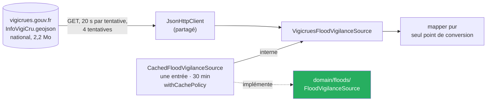
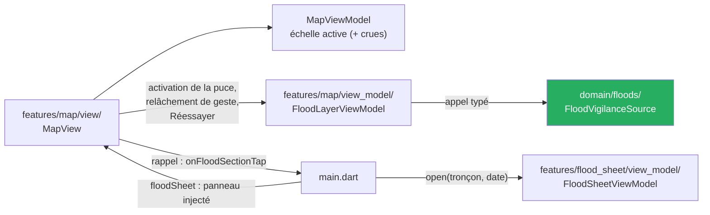

# Cadrage de T4 — Crues : lire la vigilance publiée par Vigicrues

**Date :** 2026-10-14 · **Statut :** ✅ **approuvé par le commanditaire le 2026-10-14** (« oui tu écris le plan »), retouche du texte de l'écran des sources comprise ; treize arbitrages reçus le 2026-10-14 (§ 2), les arbitrages 11 et 12 à la relecture du plan ; conception présentée en trois sections et approuvée section par section ; relu par un second agent, corrections intégrées · **Branche :** `feat/t4-crues`, partie de `dev` à `801b125` · **Cadrage d'ensemble :** [`2026-10-03-cadrage-t4-t5-crues-design.md`](2026-10-03-cadrage-t4-t5-crues-design.md) · **Faits de la source :** [`docs/sources/vigicrues.md`](../../sources/vigicrues.md) · **État vivant :** [`project-state.md`](../../project-state.md)

> Ce document décide du **quoi**, du **pourquoi** et des **frontières** (où vit quoi, au regard d'[`ADR-014`](../../adr/ADR-014-feature-first-mvvm.md)). Il ne fixe ni les tâches ni le détail des widgets : le plan vient après. Les faits Vigicrues sont ceux du **relevé du lot 0** (`VC-01` à `VC-13`, appels réels du 2026-10-14, commit `782c18c`). Les faits de code sont cités `fichier:ligne`, relevés le 2026-10-14 et relus par un second agent ; ceux que la boucle principale a relus elle-même sont marqués ✔.

## 1. But et succès

Permettre à l'usager de **lire, là où il regarde, la vigilance crues que l'État publie** : sur la carte, une quatrième lecture qui trace les tronçons surveillés par Vigicrues avec leur niveau ; au toucher d'un tronçon, une fiche qui cite ce niveau tel que publié, daté et attribué, et renvoie au bulletin.

**T4 est réussie si :**

1. sur Windows et sur Android, la lecture « Vigilance crues » trace les tronçons, **leur niveau écrit** selon l'arbitrage 3, et sa légende porte la date de l'information et « © VIGICRUES » ;
2. la fiche d'un tronçon cite la définition publiée par Vigicrues, la date, « © VIGICRUES », ouvre le bulletin du territoire, et porte l'avertissement de crue en tête ;
3. un chargement en cours, une source injoignable, une réponse illisible, un secteur sans tronçon ou un niveau inconnu **ne se lisent jamais comme du vert** (`BR-007`, `BR-011`) ;
4. l'application **ne calcule, ne déduit ni ne prévoit** aucun niveau ni risque de crue, et ne rapproche aucun débit d'une crue (`BR-015`, § 9.1) ;
5. la suite reste verte et son décompte ne baisse pas (repère : **3 313** au départ, `dev` à `801b125`) ;
6. la porte est franchie **sur Windows et sur Android** (arbitrage 0b).

## 2. Arbitrages du commanditaire

| # | Date | Question | Réponse |
|---|---|---|---|
| 0a | 2026-10-03 | Découpage, place, forme de T4 | Deux tranches, T4 lecture puis T5 avis ; T4 après T3 ; **quatrième lecture sur la carte** ([cadrage d'ensemble § 6](2026-10-03-cadrage-t4-t5-crues-design.md)) |
| 0b | 2026-10-14 | Porte de T4 | **Windows et Android**, comme T3 : release Windows lancée hors Flutter, émulateur `Pixel_7` |
| 1 | 2026-10-14 | La seule source qui porte tracés et niveaux est un appel national — quelle voie ? | D'abord « tracés embarqués + RSS », **sur un fait faux** (« sans date ») ; après correction (`VC-05`, `VC-12`) : **« Passer à B, GeoJSON »** — un appel national mis en cache, niveaux chiffrés Sandre 837, date et tracés dans le même document, aucune bibliothèque ; `NFR-07` amendé pour Vigicrues, avec son motif ; `NFR-01` mesuré à la porte |
| 2 | 2026-10-14 | Texte de l'avertissement de crue | **« Sans impératif »** : « Ce n'est pas un système d'alerte. Cette application reprend la vigilance publiée par Vigicrues, à la date indiquée ; elle ne remplace ni le bulletin de Vigicrues, ni les consignes des autorités et des secours. » — encart non repliable en tête de la fiche tronçon, avant le niveau ; ajouté à la fenêtre « ⚠ Avertissement » quand la lecture Crues est active |
| 3 | 2026-10-14 | Le niveau lisible sans la couleur, sur la carte | **« Étiquettes selon le zoom »** : traits à contour noir, teintes du canvas, plus épais quand le niveau monte ; étiquette (jauge et nom du niveau) sur chaque tronçon **non vert à tous les zooms**, et sur **chaque tronçon, vert compris, à partir du zoom 9** (cible de toucher et de clavier) ; sous le zoom 9, le vert n'est nommé que par la légende |
| 4 | 2026-10-14 | Contenu de la fiche tronçon | **« Le nécessaire de D3 »** : « Tronçon Vigicrues », nom publié, « ⚠ Avertissement », fermeture ; encart ; niveau et jauge ; définition publiée, citée et attribuée ; date et « © VIGICRUES » ; lien du bulletin. Ni territoire nommé, ni rien de T5 |
| 5 | 2026-10-14 | Quelle définition citer | **« Site Vigicrues »** : la légende et l'explication de la page d'accueil, recopiées au caractère près, datées (`VC-13`) — pas la nomenclature Sandre |
| 6 | 2026-10-14 | Durée de conservation du GeoJSON | **30 minutes** : chargé à la première activation de la lecture ; au-delà, l'ancien reste affiché avec sa date pendant qu'un nouveau se charge |
| 7 | 2026-10-14 | Où vit l'état de la lecture Crues | **« Second ViewModel »** : un `FloodLayerViewModel` dans la tranche carte ; `MapViewModel` ne gagne que la valeur `crues` ; écart à `ADR-014` assumé et écrit |
| 8 | 2026-10-14 | Sections 1 à 3 de la conception | **Approuvées** une à une, textes d'écran compris ; **le modal du premier lancement reste inchangé en T4** : il ne nomme que Hub'Eau, le changer forcerait un nouvel acquittement de tous les usagers (`BR-012`) |
| 9 | 2026-10-14 | Avis pendant le chargement (relecture du cadrage : aucun indicateur de chargement n'existe sur la carte) | **« Dire ce qui manque »** : « Lecture de la vigilance publiée par Vigicrues… Aucun tronçon n'est affiché tant qu'elle n'est pas lue. » ; la phrase de couverture de la légende n'apparaît qu'une fois la vigilance lue |
| 10 | 2026-10-14 | Ce qui relance le chargement après un échec | **Bouton « Réessayer »** sur l'avis d'échec ; seul ce geste relance (quatre tentatives au plus). `NFR-07` : un chargement réussi par 30 min au plus ; après un échec, un essai par appui |
| 11 | 2026-10-14 | Relecture du plan : au zoom fort, un trait peut traverser l'écran sans qu'aucun de ses sommets y soit (sommets espacés jusqu'à 2 km sur la fixture du territoire 8). Quelle règle d'emprise et d'étiquette ? | **« Par les segments »** : un tronçon est dans le secteur si l'un de ses **segments** coupe l'emprise ; l'étiquette se pose sur le point du trait visible le plus proche du centre de l'écran — remplace la règle « par les sommets » du § 5 |
| 12 | 2026-10-14 | Relecture du plan : passé 30 min, si le rafraîchissement en fond échoue, quand Vigicrues est-il rappelé ? | **« Au geste suivant »** : chaque relâchement de geste sur la lecture Crues relit, un seul essai à la fois ; l'ancienne vigilance reste affichée avec sa date ; écrit tel quel dans `NFR-07` et `ADR-016`. L'arbitrage 10 (« Réessayer ») vaut pour l'échec **sans** vigilance lue |

## 3. Périmètre

### Dedans

| # | Élément | Source |
|---|---|---|
| D1 | Lecture « Vigilance crues » dans les puces d'échelle, une seule lecture active à la fois | cadrage d'ensemble D1, `BR-008` |
| D2 | Tronçons tracés par niveau, étiquettes selon le zoom, légende datée et attribuée | D2, arbitrage 3 |
| D3 | Fiche tronçon | D3, arbitrages 4 et 5 |
| D4 | Avis : en cours, injoignable, illisible, entités écartées, secteur sans tronçon ; niveau inconnu tracé et nommé ; « Réessayer » | D4, `BR-007`, `BR-011`, arbitrages 9 et 10 |
| D5 | Avertissement de crue : encart de la fiche, fenêtre « ⚠ Avertissement » | D5, arbitrage 2, `BR-015` |
| D6 | Source derrière `FloodVigilanceSource`, cache de 30 min, `ADR-016` | D6, arbitrages 1, 6 |
| D7 | Fiche de source et fixtures | ✅ faites au **relevé du lot 0** (`VC-01` à `VC-13`, `782c18c`) |
| D8 | Section Vigicrues dans « D'où vient cette donnée ? » | licence Etalab : source et date mentionnées (`VC-09`) |
| D9 | Porte de T4 sur Windows et Android, version `0.5.0` | arbitrage 0b |

### Dehors

| Élément | Vers | Motif |
|---|---|---|
| Tout niveau, seuil, prévision ou risque **calculé** ; rapprocher un débit « Très haut » d'une crue | jamais (`Won't (v1)`) | cadrage d'ensemble § 3 ; `BR-015` |
| Avis, « Me prévenir », lieux suivis, favori d'un tronçon | T5 | cadrage d'ensemble § 4 |
| Vigilance dans la fiche d'une station (lien station–tronçon, `VC-11`) ; « Débit et hauteur autour » du canvas | non prévu | forme écartée le 2026-10-03 (Q3) |
| Nom du territoire dans la fiche | non prévu | arbitrage 4 ; absent du GeoJSON (`VC-08`) |
| Prévisions et observations Vigicrues (`previsions.json`, `observations.json`) | non prévu | hors besoin ; « prévision » reste `Won't (v1)` |
| Guyane (tronçons `GU1` à `GU4`), La Réunion et autres outre-mer | non prévu | absents du GeoJSON (`VC-07`) ; dit par l'avis « secteur sans tronçon » |
| Filtre sur la lecture Crues | non prévu | § 7.7 |
| Avis quand la date de la vigilance vieillit ; seuil d'ancienneté | non prévu | aucune borne publiée ; la date est toujours affichée (§ 7.6) |
| Conservation au-delà de la session, hors-ligne | tranche du hors-ligne | `US-10`, `UC-005` |
| Changer le modal du premier lancement | non prévu en T4 | arbitrage 8 |

## 4. État des lieux — lu le 2026-10-14

### 4.1 Vigicrues (relevé du lot 0, `docs/sources/vigicrues.md`)

| Fait | Réf. |
|---|---|
| Adresse retenue `https://www.vigicrues.gouv.fr/services/InfoVigiCru.geojson` (`/services/1/…` y redirige) ; `200`, `application/json`, **2 245 691 octets non compressés**, `max-age=120` | `VC-01` |
| **National, sans filtre** : cinq jeux de paramètres ignorés | `VC-02` |
| `FeatureCollection`, 337 `MultiLineString`, `[lon, lat]` WGS84 ; codes en chaînes, `NivInfViCr` en nombre ; `bbox` déclarée fausse (sans la Corse) | `VC-03` |
| `NivInfViCr` : nomenclature Sandre 837, `1` Vert, `2` Jaune, `3` Orange, `4` Rouge ; **seul `1` observé** | `VC-04` |
| **Daté au premier niveau** : `DtHrInfoVigiCru` `"2026-10-14T13:55:31+00:00"` = bulletin national de 15 h 55 ; « prochaine actualisation au plus tard » absente du GeoJSON ; rythme « au moins deux fois par jour » **annoncé**, non mesuré | `VC-05` |
| 56 110 points ; ~111 m de tolérance : 35 661 points ; effet sur `NFR-01` non mesuré | `VC-06` |
| 337 tronçons (métropole, Corse) contre 341 au référentiel : `GU1` à `GU4` absents | `VC-07` |
| `cdensup_1` = code du territoire ; bulletin à `https://www.vigicrues.gouv.fr/bulletin_local/<cdensup_1>` | `VC-08` |
| Licence Ouverte ; « © VIGICRUES » et date de mise à jour obligatoires ; logo interdit ; lien permis, intitulé citant www.vigicrues.gouv.fr | `VC-09` |
| Erreurs en HTML ; aucune panne observée | `VC-10` |
| Légende et explication publiées des quatre niveaux, recopiées ; écarts avec le Sandre | `VC-13` |

### 4.2 Code

| Fait | Preuve |
|---|---|
| ✔ `enum MapScaleKind { ecoulement, debit }` vit dans la tranche carte | `lib/features/map/view_model/map_scale.dart:21` |
| 12 `switch` sur `MapScaleKind` dans `lib/` ; **plus quatre comparaisons `==` / `!=` que le compilateur ne signale pas** ; des tests figent `MapScaleKind.values` | `map_scale.dart:42`, `:65` ; `map_filter_scale.dart:13` ; `map_view_model.dart:337`, `:625` ; `area_cluster_marker.dart:63`, `:89` ; `map_empty_states.dart:275` ; `map_filter_sheet.dart:169` ; `map_legend.dart:202` ; `map_view.dart:473`, `:2153` ; comparaisons : `map_view_model.dart:854`, `:946`, `:1017`, `:1021` ; `test/features/map/view_model/map_scale_test.dart:19-24` |
| `MapViewModel.loadFor` lit les stations de l'emprise quelle que soit l'échelle ; une panne du référentiel « parle seule » dans `mapNoticesFor` | `map_view_model.dart` (`loadFor`) ; `map_empty_states.dart:258-290` |
| ✔ « Restrictions » n'est pas une échelle : une puce-interrupteur ajoutée après les puces d'échelle | `lib/features/map/view/map_scale_chips.dart:27`, `:82` |
| ✔ Aucune `Polyline` ni `PolylineLayer` dans `lib/` ; les couches sont un `TileLayer` et des `MarkerLayer` | `grep` du 2026-10-14 ; `map_view.dart:443-507` |
| ✔ `flutter_map` 8.3.2 : `PolylineLayer` a `hitNotifier`, `minimumHitbox` (défaut 10), `cullingMargin`, et `simplificationTolerance` (défaut 0,3) | paquet installé, `polyline_layer.dart:63-71`, `layer_projection_simplification/widget.dart:26` |
| `Polyline` : `points`, `strokeWidth`, `pattern` (`StrokePattern.solid/dotted/dashed`), `color`, `borderStrokeWidth` (0 par défaut), `borderColor`, `hitValue` ; constructeur non `const` | paquet installé, `polyline_layer/polyline.dart:52-65` |
| Le toucher parcourt les éléments **du dernier dessiné au premier** : le premier de `hitValues` est le trait le plus haut | paquet installé, `layer_interactivity/internal_hit_detectable.dart:63` |
| `didUpdateWidget` d'un calque à simplification vide ses caches de projection et de simplification : un `PolylineLayer` reconstruit avec d'autres traits reprojette tout | paquet installé, `layer_projection_simplification/state.dart:54-58` |
| `MapOptions` a un `onTap` ; l'instance de la carte n'en passe pas : un toucher de marqueur passe par un `GestureDetector` du `Marker`, puis un rappel injecté par `main.dart` | paquet installé, `options.dart:90`, `:170` ; `map_view.dart:1739-1762`, `:619-621` ; `main.dart:384-387` |
| ✔ Aucun indicateur de chargement sur la carte (`ProgressIndicator` absent de `lib/features/map/`) | relecture du 2026-10-14 |
| ✔ Taille : `map_view.dart` 2 332 lignes, `map_view_model.dart` 1 432, `main.dart` 635 | `wc -l` du 2026-10-14 |
| ✔ `RestrictionSource` : interface du domaine, une méthode, **lève** des échecs typés (`sealed RestrictionLookupFailure`) | `lib/domain/restrictions/restriction_source.dart:36`, `:48` |
| ✔ `CachedRestrictionSource` : TTL 6 h, par `withCachePolicy` | `lib/data/restrictions/cached_restriction_source.dart:59` |
| ✔ `withCachePolicy<T>(…)` rend une fermeture `Future<T> Function()` ; périmé → rendu tout de suite et rafraîchi en fond **sans prévenir l'appelant**, échec de ce rafraîchissement absorbé ; échec jamais caché | `lib/data/cache/cache_policy.dart:69` ; contrat écrit `:32-68` |
| ✔ `JsonHttpClient` : `requestTimeout` réglable, 10 s par défaut ; Hub'Eau passe 20 s | `lib/data/http/json_http_client.dart:181`, `:204-209` ; `lib/data/http/hub_eau_client.dart:59` |
| ✔ Palette : Okabe-Ito pour l'écoulement (`onde_marker.dart:24`, `04-ui.md § 3`) ; contour noir de 2 px, libellé jamais sur la teinte, `#767676` pointillé pour l'inconnu (badge sécheresse). `#009E73` est déjà la teinte de « Habituel » (échelle débit, `04-ui.md` § 2) ; `#7B241C`, celle de « Crise », n'est pas une teinte Okabe-Ito | `drought_severity_badge.dart:1-19`, `:85-120` ; `docs/04-ui.md` § 2 |
| ✔ Avis de la carte : `sourceUnavailableText(nom)` = « … n'a pas répondu. » ; `unreadableRowsText` ; `sealed MapNotice` ; décision pure `mapNoticesFor` | `lib/features/map/view/map_empty_states.dart:109`, `:114`, `:149`, `:258` |
| ✔ `GeoPoint` (latitude, longitude validées) et `Bounds` (ouest, sud, est, nord) existent dans le domaine | `lib/domain/geo/geo_point.dart:16`, `lib/domain/geo/bounds.dart:22` |
| `WarningLink(extraText:)` ouvre `WarningWindow` ; posé sur la carte et en tête de chaque fiche | `lib/features/shared/warning_link.dart:58-142` ; `map_view.dart:936-939` ; `station_summary_sheet.dart:165` |
| L'avis « lien non ouvert » : type `UnopenedLink` (avec `LinkTarget { publicSite, decree, frameworkDecree }`) dans le ViewModel des restrictions, widget privé dans sa vue | `restrictions_view_model.dart:115-140` ; `restrictions_screen.dart:1335-1397` |
| `DataSourcesView` liste quatre sources ; des tests en figent le nombre et l'ordre | `lib/features/shared/data_sources_view.dart:254-283` ; `test/domain/sources/source_names_test.dart:47-54` ; `test/features/shared/data_sources_view_test.dart:118-145` |
| Le nom « vigieau » est confiné par un test ; le nom des sources affichables vit dans le domaine | `test/data/restrictions/restriction_source_test.dart:7-18` ; `lib/domain/sources/source_names.dart` |
| `test/project/` verrouille les `.feature` (liste de sept), le vocabulaire banni de `lib/domain` et `lib/features`, le modal, `domain-model.md` (types du domaine), `tracabilite.md` (BR-001 à 014, UC-001 à 008) | `acceptance_features_test.dart:40-49` ; `vocabulary_test.dart:580-588` ; `domain_model_doc_test.dart:21-68` ; `tracabilite_test.dart:37-65` |

## 5. Conception — domaine, `lib/domain/floods/`

Dart pur (`domain_isolation_test.dart`). Code en anglais, noms du domaine en français là où le projet le fait déjà (branches de nomenclature).

| Type | Contenu |
|---|---|
| `FloodVigilanceLevel` (`sealed`) | `Vert`, `Jaune`, `Orange`, `Rouge`, `NiveauCruesInconnu(raw)` — `raw` garde la valeur reçue telle quelle, `null` compris (`BR-011`). Noms choisis pour ne pas heurter `Vigilance` (gravité sécheresse) ni `Inconnu` (`FlowCategory`) |
| `FloodSectionCode` | le code publié du tronçon (`CdEntCru`), chaîne non vide, tel quel |
| `FloodSection` | code, nom publié (`lbentcru`) tel quel, code du territoire (`cdensup_1`), niveau, tracé : une liste non vide de lignes, chaque ligne une liste d'au moins deux `GeoPoint` |
| `FloodVigilanceMap` | la carte de vigilance : **date de l'information** (`DtHrInfoVigiCru`, instant UTC) **obligatoire**, tronçons, nombre d'entités écartées |
| `FloodVigilanceSource` | interface, une méthode : la carte de vigilance en cours ; **lève** un `FloodVigilanceFailure` (`sealed`) : `VigilanceInjoignable`, `VigilanceRefusee(statusCode)`, `VigilanceIllisible` — sur le modèle de `RestrictionSource`, sans en partager les types (contextes distincts) |
| Règles pures | **étiquette** : un tronçon non vert ou inconnu en porte une à tout zoom, un tronçon vert à partir du zoom 9 ; **ancre** : le point du trait **visible** — segments découpés à l'emprise — le plus proche du centre de l'emprise ; aucun segment dans l'emprise, aucune étiquette ; **ordre de dessin** : vert, jaune, orange, rouge, inconnu (le plus grave au-dessus, l'inconnu par-dessus tout) ; **emprise** : un tronçon touche l'emprise si l'un de ses **segments** la coupe (arbitrage 11 ; *remplace « si l'un de ses points y est »*) |

- **Lecture du niveau** : `1` → `Vert` … `4` → `Rouge` ; tout autre nombre, une chaîne, `null`, un champ absent → `NiveauCruesInconnu`. La traduction se fait **une fois**, dans le mapper (§ 6), jamais dans une vue.
- **Le seuil de zoom 9** n'est pas une donnée hydrologique : c'est celui d'[`ADR-015`](../../adr/ADR-015-regroupement-par-zone-administrative.md) (niveau individuel), réemployé.
- **L'ancre suit l'emprise** : une étiquette se déplace le long du tronçon quand la carte bouge, et un long tronçon qui traverse l'écran garde la sienne à l'écran, même quand aucun de ses sommets n'y est (arbitrage 11).

## 6. Conception — données, `lib/data/floods/`

- **Confinement, sur le modèle d'`ADR-004` (AR-1)** : le **nom affichable** « Vigicrues », l'adresse du site public `https://www.vigicrues.gouv.fr` et le **gabarit de l'adresse du bulletin** (`…/bulletin_local/<code du territoire>`) vivent dans `lib/domain/sources/source_names.dart`, et les textes d'écran les interpolent. Le **vocabulaire de l'API** — adresse `/services/InfoVigiCru.geojson`, `InfoVigiCru`, `NivInfViCr`, `CdEntCru`, `DtHrInfoVigiCru`… — est confiné à `lib/data/floods/` (et à `main.dart`, qui compose), verrou par test sur le modèle de `test/data/restrictions/restriction_source_test.dart:7-18`.
- **Adresse appelée** : l'adresse finale, sans la redirection de `/services/1/…` (`VC-01`).
- **Transport** : `JsonHttpClient` partagé, **20 s par tentative** (constante propre, comme `hubEauRequestTimeout`) : 2,2 Mo sur un réseau mobile ; 4 tentatives, recul existant. Pire cas avant l'échec : 83,5 à 87 s, comme Hub'Eau.
- **Mapper** (pur, testé sur la fixture `infovigicru_extrait_territoire_8_2026-10-14.geojson` et sur des cas construits dans les tests) :
  - **illisible pour toute la réponse** (`VigilanceIllisible`) : racine qui n'est pas un objet `FeatureCollection`, `features` absent ou non liste, **`DtHrInfoVigiCru` absent ou non lisible** (`BR-001` : une carte de vigilance sans date ne s'affiche pas) ;
  - **écartée et comptée, entité par entité** : entité sans code, sans nom, sans code de territoire (le bulletin ne s'ouvrirait pas), ou sans tracé `MultiLineString` lisible ; une ligne de moins de deux points ou dont une coordonnée n'est pas un `GeoPoint` valide est retirée, et l'entité est écartée s'il ne lui reste aucune ligne. Les autres entités restent affichées et l'avis dit le compte (§ 7.5). Motif, différent du « tout ou rien » de VigiEau (AR-2) : une entité cassée ne doit pas cacher 336 vigilances publiées ; précédent : les entités écartées et comptées de l'asset des stations ;
  - `[longitude, latitude]` → `GeoPoint(latitude:, longitude:)` : **la seule inversion d'ordre**, ici ;
  - champs inconnus ignorés (`BR-011`) ; la `bbox` déclarée **n'est pas lue** (fausse, `VC-03`).
- **Échecs** : statut rejouable épuisé ou réseau → `VigilanceInjoignable` ; autre statut → `VigilanceRefusee` ; corps non JSON (les erreurs sont en HTML, `VC-10`) ou forme illisible → `VigilanceIllisible`.
- **Cache** : `CachedFloodVigilanceSource`, une seule entrée, **TTL 30 min** (arbitrage 6), par `withCachePolicy` : premier appel attendu ; périmée, la carte de vigilance est rendue avec sa date pendant qu'une nouvelle se charge **en fond** — le décorateur ne prévient pas l'appelant : la nouvelle carte apparaît à la lecture suivante (§ 7.1) ; un rafraîchissement en échec est absorbé, l'ancienne carte reste affichée avec sa date. Un échec du premier appel n'est jamais mis en cache. Session seulement.
- **Aucune simplification à la lecture** : celle de `PolylineLayer` au rendu (`simplificationTolerance`, 0,3 par défaut) d'abord ; une simplification à la lecture ne s'ajoute que si `NFR-01` échoue à la porte (§ 11, constat h).
- **Décodage** : 2,2 Mo et 56 110 points sont décodés et convertis sur l'isolat principal, comme les autres sources ; un isolat à part ne s'ajoute que si le constat h le montre nécessaire.
- **`NFR-07`, amendement** (texte au § 12.1) : exception nommée pour Vigicrues — **un chargement réussi au plus toutes les 30 minutes**, seulement après la première activation de la lecture Crues dans la session ; **après un échec, un nouvel essai par appui sur « Réessayer »**, quatre tentatives au plus.

## 7. Conception — la carte

### 7.1 Deux ViewModels pour un écran (arbitrage 7)

- `MapViewModel` gagne **la seule valeur** `MapScaleKind.crues`. Sur cette échelle : ni stations, ni points ONDE, ni pastilles, ni préchargement dessinés ; `loadFor` lit toujours les stations de l'asset embarqué (local, sans réseau), pour qu'un retour sur une autre échelle les trouve, et n'appelle pas l'ONDE ; les avis du référentiel, de l'hydrométrie et de l'ONDE ne s'y affichent pas (*corrigé le 2026-10-14 à l'écriture du plan, `D1` : « `loadFor` ne lit rien » laissait l'emprise marquée comme demandée sans avoir été lue*). Les 12 `switch` gagnent leur branche ; les quatre comparaisons `==` / `!=` (§ 4.2) sont relues une à une, puisque le compilateur ne les signale pas.
- `FloodLayerViewModel` (`ChangeNotifier`, aucun widget importé) reçoit `FloodVigilanceSource` et expose un état `sealed` — `NonDemandee`, `EnCours`, `Prete(FloodVigilanceMap)`, `EnEchec(cause)` — et, pour une emprise et un zoom donnés, les tronçons à tracer et les étiquettes à poser (règles du domaine, § 5).
  - **C'est la vue qui le prévient**, aucun ViewModel n'important l'autre : à la sélection de la puce « Vigilance crues » (premier chargement), à chaque relâchement de geste sur cette lecture (relecture : le décorateur décide s'il rend la carte en cache ou rafraîchit ; un rafraîchissement en fond qui a échoué est retenté au geste suivant, un seul à la fois — arbitrage 12), et à l'appui sur « Réessayer ».
  - **En `EnEchec`**, un relâchement de geste ne relance rien : seul « Réessayer » relance (arbitrage 10).
- `MapView` reçoit les deux ViewModels de `main.dart`.
- **Écart à `ADR-014`**, à écrire en amendement daté : un écran peut avoir **plus d'un ViewModel quand une lecture a son propre cycle de chargement** ; chacun reste sans widget, testable sans rendu, et appelle son dépôt par un appel typé.

### 7.2 Puce et lecture (`BR-008`)

- `mapScaleLabel(crues)` = **« Vigilance crues »** : texte de la puce et titre de la légende.
- Sur cette lecture : marqueurs et pastilles des deux autres échelles **effacés** ; la puce-interrupteur « Restrictions » reste disponible (elle n'est pas une échelle).
- **Quitter la lecture Crues ferme la fiche tronçon** (son tronçon n'est plus tracé).
- Annonce au lecteur d'écran d'une étiquette : **« crues : vigilance orange, Blavet »** ; niveau inconnu : **« crues : niveau non reconnu, Blavet »** (`BR-008`, l'annonce nomme l'échelle).

### 7.3 Traits

| Niveau | Teinte | Épaisseur (px) | Motif |
|---|---|---|---|
| Vert | `#009E73` | 3 | plein |
| Jaune | `#F0E442` | 5 | plein |
| Orange | `#E69F00` | 6 | plein |
| Rouge | `#7B241C` | 7 | plein |
| Niveau non reconnu | `#767676` | 4 | pointillé |

- Contour noir sur chaque trait (halo, `04-ui.md § 3`, précédent : badge sécheresse). Teintes du canvas du 2026-10-03, déjà employées par d'autres échelles ; leur réemploi d'une échelle à l'autre est permis par `BR-008`.
- **Un seul `PolylineLayer`**, construit une fois par carte de vigilance lue et **stable tant qu'elle ne change pas** : tous les tronçons y sont, dans l'ordre de dessin du domaine (§ 5) ; l'emprise ne sert qu'aux étiquettes et aux avis. Motif : un calque reconstruit avec d'autres traits reprojette les 56 110 points (§ 4.2).
- **Toucher d'un trait** : `hitNotifier` de `PolylineLayer`, tolérance **la moitié de la cible** — 22 px sur Windows, 24 px sur Android (`minimumHitbox`) ; plusieurs tronçons touchés : le premier de `hitValues`, c'est-à-dire **le plus haut dessiné** (§ 4.2). ⚠️ À constater à l'écran (§ 11, c).

### 7.4 Étiquettes (arbitrage 3)

- Posées par un `MarkerLayer` au-dessus des traits, à l'ancre du domaine (§ 5) : **non vertes et inconnues à tous les zooms ; toutes à partir du zoom 9**.
- Forme : fond blanc, contour noir 2 px, **jauge** (carré à la teinte du niveau : 0 barre vert, 1 jaune, 2 orange, 3 rouge — barres blanches sur le rouge ; inconnu : carré gris pointillé, sans barre) puis le **nom** : « Vert », « Jaune », « Orange », « Rouge », « Niveau non reconnu ». Le nom n'est jamais posé sur la teinte (`drought_severity_badge.dart:12-16`).
- Cible : 44 pt sur Windows, 48 sur Android (`tap_target.dart`) ; focalisable au clavier (`KeyboardFocusRing`), Entrée ouvre la fiche.
- 💭 Recouvrement d'étiquettes sous le zoom 9 lors d'un épisode étendu : non mesurable aujourd'hui (tout est vert, `VC-04`) ; accepté en constat.

### 7.5 Avis (`BR-007`)

Aucun trait n'est dessiné tant que la carte de vigilance n'est pas lue : ni pendant le chargement, ni en échec — **jamais un trait vert par défaut**.

| Cas | Texte | Rang |
|---|---|---|
| En cours (premier chargement) | « Lecture de la vigilance publiée par Vigicrues… Aucun tronçon n'est affiché tant qu'elle n'est pas lue. » | parle seul |
| Injoignable | « Vigicrues n'a pas répondu. Aucun tronçon n'est affiché : cela ne dit rien du risque de crue. » · action « Réessayer » | parle seul |
| Refusée ou illisible | « La vigilance publiée par Vigicrues n'a pas pu être lue. Aucun tronçon n'est affiché : cela ne dit rien du risque de crue. » · action « Réessayer » | parle seul |
| Entités écartées (n > 0) | « 1 tronçon de vigilance non lisible. » / « 3 tronçons de vigilance non lisibles. » | avec les tronçons lus ; **remplace** l'avis « secteur sans tronçon » (la position des entités écartées est inconnue : l'absence ne peut être affirmée — règle déjà appliquée par `mapNoticesFor` aux points ONDE illisibles) |
| Prête, aucun tronçon ne touche l'emprise, aucune entité écartée | « Aucun cours d'eau suivi par Vigicrues dans le secteur affiché. Cela ne dit rien du risque de crue : sur cette carte, Vigicrues ne suit que certains cours d'eau de métropole et de Corse. » | exclusif |

`MapNotice` gagne les branches nécessaires ; la décision reste une fonction pure (`mapNoticesFor`). Un rafraîchissement en fond (cache périmé) n'affiche aucun avis : la carte en cache reste tracée avec sa date.

### 7.6 Légende

Une rangée par niveau, glyphe de jauge et trait, avec la **légende publiée** (`VC-13`), attribuée par la ligne « © VIGICRUES » qui clôt la légende : « Vert — Pas de vigilance particulière requise » · « Jaune — Risque de crue génératrice de débordements » · « Orange — Risque de crue génératrice de débordements importants » · « Rouge — Risque de crue majeure » · « Niveau non reconnu ». **Une fois la vigilance lue seulement** (arbitrage 9) : « Un cours d'eau sans trait de couleur n'est pas suivi par Vigicrues. », puis **« Information de vigilance du 14/10/2026 à 15:55 — © VIGICRUES »** (`BR-001`, licence `VC-09`).

### 7.7 Filtres, avertissement

- **Filtres** : sur cette lecture, la feuille dit **« Aucun filtre ne s'applique à la lecture Vigilance crues. »** et n'offre aucun critère ; le bouton « Filtres » ne s'y montre jamais actif (`mapFilterActiveFor(crues)` faux). Masquer un niveau publié cacherait une vigilance émise : non prévu.
- **« ⚠ Avertissement »** de la carte : quand la lecture Crues est active, la fenêtre ajoute le texte de l'avertissement de crue (arbitrage 2) sous le texte général.

## 8. Conception — la fiche tronçon, `lib/features/flood_sheet/{view,view_model}/`

- **Ouverture** : toucher d'un trait ou d'une étiquette, Entrée sur une étiquette → rappel injecté par `main.dart`, qui ferme les autres fiches et appelle `FloodSheetViewModel.open(section, informationDate)`. **Aucun appel réseau** : tout est dans le tronçon et la date de la carte lue.
- **Exclusivité, dans les deux sens** : ouvrir une fiche station ou ONDE, ouvrir un favori, désigner un point, ouvrir l'écran « Favoris », Échap, ou quitter la lecture Crues **ferment la fiche tronçon** — aux mêmes endroits de `main.dart` que pour les deux autres fiches, sous le test de la racine (§ 14, lot 6).
- **Panneau injecté** dans la carte, comme les deux autres fiches (`main.dart:391-401`) ; même cadre, bouton de fermeture « Fermer la fiche » ; **pas d'étoile** (T5).
- **Contenu, dans l'ordre** (arbitrages 4 et 5, textes § 12.2) :
  1. « Tronçon Vigicrues », puis le **nom publié** ; contrôle « ⚠ Avertissement » (sa fenêtre porte le texte de crue) et fermeture ;
  2. **encart de crue**, non repliable, avant le niveau, région annoncée en priorité au lecteur d'écran (`BR-015`) ;
  3. **niveau** : jauge et « Vigilance verte » / « Vigilance jaune » / « Vigilance orange » / « Vigilance rouge » ;
  4. **définition publiée, citée** : la légende, puis l'explication s'il y en a une (le vert n'en a pas), entre guillemets, suivies de « — Vigicrues » ;
  5. **date** : « Information de vigilance du JJ/MM/AAAA à HH:MM — © VIGICRUES », à l'heure locale de l'appareil, comme les autres fiches ;
  6. **bulletin** : bouton « Lire le bulletin sur www.vigicrues.gouv.fr » vers le gabarit du bulletin (§ 6) appliqué au code du territoire, l'adresse affichée et sélectionnable dessous ; lien non ouvert : l'avis partagé (ci-dessous).
- **Niveau inconnu** : « Niveau de vigilance non reconnu », puis « Vigicrues a publié un niveau que cette application ne sait pas lire. Le bulletin sur www.vigicrues.gouv.fr fait foi. » ; ni jauge colorée, ni citation.
- **Lien** : `FloodSheetViewModel` ouvre l'adresse par `ExternalLinkOpener` et tient son propre état de lien non ouvert. **Seul le widget d'avis** (texte « Ce lien n'a pas pu être ouvert depuis l'application. Son adresse reste affichée ci-dessus. ») sort de la vue des restrictions vers `lib/features/shared/` ; `UnopenedLink` et `LinkTarget` restent dans la tranche restrictions — **sans changement de comportement** de l'écran des restrictions.
- **Écran « D'où vient cette donnée ? »** : une section Vigicrues (§ 12.2) ; le nom de source « Vigicrues » rejoint `lib/domain/sources/source_names.dart` (§ 6).

## 9. Ce que T4 ne fait pas, et le dit

### 9.1 Relayer, ne rien prédire (`BR-015`)

- Aucun niveau n'est **calculé** : le niveau affiché est celui que porte `NivInfViCr`, et rien d'autre.
- Aucun **rapprochement** entre un débit (échelle 2), une hauteur, un écoulement et un risque de crue — ni dans un texte, ni dans un enchaînement d'écran.
- Aucune **date d'actualisation future** n'est promise : la « prochaine actualisation au plus tard » des bulletins n'est pas dans le GeoJSON (`VC-05`).
- Aucun texte ne présente l'application comme un système d'alerte, ni ne la dit « en direct », « temps réel » ou « officielle » (`BR-014`) ; l'encart dit l'inverse.

### 9.2 Ce qui n'est pas vérifiable avant un épisode

Les niveaux 2 à 4 ne sont publiés par aucun tronçon le 2026-10-14 (`VC-04`). Ils sont éprouvés par **des cas construits dans les tests, dits tels** — jamais rangés sous `test/fixtures/`, qui ne porte que des réponses constatées. Leur forme réelle dans le GeoJSON reste « Non vérifié » dans la fiche de source ; un épisode survenu avant la porte se capture en fixture datée et se constate à l'écran (constat anticipé, § 11).

## 10. Critères d'acceptation proposés — `US-21`

Futurs scénarios de `docs/acceptance/crues.feature`, écrits avec le lot qui les réalise.

1. La puce « Vigilance crues » active la lecture : les marqueurs et pastilles des autres échelles disparaissent, la légende « Vigilance crues » s'affiche.
2. Pendant le premier chargement, aucun trait n'est tracé, l'avis « Lecture de la vigilance publiée par Vigicrues… » s'affiche, et la légende ne porte ni la phrase de couverture ni de date.
3. Une fois la carte de vigilance lue, chaque tronçon est tracé à la teinte, l'épaisseur et le motif de son niveau, le plus grave au-dessus.
4. Sous le zoom 9, seuls les tronçons non verts et ceux de niveau inconnu portent une étiquette ; à partir du zoom 9, chaque tronçon dont un segment coupe l'emprise en porte une, posée sur le point du trait visible le plus proche du centre (arbitrage 11).
5. Une étiquette porte la jauge et le nom du niveau ; elle s'annonce « crues : vigilance <niveau>, <nom du tronçon> », ou « crues : niveau non reconnu, <nom du tronçon> ».
6. La légende cite les quatre légendes publiées et porte « Information de vigilance du … — © VIGICRUES ».
7. Toucher un trait ou une étiquette ouvre la fiche du tronçon et ferme toute autre fiche ; Entrée sur une étiquette aussi ; deux traits superposés : le plus haut.
8. Ouvrir une fiche station ou ONDE, un favori, désigner un point, ou quitter la lecture Crues ferme la fiche tronçon.
9. La fiche porte, dans l'ordre : nom, encart de crue, niveau, définition citée et attribuée, date et « © VIGICRUES », lien du bulletin ; sa fenêtre « ⚠ Avertissement » porte le texte de crue.
10. Le lien ouvre `bulletin_local/<territoire>` ; un lien non ouvert le dit, et l'adresse reste lisible.
11. Une valeur de niveau autre que 1 à 4, absente ou nulle, trace un trait gris pointillé étiqueté « Niveau non reconnu », et la fiche le dit sans citer de définition.
12. Source injoignable, refusée ou illisible : aucun trait, l'avis par cas avec « Réessayer », jamais une teinte verte ; un relâchement de geste ne relance rien ; « Réessayer » relance.
13. Une carte de vigilance sans date lisible n'est pas affichée (`BR-001`).
14. Des entités illisibles sont écartées et comptées ; les autres restent tracées ; l'avis du compte remplace celui du secteur sans tronçon.
15. Un secteur sans tronçon, sans entité écartée, le dit, sans rien affirmer du risque de crue.
16. Passé 30 minutes, la carte en cache reste tracée avec sa date pendant qu'une nouvelle se charge ; Vigicrues n'est appelé qu'après la première activation de la lecture, et au plus une fois par 30 minutes tant que les chargements réussissent.
17. La feuille de filtres, sur cette lecture, dit qu'aucun filtre ne s'applique.
18. La fenêtre « ⚠ Avertissement » de la carte porte le texte de crue quand la lecture est active.
19. Aucun texte de T4 ne qualifie un débit, ne porte un verbe d'instruction ni un mot de garantie (`BR-003`, `BR-014`).

## 11. Constats qui ne se voient qu'à l'écran — porte de T4, au commanditaire

**Windows** : exécutable de release lancé hors Flutter. **Android** : émulateur `Pixel_7`, en débogage.

| # | Constat | Cible |
|---|---|---|
| a | La puce « Vigilance crues » : l'avis de lecture, puis les tronçons tracés, les marqueurs effacés ; la légende porte la date et « © VIGICRUES » | les deux |
| b | Sous le zoom 9, aucune étiquette « Vert » ; à partir du zoom 9, une étiquette par tronçon visible, lisible sans la couleur, qui suit la carte quand on la déplace | les deux |
| c | Toucher un trait (tolérance 22 / 24 px) ou une étiquette ouvre la fiche ; Tab atteint les étiquettes et Entrée l'ouvre | les deux ; clavier sur Windows |
| d | La fiche : encart en tête, non repliable, citation, date, lien ; le lien ouvre le bulletin dans le navigateur | les deux |
| e | La fenêtre « ⚠ Avertissement » porte le texte de crue, sur la carte et sur la fiche | les deux |
| f | Réseau coupé avant la première activation : l'avis d'échec, aucun trait ; réseau rétabli, « Réessayer » trace les tronçons | les deux |
| g | Carte amenée sur La Réunion : l'avis « secteur sans tronçon » | les deux |
| h | `NFR-01` mesuré sur la lecture Crues, gestes `G1` à `G3`, en `--profile` (sonde `X3`) ; durée du premier chargement, décodage compris | Windows |
| i | Cibles de 48 au toucher, lecture des étiquettes en taille de téléphone | Android |
| j | **Anticipé, si un épisode survient avant la porte** : une étiquette « Jaune », « Orange » ou « Rouge » réelle et sa fiche | la cible disponible |

## 12. Textes — règles et écrans

### 12.1 Règles métier, décisions et exigences — textes à écrire au lot 1

- **`BR-008`**, règle : « Les **quatre** échelles d'état — **écoulement**, **niveau de débit**, **sévérité sécheresse**, **vigilance crues** — ne sont jamais superposées sur un même marqueur ni affichées simultanément sur la carte. […] » Table de justification, ligne ajoutée : « Vigilance crues | **Vigilance publiée par l'État** | Le niveau que Vigicrues a émis pour un tronçon de cours d'eau, à une date ». Familles de formes : « formes pleines · chevrons · badges · **traits et étiquettes à jauge** ».
- **`BR-014`**, invariant ajouté : « Les légendes et explications des niveaux de vigilance **reprises de Vigicrues** sont citées telles quelles et attribuées à Vigicrues — entre guillemets et suivies de « — Vigicrues » dans la fiche d'un tronçon ; dans la légende de la carte, la ligne « © VIGICRUES » qui la clôt les attribue. Elles ont été relevées le 2026-10-14 (`docs/sources/vigicrues.md`, `VC-13`). Ce n'est pas l'application qui qualifie le risque. »
- **`BR-007`**, invariant ajouté : « **Vigilance crues (T4).** Un cours d'eau sans trait de couleur n'est pas suivi par Vigicrues : ce n'est pas une absence de risque. Tant que la carte de vigilance n'est pas lue — chargement, panne, réponse illisible — aucun trait n'est dessiné, jamais un trait vert par défaut, et l'avis le dit : *« Lecture de la vigilance publiée par Vigicrues… Aucun tronçon n'est affiché tant qu'elle n'est pas lue. »* pendant le chargement, *« … Aucun tronçon n'est affiché : cela ne dit rien du risque de crue. »* en échec. Un secteur sans tronçon l'écrit : *« Aucun cours d'eau suivi par Vigicrues dans le secteur affiché. Cela ne dit rien du risque de crue : sur cette carte, Vigicrues ne suit que certains cours d'eau de métropole et de Corse. »* — sauf si des tronçons ont été écartés comme illisibles : leur compte est dit à la place. »
- **`BR-011`**, ligne ajoutée au tableau : « Niveau Vigicrues (`NivInfViCr`) | Nomenclature Sandre 837, `1` à `4` | Seul `1` observé le 2026-10-14 ; toute autre valeur, absente ou nulle, devient `NiveauCruesInconnu` ». Règle, précision : « Pour la vigilance crues, la valeur non reconnue s'affiche « Niveau non reconnu » (étiquette) et « Niveau de vigilance non reconnu » (fiche), au lieu de « non renseigné » : le niveau a bien été publié, l'application ne sait pas le lire. » Invariant ajouté : « Pour Vigicrues, une carte de vigilance dont la racine n'est pas une `FeatureCollection`, sans `features`, ou sans date lisible, est illisible **pour toute la réponse** ; une entité sans code, sans nom, sans code de territoire ou sans tracé lisible est **écartée et comptée**, entité par entité, et l'avis dit le compte. »
- **`BR-001`**, invariant ajouté : « Vigilance crues : la date de l'information de vigilance (`DtHrInfoVigiCru`) figure sur la légende de la lecture et sur la fiche du tronçon, avec « © VIGICRUES ». Une carte de vigilance sans date lisible n'est pas affichée. »
- **`BR-015` — Relayer la vigilance crues, ne rien prédire** (nouvelle ; contexte borné : Crues · Avertissement). Règle : « L'application **relaie** le niveau de vigilance crues publié par Vigicrues pour un tronçon, daté et attribué. Elle ne calcule, ne déduit ni ne prévoit aucun niveau, seuil ou risque de crue, et ne rapproche jamais un débit, une hauteur ou un écoulement d'un risque de crue. Tout écran qui montre le niveau d'un tronçon porte l'avertissement de crue. » Invariants : encart **en tête de la fiche tronçon, non repliable, avant le niveau**, annoncé en priorité au lecteur d'écran ; titre « CE N'EST PAS UN SYSTÈME D'ALERTE » et corps arbitré (§ 12.2) ; la fenêtre « ⚠ Avertissement » le porte, sur la carte quand la lecture Crues est active et sur la fiche ; aucun texte ne présente l'application comme un système d'alerte, aucun mot de garantie (`BR-014`) ; distinct de l'encart de `BR-013`, qui porte sur la ressource et les arrêtés.
- **`ADR-016` — Intégrer Vigicrues derrière une abstraction** (statut : Accepté, arbitrages 1, 6 et 10 du commanditaire). Contexte : `VC-01` à `VC-13`. Décision : `FloodVigilanceSource` dans `lib/domain/floods/` ; une implémentation, `VigicruesFloodVigilanceSource`, sur le GeoJSON national, 20 s par tentative ; cache de session d'une entrée, 30 min, par `withCachePolicy` ; nouvel essai après échec sur geste explicite « Réessayer » ; mapper seul point de conversion ; « tout ou rien » à la racine, à `features` et à la date, « écartée et comptée » par entité ; confinement sur le modèle d'AR-1 d'`ADR-004` (nom et adresses affichables dans le domaine, vocabulaire de l'API dans `lib/data/floods/`). Conséquences : 2,2 Mo par chargement, exception à `NFR-07` ; aucune bibliothèque ; formats susceptibles d'évoluer sans préavis (`VC-09`) — le confinement borne la rupture. Alternatives écartées : (1) tracés embarqués et niveaux par le flux RSS filtré — date d'item qui n'est pas celle de l'information, niveau en mot jamais vu au-delà de « vert », code inconnu rendu en message national, erreurs en `200` (`VC-12`), et une lecture XML que le projet ne fait nulle part aujourd'hui (aucune bibliothèque XML dans `pubspec.yaml`) ; (2) lien vers le site seul — écarté le 2026-10-03 ; (3) vigilance dans la fiche station seule — écarté le 2026-10-03. Si la décision est revue : quand Vigicrues publiera la vigilance « sous une forme structurée » annoncée avec le Sandre (`VC-09`), ou si `NFR-01` échoue sur 56 110 points.
- **`ADR-014`**, amendement daté : « Un écran peut avoir plus d'un ViewModel quand une lecture a son propre cycle de chargement (T4, `FloodLayerViewModel`, arbitrage 7 du 2026-10-14). Chacun reste sans widget, testable sans rendu, et appelle son dépôt par un appel typé ; aucun n'importe l'autre ; la vue les relie. »
- **`NFR-07`**, amendement de la cible : « aucun appel national en bloc, **sauf Vigicrues** (`ADR-016`) : un chargement réussi au plus toutes les 30 minutes, seulement après la première activation de la lecture Crues dans la session ; après un échec sans vigilance lue, un nouvel essai par appui sur « Réessayer » ; une vigilance lue et périmée se rafraîchit en fond au geste suivant sur la lecture Crues, un essai à la fois, y compris après un rafraîchissement en échec (arbitrage 12) ; 20 s par tentative, quatre tentatives » — vérifié par test du cache, du ViewModel et du client.
- **`US-21`** (Should, personas : tous) : « Je lis sur la carte et dans la fiche d'un tronçon le **niveau de vigilance crues** publié par Vigicrues, daté et attribué ». **`UC-009` — Consulter la vigilance crues** (contexte : Crues) : déclencheur, la puce ; flux nominal, § 7 et § 8 ; flux d'exception, § 7.5 et niveau inconnu.

### 12.2 Textes d'écran — approuvés avec la section 2 et les arbitrages 9 et 10 (2026-10-14)

| Emplacement | Texte |
|---|---|
| Puce, titre de légende | « Vigilance crues » |
| Légende, rangées | « Vert — Pas de vigilance particulière requise » · « Jaune — Risque de crue génératrice de débordements » · « Orange — Risque de crue génératrice de débordements importants » · « Rouge — Risque de crue majeure » · « Niveau non reconnu » |
| Légende, couverture (une fois la vigilance lue) | « Un cours d'eau sans trait de couleur n'est pas suivi par Vigicrues. » |
| Légende et fiche, date | « Information de vigilance du JJ/MM/AAAA à HH:MM — © VIGICRUES » |
| Étiquettes | « Vert » · « Jaune » · « Orange » · « Rouge » · « Niveau non reconnu » ; annonces « crues : vigilance <niveau>, <nom du tronçon> » · « crues : niveau non reconnu, <nom du tronçon> » |
| Avis, en cours | « Lecture de la vigilance publiée par Vigicrues… Aucun tronçon n'est affiché tant qu'elle n'est pas lue. » |
| Avis, injoignable | « Vigicrues n'a pas répondu. Aucun tronçon n'est affiché : cela ne dit rien du risque de crue. » · « Réessayer » |
| Avis, refusée ou illisible | « La vigilance publiée par Vigicrues n'a pas pu être lue. Aucun tronçon n'est affiché : cela ne dit rien du risque de crue. » · « Réessayer » |
| Avis, entités écartées | « 1 tronçon de vigilance non lisible. » · « N tronçons de vigilance non lisibles. » |
| Avis, secteur sans tronçon | « Aucun cours d'eau suivi par Vigicrues dans le secteur affiché. Cela ne dit rien du risque de crue : sur cette carte, Vigicrues ne suit que certains cours d'eau de métropole et de Corse. » |
| Feuille de filtres, lecture Crues | « Aucun filtre ne s'applique à la lecture Vigilance crues. » |
| Fiche, en-tête | « Tronçon Vigicrues » · nom publié · « Fermer la fiche » |
| Fiche, encart — titre | « CE N'EST PAS UN SYSTÈME D'ALERTE » |
| Fiche, encart — corps | « Cette application reprend la vigilance publiée par Vigicrues, à la date indiquée ; elle ne remplace ni le bulletin de Vigicrues, ni les consignes des autorités et des secours. » |
| Fenêtre « ⚠ Avertissement » (carte en lecture Crues, fiche tronçon) | « Ce n'est pas un système d'alerte. Cette application reprend la vigilance publiée par Vigicrues, à la date indiquée ; elle ne remplace ni le bulletin de Vigicrues, ni les consignes des autorités et des secours. » |
| Fiche, niveau | « Vigilance verte » · « Vigilance jaune » · « Vigilance orange » · « Vigilance rouge » |
| Fiche, citation | « <légende publiée> » puis « <explication publiée> », suivies de « — Vigicrues » ; textes de `VC-13`, au caractère près |
| Fiche, niveau inconnu | « Niveau de vigilance non reconnu » · « Vigicrues a publié un niveau que cette application ne sait pas lire. Le bulletin sur www.vigicrues.gouv.fr fait foi. » |
| Fiche, lien | « Lire le bulletin sur www.vigicrues.gouv.fr » ; adresse affichée dessous, sélectionnable ; lien non ouvert : « Ce lien n'a pas pu être ouvert depuis l'application. Son adresse reste affichée ci-dessus. » (texte existant) |
| « D'où vient cette donnée ? » | « Niveaux de vigilance crues publiés par Vigicrues, qui annonce une production au moins deux fois par jour. © VIGICRUES — Licence Ouverte. » puis `https://www.vigicrues.gouv.fr`, sélectionnable — retouche de la boucle principale après relecture, **approuvée avec le cadrage le 2026-10-14** : le texte présenté en section 2 (« …publiés par Vigicrues, au moins deux fois par jour ») présentait comme un fait un rythme seulement annoncé (`VC-05`) |

### 12.3 Décisions de la boucle principale, réversibles

| # | Décision |
|---|---|
| R1 | Interface dans `lib/domain/floods/`, implémentation et cache dans `lib/data/floods/` ; nom et adresses affichables dans `source_names.dart` ; vocabulaire de l'API confiné à `lib/data/floods/`, verrouillé par test |
| R2 | Types d'échec propres aux crues, sans partage avec `RestrictionLookupFailure` |
| R3 | 20 s par tentative pour Vigicrues (2,2 Mo) |
| R4 | Illisible pour toute la réponse : racine, `features`, date ; écartée et comptée : l'entité (code, nom, territoire, tracé) ; ligne de moins de deux points retirée |
| R5 | Aucune simplification à la lecture ; `simplificationTolerance` par défaut au rendu ; décodage sur l'isolat principal ; revus si le constat h le demande |
| R6 | Épaisseurs 3, 5, 6, 7 et 4 px ; inconnu gris pointillé ; contour noir ; ordre de dessin vert → rouge → inconnu |
| R7 | Tolérance de toucher d'un trait : la moitié de la cible (22 px Windows, 24 px Android) ; le plus haut dessiné |
| R8 | Ancre d'étiquette : le point du trait visible (segments découpés à l'emprise) le plus proche du centre de l'emprise ; aucune étiquette sans segment dans l'emprise — **arbitrage 11** |
| R9 | Aucun filtre sur la lecture Crues |
| R10 | Seul le widget d'avis « lien non ouvert » passe dans `lib/features/shared/` ; chaque ViewModel garde son état de lien |
| R11 | Heure de la fiche et de la légende : heure locale de l'appareil, comme les autres fiches ; aucune mention « heure de Paris » |
| R12 | Fiche ouverte sans appel réseau, avec le tronçon et la date de la carte lue ; pas d'étoile ; fermée en quittant la lecture Crues |
| R13 | État de `FloodLayerViewModel` : `NonDemandee`, `EnCours`, `Prete`, `EnEchec` ; aucun trait hors `Prete` ; la vue le prévient (puce, geste, « Réessayer ») |
| R14 | Un seul `PolylineLayer`, stable pour une carte de vigilance donnée |
| R15 | Sur la lecture Crues, `MapViewModel.loadFor` lit toujours l'asset local (aucun appel ONDE) et rien n'en est dessiné ; les avis des autres sources ne s'affichent pas — *corrigé le 2026-10-14 à l'écriture du plan (`D1`)* |
| R16 | Aucun avis quand la date vieillit ni quand un rafraîchissement en fond échoue : la date affichée suffit, aucun seuil d'ancienneté n'est inventé |
| R17 | Version `0.5.0+5` |

## 13. Documents à produire ou amender en T4

Code et spec dans le même commit : chaque document s'écrit avec le lot qui le réalise ; les règles du § 12.1 précèdent le lot 2.

| Document | Changement | Lot |
|---|---|---|
| `BR-001`, `BR-007`, `BR-008`, `BR-011`, `BR-014` ; `BR-015` (nouvelle) | § 12.1 | 1 |
| `ADR-016` (nouveau), `ADR-014` (amendement), `docs/nfr.md` (`NFR-07`) | § 12.1 | 1 |
| `02-specifications.md` (`US-21` ; § 4, messages par source : Vigicrues), `UC-009`, `docs/acceptance/crues.feature` (et la liste figée par `acceptance_features_test.dart`) | § 10, § 12 | 1, puis au fil des lots |
| `docs/glossary.md` | « Vigilance crues », « Tronçon de vigilance crues », « Territoire de vigilance crues », « Niveau de vigilance crues », « Information de vigilance », « Vigicrues » ; contexte borné `Crues` | 1 |
| `docs/context-map.md` | contexte `Crues` ; relation `Crues → Carte`, fournisseur (échelle 4) ; couche anticorruption `FloodVigilanceSource` ; `Avertissement → tous` et le décompte des emplacements couvrent l'encart de crue | 1 |
| `CLAUDE.md` | invariant « Les quatre avertissements » : l'encart de crue de `BR-015` en est un emplacement de plus ; ligne T4 ; arborescence ; stack | 1, puis au fil des lots |
| `docs/domain-model.md` | section « Contexte Crues », nomenclature `FloodVigilanceLevel` ; types ajoutés à `domain_model_doc_test.dart` | 2 |
| `04-ui.md` | § 1 (puce), § 2 (quatrième échelle : teintes, épaisseurs, étiquettes), § 4 (couche des traits dans la hiérarchie de la carte), § 5 (emplacements de l'avertissement : l'encart de crue) ; croquis de la fiche | 5, 6 |
| `03-conception.md` | tranches `flood_sheet`, `FloodLayerViewModel` | 6 |
| `docs/tracabilite.md` | section `Should` : `US-21`, `BR-015`, `UC-009` | 7 |
| `docs/sources/vigicrues.md` | ✅ relevé du lot 0 ; « Non vérifié » tenu à jour | — |
| `project-state.md`, `docs/README.md` | ligne T4, arborescence (`domain/floods/`, `data/floods/`, `features/flood_sheet/`) | au fil des lots |
| `CHANGELOG.md`, `pubspec.yaml` | `0.5.0` ouverte au lot 1, datée à la porte | 1, 8 |

## 14. Découpage indicatif en lots

Ordre `domain/` → `data/` → `view_model/` → `view/`. Le **lot 0** est le relevé Vigicrues, fait (`782c18c`).

| Lot | Contenu | Dépend de |
|---|---|---|
| 0 | ✅ Relevé Vigicrues : fiche de source, fixtures | — |
| 1 | Documents du § 12.1 et de § 13 marqués « 1 » ; `0.5.0` ouverte | approbation de ce cadrage |
| 2 | Domaine : niveaux, tronçon, carte de vigilance, port et échecs, règles d'étiquette, d'ancre, d'ordre et d'emprise ; `domain-model.md` | lot 1 |
| 3 | Données : mapper sur la fixture et des cas construits, source, cache de 30 min, confinement du vocabulaire ; noms et adresses dans `source_names.dart` ; groupe Vigicrues dans `fixtures_test.dart` | lot 2 |
| 4 | `MapScaleKind.crues` et ses 12 branches, les quatre comparaisons, `loadFor` sur Crues (sans calque) ; `FloodLayerViewModel` (états, « Réessayer », relecture au geste) | lots 2, 3 |
| 5 | Carte : `PolylineLayer` unique, toucher, étiquettes, légende, avis, feuille de filtres, fenêtre « ⚠ Avertissement » | lot 4 |
| 6 | Fiche tronçon (ViewModel, vue, encart), widget d'avis « lien non ouvert » partagé, composition et exclusivité des fiches dans `main.dart` avec un test de la racine, écran des sources | lots 4, 5 |
| 7 | Finitions : clavier, cibles 44 et 48, recouvrements à la taille du téléphone, documents restants du § 13 | lots 5, 6 |
| 8 | Porte : release Windows hors Flutter **et** émulateur Android, constats du § 11, `NFR-01`, version datée | lot 7 |

**Risques à garder en vue :** `NFR-01` sur 56 110 points (jamais dessinés) ; 2,2 Mo décodés sur l'isolat principal, et sur réseau mobile ; les niveaux 2 à 4 jamais vus en production ; `map_view.dart` (2 332 lignes) qui reçoit un calque de plus — il ne doit gagner qu'un branchement vers des fichiers neufs ; les quatre comparaisons d'échelle que le compilateur ne signale pas ; la composition de `main.dart`, que rien n'éprouve, reçoit deux ViewModels, une source et un panneau — d'où le test de la racine du lot 6.
