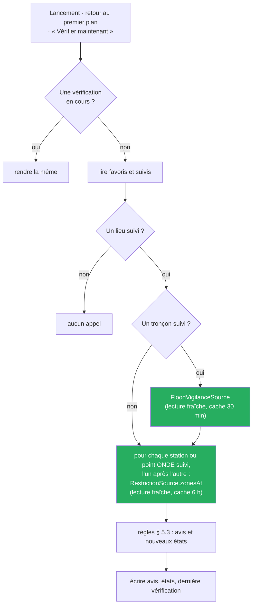
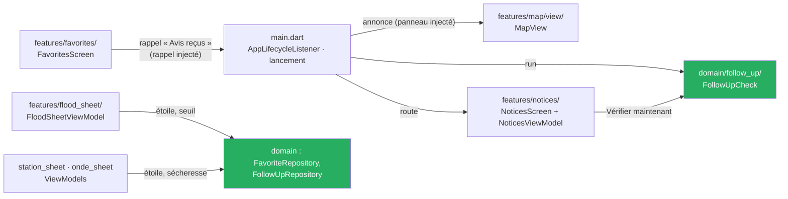

# Cadrage de T5 — Être prévenu : avis sur les lieux suivis, sans serveur ni compte

**Date :** 2026-10-17 · **Statut :** ✅ **approuvé par le commanditaire le 2026-10-17** (« Approuvé, plan suspendu »), conception et textes d'écran du § 11.2 compris — dix-sept arbitrages reçus le même jour par questions fermées (§ 2), dont deux après la relecture du cadrage par un second agent, corrections intégrées · ⏸ **Plan suspendu (arbitrage 16)** : une tranche d'ergonomie, d'après la maquette et les points d'interface ouverts, passe avant T5 ; le plan de T5 s'écrira sur les écrans refaits · **Branche :** aucune · **Cadrage d'ensemble :** [`2026-10-03-cadrage-t4-t5-crues-design.md`](2026-10-03-cadrage-t4-t5-crues-design.md), § 4 et § 7 · **Faits des sources :** [`docs/sources/vigicrues.md`](../../sources/vigicrues.md), [`docs/sources/vigieau.md`](../../sources/vigieau.md) · **État vivant :** [`project-state.md`](../../project-state.md)

> Ce document décide du **quoi**, du **pourquoi** et des **frontières** (où vit quoi, au regard d'[`ADR-014`](../../adr/ADR-014-feature-first-mvvm.md)). Il ne fixe ni les tâches ni le détail des widgets : le plan vient après. Les faits de code sont cités `fichier:ligne`, relevés le 2026-10-17 sur `c22ac0d` par un agent de lecture ; les faits de bibliothèques sont ceux du relevé pub.dev du même jour (§ 4.3), **lus, jamais exécutés**. Les décisions que la boucle principale a prises sans arbitrage sont au § 11.3, réversibles.

## 1. But et succès

Permettre à l'usager d'**être prévenu quand un niveau publié change sur un lieu qu'il suit** : la vigilance crues d'un tronçon Vigicrues, à partir du seuil qu'il a choisi parmi les niveaux publiés ; la gravité sécheresse des zones d'alerte VigiEau au point d'une station ou d'un point ONDE. Sans serveur ni compte : c'est l'appareil qui relit les sources, **quand l'application est ouverte** (étape 1). Les notifications en tâche de fond (étape 2) ne sont livrées dans aucune cible par T5 : T5 les **essaie**, sur Windows et sur Android, et en écrit le compte rendu.

**T5 est réussie si :**

1. sur Windows et sur Android, un lieu suivi dont le niveau publié change entre deux vérifications produit un **avis daté et attribué**, lisible dans l'écran « Avis reçus » et annoncé sur la carte (`BR-001`, `BR-016`) ;
2. une vérification impossible — source injoignable, réponse illisible, lieu introuvable — produit un avis qui le dit ; **un silence ne se lit jamais comme une absence de changement** (`BR-007`) ;
3. l'application **ne calcule aucun niveau** : le seuil de crue est un niveau publié choisi par l'usager ; aucun débit, aucune hauteur, aucun écoulement ne déclenche un avis (`BR-003`, `BR-015`) ;
4. **aucun appel** n'est fait sans lieu suivi ; les caches existants bornent la charge (Vigicrues 30 min, VigiEau 6 h), `NFR-07` amendé ;
5. les deux essais de l'étape 2 (Windows, Android) sont faits par le commanditaire et leur compte rendu écrit, **quel qu'en soit le résultat** ; aucune bibliothèque n'entre dans le `pubspec.yaml` de l'application ;
6. la suite reste verte et son décompte ne baisse pas (repère du cadrage : **3 978**, `dev` à `c22ac0d`, constaté le 2026-10-17 ; le plan relèvera le sien, après la tranche d'ergonomie) ;
7. la porte est franchie **sur Windows et sur Android** (arbitrage 10).

## 2. Arbitrages du commanditaire

| # | Date | Question | Réponse |
|---|---|---|---|
| 0 | 2026-10-03 | Découpage, ordre, deux étapes | T5 après T4 ; étape 1 vérification à l'ouverture, étape 2 notifications en tâche de fond après un essai par cible ([cadrage d'ensemble § 4](2026-10-03-cadrage-t4-t5-crues-design.md)) |
| 1 | 2026-10-17 | Clôture de T5 ; où va l'étape 2 ? | **« Étape 1 + essais »** : T5 livre la vérification à l'ouverture et un essai technique jetable de l'étape 2 sur Windows et sur Android, hors du `pubspec.yaml` de l'application. **T5 se clôt sur l'étape 1, quel que soit le résultat des essais.** L'étape 2 devient une tranche à part, cadrée sur ce que les essais ont prouvé, bibliothèque comprise |
| 2 | 2026-10-17 | Fréquence de la vérification (`C-12`, `C-13`, `C-15` ; Vigicrues : 2,2 Mo par appel) | **« Ouverture + retour »** : une vérification au lancement et à chaque retour de l'application au premier plan, et un bouton « Vérifier maintenant ». Les caches existants servent de frein : Vigicrues relu au plus toutes les 30 min (arbitrage 6 de T4), et seulement si un tronçon est suivi ; VigiEau, un appel par lieu suivi, l'un après l'autre, gardé 6 h. Aucun appel s'il n'y a aucun lieu suivi |
| 3 | 2026-10-17 | Changements de vigilance crues qui produisent un avis | **« Seuil, dans les deux sens »** : un avis à chaque changement du niveau publié dès que l'ancien **ou** le nouveau niveau atteint le seuil — montée au seuil, aggravation, baisse, retour sous le seuil. Seuil orange : jaune → orange, orange → rouge, rouge → orange, orange → jaune font un avis ; vert → jaune non. **Un niveau non reconnu fait toujours un avis** |
| 4 | 2026-10-17 | Quels lieux peut-on suivre ? | **« Favoris + tronçon »** : les favoris sont les lieux suivis. Station et point ONDE : avis de sécheresse au point du lieu (station : coordonnées lues dans le référentiel embarqué, sans réseau). Nouveau favori « tronçon Vigicrues », par l'étoile de la fiche tronçon : avis de crue avec son seuil. « Me prévenir » s'active lieu par lieu, **éteint par défaut**. **Aucun rattachement station → tronçon** (`VC-11`) |
| 5 | 2026-10-17 | Changements de sécheresse qui produisent un avis | **« Toute zone, tout changement »** : un avis quand la gravité d'une zone d'alerte du point change, dans les deux sens, quand une zone apparaît ou n'est plus citée ; chaque zone nommée, eaux superficielles d'abord, comme l'écran des restrictions. Une gravité non reconnue fait un avis. Aucun seuil (D2 du cadrage d'ensemble) |
| 6 | 2026-10-17 | Stockage des réglages, du dernier état connu et des avis | **« shared_preferences »**, comme les favoris (`ADR-011` amendé) : une clé JSON versionnée pour le suivi et le dernier état connu, une autre pour les avis, **liste bornée aux 100 avis les plus récents**. Aucune bibliothèque. Risque noté pour l'étape 2 : une tâche de fond qui écrit pendant que l'application tourne |
| 7 | 2026-10-17 | Où vit la vérification ? | **« Service du domaine »** : un seul cas d'usage, Dart pur, sous `lib/domain/` ; il lit les lieux suivis, appelle les ports `FloodVigilanceSource` et `RestrictionSource`, compare au dernier état connu, écrit les avis. Appelé par `main.dart` (lancement, retour au premier plan) et par le ViewModel de l'écran (« Vérifier maintenant »). Les sept règles de couches inchangées ; `ADR-017` et amendement d'`ADR-014` |
| 8 | 2026-10-17 | Où régler « Me prévenir » et lire les avis ? | **« Fiche + « Avis reçus » »** : le réglage se fait dans la fiche, sous l'étoile — la fiche tronçon gagne l'étoile, puis « Me prévenir » et le seuil Jaune / Orange / Rouge ; fiches station et ONDE : « Me prévenir des restrictions sécheresse ». L'écran « Favoris » rappelle le réglage de chaque lieu (texte, aucune mesure) et ouvre un écran « Avis reçus », qui porte « Vérifier maintenant ». Au lancement, un avis nouveau s'annonce sur la carte et mène à cet écran. **Aucun bouton de plus sur la carte** (point 61) |
| 9 | 2026-10-17 | Texte de l'avertissement « Ce n'est pas un système d'alerte » | **« Sans impératif, complet »** : texte au § 11.2, encart non repliable en tête de l'écran des avis, repris sous le réglage, suivi du lien « Lire la vigilance sur www.vigicrues.gouv.fr » |
| 10 | 2026-10-17 | Porte de T5 | **Windows et Android**, comme T3 et T4 : exécutable de release Windows lancé hors Flutter, émulateur `Pixel_7` en débogage ; plus les comptes rendus des deux essais |
| 11 | 2026-10-17 | Voie de l'essai Windows (aucune bibliothèque de tâche de fond ne cible Windows) | **« Planificateur »** : le planificateur de tâches de Windows lance l'exécutable de l'essai avec un argument ; il vérifie, affiche un toast si un niveau a changé, puis quitte, sans fenêtre (modification du runner C++, dans l'essai). La tâche planifiée est **créée et supprimée à la main par le commanditaire**, commandes fournies |
| 12 | 2026-10-17 | Bibliothèques des essais | **`flutter_local_notifications` 22.3.2 + `workmanager` 0.10.10**, dans un projet jetable sous `spike/`, **jamais** dans le `pubspec.yaml` de l'application (§ 4.3). Les notifications planifiées (`zonedSchedule`) sont écrites d'avance et ne peuvent pas dépendre d'un appel réseau : elles ne servent pas |
| 13 | 2026-10-17 | Relecture du cadrage : les fiches station et ONDE ne montrent aucune gravité ; un premier relevé muet laisserait l'état de départ invisible. Que fait la première vérification d'un lieu ? | **« Avis « Suivi commencé » »** : pour chaque lieu, crues comme sécheresse, la première lecture réussie produit un avis « Suivi commencé » qui dit l'état publié lu (vigilance du tronçon ; zones et gravités du point, ou « aucune zone citée »), daté et attribué — *remplace le « premier relevé sans avis » de la première rédaction* |
| 14 | 2026-10-17 | Relecture du cadrage : le code de l'essai entre-t-il dans git ? | **« Versionné, exclu de l'analyse »** : le projet d'essai est committé (sans `build/` ni caches), pour être reconstruit sur un autre poste ; `analysis_options.yaml` exclut `spike/**`, le `flutter analyze` de la racine reste à zéro remarque ; jamais importé par `lib/` ni `test/` — *écart assumé au précédent de `spike/porte_flutter/`, qui ne versionne que son compte rendu* |
| 15 | 2026-10-17 | Question du commanditaire pendant le cadrage : T5 traite-t-elle les améliorations d'interface encore ouvertes (points 49, 51, 60, 61, 63, 64 de `project-state.md`) ? | ~~**« Tranche à part, après T5 »** : T5 ne touche que son interface à elle ; les points ouverts passent dans une tranche de finitions cadrée une fois T5 close~~ — **remplacé par l'arbitrage 17** |
| 16 | 2026-10-17 | Les trois rangées d'ergonomie de la maquette du 2026-10-03 (carte à un seul sélecteur ; fiches hiérarchisées, restrictions par désignation seule ; fiche en panneau latéral sur Windows) : où ? | **« Avant T5 »** : le plan de T5 est **suspendu** ; une tranche d'ergonomie d'après la maquette passe d'abord ; T5 se planifie ensuite sur les écrans refaits |
| 17 | 2026-10-17 | Les points d'interface ouverts (49, 51, 60, 61, 63, 64) rejoignent-ils cette tranche ? | **« Oui, regrouper avant T5 »** : une seule tranche d'interface avant T5 — la maquette refait le sélecteur, les fiches et le panneau Windows, ce qui change la mise en page des points 60, 61 et 64 ; remplace l'arbitrage 15 |

## 3. Périmètre

### Dedans

| # | Élément | Source |
|---|---|---|
| D1 | **Favori tronçon** : étoile sur la fiche tronçon ; ligne « Tronçon Vigicrues » dans l'écran « Favoris » ; l'ouvrir passe sur la lecture Crues et ouvre sa fiche | arbitrage 4 ; T4 l'avait renvoyé à T5 |
| D2 | **« Me prévenir »**, lieu par lieu, éteint par défaut : seuil Jaune / Orange / Rouge sur la fiche tronçon ; restrictions sécheresse sur les fiches station et ONDE ; visible seulement pour un lieu en favori | arbitrages 4, 8 ; D1, D2 du cadrage d'ensemble |
| D3 | **Vérification à l'ouverture** : au lancement, au retour au premier plan, sur « Vérifier maintenant » ; une à la fois ; par les caches existants, **en lecture fraîche** (§ 6.3) | arbitrage 2 |
| D4 | **Règles d'avis**, pures, dans le domaine : crues (arbitrage 3), sécheresse (arbitrage 5), suivi commencé (arbitrage 13), vérification impossible, lieu non vérifiable, stockage illisible (§ 5.3) | arbitrages 3, 5, 13 ; D4 du cadrage d'ensemble |
| D5 | **Écran « Avis reçus »** : encart d'avertissement, contrôle « ⚠ Avertissement », dernière vérification, « Vérifier maintenant », avis datés et attribués, les nouveaux marqués | arbitrage 8 ; D3 du cadrage d'ensemble |
| D6 | **Annonce sur la carte** quand une vérification produit un avis nouveau, « Lire les avis » | arbitrage 8 |
| D7 | **Écran « Favoris »** : le tronçon, le rappel du réglage de chaque lieu, l'accès à « Avis reçus » ; toujours aucune mesure | arbitrage 8 |
| D8 | **Stockage** : `shared_preferences`, deux clés versionnées, 100 avis au plus | arbitrage 6 |
| D9 | **Avertissement de suivi** (`BR-016`) : encart non repliable en tête d'« Avis reçus », texte repris sous chaque réglage « Me prévenir », fenêtre « ⚠ Avertissement » de l'écran des avis | arbitrage 9 ; D5 du cadrage d'ensemble |
| D10 | **Essais de l'étape 2** : un projet jetable sous `spike/t5_tache_de_fond/`, versionné et exclu de l'analyse de la racine, essai Android (`workmanager`) et essai Windows (planificateur), compte rendu daté | arbitrages 1, 11, 12, 14 |
| D11 | **Documents** : `US-22`, `UC-010`, `BR-016`, `ADR-017` ; amendements (§ 12) | règle du projet |
| D12 | **Porte** sur Windows et Android, version `0.6.0` | arbitrage 10 |

### Dehors

| Élément | Vers | Motif |
|---|---|---|
| Notifications système, tâche de fond, lancement planifié **dans l'application** | tranche à part, cadrée sur les essais | arbitrage 1 |
| Rattacher une station ou un point ONDE à un tronçon (par distance ou autrement) | jamais inventé | `VC-11` : aucun lien structuré ; une règle de distance serait un seuil inventé |
| Suivre un point désigné sur la carte des restrictions | non prévu | arbitrage 4 |
| Un avis tiré d'un débit, d'une hauteur, d'un écoulement ONDE | jamais (`Won't (v1)`) | `BR-003`, `BR-015` ; D1 et D2 du cadrage d'ensemble ne visent que crues et sécheresse |
| Envoi par courriel, SMS, serveur ; compte | jamais | `02-specifications.md § 3` |
| Un avis qui rouvre une fiche ou l'écran des restrictions (avis cliquable) | non prévu | § 11.3, R9 : l'écran « Favoris » ouvre les lieux |
| Répéter un avis non lu, rappel, son, vibration | non prévu | étape 1 sans notification système |
| Avis quand une date vieillit ; seuil d'ancienneté | non prévu | aucune borne publiée (comme R16 de T4) |
| Historique au-delà de 100 avis ; export | non prévu | arbitrage 6 |
| iOS | configuré, jamais compilé | aucun hôte macOS (`NV-W4`) |
| Changer le modal du premier lancement | non prévu en T5 | `BR-012` : un changement forcerait un nouvel acquittement (comme l'arbitrage 8 de T4) |
| Les trois rangées d'ergonomie de la maquette ; les points d'interface ouverts 49, 51, 60, 61, 63, 64 | tranche d'ergonomie, **avant** T5 | arbitrages 16, 17 |

## 4. État des lieux — lu le 2026-10-17

### 4.1 Code (`c22ac0d`)

| Fait | Preuve |
|---|---|
| `sealed class Favorite`, trois branches : `StationFavorite` (code, libellé, date d'ajout, **sans coordonnées**), `OndePointFavorite` (le `OndePoint` entier, **avec** latitude et longitude), `UnreadableFavorite` (brut gardé tel quel) ; identité = type + code | `lib/domain/favorites/favorite.dart:18`, `:24`, `:56`, `:96`, `:114-122` ; `lib/domain/onde/onde_point.dart:33`, `:37` |
| `FavoriteRepository` : `readAll`, `add`, `remove`, `clear` ; échecs `ListeDeFavorisIllisible`, `EcritureDeFavorisEnEchec` | `lib/domain/favorites/favorite_repository.dart:11-43` |
| Une clé `favorites`, forme `{"version":1,"favoris":[…]}` ; un type inconnu est gardé en `UnreadableFavorite` et réécrit à l'identique ; aucune limite de nombre | `lib/data/preferences/shared_preferences_favorite_repository.dart:25` ; `lib/data/preferences/favorites_codec.dart:28`, `:113`, `:142`, `:161` |
| `shared_preferences` par l'API historique `SharedPreferences.getInstance()` (cache en mémoire du processus) | `shared_preferences_favorite_repository.dart:30` ; `shared_preferences_acknowledgement_repository.dart:9-10`, `:31` |
| `StationRepository.findByCode(StationCode)` rend la `Station`, qui porte ses coordonnées (référentiel embarqué) | `lib/domain/repositories/repositories.dart:32` ; `lib/domain/station/station.dart:99-121` |
| `RestrictionSource.zonesAt(GeoPoint)` → `ZonesAtPoint` (`retrievedAt`, `zones`) ; `AlertZone` : `name`, `kind` (`ZoneKind` : `EauxSuperficielles`, `EauxSouterraines`, `EauPotable`, `TypeZoneInconnu`), `severity` (`DroughtSeverity` : `Vigilance`, `Alerte`, `AlerteRenforcee`, `Crise`, `GraviteInconnue`), `decree.validFrom` ; **aucun identifiant de zone** | `lib/domain/restrictions/restriction_source.dart:36-43` ; `zones_at_point.dart:19-51` ; `alert_zone.dart:61-85`, `:147-162` ; `drought_severity.dart:17-109` ; `zone_kind.dart:15-82` |
| Libellés existants : gravité « Vigilance », « Alerte », « Alerte renforcée », « Crise », « Non renseigné » ; type de zone « Eaux superficielles », « Eaux souterraines », « Eau potable », « Type de zone non renseigné » | `drought_severity.dart:103-109` ; `zone_kind.dart:79-82` |
| `FloodVigilanceSource.current()` → `FloodVigilanceMap` (`informationDate`, `sections`, `skippedEntities`, `sectionByCode`) ; `FloodSection` (`code`, `name`, `territoryCode`, `level`) ; `FloodVigilanceLevel` : `Vert`, `Jaune`, `Orange`, `Rouge`, `NiveauCruesInconnu(raw)` | `lib/domain/floods/flood_vigilance_source.dart:7-61` ; `flood_vigilance_map.dart:7-53` ; `flood_section.dart:42-111` ; `flood_vigilance_level.dart:11-65` |
| Caches : `floodVigilanceCacheTtl` 30 min, une entrée ; `restrictionsCacheTtl` 6 h, clé lat/lon à 7 décimales ; tous deux en mémoire, par `withCachePolicy` : **périmé → rendu tout de suite et rafraîchi en fond sans prévenir l'appelant** | `lib/data/floods/cached_flood_vigilance_source.dart:23` ; `lib/data/restrictions/cached_restriction_source.dart:59-90` ; `lib/data/cache/cache_policy.dart:32-69`, `:121-139` |
| Démarrage : acquittement lu avant `runApp`, puis dépôts et sources construits, **une seule** `SharedPreferencesFavoriteRepository` ; la carte n'est construite qu'une fois l'avertissement acquitté | `lib/main.dart:97-198`, `:208-212`, `:499-509` |
| Aucun `AppLifecycleListener` ni `WidgetsBindingObserver`, aucune tâche de fond, aucune notification dans `lib/`, `pubspec.yaml`, `android/` | recherches du 2026-10-17 (`AppLifecycle`, `Workmanager`, `Isolate.`, `notification`, `POST_NOTIFICATIONS`) |
| L'écran « Favoris » ne montre que l'identité ; ouvert par `main.dart`, `FavoritesViewModel.load()` à chaque ouverture | `lib/features/favorites/view/favorites_screen.dart:4-8`, `:305-329` ; `lib/main.dart:685-727` |
| La fiche tronçon n'a pas d'étoile ; `FloodSheetViewModel` ne lit aucun dépôt (113 lignes) | `lib/features/flood_sheet/view_model/flood_sheet_view_model.dart` ; cadrage de T4, R12 |
| Étoile partagée : `FavoriteStar` (Dart pur) et `FavoriteStarButton` (« Ajouter aux favoris », « Retirer des favoris ») | `lib/features/shared/favorite_star.dart` ; `lib/features/shared/favorite_star_button.dart:26-29` |
| Avis de carte : `sealed MapNotice`, décision pure `mapNoticesFor` | `lib/features/map/view/map_empty_states.dart:188-276`, `:355` |
| Taille : `main.dart` 823 lignes, `map_view.dart` 2 668 | `wc -l` du 2026-10-17 |
| Android : `minSdk` 24, `targetSdk` et `compileSdk` 36 (valeurs du SDK Flutter installé) ; seule permission `INTERNET` | `android/app/build.gradle.kts:9`, `:21-22` ; `android/app/src/main/AndroidManifest.xml:3` |
| Windows : le runner transmet les arguments de la ligne de commande au point d'entrée Dart et crée **toujours** une fenêtre ; le `main()` de l'application ne prend aucun paramètre (le projet d'essai, lui, lira `main(List<String> args)`) | `windows/runner/main.cpp:22-25` ; `lib/main.dart:96` |
| `analysis_options.yaml` n'exclut pas `spike/` : un projet Flutter posé là serait analysé par le `flutter analyze` de la racine ; seul `spike/porte_flutter/COMPTE-RENDU.md` est versionné | `analysis_options.yaml` ; `git ls-files spike` du 2026-10-17 |
| Verrous à étendre : `.feature` (`acceptance_features_test.dart:56-65`), BR et UC attendus (`tracabilite_test.dart:38-67`), types du domaine (`domain_model_doc_test.dart:21-78`) | relevé du 2026-10-17 |

### 4.2 Sources

| Fait | Réf. |
|---|---|
| Vigicrues : un seul document national de 2,2 Mo, non compressé, daté au premier niveau (`DtHrInfoVigiCru`) ; production annoncée « au moins deux fois par jour, à 10h et 16h », **non mesurée** | `VC-01`, `VC-05` |
| Vigicrues : niveaux `2` à `4` jamais observés en production (au 2026-10-17) | `VC-04` ; `vigicrues.md`, « Non vérifié » |
| VigiEau : `X-RateLimit-Limit: 300`, fenêtre non élucidée ; aucun `429` observé | `C-13` ; `VG-10` |
| Aucune source n'a de SLA | `C-15` |

### 4.3 Bibliothèques — relevé du 2026-10-17, lu, rien exécuté

Relevé complet, avec chaque URL lue : [`spike/t5_tache_de_fond/RELEVE-BIBLIOTHEQUES.md`](../../../spike/t5_tache_de_fond/RELEVE-BIBLIOTHEQUES.md) — pub.dev (pages et API JSON), GitHub, Microsoft Learn, developer.android.com, par un agent de lecture.

| Paquet | Version, date | Éditeur, licence | Plateformes | Ce qui compte pour T5 |
|---|---|---|---|---|
| `flutter_local_notifications` | **22.3.2**, 2026-10-12 | `dexterx.dev` vérifié, **BSD-3-Clause** | Android, iOS, Linux, macOS, web, **Windows** (depuis 19.0.0) | Seul paquet relevé qui couvre Windows **et** Android. Flutter `>=3.38.1`, Dart `^3.10.0`. Android : API 24 minimum (le projet est à 24), **désucrage** des bibliothèques cœur exigé (absent de `build.gradle.kts`), `POST_NOTIFICATIONS` déclarée. Windows non empaqueté : le code natif enregistre un AUMID sous `HKCU\Software\Classes\AppUserModelId\<aumid>`, sans raccourci ni MSIX pour **afficher** ; `cancel` et `getActiveNotifications` exigent MSIX ; aucun `LocalServer32` écrit — **inférence** : un clic ne relance pas l'exécutable fermé. `periodicallyShow` non pris en charge sur Windows. N'exécute aucun code réseau de lui-même |
| `workmanager` | **0.10.10**, 2026-09-07 | `fluttercommunity.dev` vérifié, **MIT** | Android, iOS, macOS, web — **pas Windows** | Tâche périodique Android ≥ **15 min**, jamais exacte ; Doze et App Standby la reportent (une application peu ouverte : réseau environ une fois par jour) ; Flutter `>=3.38.0` ; `android.builtInKotlin=false` déjà posé dans le projet |
| `background_fetch` 1.7.0 · `android_alarm_manager_plus` 5.1.2 | 2026-05-25 · 2026-10-01 | MIT · BSD-3-Clause | Android, iOS · Android | Écartés : pas de Windows ; le second exige des alarmes exactes refusées par défaut depuis Android 14 |
| `local_notifier` 0.1.6 · `windows_notification` 1.3.0 · `win_toast` 0.4.0 | 2024-04-05 · 2024-08-20 · 2025-07-18 | MIT · MIT · Apache-2.0 | sans Android | Écartés (arbitrage 12) |
| `awesome_notifications` 0.12.1 | 2026-07-01 | Apache-2.0 | dont Windows sur pub.dev | Écarté : se dit incompatible avec tout autre plugin de notifications ; le README range encore le bureau dans « prochaines étapes » |
| `tray_manager` 0.8.0 · `launch_at_startup` 0.5.1 | 2026-10-08 · 2025-04-01 | MIT · MIT | bureau | Non retenus (arbitrage 11) |
| Planificateur de tâches Windows (`schtasks`) | — | système, aucun paquet | Windows | Lance un programme avec arguments, à heure (`/sc minute`, `/mo` 1 à 1439) ou à l'ouverture de session (`/sc onlogon`) ; Microsoft déconseille une interrogation à intervalle court sur batterie |

**À prouver par les essais, rien n'est établi :** un toast affiché par l'exécutable non empaqueté avec le seul AUMID ; un mode « vérifier puis quitter » sans fenêtre lancé par le planificateur ; la tâche `workmanager` qui part application fermée, sous Doze ; la demande de `POST_NOTIFICATIONS` sur l'émulateur.

## 5. Conception — domaine

Dart pur (`domain_isolation_test.dart`). Code en anglais ; branches de nomenclature en français là où le projet le fait déjà.

### 5.1 Le favori tronçon — `lib/domain/favorites/`

- `FloodSectionFavorite` : quatrième branche de `Favorite` — `code` (`FloodSectionCode`), `name` (le nom publié **au moment de l'ajout**, tel quel), `addedAt` (UTC). Identité : type + code, comme les autres (`sameFavoritePlace`).
- Chaque `switch` sur `Favorite` gagne sa branche (codec, écran « Favoris », fiches) : le compilateur les désigne.

### 5.2 Le suivi — `lib/domain/follow_up/`

| Type | Contenu |
|---|---|
| `FloodThreshold` (`enum`) | `jaune`, `orange`, `rouge` — **une valeur choisie par l'usager parmi les niveaux publiés**, pas une nomenclature d'API : aucune branche inconnue (une valeur stockée illisible rend l'entrée illisible, § 6.1) |
| `FollowUp` (`sealed`) | `FloodFollowUp(place, threshold, lastKnown?)` pour un tronçon ; `DroughtFollowUp(place, lastKnown?)` pour une station ou un point ONDE ; `UnreadableFollowUp(raw)` gardé tel quel. `place` = l'identité du favori |
| `LastKnownFloodLevel` | le niveau publié lu (`FloodVigilanceLevel`, inconnu compris) et la date de l'information |
| `LastKnownZones` | pour chaque zone citée : nom, type, gravité (inconnue comprise), date d'entrée en vigueur de l'arrêté ; et la date de la lecture |
| `FollowUpRepository` (port) | lire tout ; activer ou modifier le suivi d'un lieu ; l'éteindre ; enregistrer le dernier état connu et l'état des sources ; échecs typés sur le modèle de `FavoriteStorageFailure`, sans en partager les types |
| `ReceivedNotice` (`sealed`) | `FollowUpStarted` (lieu, état publié lu : le niveau et la date de l'information, ou les zones et la date de la lecture ; arbitrage 13) · `FloodLevelChanged` (lieu, ancien et nouveau niveau, date de l'information) · `DroughtZoneChanged` (lieu, zone : nom et type, ancienne gravité ou `null` si la zone apparaît, nouvelle gravité ou `null` si elle n'est plus citée, date de l'arrêté) · `CheckImpossible` (source : crues ou sécheresse ; cause : **injoignable, refusée ou illisible**, les trois échecs des ports ; les lieux concernés) · `PlaceNotVerifiable` (lieu ; motif : tronçon absent de la vigilance publiée, tronçon peut-être parmi les entités illisibles, station absente du référentiel embarqué). Chacun porte `receivedAt` (UTC) et un drapeau « lu » |
| `NoticeRepository` (port) | lire la liste (la plus récente en tête) ; ajouter des avis, **en gardant les 100 plus récents** ; marquer tout comme lu ; repartir d'une liste vide ; échecs typés (liste illisible, écriture en échec) |
| `LastCheck` | date de la dernière vérification et, par source, la date de sa dernière lecture réussie |
| `CheckOutcome` | ce que rend une vérification : nombre d'avis nouveaux ; vérification faite, sans lieu suivi, ou **impossible faute de stockage lisible** (suivi ou avis), dit tel |

### 5.3 Les règles — pures, testées sans rien d'autre

- **Rang** des niveaux publiés : vert 0, jaune 1, orange 2, rouge 3 ; le seuil a le rang de son niveau. **Ce rang compare deux niveaux publiés ; il ne calcule aucun niveau** (`BR-016`).
- **Avis de crue dû** (arbitrage 3) : ancien ≠ nouveau, **et** (l'un des deux est `NiveauCruesInconnu`, **ou** max(rang ancien, rang nouveau) ≥ rang du seuil). Deux inconnus de même valeur brute sont égaux ; de valeurs différentes, ils diffèrent.
- **Changements de sécheresse** (arbitrage 5) : zones appariées par (type, nom) ; gravité changée → un avis ; zone nouvelle → un avis (« n'était pas citée ») ; zone plus citée → un avis (« n'est plus citée ») ; ordre des avis : eaux superficielles, puis les autres, comme l'écran des restrictions. Un changement de la seule date d'arrêté, gravité égale, **ne fait pas d'avis** (§ 11.3, R5).
- **Premier relevé** (arbitrage 13) : un lieu dont le dernier état est inconnu (suivi tout juste activé) produit, à sa première lecture réussie, un avis **« Suivi commencé »** qui dit l'état publié lu, et l'enregistre ; aucune règle de changement ne s'applique à cette lecture.
- **Vérification impossible** (R4) : une **série** d'échecs se compte **par lieu et par source** — pour Vigicrues, un échec de la carte met en série tous les tronçons suivis ; pour VigiEau, chaque point a la sienne (un point refusé à chaque fois n'empêche pas les autres de se lire). Une série s'ouvre au premier échec et se ferme à la première lecture réussie **de ce lieu**, sans avis de rétablissement. **Un seul avis par source et par vérification** nomme les lieux dont la série s'ouvre ; un lieu déjà en série n'est pas redit. Le dernier état connu ne change pas pendant un échec.
- **Lieu non vérifiable** : un avis par lieu et par série, de même (R4).
- **Stockage illisible** (R16) : si la clé du suivi ou celle des avis est illisible, la vérification **n'appelle aucune source et n'écrit rien** ; elle rend « impossible faute de stockage lisible », que l'annonce de la carte et l'écran « Avis reçus » disent ; l'écran offre « Repartir d'une liste vide », sur le modèle de la liste de favoris illisible (`favorites_screen.dart:53-63`). Jamais un silence.

### 5.4 La vérification — `FollowUpCheck`, cas d'usage du domaine (arbitrage 7)

- Dépend **seulement** de ports du domaine : `FavoriteRepository`, `FollowUpRepository`, `NoticeRepository`, `FloodVigilanceSource`, `RestrictionSource`, `StationRepository` (coordonnées d'une station) et d'une horloge injectée.
- **Une seule à la fois** : un appel pendant qu'une vérification court rend la même.
- Un suivi dont le favori n'existe plus est ignoré (et retiré à l'écriture suivante) ; un suivi éteint n'est pas lu.
- Rend un `CheckOutcome` : nombre d'avis nouveaux, ou vérification impossible faute de stockage lisible — `main.dart` en tire l'annonce de la carte.
- **Aucun appel réseau sans lieu suivi** ; Vigicrues **seulement** si un tronçon est suivi (arbitrage 2).

## 6. Conception — données

### 6.1 Stockage, `lib/data/follow_up/` (arbitrage 6)

- Deux clés `shared_preferences`, nommées dans le plan, chacune une chaîne JSON **versionnée** (`"version": 1`), sur le modèle de `favorites_codec.dart` : **le suivi** (réglages, derniers états, dernière vérification, séries d'échecs) et **les avis** (100 au plus).
- Une entrée illisible est gardée telle quelle et réécrite à l'identique (`UnreadableFollowUp`, comme `UnreadableFavorite`) ; une racine illisible lève un échec typé, jamais une liste vide, et n'est remplacée que par le geste « Repartir… » de l'écran « Avis reçus » (§ 5.3, R16).
- Les niveaux et gravités se stockent par des **mots propres au projet** (« vert », « jaune »… ; « vigilance », « alerte »…), la valeur brute d'un inconnu gardée telle quelle : **aucun nom de champ ni valeur codée d'API** n'y paraît (confinement de `ADR-016` et d'`ADR-004`).
- `favorites_codec.dart` gagne le type `troncon` ; la **version reste 1** : un lecteur plus ancien le garde en `UnreadableFavorite` et le réécrit à l'identique (`favorites_codec.dart:113`, `:161`).
- Chaque dépôt sérialise ses écritures (comme `_inTurn` des favoris). **Une seule instance** de chacun, construite par `main.dart`.

### 6.2 Aucun changement de source

`VigicruesFloodVigilanceSource` et `VigieauRestrictionSource` ne changent pas ; aucun appel nouveau, aucun paramètre nouveau.

### 6.3 Lecture fraîche — dans `CachePolicy`, seul composant de cache

Le décorateur rend une valeur périmée **tout de suite** et rafraîchit en fond **sans prévenir l'appelant** (`cache_policy.dart:32-69`). Pour la vérification, c'est un défaut : passé 30 min, elle comparerait l'**ancienne** carte de vigilance et ne verrait le changement qu'à la vérification suivante — peut-être le lendemain.

- `withCachePolicy` gagne une **lecture fraîche** : valeur encore valide → rendue ; périmée ou absente → **attendre** la lecture (en partageant un rafraîchissement déjà en vol) ; échec → levé, l'ancienne valeur restant en cache pour la lecture ordinaire.
- `CachedFloodVigilanceSource` et `CachedRestrictionSource` exposent chacun une **vue fraîche** qui implémente le même port, sur la **même** entrée de cache : la carte et la vérification ne téléchargent jamais deux fois. `main.dart` passe les vues fraîches à `FollowUpCheck`, les vues ordinaires aux écrans.
- La lecture ordinaire ne change pas de comportement.

### 6.4 `NFR-07`, amendement (texte au § 11.1)

Vigicrues est aussi lu à la vérification des lieux suivis, seulement si un tronçon est suivi ; VigiEau, un appel par station ou point ONDE suivi, l'un après l'autre ; les caches de 30 min et de 6 h bornent les deux, y compris sur « Vérifier maintenant » ; aucun appel sans lieu suivi.

## 7. Conception — écrans

> ⏸ **À relire sur les écrans refaits** (arbitrage 16) : la tranche d'ergonomie change le sélecteur, les fiches et, sur Windows, la place de la fiche. Ce qui suit dit **ce que T5 ajoute** à chaque écran ; l'endroit exact où il se pose se fixe avec le plan, sur les écrans tels qu'ils seront. Les choix arbitrés (réglage dans la fiche, « Avis reçus » ouvert depuis « Favoris », aucun bouton de plus sur la carte) ne changent pas.

### 7.1 Fiche tronçon (`flood_sheet`)

- Gagne **l'étoile** (`FavoriteStarButton` partagé), à l'endroit qu'elle a dans les deux autres fiches. `FloodSheetViewModel` reçoit `FavoriteRepository` et `FollowUpRepository` ; la fiche reste ouverte **sans appel réseau** (R12 de T4).
- **Une fois le tronçon en favori**, la section « Me prévenir » : quatre choix exclusifs — « Non » (par défaut), « Jaune », « Orange », « Rouge » — et la phrase qui dit la règle ; puis l'**avertissement de suivi** complet (§ 11.2). Retirer l'étoile éteint le suivi.
- Ordre de la fiche : celui de T4, puis la section « Me prévenir » **après** le lien du bulletin ; l'encart de crue reste en tête.

### 7.2 Fiches station et ONDE

- Une fois le lieu en favori : « Me prévenir des restrictions sécheresse » (interrupteur, éteint par défaut), la phrase qui dit la règle, l'avertissement de suivi. Retirer l'étoile éteint le suivi.
- Les deux ViewModels reçoivent `FollowUpRepository`. Le widget de l'interrupteur et l'avertissement de suivi, partagés par trois fiches, vivent dans `lib/features/shared/`.

### 7.3 Écran « Favoris »

- Ligne d'un tronçon : son nom, « Tronçon Vigicrues », la date d'ajout ; l'ouvrir passe sur la lecture Crues et ouvre sa fiche **une fois la vigilance lue** — si le tronçon n'y figure pas, la fiche le dit, l'étoile restant disponible ; la carte ne bouge pas (arbitrage 6 de T3, R7).
- Chaque lieu suivi porte le **rappel de son réglage** (texte au § 11.2) ; aucun niveau, aucune mesure.
- Un accès « Avis reçus », avec le nombre d'avis non lus ; `main.dart` pousse l'écran.

### 7.4 Écran « Avis reçus » — tranche `lib/features/notices/{view,view_model}/`

- `NoticesViewModel` (`ChangeNotifier`, aucun widget) : lit `NoticeRepository` et la dernière vérification, appelle `FollowUpCheck` sur « Vérifier maintenant », marque les avis comme lus à la fermeture de l'écran (R8). États : lecture, aucun lieu suivi, aucun avis, avis lus, **avis illisibles**, **suivi illisible** — chacun des deux derniers avec son geste « Repartir… » (R16).
- Dans l'ordre : barre de titre (`ScreenTitleBar`) avec le contrôle « ⚠ Avertissement » (sa fenêtre ajoute le texte de suivi) ; **encart** non repliable, annoncé en priorité au lecteur d'écran ; lien « Lire la vigilance sur www.vigicrues.gouv.fr » ; « Dernière vérification » ; « Vérifier maintenant » (désactivé pendant une vérification, qui se dit) ; les avis, le plus récent en tête, les non lus marqués « Nouveau ».
- **Chaque avis porte** : son échelle (crues **ou** sécheresse, jamais les deux, `BR-008`), le lieu, le niveau ou la gravité **publiés** et le précédent, la date de l'information ou de l'arrêté, la source (« © VIGICRUES » ou « VigiEau »), « Reçu le … » (`BR-001`). Un avis n'est pas un lien (R9).

### 7.5 Annonce sur la carte (arbitrage 8)

- Quand une vérification **produit au moins un avis nouveau** — ou qu'elle est impossible faute de stockage lisible —, la carte montre une annonce : « 1 avis nouveau sur vos lieux suivis » / « N avis nouveaux… » (ou le texte du stockage illisible), action « Lire les avis », fermeture. Elle disparaît à l'ouverture de l'écran ou à sa fermeture.
- **Aucun bouton de plus** dans les colonnes de la carte (point 61) : l'annonce est un **panneau injecté** par `main.dart` (comme les fiches), placé par la mise en page des surcouches ; elle ne passe pas par `mapNoticesFor`, qui reste réservée à ce que montre la carte (R10).

### 7.6 Composition, `main.dart`

- Construit une instance de chaque dépôt, `FollowUpCheck` sur les **vues fraîches** (§ 6.3), `NoticesViewModel`.
- **Lancement** : la vérification part une fois la carte affichée, donc après l'acquittement de l'avertissement (`main.dart:208-212`).
- **Retour au premier plan** : un `AppLifecycleListener` (dans l'état de la racine, qui seul importe les widgets et compose) lance la vérification à chaque `onResume` ; les caches font le frein (arbitrage 2). Sur Windows, le retour au premier plan est celui que Flutter signale ; ce qu'il recouvre (fenêtre restaurée, focus) est **à constater à la porte** (§ 10, `f`).
- Test de la racine (`test/main_test.dart`) : la vérification au lancement, au retour, l'annonce, la route, l'ouverture d'un favori tronçon.

## 8. Ce que T5 ne fait pas, et le dit

### 8.1 Relayer, ne rien calculer (`BR-015`, `BR-016`)

- Le seuil de crue est **un niveau publié** choisi par l'usager ; le comparer à un autre niveau publié n'est pas calculer un niveau.
- Aucun avis ne dit « fin de vigilance », « danger écarté », « restrictions levées » : un retour sous le seuil dit le niveau publié ; une zone qui n'est plus citée dit seulement qu'elle n'est plus citée, et que l'arrêté fait foi (`BR-007`).
- Aucun texte ne promet un délai, une exhaustivité, un « temps réel » (`BR-014`) ; l'encart dit l'inverse.

### 8.2 Ce que l'étape 1 ne peut pas voir

Un niveau monté puis redescendu entre deux ouvertures ne laisse aucun avis : l'application ne relit que lorsqu'elle est ouverte. C'est écrit dans l'avertissement (arbitrage 9) et dans `BR-016`.

### 8.3 Ce qui n'est pas vérifiable avant un épisode

Les niveaux 2 à 4 n'ont jamais été publiés depuis le relevé de T4 (`VC-04`) ; aucun arrêté n'a été vu changer pendant T4. Les avis sont éprouvés par **des cas construits dans les tests, dits tels**, jamais sous `test/fixtures/`. Un vrai changement survenu avant la porte se constate à l'écran (§ 10, `j`).

## 9. Critères d'acceptation proposés — `US-22`

Futurs scénarios de `docs/acceptance/suivi.feature`, écrits avec le lot qui les réalise.

1. La fiche tronçon porte l'étoile ; ajouter le tronçon le fait apparaître dans « Favoris » comme « Tronçon Vigicrues ».
2. Ouvrir un favori tronçon passe sur la lecture Crues et ouvre sa fiche une fois la vigilance lue ; un tronçon absent de la vigilance publiée le dit.
3. « Me prévenir » n'apparaît que pour un lieu en favori ; il est sur « Non » à l'ajout.
4. Sur la fiche tronçon, choisir « Orange » enregistre le seuil ; « Favoris » le rappelle ; retirer l'étoile éteint le suivi.
5. Sur les fiches station et ONDE, l'interrupteur « Me prévenir des restrictions sécheresse » s'enregistre et se rappelle de même.
6. Sous chaque réglage, l'avertissement de suivi est écrit en entier.
7. Sans lieu suivi, aucune vérification n'appelle de source.
8. Avec un tronçon suivi, la vérification lit Vigicrues ; sans tronçon suivi, elle ne le lit pas.
9. Au lancement, après l'acquittement, et au retour au premier plan, une vérification part ; une seule à la fois.
10. La première lecture réussie d'un lieu suivi produit un avis « Suivi commencé » qui dit l'état publié lu — la vigilance du tronçon, ou les zones et gravités du point, ou « aucune zone citée » —, daté et attribué ; aucune règle de changement ne s'y applique.
11. Seuil orange : jaune → orange, orange → rouge, rouge → orange, orange → jaune produisent un avis ; vert → jaune et jaune → vert n'en produisent pas.
12. Un niveau non reconnu, ancien ou nouveau, produit un avis « niveau non reconnu ».
13. Sécheresse : une gravité changée, une zone nouvelle, une zone plus citée produisent chacune un avis qui nomme la zone et son type, eaux superficielles d'abord ; une gravité non reconnue produit un avis.
14. Une source injoignable, qui refuse ou dont la réponse est illisible produit un avis « Vérification impossible » qui nomme les lieux dont la série d'échecs s'ouvre ; un lieu déjà en série n'est pas redit ; un point VigiEau en échec n'empêche pas les autres de se lire ; le dernier état connu ne change pas.
15. Un tronçon absent de la vigilance publiée, une station absente du référentiel, produisent un avis « lieu non vérifiable », une fois par série.
15 bis. Un suivi ou une liste d'avis illisibles : la vérification n'appelle aucune source et n'écrit rien ; l'annonce de la carte et « Avis reçus » le disent ; « Repartir… » remplace la liste illisible, et seulement sur ce geste.
16. Chaque avis porte son échelle, le lieu, le niveau publié et le précédent, la date de l'information ou de l'arrêté, la source et « Reçu le … ».
17. La liste garde les 100 avis les plus récents.
18. Une vérification qui produit un avis nouveau l'annonce sur la carte ; « Lire les avis » ouvre « Avis reçus » ; les avis y sont marqués « Nouveau » jusqu'à la fermeture de l'écran.
19. « Avis reçus » porte en tête l'encart non repliable, le lien vers www.vigicrues.gouv.fr, la dernière vérification et « Vérifier maintenant » ; sa fenêtre « ⚠ Avertissement » porte le texte de suivi.
20. Passé 30 minutes, une vérification attend la nouvelle vigilance au lieu de comparer l'ancienne ; avant, elle reprend celle du cache sans appel.
21. Aucun texte de T5 ne qualifie un débit, ne porte un verbe d'instruction ni un mot de garantie, ne dit « fin de vigilance » ni « restrictions levées » (`BR-003`, `BR-014`, `BR-016`).

## 10. Constats qui ne se voient qu'à l'écran — porte de T5, au commanditaire

**Windows** : exécutable de release lancé hors Flutter. **Android** : émulateur `Pixel_7`, en débogage.

| # | Constat | Cible |
|---|---|---|
| a | Étoile de la fiche tronçon ; le tronçon dans « Favoris » ; l'ouvrir passe sur la lecture Crues et ouvre sa fiche | les deux |
| b | « Me prévenir » : seuil sur la fiche tronçon, interrupteur sur les fiches station et ONDE, avertissement de suivi dessous ; rappel dans « Favoris » ; l'étoile retirée éteint le suivi | les deux |
| c | Un lieu suivi, application relancée : l'annonce sur la carte, et dans « Avis reçus » un avis **« Suivi commencé »** par lieu qui dit l'état lu, et une dernière vérification datée | les deux |
| d | Réseau coupé, application relancée : un seul avis « Vérification impossible », l'annonce sur la carte, « Lire les avis » ouvre l'écran ; avis « Nouveau » jusqu'à la fermeture | les deux |
| e | Réseau rétabli, « Vérifier maintenant » : la date change, aucun avis nouveau | les deux |
| f | Retour au premier plan : Windows — fenêtre réduite puis restaurée, et fenêtre quittée puis reprise par le focus ; Android — application mise en arrière-plan puis reprise : une vérification part (date de « Dernière vérification ») | les deux |
| g | Encart d'« Avis reçus » en tête, non repliable ; le lien ouvre www.vigicrues.gouv.fr dans le navigateur ; fenêtre « ⚠ Avertissement » | les deux |
| h | Cibles de 48 au toucher, lecture à la taille du téléphone, à 100 % et 200 % | Android |
| i | Favoris et suivis retrouvés après fermeture et relancement | les deux |
| j | **Anticipé**, si un vrai changement survient avant la porte (épisode de crue, arrêté sécheresse) : l'avis réel et son texte | la cible disponible |

### 10.1 Essais de l'étape 2 — au commanditaire, comptes rendus écrits par la boucle principale

| # | Essai | Ce qu'il doit établir |
|---|---|---|
| E-A | **Android**, émulateur `Pixel_7`, projet `spike/t5_tache_de_fond/` en débogage | (a) la demande de `POST_NOTIFICATIONS` ; (b) une tâche `workmanager` périodique (15 min) part **application fermée** (retirée des applications récentes), au moins deux fois ; (c) elle lit le GeoJSON de Vigicrues et en note la date de l'information ; (d) elle affiche une notification ; (e) sous Doze forcé (`adb shell dumpsys deviceidle force-idle`), ce qu'il advient ; (f) écart entre heures prévues et réelles. **Trois heures au plus**, puis la tâche est annulée |
| E-W | **Windows**, exécutable de release du projet d'essai lancé par le **planificateur**, tâche créée puis supprimée **par le commanditaire** | (a) l'exécutable lancé avec l'argument de vérification n'ouvre **aucune fenêtre** ; (b) il lit le GeoJSON de Vigicrues ; (c) il affiche un toast **sans MSIX ni raccourci** ; (d) il quitte, aucun processus ne reste ; (e) au clic sur le toast, ce qui se passe ; (f) ce qui reste sur le poste après suppression de la tâche (clés `HKCU` écrites par le plugin, listées ; leur suppression appartient au commanditaire). **Une tâche toutes les 30 minutes, trois heures au plus** |

Un essai qui échoue est un **résultat**, pas un défaut de T5 (arbitrage 1). Un blocage par l'antivirus du poste se constate et se rapporte ; rien n'y est réglé (consigne du poste).

## 11. Textes — règles et écrans

### 11.1 Règles métier, décisions et exigences — textes à écrire au lot 1

- **`BR-016` — Un avis relaie un changement publié ; le silence n'est jamais une absence** (nouvelle ; contexte borné : Suivi · Avertissement). Règle : « Sur un lieu suivi, l'application signale par un avis un changement d'un niveau **publié** — la vigilance crues d'un tronçon par Vigicrues, la gravité des zones d'alerte sécheresse par VigiEau — constaté entre deux vérifications faites depuis l'appareil, quand l'application est ouverte. Elle ne calcule aucun niveau : le seuil de crue choisi par l'usager est un niveau publié, comparé à un autre niveau publié. Une vérification impossible est dite par un avis ; elle n'est jamais tue. Tout écran qui montre un avis porte l'avertissement de suivi. » Invariants : chaque avis porte son échelle (une seule, `BR-008`), le lieu, le niveau publié et le précédent, la date de l'information ou de l'arrêté, la source et la date de réception (`BR-001`) ; la première lecture réussie d'un lieu produit un avis « Suivi commencé » qui dit l'état publié lu ; niveau ou gravité non reconnus → avis (`BR-011`) ; une série d'échecs se compte par lieu et par source, et un seul avis « Vérification impossible » par source et par vérification nomme les lieux dont la série s'ouvre ; un stockage illisible est dit, jamais tu ; une zone plus citée n'est jamais dite « levée » ; aucun avis ne dit « fin de vigilance » ni « danger écarté » ; un changement survenu et défait entre deux vérifications n'est pas vu, et l'avertissement le dit ; 100 avis gardés au plus ; encart non repliable en tête d'« Avis reçus », texte repris sous chaque réglage « Me prévenir », fenêtre « ⚠ Avertissement » de l'écran ; distinct de l'encart de `BR-015` et de celui de `BR-013`.
- **`BR-007`**, invariant ajouté : « **Suivi (T5).** Une vérification qui n'a pas pu lire une source le dit par l'avis « Vérification impossible » : *« … Cela ne dit rien du risque de crue. »* ou *« … Cela ne dit rien des restrictions en vigueur. »* Une zone que VigiEau ne cite plus n'est pas une restriction levée. »
- **`BR-001`**, invariant ajouté : « Avis (T5) : chaque avis porte la date de l'information de vigilance ou la date d'entrée en vigueur de l'arrêté, et sa date de réception. »
- **`BR-011`**, ligne ajoutée : « Suivi stocké (T5) : une entrée de suivi ou d'avis illisible est gardée telle quelle et réécrite à l'identique ; une racine illisible est dite, jamais lue comme vide. »
- **`ADR-017` — Vérifier les lieux suivis depuis l'appareil, sans serveur** (statut : Accepté, arbitrages 1, 2, 6, 7, 11 et 12 du commanditaire du 2026-10-17). Contexte : cadrage d'ensemble § 4 ; `C-12`, `C-13`, `C-15` ; le relevé du § 4.3. Décision : `FollowUpCheck`, cas d'usage du domaine sur des ports ; déclencheurs (lancement, retour au premier plan, « Vérifier maintenant »), une à la fois ; lecture fraîche dans `CachePolicy` ; deux clés `shared_preferences` ; étape 2 renvoyée à une tranche cadrée sur les essais ; essais sous `spike/` avec `flutter_local_notifications` 22.3.2 et `workmanager` 0.10.10. Conséquences : aucune bibliothèque dans l'application ; un avis dépend d'une ouverture ; une écriture concurrente depuis une tâche de fond, avec l'API historique de `shared_preferences` qui garde un cache par processus, est le premier risque de l'étape 2. Alternatives écartées : la vérification dans un ViewModel ; une couche `lib/application/` ; `drift` ; l'étape 2 dans T5 ; la zone de notification Windows ; une notification planifiée d'avance (`zonedSchedule`), qui ne peut dépendre d'un appel. Si la décision est revue : à l'ouverture de la tranche de l'étape 2 ; si les avis dépassaient ce qu'une clé `shared_preferences` porte sans gêne.
- **`ADR-014`**, amendement daté : « Un cas d'usage du domaine, `FollowUpCheck` (T5, arbitrage 7 du 2026-10-17), réunit plusieurs dépôts hors de tout écran — la vérification part au lancement et au retour au premier plan, et partira demain d'une tâche de fond. C'est le cas que la décision annonçait (« le jour où un écran croisera… »). Il vit sous `lib/domain/`, Dart pur, sur des ports ; aucune couche `application/` n'est créée ; un ViewModel l'appelle par un appel typé. Les sept règles de `layers_test.dart` ne changent pas. »
- **`ADR-011`**, amendement daté : « T5 (arbitrage 6 du 2026-10-17) : le suivi des lieux et les avis reçus sont en `shared_preferences`, deux clés JSON versionnées, 100 avis au plus. Le moteur structuré reste ouvert jusqu'au hors-ligne (`US-10`). »
- **`NFR-07`**, amendement de la cible : « … ; **suivi (T5, `ADR-017`)** : Vigicrues est aussi lu à la vérification des lieux suivis — lancement, retour au premier plan, « Vérifier maintenant » —, seulement si un tronçon est suivi, par le même cache de 30 min ; VigiEau, un appel par station ou point ONDE suivi, l'un après l'autre, par le cache de 6 h ; une valeur périmée est relue avant comparaison, jamais deux téléchargements à la fois ; aucun appel sans lieu suivi. »
- **`US-22`** (Should ; personas P1, P2, P3) : « Je suis **prévenu**, quand j'ouvre l'application, d'un changement du niveau publié sur un lieu que je suis — la vigilance crues d'un tronçon, à partir du seuil que j'ai choisi, la gravité sécheresse au point d'une station ou d'un point ONDE —, par un avis daté et attribué ; une vérification impossible m'est dite. » **`UC-010` — Être prévenu d'un changement sur un lieu suivi** (contexte : Suivi) : déclencheurs, § 7.6 ; flux nominal, § 5.4 et § 7.4 ; flux d'exception, vérification impossible, lieu non vérifiable, liste illisible.

### 11.2 Textes d'écran — proposés, à approuver

| Emplacement | Texte |
|---|---|
| Encart et réglage — titre | « CE N'EST PAS UN SYSTÈME D'ALERTE » |
| Encart et réglage — corps (**arbitré**, arbitrage 9) | « Cette application ne relit les niveaux publiés par Vigicrues et VigiEau que lorsqu'elle est ouverte, depuis cet appareil, sans serveur. Un avis peut arriver tard, ou ne pas arriver : un changement survenu entre deux ouvertures peut ne pas être vu. Elle ne remplace ni le bulletin de Vigicrues, ni les arrêtés préfectoraux, ni les consignes des autorités et des secours. » |
| Lien (**arbitré**) | « Lire la vigilance sur www.vigicrues.gouv.fr » — vers `https://www.vigicrues.gouv.fr` ; adresse affichée dessous, sélectionnable ; lien non ouvert : l'avis partagé existant |
| Fenêtre « ⚠ Avertissement » d'« Avis reçus » | le texte général, puis le corps de l'encart |
| Fiche tronçon, section | « Me prévenir » · choix « Non » · « Jaune » · « Orange » · « Rouge » |
| Fiche tronçon, règle | « Un avis à chaque changement de la vigilance publiée, dès qu'elle atteint le niveau choisi ou le quitte. » |
| Fiches station et ONDE, interrupteur | « Me prévenir des restrictions sécheresse » |
| Fiches station et ONDE, règle | « Un avis quand la gravité d'une zone d'alerte change à cet endroit, d'après VigiEau. » |
| « Favoris », ligne d'un tronçon | nom publié · « Tronçon Vigicrues » · date d'ajout (forme existante) |
| « Favoris », rappel du réglage | « Prévenu : vigilance crues à partir du jaune » · « … de l'orange » · « … du rouge » ; « Prévenu : restrictions sécheresse » |
| « Favoris », accès | « Avis reçus » ; avec des non lus : « Avis reçus — 2 nouveaux » / « — 1 nouveau » |
| « Avis reçus », titre | « Avis reçus » |
| « Avis reçus », dernière vérification | « Dernière vérification : le JJ/MM/AAAA à HH:MM » · aucune encore : « Aucune vérification pour l'instant. » |
| « Avis reçus », bouton | « Vérifier maintenant » · pendant : « Vérification en cours… » |
| « Avis reçus », vides | aucun lieu suivi : « Aucun lieu n'est suivi. Un lieu en favori se suit depuis sa fiche, par « Me prévenir ». » · aucun avis : « Aucun avis reçu. » |
| « Avis reçus », avis illisibles | « Les avis enregistrés sur cet appareil n'ont pas pu être lus. Ils sont conservés tels quels : aucune vérification n'est faite tant que la liste n'est pas remplacée. » · action « Repartir d'une liste vide » · sous-titre « Les avis enregistrés sur cet appareil seront effacés. » (forme des favoris, `favorites_screen.dart:53-63`) |
| « Avis reçus », suivi illisible | « Les réglages « Me prévenir » enregistrés sur cet appareil n'ont pas pu être lus. Ils sont conservés tels quels : aucune vérification n'est faite tant qu'ils ne sont pas remplacés. » · action « Repartir sans lieu suivi » · sous-titre « Les réglages « Me prévenir » seront effacés ; les favoris restent. » |
| Annonce, stockage illisible | « Aucune vérification n'a été faite : les avis ou les réglages enregistrés n'ont pas pu être lus. » · action « Lire les avis » |
| Avis — marque | « Nouveau » |
| Suivi commencé, crues | titre « Suivi commencé » · le nom du tronçon · « Vigilance <niveau> — information de vigilance du JJ/MM/AAAA à HH:MM — © VIGICRUES. » puis le rappel du réglage (« Prévenu : vigilance crues à partir de l'orange ») · « Reçu le … » |
| Suivi commencé, sécheresse | titre « Suivi commencé » · le libellé du lieu · une ligne par zone : « Zone « <nom> » (<type>) : <gravité> d'après VigiEau, arrêté en vigueur depuis le JJ/MM/AAAA. » ; sans zone : « VigiEau ne cite aucune zone d'alerte à cet endroit. Cela ne dit pas qu'aucune restriction ne s'y applique. » · « Reçu le … » |
| Avis crues | titre « Vigilance crues <niveau> » (« verte », « jaune », « orange », « rouge ») · le nom du tronçon · « Information de vigilance du JJ/MM/AAAA à HH:MM — © VIGICRUES. Avant : vigilance <niveau>. » · « Reçu le JJ/MM/AAAA à HH:MM » |
| Avis crues, niveau non reconnu | titre « Niveau de vigilance non reconnu » · « Vigicrues a publié un niveau que cette application ne sait pas lire. Le bulletin sur www.vigicrues.gouv.fr fait foi. » (texte existant de la fiche, T4) · « Avant : … » |
| Avis sécheresse, gravité changée | titre « Restrictions sécheresse : <gravité> » · le libellé du lieu · « Zone « <nom> » (<type>) : <gravité> d'après VigiEau, arrêté en vigueur depuis le JJ/MM/AAAA. Avant : <gravité>. L'arrêté fait foi. » |
| Avis sécheresse, zone nouvelle | même forme, « Avant : cette zone n'était pas citée à cet endroit. » (vrai aussi d'un renommage, R5) |
| Avis sécheresse, zone plus citée | titre « Restrictions sécheresse : zone plus citée » · « VigiEau ne cite plus la zone « <nom> » (<type>) à cet endroit. Avant : <gravité>. Cela ne dit pas que les restrictions sont levées : l'arrêté fait foi. » |
| Vérification impossible, crues | titre « Vérification impossible » · injoignable : « Vigicrues n'a pas répondu : aucun avis de crue n'a pu être donné pour <lieux>. Cela ne dit rien du risque de crue. » · refusée : « Vigicrues a refusé la demande : … » · illisible : « La vigilance publiée par Vigicrues n'a pas pu être lue : … » — `<lieux>` : les noms des lieux dont la série s'ouvre |
| Vérification impossible, sécheresse | injoignable : « VigiEau n'a pas répondu : aucun avis de restrictions n'a pu être donné pour <lieux>. Cela ne dit rien des restrictions en vigueur. » · refusée : « VigiEau a refusé la demande pour <lieux> : … » · illisible : « La réponse de VigiEau n'a pas pu être lue pour <lieux> : … » |
| Lieu non vérifiable | tronçon absent : « <nom> : ce tronçon n'est pas dans la vigilance publiée par Vigicrues le JJ/MM/AAAA à HH:MM. Aucun avis de crue ne peut être donné pour lui. » · entités illisibles dans la carte : « … n'a pas pu être lu dans la vigilance publiée … » · station absente : « <libellé> : cette station n'est pas dans le référentiel embarqué. Aucun avis de restrictions ne peut être donné pour elle. » |
| Annonce sur la carte | « 1 avis nouveau sur vos lieux suivis » · « N avis nouveaux sur vos lieux suivis » · action « Lire les avis » · « Fermer l'annonce » |
| Fiche ouverte depuis un favori tronçon absent | « Ce tronçon n'est pas dans la vigilance publiée par Vigicrues le JJ/MM/AAAA à HH:MM. » |

Les gravités et types de zone reprennent les libellés existants (§ 4.1) ; « Non renseigné » pour une gravité non reconnue.

### 11.3 Décisions de la boucle principale, réversibles

| # | Décision |
|---|---|
| R1 | Domaine sous `lib/domain/follow_up/` ; données sous `lib/data/follow_up/` ; tranche `lib/features/notices/` ; widgets de suivi partagés sous `lib/features/shared/` |
| R2 | `FloodThreshold` est un `enum` sans branche inconnue : c'est une valeur de l'usager, pas une nomenclature d'API ; une valeur stockée illisible rend l'entrée illisible |
| R3 | ~~Premier relevé sans avis~~ — remplacé par l'**arbitrage 13** (« Suivi commencé ») |
| R4 | Séries d'échecs **par lieu et par source** ; un avis « Vérification impossible » par source et par vérification, qui nomme les lieux dont la série s'ouvre ; un avis « lieu non vérifiable » par lieu et par série ; aucun avis de rétablissement — *précisé après relecture : une série par source seule s'ouvrait et se fermait à chaque vérification quand un point VigiEau échouait et un autre répondait* |
| R5 | Zones appariées par (type, nom), faute d'identifiant ; un renommage se lit « zone plus citée » puis « zone nouvelle » ; un changement de seule date d'arrêté ne fait pas d'avis |
| R6 | Lecture fraîche ajoutée à `CachePolicy` ; vues fraîches sur la même entrée de cache |
| R7 | Ouvrir un favori tronçon : lecture Crues, fiche une fois la vigilance lue ; tronçon absent : la fiche le dit ; échec de lecture : l'avis de la lecture Crues et « Réessayer », la fiche ne s'ouvre pas |
| R8 | Les avis sont marqués lus à la fermeture de l'écran « Avis reçus » |
| R9 | Un avis n'est pas un lien |
| R10 | L'annonce est un panneau injecté, hors de `mapNoticesFor` |
| R11 | La vérification part une fois la carte affichée (après l'acquittement) |
| R12 | « Avis reçus » porte le contrôle « ⚠ Avertissement » en plus de l'encart : l'écran montre des niveaux publiés |
| R13 | Version `0.6.0+6` |
| R14 | Essais sous `spike/t5_tache_de_fond/`, projet Flutter à part, versionné sans `build/` ni caches (arbitrage 14), exclu de `analysis_options.yaml` à la racine, jamais importé par `lib/` ni par `test/` ; ni son code ni sa construction n'entrent dans le décompte des tests |
| R15 | Les trois échecs des ports (injoignable, refusée, illisible) sont trois causes de « Vérification impossible », chacune son texte ; aucun n'est rangé en « lieu non vérifiable » |
| R16 | Stockage illisible : la vérification n'appelle rien et n'écrit rien ; l'annonce et l'écran le disent ; « Repartir d'une liste vide » (avis) et « Repartir sans lieu suivi » (réglages), seuls gestes qui remplacent une racine illisible, sur le modèle des favoris |

## 12. Documents à produire ou amender en T5

Code et spec dans le même commit : chaque document s'écrit avec le lot qui le réalise ; les règles du § 11.1 précèdent le lot 2.

| Document | Changement | Lot |
|---|---|---|
| `BR-001`, `BR-007`, `BR-011` ; `BR-016` (nouvelle) | § 11.1 | 1 |
| `ADR-017` (nouveau), `ADR-014`, `ADR-011` (amendements), `docs/nfr.md` (`NFR-07`) | § 11.1 | 1 |
| `02-specifications.md` (`US-22` ; note de « Won't (v1) » : l'étape 1 en T5, l'étape 2 après les essais), `UC-010`, `docs/acceptance/suivi.feature` (et la liste figée par `acceptance_features_test.dart`) | § 9, § 11 | 1, puis au fil des lots |
| `docs/glossary.md` | « Lieu suivi », « Avis », « Seuil de vigilance » (niveau publié choisi par l'usager, jamais un seuil hydrologique), « Vérification », « Vérification impossible » ; contexte borné `Suivi` | 1 |
| `docs/context-map.md` | contexte `Suivi` ; relations `Suivi → Favoris`, `Suivi → Crues`, `Suivi → Restrictions` (client) ; `Avertissement → tous` compte l'encart de suivi | 1 |
| `CLAUDE.md` | invariant « Les quatre avertissements » : l'encart de suivi (`BR-016`) ; ligne T5 ; arborescence ; stack (aucune bibliothèque de notification dans l'application, essais sous `spike/`) | 1, puis au fil des lots |
| `docs/domain-model.md` | section « Contexte Suivi » ; `FloodSectionFavorite` ; types ajoutés à `domain_model_doc_test.dart` | 2 |
| `04-ui.md` | fiches (section « Me prévenir »), écran « Avis reçus », annonce sur la carte, emplacements de l'avertissement | 5 |
| `03-conception.md` | tranche `notices`, `FollowUpCheck` | 6 |
| `docs/tracabilite.md` | `US-22`, `BR-016`, `UC-010` | 1, 7 |
| `spike/t5_tache_de_fond/` (projet versionné), `COMPTE-RENDU.md` ; `analysis_options.yaml` (exclusion de `spike/**`) ; `.gitignore` (`build/` et caches du projet d'essai) ; `RELEVE-BIBLIOTHEQUES.md` ✅ recopié le 2026-10-17 | code de l'essai ; comptes rendus | 8 |
| `project-state.md`, `docs/README.md` | ligne T5, arborescence, index | au fil des lots |
| `CHANGELOG.md`, `pubspec.yaml` | `0.6.0` ouverte au lot 1, datée à la porte | 1, 9 |

## 13. Découpage indicatif en lots

Ordre `domain/` → `data/` → `view_model/` → `view/`. Les essais (lot 8) sont indépendants du code de l'application : ils peuvent courir dès le lot 1 fini. ⏸ **Le plan s'écrit après la tranche d'ergonomie** (arbitrage 16), sur les écrans refaits ; ce découpage en est le point de départ.

| Lot | Contenu | Dépend de |
|---|---|---|
| 1 | Documents du § 11.1 et du § 12 marqués « 1 » ; `0.6.0` ouverte | approbation de ce cadrage |
| 2 | Domaine : favori tronçon, suivi, avis, règles, `FollowUpCheck` | lot 1 |
| 3 | Données : codecs et dépôts, type `troncon` des favoris, lecture fraîche de `CachePolicy` et vues fraîches | lot 2 |
| 4 | ViewModels : fiches (étoile du tronçon, réglages), « Favoris », `NoticesViewModel` | lots 2, 3 |
| 5 | Vues : widgets partagés de suivi, fiches, « Favoris », « Avis reçus », annonce | lot 4 |
| 6 | Composition : `main.dart` (lancement, retour, route, favori tronçon), test de la racine | lot 5 |
| 7 | Finitions : clavier, cibles 44 et 48, téléphone, documents restants | lot 6 |
| 8 | Essais de l'étape 2 : projet jetable, relevé recopié, essais Android et Windows (commanditaire), comptes rendus | lot 1 |
| 9 | Porte : release Windows hors Flutter **et** émulateur Android, constats du § 10, version datée | lots 7, 8 |

**Risques à garder en vue :** la lecture périmée du cache, qui retarderait un avis d'une vérification (§ 6.3) ; `main.dart` (823 lignes) qui reçoit un écouteur de cycle de vie, une route, un panneau et trois dépôts — d'où le test de la racine ; le `switch` sur `Favorite` qui gagne une branche dans le codec, l'écran et les fiches ; le retour au premier plan sur Windows, dont la sémantique ne se voit qu'à l'écran ; les niveaux 2 à 4 et un changement d'arrêté, jamais vus ; l'essai Windows, qui écrit dans le registre de l'utilisateur et touche au runner natif.
