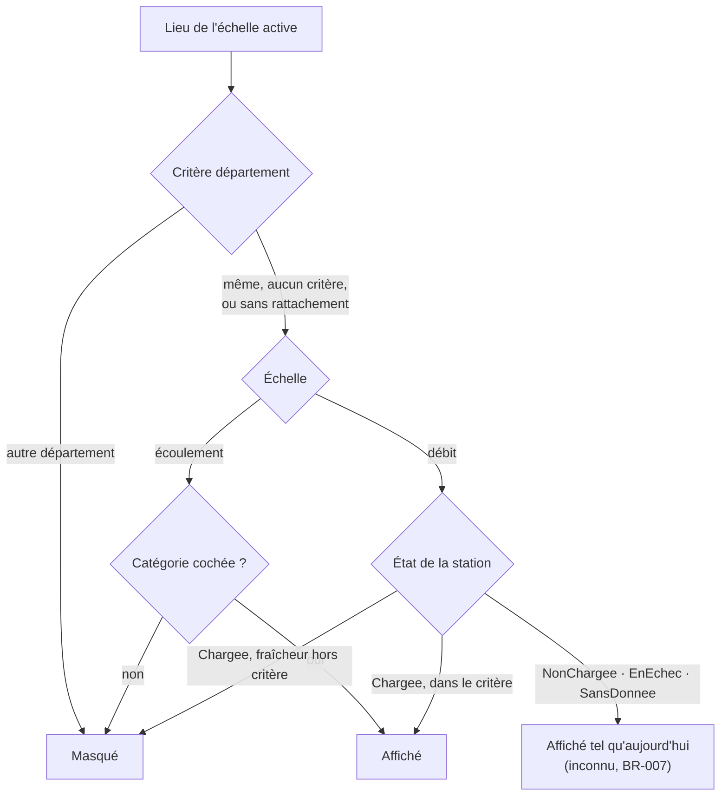

# UC-007 — Filtrer la carte

- **Statut :** Accepté
- **Date :** 2026-10-12
- **Contexte borné :** Carte
- **Acteur principal :** Pêcheur (P3), P5 · **Acteurs secondaires :** aucun (le filtre n'appelle aucune source)

## Objectif

Réduire la carte aux lieux cherchés sans qu'un lieu masqué se lise comme une absence.

## Préconditions

- La carte est affichée (`UC-001`).

## Déclencheur

L'usager active le bouton « Filtres », en bas à droite de la carte.

## Flux nominal

1. La feuille « Filtres » s'ouvre sur les critères de l'échelle affichée — écoulement : « États » (six cases, toutes cochées au départ) et « Département » ; débit : « Département » et « Fraîcheur » (« Toutes », « Moins de 2 h », « Moins de 24 h »).
2. L'usager règle un brouillon.
3. « Appliquer » ferme la feuille : marqueurs et pastilles ne montrent plus que les lieux retenus (`BR-009`).
4. Le bouton « Filtres » change de forme tant qu'un critère est actif pour l'échelle affichée (`BR-007`).

## Flux alternatifs / erreurs

- **A1 — Fermer sans appliquer :** rien ne change.
- **A2 — « Effacer » :** tous les critères, des deux échelles, sont retirés.
- **A3 — La carte est vidée par le filtre :** avis « Les filtres masquent tous les lieux du secteur affiché. Cela ne dit rien de l'état des cours d'eau. » et action « Effacer les filtres » (`BR-007`).
- **A4 — État non connu** (station non chargée, en échec, sans donnée ; lieu sans département) : le lieu reste affiché.

- **A5 — Sous le zoom 9 sur le débit :** le critère de fraîcheur ne change aucune pastille, la feuille le dit (`BR-009`).
- **A6 — Liste des départements illisible :** le critère n'est pas proposé, « La liste des départements n'a pas pu être lue. »
- **A7 — L'usager change d'échelle :** le filtre est gardé, seuls les critères de la nouvelle échelle jouent (`BR-008`).

## Postconditions

- Le filtre vit le temps de la session ; après relancement, aucun filtre n'est actif.

## Règles métier référencées

- `BR-003`, `BR-005`, `BR-007`, `BR-008`, `BR-009`, `BR-011`

## Liens

- ADR : `ADR-014`, `ADR-015` · Écran : [`04-ui.md`](../04-ui.md)
