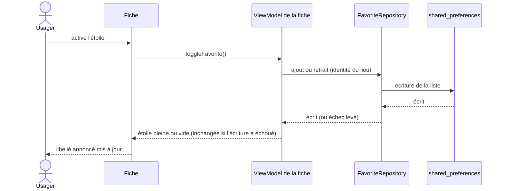

# UC-008 — Suivre un lieu en favori

- **Statut :** Accepté
- **Date :** 2026-10-12
- **Contexte borné :** Favoris
- **Acteur principal :** Pêcheur (P3) · **Acteurs secondaires :** Citoyen riverain (P1)

## Objectif

Garder quelques lieux — stations hydrométriques et points ONDE — pour rouvrir leur fiche sans les chercher sur la carte. Un favori ne copie que l'identité du lieu : jamais une mesure (`BR-001`).

## Préconditions

- Une fiche de station ou de point ONDE est ouverte (`UC-003`, `UC-004`).

## Déclencheur

L'usager active l'étoile d'une fiche, ou ouvre un favori depuis la liste.

## Flux nominal

L'étoile est dans le cadre de la fiche, **sous le bouton de fermeture**, dans la même colonne de droite. Sa forme dit l'état : pleine pour un favori, vide sinon ; un lecteur d'écran annonce l'action (« Ajouter aux favoris » ou « Retirer des favoris »).

1. **Ajouter.** Le lieu n'est pas en favori : l'usager active l'étoile « Ajouter aux favoris ». Le favori copie l'identité du lieu et la date d'ajout : pour une station, son code et son libellé ; pour un point ONDE, le point entier — code, libellé, coordonnées, cours d'eau, département, région. Aucune valeur mesurée.
2. L'étoile devient pleine et s'annonce « Retirer des favoris ».
3. **Retirer.** Le lieu est en favori : l'usager active l'étoile « Retirer des favoris ». L'étoile redevient vide.
4. **Retrouver.** Le bouton « Favoris » de la carte ouvre l'écran « Favoris » : la fiche ouverte se ferme, la liste est relue. Elle ne porte que l'identité des lieux, aucune valeur mesurée (`BR-001`).
5. **Ouvrir.** L'usager choisit un favori dans la liste : l'écran se retire et la fiche du lieu s'ouvre. La carte ne bouge pas, l'échelle et les filtres restent tels quels — la fiche d'un point ONDE s'ouvre donc aussi quand la carte est sur l'échelle débit.
6. Depuis la liste, l'usager peut retirer un favori sans rouvrir sa fiche.

## Flux alternatifs / erreurs

- **A1 — Station hors du référentiel embarqué :** la fiche dit que la station n'est pas dans le référentiel (`BR-007`) ; il n'y a aucun libellé à copier, donc aucune étoile n'est proposée. Si la station est déjà en favori, son étoile pleine reste, et retirable. Sur une fiche station, l'étoile est aussi absente tant que rien ne peut être ajouté (fiche en chargement, en échec ou hors référentiel, pour un lieu qui n'est pas en favori), et sur toute fiche tant que la lecture des favoris n'a pas abouti ; si la liste stockée est illisible (A2), elle est en revanche présente et inactive dans tous les états de la fiche. Sur une fiche ONDE, une fois les favoris lus, elle est présente dans tous les états visibles.
- **A2 — Liste stockée illisible :** l'étoile est inactive — elle garde sa forme, atténuée, annoncée désactivée — sans phrase sur la fiche. Rien n'est écrit par-dessus une liste qu'on ne sait pas lire.
- **A3 — Écriture en échec :** l'étoile garde la forme qu'elle avait avant le geste et la fiche affiche « Le favori n'a pas pu être enregistré. » (ajout) ou « Le favori n'a pas pu être retiré. » (retrait) (`BR-007`). Pendant une écriture l'étoile est inactive, et garde le focus clavier.
- **A4 — Entrée non lisible dans la liste :** une entrée dont l'identité n'est pas reconnue (type de lieu inconnu, `BR-011`) est gardée telle quelle et ne fait pas perdre les autres ; un code ONDE à espaces revient identique, espaces compris. Une station et un point ONDE de même code sont deux favoris distincts.

## Postconditions

- La liste des favoris, stockée sur l'appareil, garde l'ajout ou le retrait. Aucune valeur mesurée n'y entre (`BR-001`).

## Règles métier référencées

- `BR-001 — date de mesure obligatoire` : un favori ne porte aucune mesure.
- `BR-007 — absence de donnée jamais neutre` : station hors référentiel, écriture en échec.
- `BR-011 — nomenclature tolérante à l'inconnu` : entrée non reconnue.
- `BR-014 — aucun verbe d'instruction` : les libellés de l'étoile ne portent sur aucun usage de l'eau.

## Liens

- Critères : [`favoris.feature`](../acceptance/favoris.feature) · Cas d'usage : `UC-003`, `UC-004` · Écran : [`04-ui.md`](../04-ui.md)
