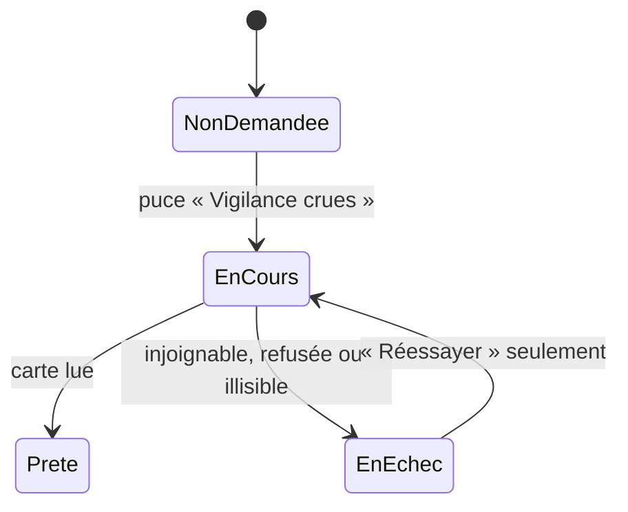

# UC-009 — Consulter la vigilance crues

- **Statut :** Accepté
- **Date :** 2026-10-14
- **Contexte borné :** Crues
- **Acteur principal :** Tous les personas · **Acteurs secondaires :** Vigicrues (GeoJSON national de vigilance), `ExternalLinkOpener`

## Objectif

Lire la vigilance crues publiée là où l'on regarde, sans qu'une panne ou une absence se lise comme une absence de risque.

## Préconditions

- La carte est affichée (`UC-001`).

## Déclencheur

L'usager active la puce « Vigilance crues ».

## Flux nominal

1. La lecture « Vigilance crues » s'active : les marqueurs et les pastilles des autres échelles disparaissent, la légende « Vigilance crues » s'affiche (`BR-008`). Premier chargement : l'avis « Lecture de la vigilance publiée par Vigicrues… Aucun tronçon n'est affiché tant qu'elle n'est pas lue. » s'affiche, aucun trait n'est tracé (`BR-007`).
2. La carte de vigilance est lue : chaque tronçon est tracé à la teinte, à l'épaisseur et au motif de son niveau, le plus grave au-dessus.
3. Les étiquettes se posent : non vertes et niveau non reconnu à tous les zooms, toutes à partir du zoom 9. Une étiquette porte la jauge et le nom du niveau ; elle s'annonce « crues : vigilance <niveau>, <nom du tronçon> ».
4. La légende cite les légendes publiées par Vigicrues, puis « Un cours d'eau sans trait de couleur n'est pas suivi par Vigicrues. » et « Information de vigilance du JJ/MM/AAAA à HH:MM — © VIGICRUES » (`BR-001`, `BR-014`).
5. L'usager touche un trait ou une étiquette, ou appuie sur Entrée sur une étiquette : toute autre fiche se ferme, la fiche du tronçon s'ouvre. Aucun appel réseau.
6. La fiche porte, dans l'ordre : « Tronçon Vigicrues » et le nom publié, l'encart « CE N'EST PAS UN SYSTÈME D'ALERTE » (`BR-015`), le niveau (« Vigilance verte », « Vigilance jaune », « Vigilance orange », « Vigilance rouge »), la définition publiée citée et suivie de « — Vigicrues », la date et « © VIGICRUES », puis « Lire le bulletin sur www.vigicrues.gouv.fr ».
7. Le bouton ouvre le bulletin local du territoire du tronçon ; l'adresse reste affichée dessous, sélectionnable.

## Flux alternatifs / erreurs

- **A1 — Vigicrues injoignable :** aucun trait ; « Vigicrues n'a pas répondu. Aucun tronçon n'est affiché : cela ne dit rien du risque de crue. » et l'action « Réessayer » (`BR-007`).
- **A2 — Réponse refusée ou illisible**, y compris sans date lisible (`BR-001`, `BR-011`) : aucun trait ; « La vigilance publiée par Vigicrues n'a pas pu être lue. Aucun tronçon n'est affiché : cela ne dit rien du risque de crue. » et « Réessayer ».
- **A3 — « Réessayer » :** seul cet appui relance la lecture ; un relâchement de geste en échec ne relance rien.

- **A4 — Entités écartées :** une entité sans code, sans nom, sans territoire ou sans tracé lisible est écartée et comptée ; les autres restent tracées ; l'avis « 1 tronçon de vigilance non lisible. » ou « N tronçons de vigilance non lisibles. » remplace l'avis du secteur sans tronçon (`BR-011`, `BR-007`).
- **A5 — Secteur sans tronçon :** « Aucun cours d'eau suivi par Vigicrues dans le secteur affiché. Cela ne dit rien du risque de crue : sur cette carte, Vigicrues ne suit que certains cours d'eau de métropole et de Corse. » (`BR-007`).
- **A6 — Niveau inconnu** (valeur hors 1 à 4, absente ou nulle) : trait gris pointillé, étiquette « Niveau non reconnu » ; la fiche dit « Niveau de vigilance non reconnu » puis « Vigicrues a publié un niveau que cette application ne sait pas lire. Le bulletin sur www.vigicrues.gouv.fr fait foi. », sans citation (`BR-011`).
- **A7 — Lien non ouvert :** « Ce lien n'a pas pu être ouvert depuis l'application. Son adresse reste affichée ci-dessus. »
- **A8 — Quitter la lecture Crues**, ouvrir une autre fiche, un favori ou désigner un point : la fiche du tronçon se ferme.
- **A9 — Rafraîchissement après 30 minutes :** l'ancienne vigilance reste tracée avec sa date pendant qu'une nouvelle se charge, sans avis ; Vigicrues n'est appelé qu'après la première activation de la lecture, au plus une fois par 30 minutes tant que les chargements réussissent.

## Postconditions

- Rien n'est conservé au-delà de la session.

## Règles métier référencées

- `BR-001`, `BR-007`, `BR-008`, `BR-011`, `BR-014`, `BR-015`

## Liens

- ADR : `ADR-016`, `ADR-014` · Écran : [`04-ui.md`](../04-ui.md) · Critères : [`crues.feature`](../acceptance/crues.feature)
