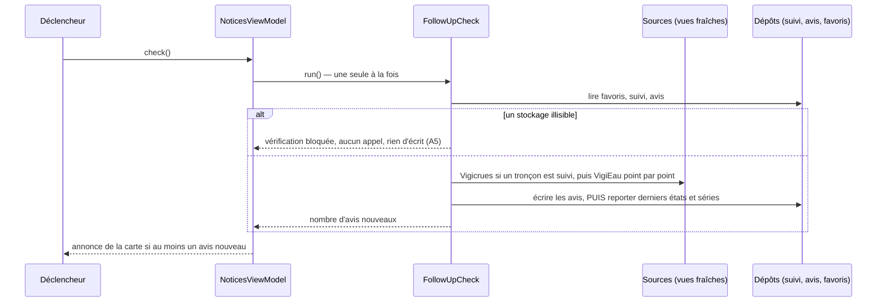
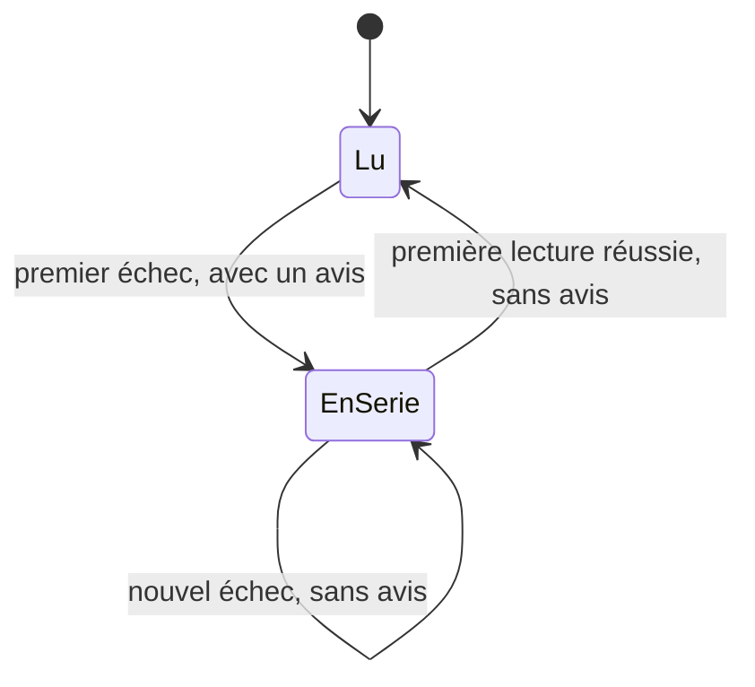

# UC-010 — Être prévenu d'un changement sur un lieu suivi

- **Statut :** Accepté
- **Date :** 2026-10-21
- **Contexte borné :** Suivi
- **Acteur principal :** Tous les personas · **Acteurs secondaires :** Vigicrues (GeoJSON national de vigilance), VigiEau, `ExternalLinkOpener`

## Objectif

Savoir, en ouvrant l'application, qu'un niveau **publié** a changé sur un lieu que l'on suit — sans que l'application calcule quoi que ce soit, et sans qu'une vérification impossible se lise comme une absence de changement.

## Préconditions

- Un lieu est en favori (`UC-008`) et « Me prévenir » est activé pour lui : un seuil « Jaune », « Orange » ou « Rouge » pour un tronçon, l'interrupteur « Me prévenir des restrictions sécheresse » pour une station ou un point ONDE. « Non » est le réglage par défaut à l'ajout.
- L'avertissement du premier lancement est acquitté (`UC-006`).

## Déclencheurs

- Le **lancement**, une fois la carte affichée, donc après l'acquittement ;
- le **retour au premier plan** de l'application ;
- « **Vérifier maintenant** » sur l'écran « Avis reçus ».

## Flux nominal

1. Un déclencheur lance une vérification. S'il en court déjà une, la même est rendue : il n'y en a jamais deux ensemble.
2. L'application lit les favoris, le suivi et les avis enregistrés. Aucun lieu n'est suivi : fin, sans aucun appel (A1).
3. Un tronçon est suivi : la vigilance de Vigicrues est lue, une fois, par une lecture fraîche — la valeur gardée au plus 30 minutes est reprise sans appel, une valeur plus ancienne est relue avant toute comparaison. Aucun tronçon suivi : Vigicrues n'est pas lu (`NFR-07`).
4. Pour chaque station ou point ONDE suivi, **l'un après l'autre**, les zones d'alerte du point sont lues chez VigiEau, par la même lecture fraîche (cache de 6 heures).
5. Les règles du domaine comparent deux niveaux **publiés** — le dernier état connu du lieu et celui qui vient d'être lu — et en tirent des avis :
   - la première lecture réussie d'un lieu produit « Suivi commencé », qui dit l'état publié lu, et aucune règle de changement ne s'y applique (A2) ;
   - **crues** : un avis quand la vigilance change et qu'elle atteint le niveau choisi ou le quitte ; un niveau non reconnu, ancien ou nouveau, produit un avis ;
   - **sécheresse** : une gravité changée, une zone nouvelle, une zone plus citée produisent chacune un avis qui nomme la zone et son type, eaux superficielles d'abord ; une gravité non reconnue produit un avis ; un changement de la seule date d'arrêté n'en produit pas.
6. Les avis sont écrits **d'abord**, les 100 plus récents étant gardés ; puis les derniers états connus et la date de dernière vérification sont reportés sur l'état stocké au moment de l'écriture, si bien qu'un réglage changé pendant la vérification est gardé (A6).
7. Au moins un avis nouveau : la carte montre l'annonce « 1 avis nouveau sur vos lieux suivis » ou « N avis nouveaux sur vos lieux suivis », avec l'action « Lire les avis » et « Fermer l'annonce ». Elle ne s'ajoute à aucune colonne de boutons de la carte.
8. « Lire les avis » ouvre « Avis reçus » ; l'annonce disparaît. L'écran porte, dans l'ordre : la barre de titre avec le contrôle « ⚠ Avertissement », dont la fenêtre ajoute le texte de suivi au texte général ; l'encart « CE N'EST PAS UN SYSTÈME D'ALERTE », non repliable ; le lien « Lire la vigilance sur www.vigicrues.gouv.fr » ; « Dernière vérification : le JJ/MM/AAAA à HH:MM » ; « Vérifier maintenant » ; les avis, le plus récent en tête, les non lus marqués « Nouveau ».
9. Chaque avis porte son échelle (crues **ou** sécheresse, jamais les deux, `BR-008`), le lieu, le niveau ou la gravité publiés et le précédent, la date de l'information de vigilance ou de l'arrêté, la source (« © VIGICRUES » ou « VigiEau ») et « Reçu le … » (`BR-001`). Un avis n'est pas un lien.
10. À la fermeture de l'écran, les avis sont marqués lus.

## Flux alternatifs / erreurs

- **A1 — Aucun lieu suivi :** aucun appel, aucune écriture ; « Avis reçus » dit « Aucun lieu n'est suivi. Un lieu en favori se suit depuis sa fiche, par « Me prévenir ». » (`BR-007`). Un lieu en favori dont « Me prévenir » est sur « Non » n'est pas suivi.
- **A2 — Première lecture : « Suivi commencé ».** Pour un tronçon : « Vigilance <niveau> » et la date de l'information, attribuées à © VIGICRUES, puis le rappel du réglage. Pour une station ou un point ONDE : une ligne par zone citée, ou « VigiEau ne cite aucune zone d'alerte à cet endroit. Cela ne dit pas qu'aucune restriction ne s'y applique. » Rien n'est comparé à un état antérieur : il n'y en a pas (`BR-016`).
- **A3 — Source injoignable, refusée ou illisible :** un avis « Vérification impossible » **par source et par cause**, qui nomme les lieux dont la série d'échecs s'ouvre ; « Cela ne dit rien du risque de crue. » pour Vigicrues, « Cela ne dit rien des restrictions en vigueur. » pour VigiEau (`BR-007`). Une série se compte par lieu et par source : un lieu déjà en série n'est pas redit, un point VigiEau en échec n'empêche pas les autres d'être lus, le dernier état connu ne change pas. La série se ferme à la première lecture réussie **de ce lieu**, sans avis de rétablissement. Une carte de vigilance périmée en cache n'est jamais comparée : la lecture fraîche qui échoue est une vérification impossible.

- **A4 — Lieu non vérifiable :** un tronçon absent de la vigilance publiée, un tronçon peut-être parmi les entités illisibles de la carte, une station absente du référentiel embarqué : un avis « Lieu non vérifiable » par lieu et par série. Aucun avis de crue ni de restrictions n'est donné pour lui (`BR-007`).
- **A5 — Un stockage illisible :** le suivi, les avis ou la liste des favoris ne peuvent pas être lus. La vérification n'appelle aucune source et n'écrit rien ; l'annonce de la carte le dit (« Aucune vérification n'a été faite : les avis ou les réglages enregistrés n'ont pas pu être lus. », action « Lire les avis ») et « Avis reçus » aussi. Les entrées sont conservées telles quelles. Seuls les gestes « Repartir d'une liste vide » (avis) et « Repartir sans lieu suivi » (réglages) remplacent une racine illisible (`BR-011`).
- **A6 — L'écriture des avis échoue :** aucun dernier état n'est enregistré ; la vérification suivante redonne les mêmes avis et rien n'est perdu. L'échec est dit : « La dernière vérification n'a pas pu être enregistrée sur cet appareil. » Un échec du seul report peut redonner une fois les mêmes avis. De même, un réglage « Me prévenir » qui n'est pas enregistré dit « Le réglage n'a pas pu être enregistré. »
- **A7 — Vérification déjà en cours :** un déclencheur reçu pendant une vérification rend la même ; le bouton dit « Vérification en cours… » et reste désactivé. Un seul jeu d'avis est produit, jamais deux « Suivi commencé » pour un même lieu.
- **A8 — Lien non ouvert :** « Lire la vigilance sur www.vigicrues.gouv.fr » s'ouvre hors de l'application ; si le lien ne s'ouvre pas, l'avis partagé existant s'affiche — « Ce lien n'a pas pu être ouvert depuis l'application. Son adresse reste affichée ci-dessus. » — l'adresse restant lisible et sélectionnable (`BR-007`).

## Postconditions

- Les derniers états connus, la date de dernière vérification, les séries d'échecs et au plus 100 avis sont conservés sur l'appareil (`ADR-011`) ; aucun compte, aucun serveur.
- Un changement survenu puis défait entre deux vérifications n'est pas vu, et l'avertissement de suivi le dit : application fermée, rien n'est vérifié.

## Règles métier référencées

- `BR-001`, `BR-007`, `BR-008`, `BR-011`, `BR-014`, `BR-015`, `BR-016`

## Liens

- ADR : `ADR-017`, `ADR-011` · Cas d'usage : `UC-008`, `UC-009` · Critères : [`suivi.feature`](../acceptance/suivi.feature)
